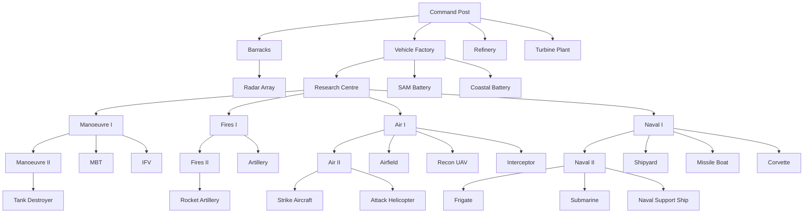

# MCA — Alliance Rosters, National Differentiation & Technology Specification

Status: **implemented through Stage 4C and the ten-nation expansion.** The two
alliance baselines (§15), the national specialisations (§17 and §23), the
authoritative research foundations (Stage 4A, §18), the in-match research
interface with production/construction gating (Stage 4B.1, §19), the AI research
policy (Stage 4C.1, §20), Recon Smokescreen (Stage 4C.2, §21), the Advanced
Turbine module (Stage 4C.3, §22) and the expansion from six to ten playable
nations (§23) are shipped and covered by tests. Implemented content is marked as
such below, and §§16–23 record exactly what was built.

Companion documents: `docs/PHASE_4_NATIONS.md` (implemented national substitutions),
`docs/FACTION_ROSTER_AUDIT.md` (roster audit), `Modern_Combined_Arms_RTS_GDD_v0.1.md`
§5 and §9.

---

## 1. Executive summary

MCA now ships **two distinct alliance baselines** over one namespace of 22
canonical slots: the Defender Coalition fields the canonical platforms, the
Eastern Coalition fields 18 registered replacements for them, and the four
utility roles (engineer, harvester, recovery, medic) stay common to both. Ten
nations — five per coalition since Stage 4D/§23 — each differ by exactly **one
replacement, one exclusive unit and one structure variant** (implemented; §17 and
§23). The simulation now has an authoritative
research foundation: eight technologies, a player-global project, global unlock
resolution, per-unit upgrades, per-building modules, the Research Centre and its
Belarusian variant (implemented; §18). The research interface and AI policy are
still future work. The original design proposal is:

- **Two distinct alliance baselines** that share a canonical role-slot namespace
  but field different platforms, weapons and silhouettes in every combat slot.
- **Six national specialisations**, each with exactly one replacement, one
  exclusive unit and one building variant (Hungary's existing Reinforced Bunker
  is reclassified from "replacement" to "building variant" and Hungary gains a
  unit replacement).
- **A four-branch, two-tier research system** (Manoeuvre, Fires, Air, Naval)
  built on one new structure and the existing production-queue and
  requisition systems. No new resource, no supply network, no mandatory ladder.

The implementation cost is deliberately concentrated in *data*: the roster
resolver supports per-alliance baselines, additions, removals, substitutions and
multi-level `variantOf` resolution, and the research catalogue is pure data with
one resolver shared by the simulation and every query. What remains is the
research interface, production gating for unlocked equipment, and the AI research
policy, listed in §15.

Roster size: **22 canonical slots**, **40 distinct alliance baseline definitions**
(22 per side, of which 18 differ), **12 national unit definitions** (6
replacements + 6 exclusives) and **6 national building variants**. Shipped to
date: all of the above — 52 `UnitDef`s and 33 `BuildingDef`s — with research as
the only remaining planned system. Shipped ids and status: §16 (Stages 1–2) and
§17 (Stage 3) and §18 (Stage 4A).

### Implemented platform ids (Stages 1–2)

The design tables in §4–§5 use working ids from the design phase. The shipped
registry reuses the canonical slot id wherever a Defender platform *is* the slot,
which is why several proposals below resolve to the canonical name. The shipped
mapping is authoritative:

| Slot | Defender id | Eastern id |
|---|---|---|
| `rifle` | `rifle` (Rifleman) | `rifleEC` (Motor Rifleman) |
| `atgm` | `atgm` (ATGM Gunner) | `atgmEC` (Heavy Missile Team) |
| `recon` | `recon` (Recon Vehicle) | `reconEC` (Recon BRM) |
| `ifv` | `ifv` | `ifvEC` |
| `tank` | `tank` | `tankEC` |
| `td` | `td` | `tdEC` |
| `spg` | `spg` | `spgEC` |
| `rocketArtillery` | `rocketArtillery` | `rocketArtilleryEC` |
| `aa` | `aa` | `aaEC` |
| `uav` | `uav` | `uavEC` |
| `interceptor` | `interceptor` | `interceptorEC` |
| `fighter` | `fighter` | `fighterEC` |
| `attackHelo` | `attackHelo` | `attackHeloEC` |
| `missileBoat` | `missileBoat` | `missileBoatEC` |
| `corvette` | `corvette` | `corvetteEC` |
| `frigate` | `frigate` | `frigateEC` |
| `submarine` | `submarine` | `submarineEC` |
| `navalSupport` | `navalSupport` | `navalSupportEC` |
| `engineer` | `engineer` | `engineer` (shared) |
| `harvester` | `harvester` | `harvester` (shared) |
| `recovery` | `recovery` | `recovery` (shared) |
| `medic` | `medic` | `medic` (shared) |

National replacements keep their existing ids: `pathfinder`, `spearhead`,
`mlrs`, `heavyHowitzer`, `deepReconUAV`, and `bunker` for buildings.

---

## 2. Confirmed design decisions

These are treated as fixed and are not reopened here.

| # | Decision |
|---|---|
| D1 | Six playable launch nations: Defender Coalition = Lithuania, Poland, United Kingdom; Eastern Coalition = Russia, Belarus, Hungary. |
| D2 | The two alliances field **distinct equipment and platform families**, not one roster with substitutions. |
| D3 | Both alliances cover **comparable battlefield roles** and offer balanced strategic possibilities. |
| D4 | Each nation has exactly **one replacement**, **one exclusive unit**, **one building variant**. Amended by §24: Sweden and Iran also field a national naval hull, so their fleet identity is a ship as well as a yard. |
| D5 | Research **branches** rather than forming one linear ladder; it must create real choices and stay understandable. |
| D6 | Technology must not turn a fast RTS into a slow micromanagement exercise; target match length 20–30 minutes. |
| D7 | **Full naval warfare** is core, not an optional expansion: naval units, shipyards, coastal infrastructure, naval combat and naval technology. |
| D8 | Infantry production creates **one individual soldier at a time**; each infantryman is an independent unit. |
| D9 | Players assign selected units to **numbered squads** in the sidebar; a squad holds **up to nine** units; squads are an organisational/selection feature, never a trainable entity. |
| D10 | **No logistics**: no supply networks, ammunition resupply or fuel networks. |
| D11 | Engineers keep their existing role (construction, repair, relay capture). |
| D12 | Specialist infantry stays limited and is used mainly for national differentiation. |
| D13 | Strong combined-arms counters; avoid duplicate units and specialist sprawl. |
| D14 | Existing multiplayer constraints and the deterministic simulation architecture are respected. |

---

## 3. Current implementation audit

Originally verified by reading the working tree on 2026-11-01; §3.1–§3.2 were
re-verified against the working tree on 2026-11-02 after Stages 1–2 landed.
"Implemented" means the behaviour exists in `src/` and is exercised by a test; a
design document on its own was not accepted as evidence.

### 3.1 Implemented and working

| Area | Reality |
|---|---|
| Alliances | `src/data/factions.ts` defines `defender` and `eastern` as `AllianceDef`, each with **its own frozen baseline**. |
| Baseline roster | `DEFENDER_BASELINE` = the 28 canonical unit ids plus every building id. `EASTERN_BASELINE` = one entry per canonical slot, with 21 slots pointing at the `EASTERN_PLATFORMS` map and the seven shared utility/transport slots unchanged; buildings are shared. Both flow through `mergeRoster`. |
| Nations | Ten `NationDef` records with `doctrine` + `blurb`. Every nation carries `replaceUnits`, `addUnits` and `replaceBuildings`: at least one replacement, one exclusive and one structure variant each; the contract permits further additions. |
| Roster resolution | `src/data/roster.ts`: `mergeRoster` (add/remove/replace, frozen output, validated), `unitSlotId`, `buildingSlotId`, `productionEntries`, `canProduce`, `rosterIncludes`, `resolveRoster` cache, `validateRosterRegistry`, `assertSameVariantSlot`. `src/data/variant.ts` walks the full `variantOf` chain (`resolveVariantChain`, depth-capped and cycle-guarded). Additions and removals are supported but **no nation uses them**. |
| Structure prerequisites | `BuildingDef.requires` (baseline families) + `Game.missingTech()` — a *structural* gate: factory→{airfield, shipyard, samBattery, coastalBattery}, barracks→radar. Foundations do not satisfy it. |
| Production gating | `Game.productionStatus()` checks: facility alive and complete, facility `produces`, roster membership, `productionEntries` slot resolution, queue depth (`MAX_QUEUE = 5`), materials, requisition, plus per-case rules (airfield for `fighter`, shipyard for naval, HQ-only engineer fallback). |
| Resources | Two: materials (`mats`) and requisition (`req`). `STARTING_MATS = 2600`, `STARTING_REQ = 120`. `req` income comes from the Command Post (`reqPerSec: 0.4`) and the Refinery (`0.1`); relays add income when held. |
| Units | 28 canonical + 21 Eastern platforms + 10 national replacements + 10 national exclusives + 2 national naval hulls = 71 `UnitDef`s. |
| Buildings | 13 player-buildable shared structures + 6 national variants = 19 buildable, plus 15 `authoredOnly` garrison/prop structures (34 in all). |
| Naval | `shipyard` (naval production/repair, requires water adjacency), `missileBoat`, `corvette`, `frigate`, `submarine` (battery/dive/reveal/close-detect via `SubmarineDef`), `sonar`, `coastalBattery`. |
| Aviation | `airfield` (production + recovery), `fighter`, `interceptor`, `uav`, fuel in seconds, `ammo`. |
| Squads / groups | `App.groups = Map<number, number[]>`, `assignGroup` (Ctrl+1..9), `recallGroup`, a CONTROL GROUPS sheet in the HUD. **No size cap.** |
| AI | `AIController` writes demand in **baseline slots** (`recon`, `tank`, `spg`, `uav`, `barracks`, `mgNest`, …) and resolves them with `unitIdFor`/`buildingIdFor`; counts are keyed by `unitFamily`/`buildingFamily`. `buildOptions` already skips anything for which `missingTech()` returns entries. |
| Persistence | `SAVE_FORMAT_VERSION = 3`, forward migrations in `src/sim/saveMigrations.ts`. A save stores `factionId` and entity `defId`s, so rosters rebuild from `resolveRoster(factionId)`; research, unit upgrades and building modules have their own state. |

### 3.2 Partially implemented

| Area | Gap |
|---|---|
| National differentiation | **Implemented (Stage 3), reparented in Stage 4A.** Each nation has at least one replacement, one exclusive unit and one structure variant; later stages may add further national units. Belarus's `signalsBureau` is now a `researchCentre` variant (§17.3, §18.5). |
| Hungary's specialisation | **Implemented (Stage 3).** `atgmEC` → `hedgehogTeam` for the unit replacement, `taszar` as the exclusive and `bunker` as the structure variant. |
| Alliance distinctness | **Implemented (Stage 2, extended Stage A).** The baselines differ in all 21 combat slots and share the four utility roles, so D2 is met for equipment. Structures remain common by design (§7). |
| Squads | Numbered control groups exist but are **uncapped** and not modelled as squads. D9's nine-unit ceiling is unenforced. |
| Requisition | Modelled, earned and spent, but only as a secondary price on high-tier units. Nothing else consumes it. |
| Naval depth | Four hulls and one coastal structure. No naval fire support, no naval technology, no reason to build a navy on a land map beyond coastal bombardment. |

### 3.3 Data structures that already support the proposal

- `AllianceDef.baseline: RosterDef` — per-alliance differentiated rosters need **no type change**.
- `NationRosterModifications` (`addUnits`, `addBuildings`, `removeUnits`, `removeBuildings`, `replaceUnits`, `replaceBuildings`) — exclusives need `addUnits`, already implemented and synthetically tested.
- `UnitDef.variantOf` / `BuildingDef.variantOf` — the substitution mechanism, already consumed by slot resolution, UI badges, AI family counts and save reload.
- `BuildingDef.productionList` + `productionEntries` — a new facility needs only `produces` + `productionList`.
- `Game.missingTech()` — the single place that answers "is this building locked for this player"; extending it to technology-locked units is Stage 4B interface work.

### 3.4 New structures that were required — status

1. `TechDef` registry and a `research` block on `PlayerState` — **implemented** in
   `src/data/research.ts` and `src/sim/types.ts` (Stage 4A).
2. Research progression — **implemented** as one player-global project, not a
   centre production queue (§18.4).
3. Snapshot/projection fields for per-player research — **implemented** as
   optional team-snapshot fields; no protocol bump was needed (§18.6).
4. Squad membership with a nine-unit cap — **still not implemented**; the only
   remaining item on this list.

(A `variantOf` chain walk used to be on this list. It shipped in Stage 1 as
`src/data/variant.ts` and is no longer a gap.)

### 3.5 Previous proposals that are not implemented

Do not treat these as existing: the research interface/panel, production gating
for every unlock, signature national abilities, IFV/APC transport, amphibious
landing ships, electronic warfare and naval technology — all were proposed and
none exist. The research **foundations** now exist (§18), as do separate alliance
baselines (§16) and national additions/exclusives/building variants (§17), which were
on this list and are now implemented.

### 3.6 Verification limits

The original audit was read-only. On 2026-11-02, after Stages 1–2, the full
suite was run and is green (`npx vitest run`: 117 files / 1478 tests) together
with `npx tsc --noEmit` (clean). That evidence covers the shipped baselines and
variant resolution, not the planned research system.

---

## 4. Defender Coalition — complete roster

Identity: **precision, sensors and survivability.** Fewer, better-protected
platforms, longer engagement windows, expensive hulls that punish losses.
Signature feel: accurate guns, thermal optics, layered air defence, rockets that
arrive on time.

Doctrine of the baseline: fight at range you can see, break the assault, then
counter-attack with a small number of expensive vehicles.

| Slot | Unit | Role | Platform identity | Strengths | Weaknesses | Counters / vulnerabilities | Facility | Tier | Class |
|---|---|---|---|---|---|---|---|---|---|
| `rifle` | `rifleman` Rifleman | Line infantry | 5.56mm individual weapon, body armour | Best per-man durability in the game; garrisons well | Highest infantry cost | Suppression, area fire, armour | Barracks | 0 | Baseline |
| `atgm` | `atgmTeam` Missile Team | Anti-armour infantry | Fire-and-forget ATGM | Long range, top-attack multiplier vs heavy | Slow reload, fragile | Infantry fire, artillery, fast armour closing | Barracks | 0 | Baseline |
| `medic` | `medic` Field Medic | Infantry support | Shared utility | Heals infantry, no weapon | Unarmed | Any direct fire | Barracks | 0 | Shared |
| `recon` | `scoutCar` Scout Car | Reconnaissance | Wheeled scout with thermal mast | 12.5 vision, fast, cheap, armed light MG | Thin armour | ATGM, tanks, aircraft | Factory | 0 | Baseline |
| `ifv` | `ifvDF` Infantry Fighting Vehicle | Mechanised fire support | Tracked IFV, 25mm autocannon + ATGM | Kills infantry, threatens light vehicles, survives small arms | Poor vs MBT front armour | MBT, ATGM, artillery | Factory | 1 | Baseline |
| `tank` | `natoMbt` Main Battle Tank | Armour | 120mm smoothbore, composite armour | Accuracy and HP; wins the long engagement | Slower turret than Eastern MBT | Massed ATGM, flanking, tank destroyers | Factory | 1 | Baseline |
| `td` | `tdDF` Missile Destroyer | Specialist anti-armour | Wheeled ATGM carrier, twin launchers | Kills any tank at range for a third of the price | No armour, no anti-infantry | Infantry, artillery, air | Factory | 2 | Baseline |
| `spg` | `spgDF` Self-Propelled Howitzer | Artillery | 155mm tracked SPH | Long reach, accurate, mobile | Long reload, soft | Fast armour, air, counter-battery | Factory | 1 | Baseline |
| `rocketArtillery` | `mlrsDF` Rocket Battery | Rocket artillery | Wheeled MLRS | Wide saturation, breaks static defence | Inaccurate, no close defence | Armour inside minimum range, air | Factory | 2 | Baseline |
| `aa` | `aaDF` SHORAD Vehicle | Air defence | Gun/missile hybrid | Kills helicopters and UAVs cheaply, self-defends | Short range vs fast jets | Stand-off strike, armour | Factory | 0 | Baseline |
| `recovery` | `recovery` Field Recovery Vehicle | Repair | Shared utility | Repairs vehicles in the field | Unarmed, slow | Anything | Factory | 0 | Shared |
| `harvester` | `harvester` Harvester | Economy | Shared utility | Hauls materials | Unarmed | Raiders | Factory | 0 | Shared |
| `engineer` | `engineer` Combat Engineer | Construction / capture | Shared utility | Builds, repairs, captures relays | Unarmed | Anything | Factory / Command Post | 0 | Shared |
| `uav` | `uavDF` Recon UAV | Recon aviation | Long-endurance drone | Wide vision, cheap to replace | Unarmed | SAM, interceptors | Airfield | 1 | Baseline |
| `interceptor` | `interceptorDF` Interceptor | Air superiority | Air-superiority fighter | Best air-to-air in the game | Almost useless vs ground | SAM, massed AA | Airfield | 1 | Baseline |
| `fighter` | `fighterDF` Multirole Fighter | Strike | Multirole fighter-bomber | Precision anti-structure and anti-ship | Expensive, fragile in contested air | Interceptors, SAM | Airfield | 2 | Baseline |
| `attackHelo` | `heloDF` Attack Helicopter | Rotary attack | Guided-missile helicopter | Hunts tanks and ships; hovers behind terrain | SAM, AA vehicles, interceptors | Air defence | Airfield | 2 | Baseline |
| `missileBoat` | `missileBoatDF` Missile Boat | Fast attack | Small stealthy missile boat | Cheap anti-ship punch | Dies to anything that hits it | Corvettes, aircraft, coastal battery | Shipyard | 1 | Baseline |
| `corvette` | `corvetteDF` Missile Corvette | Naval combatant | Light corvette, ASM + SAM | Balanced surface fighter with self-defence | Out-ranged by frigates | Frigates, submarines | Shipyard | 1 | Baseline |
| `frigate` | `frigateDF` Escort Frigate | Fleet escort | Guided-missile frigate | Long-range ASM, area air defence | Very expensive, slow | Submarines, massed missile boats | Shipyard | 2 | Baseline |
| `submarine` | `submarineDF` Attack Submarine | Subsurface raider | Diesel-electric hunter | Unseen approach, devastating torpedo | Blind while dived, slow | Sonar, escorts, aircraft | Shipyard | 2 | Baseline |
| `navalSupport` | `monitorDF` Fire Support Ship | Naval support | Shallow-draft gunfire support ship | Long-range shore bombardment | Cannot fight ships, very slow | Submarines, aircraft, coastal battery | Shipyard | 2 | Baseline |

**Exclusive:** `kestrelTeam` Kestrel Air Team (see §6).

## 5. Eastern Coalition — complete roster

Identity: **mass, saturation and reach.** Cheaper hulls, heavier salvoes, longer
reach, worse precision. Signature feel: more units than the enemy, more rockets
in the air, fewer shots that hit exactly what they were aimed at.

| Slot | Unit | Role | Platform identity | Strengths | Weaknesses | Counters / vulnerabilities | Facility | Tier | Class |
|---|---|---|---|---|---|---|---|---|---|
| `rifle` | `riflemanEC` Motor Rifleman | Line infantry | 5.45mm weapon, lighter kit | Cheapest infantry; spams and garrisons | Lower per-man HP and accuracy | Area fire, armour | Barracks | 0 | Baseline |
| `atgm` | `atgmTeamEC` Heavy Missile Team | Anti-armour infantry | Tube-launched heavy ATGM | Longest infantry AT reach, hits hard | Very slow reload, slow to reposition | Infantry, artillery, air | Barracks | 0 | Baseline |
| `medic` | `medic` Field Medic | Infantry support | Shared utility | Heals infantry | Unarmed | Direct fire | Barracks | 0 | Shared |
| `recon` | `reconBRM` Recon BRM | Reconnaissance | Wheeled recon vehicle, amphibious hull | 11 vision, tougher than a scout car | Slower, more expensive than the Defender scout | ATGM, tanks | Factory | 0 | Baseline |
| `ifv` | `ifvEC` Amphibious IFV | Mechanised fire support | Tracked IFV, 30mm autocannon | High rate of fire, shreds infantry | No ATGM; cannot threaten tanks | MBT, ATGM | Factory | 1 | Baseline |
| `tank` | `eastMbt` Main Battle Tank | Armour | 125mm smoothbore, reactive armour | Faster turret and hull, cheaper than the NATO MBT | Lower accuracy and HP | Tank destroyers, ATGM, long-range duels | Factory | 1 | Baseline |
| `td` | `tdEC` Assault Gun | Specialist anti-armour | Casemate 152mm assault gun | Devastating single shot, cheap | No turret; must face its target, thin sides | Flanking, air, infantry in cover | Factory | 2 | Baseline |
| `spg` | `spgEC` Self-Propelled Howitzer | Artillery | 152mm tracked SPH | Cheap, long reach | Inaccurate, long reload | Fast armour, air | Factory | 1 | Baseline |
| `rocketArtillery` | `mlrsEC` Heavy Rocket Battery | Rocket artillery | Heavy tracked MLRS | Largest salvo in the game, huge splash | Very long reload, slow, inaccurate | Armour inside minimum range, air | Factory | 2 | Baseline |
| `aa` | `aaEC` SAM Vehicle | Air defence | Vehicle-mounted SAM | Longest mobile AA reach | Cannot hit ground; defenceless alone | Armour, infantry | Factory | 0 | Baseline |
| `recovery` | `recovery` Field Recovery Vehicle | Repair | Shared utility | Repairs vehicles | Unarmed | Anything | Factory | 0 | Shared |
| `harvester` | `harvester` Harvester | Economy | Shared utility | Hauls materials | Unarmed | Raiders | Factory | 0 | Shared |
| `engineer` | `engineer` Combat Engineer | Construction / capture | Shared utility | Builds, repairs, captures | Unarmed | Anything | Factory / Command Post | 0 | Shared |
| `uav` | `uavEC` Recon UAV | Recon aviation | Recon drone | Wide vision, cheap | Unarmed | SAM, interceptors | Airfield | 1 | Baseline |
| `interceptor` | `interceptorEC` Interceptor | Air superiority | Interceptor | Fast, long reach | Weaker dogfighter than the Defender type | Air defence, numbers | Airfield | 1 | Baseline |
| `fighter` | `fighterEC` Strike Fighter | Strike | Ground-attack fighter | Best anti-armour aircraft | Poor air-to-air | Interceptors, SAM | Airfield | 2 | Baseline |
| `attackHelo` | `heloEC` Attack Helicopter | Rotary attack | Heavy gunship | Rockets and ATGM, tougher than the Defender type | Slower, less agile | Air defence | Airfield | 2 | Baseline |
| `missileBoat` | `missileBoatEC` Missile Boat | Fast attack | Armoured missile boat | Tougher than the Defender boat | Slower, shorter ASM range | Corvettes, aircraft | Shipyard | 1 | Baseline |
| `corvette` | `corvetteEC` Missile Corvette | Naval combatant | Corvette, heavy ASM | Heavy anti-ship salvo | Weak air defence | Frigates, aircraft | Shipyard | 1 | Baseline |
| `frigate` | `frigateEC` Escort Frigate | Fleet escort | ASM frigate | Enormous anti-ship salvo | Poor area air defence | Submarines, massed aircraft | Shipyard | 2 | Baseline |
| `submarine` | `submarineEC` Attack Submarine | Subsurface raider | Nuclear hunter | Longer battery, faster dived | Noisier; easier to detect | Sonar, escorts | Shipyard | 2 | Baseline |
| `navalSupport` | `monitorEC` Fire Support Ship | Naval support | Heavy monitor | Heaviest shore bombardment | Very slow, cannot fight ships | Submarines, aircraft | Shipyard | 2 | Baseline |

**Exclusive:** `tosp` Thermobaric Launcher (see §6).

---

## 6. Six national specialisations

Each nation has exactly one replacement, one exclusive unit and one building
variant. **All six triples are implemented** (see §17); this section remains the
design record, and where a shipped value differs from the design intent the
implementation note says so. (The four expansion nations follow the same rule;
Sweden and Iran add a national naval hull on top of it — §24.)

Stage 3 shipped one item provisionally: Belarus's building variant was specified
as a `researchCentre` variant, and no research building existed then, so it
shipped as a `radar` variant. Stage 4A adds the Research Centre and reparents the
bureau; §§17.3 and 18.5 record the resolution.

### 6.1 Lithuania — Defender — "Reconnaissance screen"

| Item | Definition |
|---|---|
| Replacement | `recon` → **`pathfinder`** Pathfinder Recon Team (implemented today). 16-tile optics, cheap, **unarmed**. Keep the existing id and retarget `variantOf` to the Defender `recon` platform. |
| Exclusive | **`kestrelTeam` Kestrel Air Team** — two-man MANPADS team produced at the Barracks. Cheap, deploys anywhere infantry can stand, can garrison. Anti-air only; a very high air multiplier and short range. |
| Building variant | **`forwardPost` Forward Observation Post** — variant of `radar`. Cheaper (300 mats), fewer HP (600), smaller `scanRadius`, lower power draw. Gives up map coverage for affordability. |
| Gameplay change | Lithuania buys eyes cheaply and covers the map with cheap air denial instead of expensive SHORAD. |
| Strengths | Cheapest vision in the game; air denial that cannot be outflanked by armour because it is infantry. |
| Weaknesses | The scout cannot fight. The Kestrel cannot touch ground units at all. |
| Balance risk | Massed Kestrel teams could make air unplayable for the opponent. Mitigate with a per-player soft cap through cost and a long reload, and validate with the air matchup. |

### 6.2 Poland — Defender — "Armoured spearhead"

| Item | Definition |
|---|---|
| Replacement | `tank` → **`spearhead`** Spearhead MBT (implemented today). 130mm gun, more HP, slower hull and turret. Keep the id; retarget `variantOf`. |
| Exclusive | **`wilk` Wilk Heavy IFV** — autocannon + ATGM on an MBT chassis. Produced at the Factory at tier 2. It can fight tanks, unlike the baseline IFV, but costs two-thirds of a tank and is nearly as slow. |
| Building variant | **`armourWorks` Armoured Workshop** — variant of `factory`. +40% HP, +15% cost, same production list. Harder to knock out a Polish production line. |
| Gameplay change | Poland concentrates force: fewer, tougher vehicles, and a production line the opponent cannot easily snipe. |
| Strengths | Wins the head-on armoured fight and the production war. |
| Weaknesses | Slow tempo; artillery and ATGM punish concentration; premium prices. |
| Balance risk | Spearhead + Wilk + a bunkered factory may make Poland the strongest late-game Defender nation. Watch the Poland-versus-Russia armour matchup first. |

### 6.3 United Kingdom — Defender — "Saturation fires"

| Item | Definition |
|---|---|
| Replacement | `spg` → **`mlrs`** Rocket Battery (implemented today). 18-tile rockets, wide splash, 6-tile dead zone, light hull. Keep the id; retarget `variantOf`. |
| Exclusive | **`stormShadow` Deep Strike Battery** — very long range (26 tiles), single heavy missile, 14-tile minimum range, extremely expensive, long reload. Indirect only: it needs someone else's vision, so it rewards the Lithuanian-style scout screen. Produced at the Factory at tier 2. |
| Building variant | **`expeditionaryAirfield` Expeditionary Airfield** — variant of `airfield`. −30% cost, −35% build time, −25% HP, same production list. Cheaper air, easier to lose. |
| Gameplay change | The UK fights from beyond visual range and pays for it with fragile, blind, expensive platforms. |
| Strengths | Longest reach in the game; can break a static defence without exposing a hull. |
| Weaknesses | No self-spotting; dead zones; expensive losses. |
| Balance risk | **Highest in the document.** 26-tile indirect fire with no counter-battery mechanic may be oppressive. It must rely on shared vision (fog-respecting) and be visible on the tactical map, or it will not be counterable. |

### 6.4 Russia — Eastern — "Siege artillery"

| Item | Definition |
|---|---|
| Replacement | `spg` → **`heavyHowitzer`** Heavy Howitzer (implemented today). 203mm, 105 damage, slow, expensive. Keep the id; retarget `variantOf`. |
| Exclusive | **`tosp` Thermobaric Launcher** — short range (9 tiles), enormous splash, exceptional anti-infantry and anti-structure multipliers, very slow reload, light and fragile. Produced at the Factory at tier 2. |
| Building variant | **`longRangeSam` Long-Range SAM Site** — variant of `samBattery`. +33% range, +40% cost, slower reload. |
| Gameplay change | Russia converts material into area denial: everything in a radius dies, slowly, and again. |
| Strengths | Best anti-infantry and anti-position weapon in the game; a defended line that also reaches into the approach. |
| Weaknesses | Dead zone, reload window, and air/armour that closes while the launcher is empty. |
| Balance risk | Thermobaric splash against garrisoned infantry could trivialise urban maps. Cap the multiplier against garrisons rather than against open infantry. |

### 6.5 Belarus — Eastern — "Deep surveillance"

| Item | Definition |
|---|---|
| Replacement | `uav` → **`deepReconUAV`** Deep Recon UAV (implemented today). 30-tile optics, 90 s endurance, unarmed. Keep the id; retarget `variantOf`. |
| Exclusive | **`sprut` Sprint Recon Buggy** — very fast, very cheap, one vision point less than the Eastern BRM, dies to a sneeze. Produced at the Factory at tier 0. |
| Building variant | **`signalsBureau` Signals Bureau**. A `researchCentre` variant (**implemented** in Stage 4A; previously a provisional `radar` variant): −25% HP for +25% research speed (`researchSpeed` 1.25), same branch access and requirements. Belarus-only. |
| Gameplay change | Belarus sees everything and holds nothing: it wins by converting vision into fires before the enemy closes. |
| Strengths | Cheapest and widest vision in the game; faster research to convert vision into technology. |
| Weaknesses | Fragile economy of information: losing the buggies and the drone blinds the whole army. |
| Balance risk | Faster research is a *tempo* advantage that compounds. The HP and survivability penalty is the intended brake; verify it in the AI ladder before shipping. |

### 6.6 Hungary — Eastern — "Fortified defence"

| Item | Definition |
|---|---|
| Replacement | `atgm` → **`hedgehogTeam` Hedgehog AT Team** — shorter range than the Eastern heavy ATGM, much faster reload, cheaper, more HP per man. Defensive volume over reach. |
| Exclusive | **`taszar` Mobile Mortar Team** — infantry-portable indirect fire: 7-tile range, 3-tile minimum, small splash, cheap, can garrison. Gives Hungary the only *infantry* indirect-fire answer, which defends a position without a vehicle. |
| Building variant | **`bunker` Reinforced Bunker** (implemented) — variant of `mgNest`. 1350 HP (the design text here previously said 900; the shipped value has always been 1350, 73% more than the shared nest), slightly more reach, 62% more cost, more power. Reclassified from "replacement" to "building variant"; the data is unchanged. |
| Gameplay change | Hungary holds ground with cheap, dense, hard-to-root-out infantry and prepared positions instead of mass or reach. |
| Strengths | Cheapest way to make a position expensive to take; mortar teams threaten a whole approach without a hull. |
| Weaknesses | Almost no mobility or reach; armour bypasses it, artillery out-ranges it. |
| Balance risk | The bunker's existing 900 HP for 420 materials is already flagged in `docs/PHASE_4_NATIONS.md`. Adding mortars may push Hungary into a turtle that cannot be broken without a large artillery investment. |

**Consistency check.** No exclusive duplicates its own alliance baseline
(Kestrel is the only infantry SAM; Wilk is the only tank-killing IFV; Storm
Shadow only adds reach; TOSP only adds close area damage; Sprut only adds speed;
Taszar only adds infantry indirect fire). No two national specialisations are
functionally redundant. Every replacement keeps the production facility and
tier of the slot it fills.

---

## 7. Complete building inventories

Buildings are a **shared functional set** with alliance identity: identical
construction, prerequisite and production roles, distinct names and hull
profiles per alliance. National building variants are the exception. This keeps
construction, AI placement, editor authoring and save compatibility tractable;
equipment distinctness is carried by units.

### 7.1 Player-buildable, shared

| Slot / id | Defender name | Eastern name | Purpose | Prerequisite | Production / research | Power | Buildable |
|---|---|---|---|---|---|---|---|
| `commandPost` | Command Post | Command Post | Headquarters, victory objective, requisition income, engineer fallback | none | `engineer` (fallback only) | +50 | yes |
| `barracks` | Field Barracks | Motor Rifle Barracks | Individual infantry | none | `rifleman`, `atgmTeam`, `medic` | −8 | yes |
| `factory` | Vehicle Factory | Vehicle Plant | Land vehicles | none | engineer, harvester, recon, `ifv`, `tank`, `td`, `spg`, `rocketArtillery`, `aa`, `recovery` | −15 | yes |
| `refinery` | Material Refinery | Material Refinery | Material drop-off + requisition | none | — | −10 | yes |
| `powerPlant` | Turbine Plant | Turbine Plant | Power | none | — | +60 | yes |
| `radar` | Radar Array | Radar Array | Tactical map + detection | barracks | — | −12 | yes |
| `researchCentre` | Applied Research Centre | Design Bureau | **All research** | factory | 1 project at a time | −30 | yes |
| `airfield` | Forward Airfield | Forward Airfield | Air production / recovery | factory **+ Air Operations** | `uav`, `interceptor`, `fighter`, `attackHelo` | −25 | yes |
| `shipyard` | Naval Shipyard | Naval Shipyard | Naval production / repair, needs water adjacency | factory **+ Naval Operations** | `missileBoat`, `corvette`, `frigate`, `submarine`, `navalSupport` | −20 | yes |
| `mgNest` | Heavy MG Nest | Heavy MG Nest | Static anti-infantry | none | — | −6 | yes |
| `atTurret` | Anti-Tank Gun | Anti-Tank Gun | Static anti-armour | none | — | −10 | yes |
| `samBattery` | SAM Battery | SAM Battery | Static air defence | factory | — | −20 | yes |
| `coastalBattery` | Coastal Battery | Coastal Battery | Static anti-ship | factory | — | −12 | yes |

The grid is meant to be a construction constraint, not a one-off purchase: the
Command Post's integral generator covers the opening (barracks, factory,
refinery and radar fit inside 50), one Turbine Plant carries a mid-game base
with air, radar and a perimeter, and a fully built-out base of air, naval,
radar and defensive structures needs two or three. The plant is deliberately
cheaper and quicker than the old single-plant design (400 materials, 12 s) so
the extra plants cost a decision rather than a tax. Exact figures live in
`src/data/buildings.ts`; this table records the current set.

### 7.2 National building variants

| Nation | Id | Slot | Difference |
|---|---|---|---|
| Lithuania | `forwardPost` | `radar` | 300 mats, 600 HP, 12-tile vision (**implemented**) |
| Poland | `armourWorks` | `factory` | 2520 HP, 966 mats, same production list (**implemented**) |
| United Kingdom | `expeditionaryAirfield` | `airfield` | 875 mats, 17 s, 1690 HP, same airframes (**implemented**) |
| Russia | `longRangeSam` | `samBattery` | 16-tile SAM, 590 mats, slower reload (**implemented**) |
| Belarus | `signalsBureau` | `researchCentre` | 900 HP (vs 1,400), 600/30 and 52 s (vs 700/40 and 60 s), 14-tile vision, +25% research speed (`researchSpeed` 1.25). **Implemented**; no longer a radar variant |
| Hungary | `bunker` | `mgNest` | 1350 HP, more reach, more cost (**implemented**) |

### 7.3 Authored-only / scenario structures (unchanged)

`bridge`, `relay`, `supplyDepot`, `radarStation`, `tenement`, `warehouse`,
`officeBlock`, `freightShed`, `civicHall`, `foundryWorks`, `ruin`, `chapel`,
`farmhouse`, `constabulary`, `watchtower`. These are the garrison, objective and
prop inventory and are **not** part of the tech system. No change proposed.

### 7.4 Deliberately not added

No second-tier production building (a "war factory"), no separate artillery
building, no naval HQ, no air-defence building chain, no supply/logistics
structure. Research replaces production-tier buildings: one facility, four
branches, two tiers.

---

## 8. Unit-to-production-facility mapping

| Facility | Units (canonical slots) |
|---|---|
| Command Post | `engineer` — only while no operational Vehicle Factory exists |
| Barracks | `rifle`, `atgm`, `medic`, + national exclusive infantry (`kestrelTeam`, `taszar`) |
| Vehicle Factory | `engineer`, `harvester`, `recon`, `ifv`, `tank`, `td`, `spg`, `rocketArtillery`, `aa`, `recovery`, + national vehicle exclusives (`wilk`, `stormShadow`, `tosp`, `sprut`) |
| Airfield | `uav`, `interceptor`, `fighter`, `attackHelo` |
| Naval Shipyard | `missileBoat`, `corvette`, `frigate`, `submarine`, `navalSupport` |
| Construction (engineer) | All buildable structures in §7.1 and the nation's variant |

National replacements keep the facility of the slot they replace — enforced
today by `validateRosterRegistry`.

---

## 9. Technology and unlock tables

### 9.1 Model

- **One structure**: `researchCentre`. Each centre runs **one project at a
  time**. Stage 4A ships **one centre per battlegroup**, matching the stage's
  explicit one-centre instruction; the design allowance of a second centre is
  deferred, not quietly implemented.
- **Cost currency**: materials **and requisition**. This finally gives
  requisition a job beyond unit prices, and it makes relay control pay for
  technology rather than only for units.
- **Four branches, two tiers each.** Tier 2 requires tier 1 *of the same
  branch* and nothing else. No cross-branch prerequisites, no mandatory trunk,
  no capstone.
- Research is **player-global** (not per-building) and **permanent**.
- **Implementation note (Stage 4A).** The project lives on the player, not the
  centre's production queue. Losing or disabling the centre pauses progress and
  preserves what was paid; it does not cancel the project. Completion is still
  deterministic, exactly-once and fixed-tick based.

### 9.2 Tier 0 — available with no research

Units: `engineer`, `harvester`, `rifle`, `atgm`, `medic`, `recon`, `aa`,
`recovery`.
Structures: `commandPost`, `barracks`, `factory`, `refinery`, `powerPlant`,
`mgNest`, `atTurret`, `radar`, `researchCentre`, `samBattery`, `coastalBattery`.

**Implementation amendment:** the design table omits the SAM Battery and Coastal
Battery, but both were buildable before research and no technology claims them.
Tier 0 means "unchanged from today", so Stage 4A keeps both available rather than
making them permanently unreachable.

This keeps the opening identical to today: a player can build, harvest, field
infantry and light vehicles, defend, and scout within the first two minutes
without touching research.

### 9.3 Technology table

| Id | Name (Defender / Eastern) | Branch | Tier | Cost (mats/req) | Time | Requires | Unlocks |
|---|---|---|---|---|---|---|---|
| `manoeuvre1` | Manoeuvre Doctrine / Motorised Assault | Manoeuvre | 1 | 300 / 40 | 45 s | `researchCentre` | `tank`, `ifv` |
| `manoeuvre2` | Advanced Armour / Assault Gun Doctrine | Manoeuvre | 2 | 600 / 90 | 80 s | `manoeuvre1` | `td` |
| `fires1` | Indirect Fire Control / Massed Fires | Fires | 1 | 300 / 40 | 45 s | `researchCentre` | `spg` |
| `fires2` | Saturation Fires / Rocket Troops | Fires | 2 | 600 / 90 | 80 s | `fires1` | `rocketArtillery` |
| `air1` | Air Operations / Frontal Aviation | Air | 1 | 350 / 60 | 55 s | `researchCentre` | `airfield`, `uav`, `interceptor` |
| `air2` | Air Superiority / Strike Aviation | Air | 2 | 700 / 110 | 90 s | `air1` | `fighter`, `attackHelo` |
| `naval1` | Naval Operations / Coastal Fleet | Naval | 1 | 350 / 60 | 55 s | `researchCentre` | `shipyard`, `missileBoat`, `corvette` |
| `naval2` | Blue Water / Oceanic Strike | Naval | 2 | 700 / 110 | 90 s | `naval1` | `frigate`, `submarine`, `navalSupport` |

National exclusives require the same branch tier as their family. Stage 4A
encodes these requirements in `EXCLUSIVE_UNIT_TECH` and resolves them through
`unitDefinitionUnlocked`; **production remains ungated until the interface
stage**, so this is correct availability metadata rather than an enforced gate:

| Exclusive | Required technology |
|---|---|
| `kestrelTeam` | `manoeuvre1` (infantry equipment unlock) |
| `wilk` | `manoeuvre2` |
| `stormShadow` | `fires2` |
| `tosp` | `fires2` |
| `sprut` | none (tier 0) |
| `taszar` | `fires1` |

### 9.4 Cost rationale

Total to take every branch to tier 2: **3 900 materials, 600 requisition,
540 s of research time** on a single centre. (The earlier headline of 590/530
was an arithmetic slip: the approved per-node table above sums to 600/540. The
implementation follows the per-node table and does not silently change a node to
fit the headline.) A 25-minute match with one centre yields roughly 1 400 s of
research time, so a player can *max* about half the tree while still building an
army. Two centres cost 1 400 / 80 and 60 s of
construction, and double throughput at the price of two structures' worth of
army. That is the intended trade: **breadth of technology versus mass of
force**, resolved by spending, not by a timer gating the match.

Tier 1 is placed at 45–55 s so a player's first branch comes online at roughly
the 4–6 minute mark — early enough to matter, late enough that an opening rush
is not invalidated. Tier 2 at 80–90 s lands in the mid-game.

### 9.5 Accessible without a manual

Three rules cover the whole system:

1. Research happens in one building.
2. There are four branches; a branch's second tier needs its first.
3. A locked card names what is missing (the existing `missingTech` string path
   already does this for structures; extend it to technologies).

The HUD requirement is that every locked production card shows the *branch and
tier* it needs, using the existing greyed-card plus prerequisite-label pattern
from `hudLayout.ts`.

---

## 10. Mermaid unlock graph



---

## 11. Match progression and pacing

| Window | Intended state |
|---|---|
| 0–4 min | Command Post, refinery, harvester, barracks, power, a scout, infantry. No research. |
| 4–7 min | First `researchCentre`, first tier-1 branch, `factory`, light vehicles, first AA. |
| 7–12 min | Second branch or first tier 2; MBTs and artillery arrive; relays contested. |
| 12–18 min | Air or naval commitment becomes a real alternative; exclusives online; second tier 2. |
| 18–30 min | Two branches at tier 2 plus one at tier 1 is a strong position. Broad tech or a large army, rarely both. |

The system never *blocks* the standard opening and never *requires* a specific
technology to fight: every tier-0 roster can win a fight. Research changes how
you win, not whether you can play.

---

## 12. AI and multiplayer implications

### 12.1 AI

- **Composition needs no change.** The AI already writes demand in canonical
  slots and resolves them with `unitIdFor`. Once each alliance baseline selects
  a platform variant for a slot, the AI automatically buys the correct platform.
  This is the single strongest argument for the slot-plus-variant model.
- **Research priority is still new work.** Stage 4A deliberately did not add
  AI research policy. The required behaviour remains: after `factory` and the
  first `refinery`, add `researchCentre` to `buildOptions` with a score above
  tier-2 units and below a brownout. Then pick a branch by `AIStrategy`:
  `armour` → Manoeuvre; `pressure` → Manoeuvre then Fires; `infantry` → Fires;
  `air` → Air; `economy` → Naval when water is adjacent to its base, otherwise
  Fires.
- **AI must not stall.** A research project holds materials that a unit queue
  might want. Requirement: the AI pauses research when its bank is below the
  cost of the next essential structure, reusing the existing "essential"
  reservation pattern in `buildOptions`.
- **Exclusives are new work.** Exclusives have no canonical slot, so slot demand
  never requests them. Stage 4A adds `EXCLUSIVE_UNIT_TECH` and the availability
  query; the later AI policy must still append the nation's own exclusives to
  its composition with a weight, guarded by roster membership and technology.
- **Difficulty ladder.** `recruit`/`veteran`/`elite` must not change research
  costs or availability — only decision quality, matching the existing rule
  that difficulty never changes resources or vision.

### 12.2 Multiplayer

- **Implemented in Stage 4A.** `research`, `cancelResearch`, `installModule`
  and `activateUpgrade` go through CommandGate. The gate checks exact ownership,
  derives the seat from the session, and asks the simulation's own status method
  before queueing. A client cannot research for another player, fit a module on
  an enemy structure, or apply an upgrade to an enemy unit.
- The authoritative simulation owns all research, upgrade and module state.
  Clients receive it; they never report completion.
- **Snapshot/delta.** Per-player research (completed list plus active project,
  remaining and total) is carried by the existing team snapshot and delta. The
  fields are optional on the wire so an older peer can still decode them; no new
  protocol version was invented. The team projection filters players to the
  recipient's team, so an opponent's research never crosses the wire. Installed
  modules and applied upgrades ride only on own/allied entities.
- **Room migration.** Existing `mca.v2` rooms keep decoding; a client with no
  research field is treated as having an empty record, never as a grant.

### 12.3 Save and determinism

- **Implemented:** `SAVE_FORMAT_VERSION` 2 → 3. The migration initialises
  `research` to `{ completed: [], project: null }`, leaves `req` untouched, and
  strips upgrades/modules from older entities rather than granting anything.
- Research time is measured in ticks from `TICK_RATE`; no wall clock, no RNG.
- Player research, unit upgrades and installed modules are part of the state
  hash. Two identical runs that issue identical research, upgrade and module
  commands produce the same hash (`tests/research.test.ts`). The Phase 2A
golden fingerprints were re-baselined for the new hash content without changing
their paths or summaries.

### 12.4 Technical limitations in the current implementation

1. ~~`unitSlotId` / `buildingSlotId` resolve **one** `variantOf` hop.~~ **Resolved
   in Stage 1:** both helpers resolve through `resolveVariantChain`, so a
   national replacement two levels below the canonical slot still answers it.
2. ~~`validateRosterRegistry` requires `target.variantOf === from`.~~ **Resolved
   in Stage 1:** `assertSameVariantSlot` compares canonical families, so a
   replacement of an alliance platform is accepted and a cross-slot variant is
   still rejected.
3. `productionEntries` resolves the facility by family. Research availability is
   a separate query (`availableUnits` / `availableBuildings`); production cards
   are **not yet filtered** by it.
4. `missingTech` answers for **buildings only** and reads
   `buildingRequirements`. Extending it to technology-locked units is interface
   work, not a data change.
5. The HUD's construction grid and production rail both need a third state
   ("locked by technology") distinct from "not in roster" and "no prerequisite
   building". The queries exist; the final UI does not.
6. **Resolved:** research does not consume `MAX_QUEUE`. A player has at most one
   project, stored on `PlayerState.research.project`.
7. **Resolved:** scenario authoring grants technologies explicitly, and a
   pre-placed structure or unit grants the technology that unlocks its slot. The
   grant uses the same effect resolver as normal research.
8. Production and construction accept unlocked and locked equipment alike until
   the interface stage wires `availableUnits` / `availableBuildings` into the
   cards and the command path. Tier 0 is therefore unchanged, but so is
   everything else for now.
9. The research tree has no interface yet: there is no panel, branch view,
   progress bar or locked-card label. The Research Centre card and its
   authoritative project exist.

---

## 13. Balance-risk register

| Risk | Severity | Why | Mitigation |
|---|---|---|---|
| Storm Shadow (UK) 26-tile indirect fire with no counter-battery | **High** | Out-ranges every answer; can be fired with impunity behind a screen | Strict fog-respecting vision requirement, large minimum range, high cost, visible firing signature on the tactical map; consider adding a counter-battery order before shipping |
| Research becomes a mandatory ladder | **High** | If tier-1 unlocks are perceived as required, every match opens identically | Keep tier 0 fully capable; tier 1 unlocks *additional* platforms, never better versions of existing ones |
| Two-centre research snowballs | Medium | Faster technology compounds into more units | Power draw (−30 each), 700/40 price, and `MAX 2` cap; verify in the AI ladder |
| Hungary turtles unbreakably | Medium | `bunker` 900 HP already flagged; mortars add defensive depth | Keep Taszar short-ranged with a real minimum range; do not increase bunker HP |
| Massed Kestrel teams delete air play | Medium | Cheap, spammable, anti-air only | Long reload, no ground attack at all, cost tuned so five teams is a real investment |
| Poland late-game dominance | Medium | Best MBT + tank-killing IFV + hardened factory | Premium prices; verify Poland vs Russia and Poland vs UK armour matchups first |
| Alliance distinctness collapses into stat differences | Medium | Easy to "differentiate" with multipliers only | Enforce a silhouette and weapon-identity review per platform (`roster-visual-pass`) |
| 22-slot roster raises the understanding cost | Medium | More cards than today's 17 | Tier 0 is unchanged; new slots appear only as technology unlocks, so the opening card list stays small |
| AI cannot use exclusives | Low | Would make D4 invisible in AI play | Explicit AI composition rule, tested by matchup |
| Naval remains irrelevant on land maps | Low | Full naval war is required but maps are mostly inland | Naval is a branch, not a requirement; the existing island map and coastal maps must be the evidence that it pays |
| Requisition becomes the bottleneck | Low | Research competes with unit prices for the same resource | Relay control raises income; if it starves, lower `req` costs before touching `mats` |

---

## 14. Outstanding design questions

1. **Counter-battery.** Should artillery be able to fire at revealed enemy guns?
   Without it, long-range indirect fire (especially Storm Shadow) has no
   in-kind answer. Recommendation: add a counter-battery order in the Fires
   branch rather than a stat nerf. **Needs approval.**
2. ~~**Do scenario structures grant technology, or does authoring bypass it?**~~
   **Resolved in Stage 4A:** a pre-placed structure or unit grants the technology
   it implies, and parses/validates explicit `technologies` entries.
3. **Squad cap.** D9 fixes a nine-unit squad. The code today has uncapped
   control groups and no squad entity. Recommendation: cap squads at nine and
   keep a separate overflow group, or keep groups uncapped and treat "squad" as
   UI language only. **Needs approval**, because it changes existing behaviour.
4. **IFV transport.** No transport subsystem exists. This spec deliberately
   makes IFVs fire-support vehicles. If transport is wanted later it is a new
   subsystem, not a data change.
5. **Amphibious landing.** `navalSupport` is offshore bombardment, not a
   landing ship, for the same reason. Confirm that satisfies "naval support".
6. **Capstone technology.** Deliberately omitted to protect pacing. If late
   matches feel flat, add one capstone requiring any two tier-2 technologies.
7. **Exclusive unit tier assignment** (§9.3) is a first proposal and should be
   validated in the matchup matrix.
8. **Does the AI get to see the player's research?** Recommendation: no.
9. **Alliance naming.** `defender` / `eastern` remain working labels; narrative
   naming is still unresolved per the GDD.

---

## 15. Future implementation sequence

Each stage is independently shippable and testable. Do not begin a stage before
its predecessor's tests are green.

### Stage 1 — variant chain resolution (a prerequisite, not content) — **implemented**
- R1. `unitFamily` / `buildingFamily` walk the `variantOf` chain (depth-capped at
  8, cycle-guarded). Shipped as `resolveVariantChain` in `src/data/variant.ts`,
  with `tests/roster-variants.test.ts` covering one- to three-level chains,
  unknown targets, self-reference, cycles and the depth bound.
- R2. `unitSlotId` / `buildingSlotId` resolve through the chain.
- R3. `validateRosterRegistry` accepts a replacement whose `variantOf` equals
  the source's `variantOf`, and still rejects a mismatched family or facility.
- Verify: existing `national-specialisations`, `factions`, `roster` and
  determinism suites stay green with no content change.

### Stage 2 — distinct alliance baselines — **implemented**
- The 21 differentiated platform pairs plus the 4 shared utility units are
  authored in `src/data/units.ts`. Defender platforms are the canonical ids;
  Eastern platforms are `…EC` variants of them.
- `DEFENDER_ALLIANCE.baseline` and `EASTERN_ALLIANCE.baseline` own separate
  arrays. `heavyHowitzer` now declares `variantOf: 'spgEC'` and
  `deepReconUAV` declares `variantOf: 'uavEC'`, giving the intended
  `slot → platform → national replacement` chain; the three Defender
  replacements stay one hop from the canonical slot they refine.
- Shipped and tested by `tests/alliance-baselines.test.ts`.
- Verify: no nation inherits the other alliance's platform; AI buys the right
  hull; saves from 0.3.x reload with unchanged `defId`s.

### Stage 3 — technology data and simulation — **foundations implemented (Stage 4A)**
- `src/data/research.ts` (`TechDef`: id, name, branch, tier, cost in materials
  and requisition, seconds, requires, effects), `PlayerState.research`,
  `Game.researchStatus` / `researchStatus` query paths, one global project.
- Save format 3 + migration; determinism test; scenario grants.
- **Not yet:** production gating for every unlock and `missingTech` for units.
  The availability queries are implemented and tested; the command path still
  accepts any roster item.

### Stage 4 — research HUD and AI — **not implemented**
- Locked-card branch/tier labels; research panel on the `researchCentre` card.
- AI branch priority, research pausing on low bank, exclusive-unit composition.
- Stage 4A supplies the data and queries these need; no HUD panel or AI policy
  was added, so the AI still never starts a project.
- Verify when built: AI reaches tier 2 in a 25-minute match; the ladder gains
  the new units without a difficulty change.

### Stage 5 — new slots — **implemented**
- `ifv`, `td`, `rocketArtillery`, `attackHelo` and `navalSupport` shipped with
  the Stage 2 baselines; `researchCentre` shipped as a structure in Stage 4A,
  with `signalsBureau` reparented onto it.
- Verify: each new platform has a silhouette and a rival counter; focused tests
  pin the research centre and its national variant.

### Stage 6 — national exclusives — **implemented**
- Six replacements, six exclusives and six building variants are shipped; see
  §17. Hungary's bunker is accounted for as its building variant and it gained
  the Hedgehog AT replacement.
- Verified: roster isolation, production, AI purchase and presentation tests.
- Remaining: the per-nation matchup matrix, which is a Stage 8 balance task, not
  a content task.

### Stage 7 — multiplayer — **foundations implemented**
- Research, upgrades and modules are in the authoritative command gate, team
  snapshot and team delta. The wire fields are optional, so the existing `mca.v2`
  version still decodes; no protocol bump was required. Fog integrity keeps
  opposing research out of the projection.
- **Not yet verified end to end:** a live room rejoin mid-project. The focused
  gate, projection and snapshot suites cover authority, ownership and projection;
  a deployed-room rejoin test remains open.

### Stage 8 — pacing and balance pass
- Human and AI matchups, Fires/counter-battery decision, tier-2 timing audit.

---

## Completion report

> This section records the original design-phase audit of 2026-11-01 and is kept
> as history. At that time there was no research system; §§16–18 record what was
> implemented afterwards.

### Files inspected

`src/data/factions.ts`, `src/data/roster.ts`, `src/data/units.ts`,
`src/data/buildings.ts`, `src/data/weapons.ts`, `src/sim/types.ts`,
`src/sim/game.ts`, `src/sim/ai.ts`, `src/sim/constants.ts`,
`src/sim/saveMigrations.ts`, `src/ui/hud.ts`, `src/ui/hudLayout.ts`,
`src/app.ts`, `docs/PHASE_4_NATIONS.md`, `docs/FACTION_ROSTER_AUDIT.md`,
`Modern_Combined_Arms_RTS_GDD_v0.1.md`.

### Documentation created

- `docs/ALLIANCE_ROSTER_AND_TECHNOLOGY_SPEC.md` (this file).

No other file was created, edited or deleted. Nothing was committed.

### Important discoveries

1. **There is no research system at all.** No `TechDef`, no tech field on
   `PlayerState`, no research building or queue. Requisition is a *price*, not
   a technology currency.
2. **The only "tech" today is structural**: `BuildingDef.requires` plus
   `Game.missingTech()`, which gates construction, not production.
3. **Both alliances resolve the identical roster** — they share one frozen
   `SHARED_BASELINE` object. The per-alliance `baseline` field that would fix
   this already exists and is already consumed.
4. **`addUnits` / `addBuildings` are implemented and tested but unused**, so
   national exclusives need data, not new machinery.
5. **The AI is slot-driven**, so distinct alliance platforms and national
   replacements require no AI composition change — only research and exclusive
   handling are new.
6. **Squads do not exist as specified.** `Ctrl+1..9` control groups are
   uncapped and there is no nine-unit squad model. D9 is design intent, not
   current behaviour.
7. **Hungary has no unit-level identity** today; its single difference is a
   building.

### Decisions now sufficiently defined for implementation

- The 22 canonical slots and which platform fills each per alliance.
- The six national specialisations, complete with replacement, exclusive and
  building variant.
- The building inventory, including the one new structure.
- The complete unit-to-facility mapping.
- The eight technologies with branch, tier, cost, time, prerequisites and
  unlocks.
- The AI branch policy and the exclusive-unit requirement.
- The variant-chain resolution model (R1–R3), which is the prerequisite for
  everything else.

### Remaining unresolved decisions

Counter-battery; scenario-granted technology; the nine-unit squad cap; IFV
transport; amphibious landing; capstone technology; exclusive tier assignment;
whether the AI may read the player's research; alliance naming.

### Assumptions needing approval

1. **Slot-plus-variant over six independent rosters.** Alliances get distinct
   platforms under a shared canonical slot namespace, rather than six separate
   rosters. This preserves the AI, save, HUD and multiplayer paths.
2. **Rocket artillery is its own slot,** which means the UK fields both its
   Rocket Battery (an `spg` replacement) and the baseline `mlrsDF`. Accepted as
   a national identity choice, but it is a real asymmetry.
3. **Utility units stay shared** (engineer, medic, recovery, harvester) while
   every combat platform differs.
4. **Research costs requisition,** making relays a technology investment.
5. ~~Two research centres maximum.~~ Stage 4A shipped the explicit one-centre
   rule; the two-centre allowance remains deferred until it is approved with
   parallel-research behaviour.
6. **No capstone technology** in the first shipping version.
7. **IFVs do not transport infantry** and **naval support is bombardment, not
   landing**, because no transport subsystem exists.
8. **The nine-unit squad cap is not implemented** and changing it alters
   existing control-group behaviour.

---

## 16. Implementation record — Stages 1–2 (2026-11-02)

This section describes what is on disk. It is evidence, not a plan; the design
sections above remain the source of truth for everything still unbuilt.

### 16.1 Files

Added:

- `src/data/variant.ts` — `resolveVariantChain`, `MAX_VARIANT_DEPTH`, `VariantChain`.
- `tests/roster-variants.test.ts` — chain resolution, failure modes, slot helpers.
- `tests/alliance-baselines.test.ts` — alliance distinction and integration.
- `docs/ALLIANCE_ROSTER_AND_TECHNOLOGY_SPEC.md` (this file).

Changed:

- `src/data/factions.ts` — `EASTERN_PLATFORMS`, separate `DEFENDER_BASELINE` /
  `EASTERN_BASELINE`, retargeted national declarations.
- `src/data/units.ts` — 5 new canonical slots, 18 Eastern platforms, retargeted
  `heavyHowitzer` and `deepReconUAV`, `national` markers.
- `src/data/weapons.ts`, `src/data/sensors.ts` — Eastern weapon and optics data.
- `src/data/buildings.ts` — chain-walking `buildingFamily`, requirements inherit
  the canonical root, `national` marker on `bunker`.
- `src/data/roster.ts` — chain-based slot helpers, `assertSameVariantSlot`
  comparing canonical families, one-definition-per-slot assertion.
- `src/sim/types.ts` — `variantOf` and `national` documented for both platforms
  and national definitions.
- `src/sim/game.ts` — airfield requirement keyed on the `fighter` family, not the
  literal id.
- `src/sim/ai.ts` — slot family comparison for saving, and naval hulls excluded
  from the land assault group so a shared approach point stays satisfiable.
- `src/ui/hud.ts` — `NATIONAL` badge keys on `national`, not on `variantOf`.
- `src/ui/icons.ts`, `src/ui/unitVoice.ts`, `src/render/unitMeshes.ts` —
  presentation for the five new slots and their Eastern platforms.
- Tests updated for the new resolution: `factions`, `national-specialisations`,
  `nation-setup`, `combined-arms`, `ai`, `naval-roster`, `submarine`,
  `unit-voice`.

### 16.2 Final Defender baseline (22 entries)

`engineer`, `rifle`, `atgm`, `medic`, `tank`, `spg`, `recon`, `aa`, `recovery`,
`harvester`, `fighter`, `interceptor`, `uav`, `missileBoat`, `submarine`,
`frigate`, `corvette`, `ifv`, `td`, `rocketArtillery`, `attackHelo`,
`navalSupport`.

The Defender platform for a combat slot is the canonical definition itself, so
none of these is a `variantOf`; `unitFamily(id) === id`.

### 16.3 Final Eastern baseline (22 entries)

`engineer`, `rifleEC`, `atgmEC`, `medic`, `tankEC`, `spgEC`, `reconEC`, `aaEC`,
`recovery`, `harvester`, `fighterEC`, `interceptorEC`, `uavEC`,
`missileBoatEC`, `submarineEC`, `frigateEC`, `corvetteEC`, `ifvEC`, `tdEC`,
`rocketArtilleryEC`, `attackHeloEC`, `navalSupportEC`.

Each `…EC` definition declares `variantOf` equal to its canonical slot, so
`unitFamily('tankEC') === 'tank'`. Buildings are identical for both sides.

### 16.4 The four shared utility slots

`engineer`, `harvester`, `recovery`, `medic` appear as the same id in both
baselines. No duplicate definitions exist for them.

### 16.5 National replacement chains

| Nation | Chain |
|---|---|
| Lithuania | `pathfinder` → `recon` |
| Poland | `spearhead` → `tank` |
| United Kingdom | `mlrs` → `spg` |
| Russia | `heavyHowitzer` → `spgEC` → `spg` |
| Belarus | `deepReconUAV` → `uavEC` → `uav` |
| Hungary (building) | `bunker` → `mgNest` |

`mergeRoster` replaces the baseline entry in place, so a nation's roster holds
`heavyHowitzer` where the Eastern baseline held `spgEC`; `unitSlotId(roster,
'spg')` still answers the canonical slot through the chain.

### 16.6 Integration findings

- **Production.** `productionEntries` resolves through the chain, so the factory
  lists `tankEC`/`heavyHowitzer` for Russia and `spearhead` for Poland. The
  registry validates that a replacement shares a production facility with its
  slot.
- **AI.** Demand is still written in canonical slots and resolved with
  `unitIdFor`; family counting uses the chain root, so an Eastern MBT counts as
  `tank`. One defect surfaced: idle naval hulls joined the land assault group
  and made its shared approach point unsatisfiable; they are now excluded.
- **HUD.** Cards show the resolved platform. The `NATIONAL` badge keys on the
  new `national` marker because every alliance platform is itself a variant.
- **Multiplayer.** No protocol change. Rooms carry `factionId`, and every client
  resolves the same frozen roster from its own bundle; no unit list or enemy
  roster state crosses the wire.
- **Saves.** `factionId` plus entity `defId` rebuilds the roster; legacy
  `baltic` / `expeditionary` presets resolve to their own alliance baseline and
  remain valid. No migration was needed because no id changed.
- **Buildings.** Shared. No alliance building differences were approved for this
  stage, so none were added.

### 16.7 Deliberately not done

Research technologies, research queue, research building and its gates,
national exclusives, further national building variants, squad or control-group
changes, AI strategic doctrines, new multiplayer modes, save-format changes and
unrelated balance tuning. `tests/ai-matchups.test.ts` was left untouched.

### 16.8 Verification

Run on 2026-11-02 from the working tree:

| Check | Command | Result |
|---|---|---|
| Typecheck | `npx tsc --noEmit` | clean, exit 0 |
| Focused roster/AI suites | `npx vitest run tests/alliance-baselines.test.ts tests/roster-variants.test.ts tests/factions.test.ts tests/national-specialisations.test.ts tests/nation-setup.test.ts tests/production.test.ts tests/combined-arms.test.ts tests/ai.test.ts` | 8 files / 151 tests passed |
| Full suite | `npx vitest run` | 117 files / 1478 tests passed, 130.25 s |
| Production build | not run for this stage | — |

### 16.9 Remaining assumptions and limits

- Alliance naming (`defender` / `eastern`) is still a working label.
- Structures are shared; the spec's per-alliance building naming is not
  implemented and was not approved for this stage.
- Some design-table ids differ from the shipped ids; §1 maps them.
- The matchup matrix has not been re-run per nation with the new platforms, so
  no balance claim is made beyond the existing difficulty ladder.

---

## 17. Implementation record — Stage 3 (2026-11-02)

Complete national specialisations: one replacement, one exclusive unit and one
structure variant per nation, on top of the Stage 2 alliance baselines.

### 17.1 Files

Implementation:

- `src/data/units.ts` — `hedgehogTeam` replacement and six exclusives
  (`kestrelTeam`, `wilk`, `stormShadow`, `tosp`, `sprut`, `taszar`).
- `src/data/weapons.ts` — `manpads`, `hedgehogAtgm`, `lightMortar`,
  `thermobaric`, `stormMissile`, `longRangeSamMissile`.
- `src/data/buildings.ts` — `forwardPost`, `armourWorks`,
  `expeditionaryAirfield`, `longRangeSam`, `signalsBureau`.
- `src/data/factions.ts` — every nation now declares `replaceUnits`, `addUnits`
  and `replaceBuildings`; blurbs name the three differences.
- `src/data/sensors.ts` — optics for each new unit and structure.
- `src/data/roster.ts` — production resolves a facility by family, so a
  national structure variant builds its family's units.
- `src/sim/ai.ts` — one optional purchase of the nation's own exclusive.
- `src/render/unitMeshes.ts`, `src/render/buildingMeshes.ts`,
  `src/render/flags.ts`, `src/ui/unitVoice.ts` — silhouettes, team surfaces,
  flag anchors and borrowed voice banks.
- `tests/national-roster-complete.test.ts` (new) plus updates to
  `tests/national-specialisations.test.ts`, `tests/factions.test.ts`,
  `tests/alliance-baselines.test.ts`, `tests/building-presentation.test.ts`,
  `tests/building-phase4.test.ts`, `tests/flags.test.ts`.

### 17.2 Final national table

| Nation | Replacement | Exclusive | Structure variant |
|---|---|---|---|
| Lithuania | `pathfinder` (recon) | `kestrelTeam` (barracks, MANPADS) | `forwardPost` (radar) |
| Poland | `spearhead` (tank) | `wilk` (factory, heavy IFV) | `armourWorks` (factory) |
| United Kingdom | `mlrs` (spg) | `stormShadow` (factory, deep strike) | `expeditionaryAirfield` (airfield) |
| Russia | `heavyHowitzer` (spg) | `tosp` (factory, thermobaric) | `longRangeSam` (samBattery) |
| Belarus | `deepReconUAV` (uav) | `sprut` (factory, scout buggy) | `signalsBureau` (researchCentre) |
| Hungary | `hedgehogTeam` (atgm) | `taszar` (barracks, light mortar) | `bunker` (mgNest) |

Chains: Defender replacements are `pathfinder → recon`, `spearhead → tank`,
`mlrs → spg`. Eastern replacements run through the coalition platform:
`heavyHowitzer → spgEC → spg`, `deepReconUAV → uavEC → uav`,
`hedgehogTeam → atgmEC → atgm`.

Exclusives declare **no** `variantOf`. They are their own family, so the roster
never holds two definitions in one canonical slot, and `productionEntries`
appends them after the slot list because their `producedBy` names the facility.

### 17.3 The Belarus building decision — resolved in Stage 4A

Stage 3 shipped `signalsBureau` provisionally as a `radar` variant because no
research structure existed. Stage 4A adds `researchCentre`, so the bureau now
declares `variantOf: 'researchCentre'`, occupies that canonical slot, and keeps
its Belarus-only availability and faster research (`researchSpeed: 1.25`). It is
no longer a radar building. See §18.5.

### 17.4 Integration findings

- **Production.** `productionEntries` now compares the facility **family**, not
  the raw id. Without that, a Polish Armoured Workshop or British Expeditionary
  Airfield produced nothing: unit definitions name `factory` / `airfield`, and
  the old check required an exact id match. A national structure of the same
  family now builds the family's units; a structure of another family still
  refuses.
- **AI.** Demand remains slot-based. Exclusives have no slot, so the controller
  adds one optional purchase of any roster unit that is `national` without a
  `variantOf`, once the field army exists and the base is quiet, at a priority
  below every core arm. It cannot request another nation's exclusive because it
  reads its own resolved roster.
- **HUD.** Exclusive cards come from `productionEntries` and carry the
  `NATIONAL` badge through the existing `national` marker; replacements keep
  their slot position and the badge they already had.
- **Presentation.** Every exclusive has its own mesh, shadow footprint, banner
  anchor and team surface; infantry exclusives also get the ground presence
  pool. Buildings reuse their parent mesh plus authored dressing, so the family
  reads without the variant being invisible. All six resolve a voice bank.
- **Multiplayer and saves.** No protocol or save-format change. `factionId`
  plus `defId` still rebuilds everything; a Poland save carrying `wilk` round
  trips to the same state hash.

### 17.5 Verification

Run on 2026-11-02 from the working tree:

| Check | Command | Result |
|---|---|---|
| Typecheck | `npx tsc --noEmit` | clean, exit 0 |
| Focused national/roster/AI | `npx vitest run` over the new suite plus national, alliance, roster, production, AI, employment, counterplay, setup and faction suites | 10 files / 188 tests passed |
| Full suite | `npx vitest run` | 118 files / 1503 tests passed, 137.46 s |
| Production build | `npm run build` | 104 modules, JS 924.38 kB / gzip 273.85 kB |

`tests/ai-matchups.test.ts` was not modified and passed (Recruit −65428,
Elite vs Recruit +66514, Elite vs Veteran +79540).

### 17.6 Balance risks carried forward

- **Kestrel mass:** cheap infantry SAM can make air unplayable if spammed. Cost
  and reload are the brake; validate with the air matchup.
- **Storm Shadow:** 26-tile indirect fire with no counter-battery. It cannot
  self-spot, which is the intended counter, but it is unverified in human play.
- **TOSP:** thermobaric splash against garrisons on urban maps. Cap the garrison
  multiplier rather than the open-infantry one if it trivialises buildings.
- **Wilk + Spearhead + Armoured Workshop:** Poland may be the strongest
  late-game Defender nation; check Poland vs Russia armour first.
- **Signals Bureau + Deep Recon UAV + Sprut:** Belarus can stack vision; its
  structures are fragile, but the information advantage compounds.
- **Exclusive availability timing:** Stage 4A encodes each exclusive's branch
  requirement but production is still ungated, so the design's tier-2 exclusives
  (Wilk, Storm Shadow, TOSP) remain available as soon as their facility stands.
  The early-game swing persists until the interface stage wires the availability
  query into production.

No matchup matrix was run; no claim is made that national matchups are balanced.

### 17.7 Exclusions observed

No research technologies, research building, research queue, requisition
research spending, technology prerequisites, alliance-wide building identity
change, new alliance slots, new multiplayer modes, squads or control-group
changes, logistics, AI doctrines, save migrations or unrelated balance tuning.
Those exclusions applied to Stage 3; Stage 4A subsequently adds the research
foundation described in §18. Nothing was committed.

---

## 18. Implementation record — Stage 4A research foundations (2026-11-02)

This is the authoritative record of what research currently does. It supersedes
the design text above wherever the two differ.

### 18.1 Files

Added:

- `src/data/research.ts` — branch/technology/upgrade/module catalogue, effect
  union, pure resolvers and catalogue validation.
- `tests/research.test.ts` — definitions, progression, upgrades, modules,
  national variants, saves and scenarios (28 tests).
- `tests/research-multiplayer.test.ts` — gate, ownership, snapshot/delta
  replication and wire validation (8 tests).

Changed:

- `src/sim/types.ts` — `researchSpeed` on structures; `upgrades` on units;
  `modules` on buildings; `ResearchBranch`, `TechDef`, `UnitUpgradeDef`,
  `BuildingModuleDef`, `ResearchState`, research commands and events.
- `src/sim/game.ts` — authoritative progression, status/query paths, one-centre
  placement rule, module installation, upgrade application, scenario grants,
  module power and research-speed effects.
- `src/sim/scenario.ts` — optional per-player `technologies`, parsing and
  validation (unknown id, alliance restriction, nation restriction).
- `src/sim/saveMigrations.ts` — save v3 migration for research, upgrades and
  modules.
- `src/data/buildings.ts` — `researchCentre`; `signalsBureau` reparented from
  `radar` to `researchCentre`; `researchSpeed` data.
- `src/data/factions.ts` — Belarus's `replaceBuildings.researchCentre`.
- `src/data/sensors.ts`, `src/render/flags.ts`, `src/render/buildingMeshes.ts`,
  `src/ui/icons.ts` — Research Centre lighting, flag anchor, mesh and icon.
- `src/multiplayer/commandGate.ts`, `projection.ts`, `teamDelta.ts`,
  `snapshotAssembler.ts`, `networkBattle.ts` — command authority, team-filtered
  research, module/upgrade replication and wire validation.
- `src/ui/powerReport.ts`, `src/ui/hud.ts` — installed module power appears in
  the grid breakdown.
- Tests updated: `save-migration`, `building-phase4`, `building-presentation`,
  `national-specialisations`, `national-roster-complete`, `production`,
  `phase2a7-first-tick-profiling`, `phase2a8-simulation-equivalence`, and the
  Phase 2A.8 fingerprint fixture (checksums only).

### 18.2 Catalogue and architecture

- Four branches (`manoeuvre`, `fires`, `air`, `naval`), two tiers each, eight
  technologies, no cross-branch prerequisite and no capstone.
- Costs and durations match §9.3: 300/40 and 45 s at tier 1 (Air and Naval
  350/60 and 55 s), 600/90 and 80 s at tier 2 (Air and Naval 700/110 and 90 s).
  Per-node table totals: 3,900 materials, 600 requisition, 540 s at one
  standard centre. The 590/530 headline in the stage brief is arithmetically 10
  low in each currency; the approved individual node costs were kept unchanged.
- Tier 0 is §9.2: eight units and eleven structures, including the new Research
  Centre and the two pre-existing defensive structures the design table omitted.
- **Economy audit:** the existing Command Post supplies 0.4 requisition/s and
  each Refinery 0.1/s, so one refinery yields about 750 requisition across 25
  minutes against the 600 the tree costs. One centre offers about 1,400 s of
  research time against 540 s of projects, so materials and requisition bind
  before the clock does. No currency or income rate was changed.
- `ResearchEffect` is a tagged union: `unlockUnit`, `unlockBuilding`,
  `grantUnitUpgrade`, `grantBuildingModule`. One technology can grant several.
- `UnitUpgradeDef` and `BuildingModuleDef` are independent of the technology
  that grants them. `installedModuleEffects` resolves power, research-speed and
  capability effects from a structure's installed ids.
- National exclusives have no canonical family, so `EXCLUSIVE_UNIT_TECH` carries
  their branch requirement (`sprut` is tier 0). `unitDefinitionUnlocked`
  resolves it; replacements inherit through `unitFamily`.
- `validateResearchCatalog` reports unknown ids, invalid branches/tiers/costs/
  durations, missing or cyclic prerequisites, invalid effect kinds, missing
  targets, cross-slot targets, duplicate grants and invalid module capacity.

### 18.3 The three outcome categories

| Category | Global availability | Individual state |
|---|---|---|
| Unit/building unlock | `resolveResearchUnlocks` → `availableUnits` / `availableBuildings` | none; the roster resolves the platform |
| Unit upgrade | `availableUpgrades(owner, unitId)` after research | `Entity.upgrades` on the individual unit |
| Building module | `availableModules(owner, buildingId)` after research | `Entity.modules` on the individual structure |

Research never auto-applies an upgrade or auto-installs a module. A newly
produced unit and a newly completed structure read the same global availability
as an existing one. Ineligible types, wrong nations and duplicate applications
are refused by the simulation's own status methods, which the command gate
calls before queueing.

### 18.4 Progression

- `PlayerState.research = { completed, project }`; the project is
  `{ techId, remaining, total }` in fixed-tick seconds.
- Starting validates one operational centre, known technology, no active
  project, not already completed, alliance/nation eligibility, prerequisites
  and both currencies. The cost is spent once, when the command is accepted.
- `updateResearch` subtracts `dt × building researchSpeed × module multiplier ×
  powerSpeed`; completion pushes the id once and clears the project before the
  event, so it cannot complete twice.
- Losing the centre pauses progress and keeps it. There is no second centre and
  no parallel project; `placementStatus` refuses a second Research Centre family.
- Cancellation refunds the full cost and clears the project.
- Power draw and brownout affect research speed through the existing
  `powerSpeed` rule.

### 18.5 Research Centre and Belarus

`researchCentre` is a normal tier-0 structure: 4×3, 1,400 HP, 700/40, 60 s,
−30 power, requires `factory`, one project at a time. `signalsBureau` is
`variantOf: 'researchCentre'`, same canonical slot and requirements, Belarus-only
through the roster, with `researchSpeed: 1.25`. Both use the same `Game`
progression path. The old radar parent is gone.

### 18.6 Multiplayer and persistence

- `research`, `cancelResearch`, `installModule` and `activateUpgrade` are
  CommandGate types. The gate rejects client authority fields, requires exact
  ownership and defers legality to `researchStatus`, `moduleStatus` and
  `upgradeStatus`.
- The team projection carries research for the recipient team only; enemy
  players are filtered out. Own/allied entities carry `upgrades` and `modules`;
  remembered enemy entities carry neither. `snapshotAssembler` validates the
  optional research object and id lists, and `teamDelta` compares them.
- Save v3 migrates legacy saves to `{ completed: [], project: null }` and no
  upgrades/modules; it never grants technology. Completed research, active
  progress, installed modules and applied upgrades round-trip through save/load
  and reproduce the same state hash.
- Scenario players may carry `technologies`; parse and `validateScenario`
  reject unknown or faction-incompatible ids. Pre-placed units and structures
  grant the technology that unlocks their slot, and a pre-placed national
  exclusive grants its own branch requirement. Grants close over prerequisites
  (a pre-placed Wilk grants both `manoeuvre2` and `manoeuvre1`) so the saved
  record is valid. The grant uses the same effect resolution as normal research.

### 18.7 Verification

Run on 2026-11-02 from the working tree:

| Check | Command | Result |
|---|---|---|
| Typecheck | `npx tsc --noEmit` | clean, exit 0 |
| Focused research | `npx vitest run tests/research.test.ts tests/research-multiplayer.test.ts` | 2 files / 36 tests passed |
| Focused affected | research, save-migration, national-roster-complete, production, power, power-report, determinism-save | all passed |
| Full suite | `npx vitest run` | 121 files passed, 1 failed; 1,565 tests passed, 1 failed (129.19 s) |
| Production build | `npm run build` | clean; 109 modules, JS 958.67 kB / gzip 283.63 kB |

The single full-suite failure is the tracked pre-existing
`tests/ai-matchups.test.ts` difficulty-ladder assertion
(`recruitVsVeteran.margin` 11,389, expected below −30,000). Its thresholds,
scenario and unrelated AI behaviour were not modified. The Phase 2A.7/2A.8
fingerprints were re-baselined only for research joining the deterministic state
hash; their workload, paths and summaries still match.

### 18.8 Remaining work (Stage 4B)

- Research interface: tree/panel, branch tiers, progress, locked-card labels,
  start/cancel controls.
- Wire `availableUnits` / `availableBuildings` into production and construction
  cards and the authoritative command path; today everything in the roster is
  still buildable.
- Unit selection-box upgrade actions, active/cooldown gameplay for the recon
  smokescreen, and module purchase UI on the building selection box.
- AI research policy and AI use of researched abilities/modules.
- Live-room rejoin verification with a project in progress.
- National-exclusive production gating. The availability metadata exists, but
  the gate does not.

### 18.9 Excluded from Stage 4A

No full research UI, no production restriction for every unlock, no final
upgrade/module selection boxes, no smoke-screen gameplay, no Storm Shadow
counter-battery, no new branches/nodes/currencies, no second centre, no squads,
no AI research strategy, no production multiplayer flag change and no deployment
configuration change. Nothing was committed.
## 19. Implementation record — Stage 4B.1 research interface and unlock integration (2026-11-02)

This is the authoritative record of what research does after Stage 4B.1. It
supersedes the "not implemented" notes in §18.8 and the §10 interface sketches
wherever the two differ.

### 19.1 Files

Added:

- `src/ui/researchView.ts` — presentation state for the tree: node status
  classification, status labels, reasons, alliance doctrine names and the active
  project readout. It reads the catalogue and the simulation; it never invents a
  cost, effect or prerequisite.
- `tests/research-ui.test.ts` — branches, tiers, costs, durations, statuses,
  faction restriction, busy/no-centre/resources, doctrine naming and the active
  project readout (7 tests).
- `tests/research-integration.test.ts` — production and construction gating,
  national resolution, multiplayer independence, scenario grants, save/load and
  live reconnect (13 tests).

Changed:

- `src/ui/hud.ts` — the research panel, its entry point and the locked-card
  treatment; production and construction cards narrate the missing technology.
- `src/style.css` — panel, node, detail and locked-card styles; the research tab
  and its progress bar; every declaration respects the 11 px HUD type floor.
- `src/app.ts` — `startResearch` / `cancelResearch`, which validate against the
  simulation, queue the command and never mark a node active themselves.
- `src/sim/game.ts` — status queries (`availableUnits`, `availableBuildings`,
  `missingResearchForUnit`, `missingResearchForBuilding`, `unitSlotUnlocked`,
  `buildingSlotUnlocked`, `researchRate`, `researchPauseReason`), the research
  check inside `productionStatus` and `placementStatus`, and the AI technology
  grant described in §19.6.
- Tests updated for the now-enforced gate: `helpers.completeResearch` plus
  `naval-roster`, `nation-setup`, `national-specialisations`,
  `national-roster-complete`, `combined-arms`, `alliance-baselines`,
  `shipyard-facing`, `submarine`. These suites ask where equipment is built, so
  they grant the tree instead of measuring the gate the research suites own.

### 19.2 The interface

- The entry point is the last tab in the production rail, beside BASE / DEFENCE /
  LAND / AIR / SEA, in the panel the tree opens into. It carries the RESEARCH
  label, the research icon and a progress bar under it; the bar fills while a
  project runs and its tooltip names the technology, the percentage, the
  remaining seconds and any pause reason. There is no separate control on the
  left rail, and the battlefield keeps its full width while the tree is closed.
- Opening the tree widens the production shell (about 300 px at scale 1) for as
  long as it is open, because two tier nodes plus a detail block do not fit the
  card column. Closing it or choosing a production category restores the normal
  width.
- The panel shows all four branches — Manoeuvre, Fires, Air, Naval — each with
  its two approved tiers as node cards, and every node carries its real name,
  cost, duration and status pill.
- Node statuses are `completed`, `researching`, `available`, `prerequisite`,
  `faction`, `busy`, `resources` and `no-centre`, each with a one-sentence
  reason. A scenario-granted technology reads as COMPLETED, never as available.
- The active-project strip shows the technology, a progress bar, percentage,
  remaining seconds, the committed costs, the effective rate and the pause
  reason; CANCEL is the only control and the refund stays in the simulation.
- Mobile uses the same panel inside the production sheet, so research is
  reachable on touch without a second layout.
### 19.3 Production and construction integration

- `productionStatus` now resolves, in order: facility ownership and completion,
  facility production list for the resolved roster, **research**, the engineer
  fallback rule, queue capacity, affordability, and the airfield/shipyard
  operational rule. Research is checked after facility eligibility so a card is
  capped by what the building makes before it is capped by what was studied.
- `placementStatus` checks authored-only status, roster inclusion, **research**,
  the single-Command-Post rule, the single-Research-Centre rule, prerequisites,
  builder eligibility and cost — in that order — and returns a machine-readable
  `code` (`research`, `roster`, `tech`, `builder`, ...).
- Cards stay visible when locked. A research-locked unit card carries the
  `locked` class, a `RESEARCH <TECHNOLOGY>` badge and a tooltip naming exactly
  what is missing; a locked structure card does the same through
  `b-req.research`. Unaffordable, roster-excluded and facility-excluded cards
  keep their own treatment, so the four states stay distinguishable.
- Affordability is displayed independently: a locked card still shows its cost
  chips, and `cardArtState(unlocked, payable)` keeps the two conditions apart.
- Because both command handlers route through these two status methods, a client
  that skips the UI (or a hostile one) is refused without spending anything. The
  tests exercise the command path, not the button.

### 19.4 National variants and exclusives

- Availability is resolved from canonical slots: `resolveResearchUnlocks` maps a
  technology to slot ids, so a national replacement inherits its alliance
  platform's unlock and the AI keeps writing demand in slots.
- A national exclusive has no canonical family, so `EXCLUSIVE_UNIT_TECH` carries
  its branch requirement (Hungary's `taszar`, Poland's `wilk`, Lithuania's
  `kestrelTeam`, Russia's `sprut`, Belarus's `tosp`, the UK's `stormShadow`);
  `unitDefinitionUnlocked` resolves it. Exclusives stay nation-restricted
  through `canProduce`, so a shared facility family cannot leak one nation's
  exclusive to another.
- A national building variant is gated by its canonical slot through
  `buildingFamily`, which keeps Belarus's `signalsBureau` (Research Centre
  family, `researchSpeed` 1.25) available at tier 0 and collecting projects
  exactly like the standard centre.
- `missingResearchForUnit` / `missingResearchForBuilding` are shared by the
  panel, the cards and the command handler, so the technology a locked card
  names is the technology the rejection names.

### 19.5 Command validation and multiplayer

- `research` and `cancelResearch` are CommandGate types; the gate rejects client
  authority fields and defers legality to `researchStatus` /
  `cancelResearchStatus`. Production and placement are validated against the
  seat's own research.
- Research remains per player. The team projection carries the recipient team's
  research and filters enemy research out; own and allied entities carry modules
  and upgrades, remembered enemy entities carry neither.
- Rejoin coverage: a live reconnect carries an active project and its progress,
  and a completed project's availability, to the returning client; the opponent
  never receives another seat's research state.

### 19.6 The AI technology grant (temporary bridge)

The AI still has no research policy (that remains Stage 4C), but production and
construction are now genuinely gated. Without a bridge the AI would be pinned to
tier 0 and unable to field armour, artillery, air or naval arms at all, which
would break both play and the AI suites.

At match setup, therefore, every seat with `isAI` receives the full technology
set through the same `grantScenarioResearch` path that scenario grants use. This
is a grant, not a strategy: the AI never queues a project, pays nothing for the
tree and reads its unlocks from the ordinary completed list. It restores exactly
the capability the AI had before gating was enforced, which is why the AI
behaviour and employment suites still pass unchanged. The Stage 4C policy
(priority by `AIStrategy`, pausing on a low bank, exclusives appended to
composition) replaces this and must remove it.
### 19.7 Verification

Run from the working tree on 2026-11-02:

| Check | Command | Result |
|---|---|---|
| Typecheck | `npx tsc --noEmit` | clean, exit 0 |
| Focused research | `npx vitest run tests/research.test.ts tests/research-integration.test.ts tests/research-ui.test.ts tests/research-multiplayer.test.ts` | 4 files / 56 tests passed |
| Focused repaired suites | `npx vitest run` over naval-roster, nation-setup, national-specialisations, national-roster-complete, combined-arms, alliance-baselines, shipyard-facing, submarine, power, presentation, ai, ai-employment | 12 files / 198 tests passed |
| Full suite | `npx vitest run` | 123 of 124 files passed; 1,585 of 1,586 tests passed; 187.94 s |
| Production build | `npm run build` | clean; 110 modules, JS 973.32 kB / gzip 287.61 kB, CSS 141.62 kB / gzip 27.08 kB |

The one remaining full-suite failure is the tracked pre-existing
`tests/ai-matchups.test.ts` difficulty-ladder assertion,
`recruitVsVeteran.margin` = -17,338 against a `< -30,000` threshold (the Stage 4A
run recorded 11,389 for the same assertion). Its thresholds, scenario and AI
behaviour were not touched, and the number is reported rather than tuned away.

Visual evidence, captured from the local dev server:

- `docs/visual-audit/research-panel-tab.png` — the tree open in the production
  panel with the RESEARCH tab at the foot of the rail.
- `docs/visual-audit/research-tree-final.png`,
  `docs/visual-audit/research-tree-desktop.png` and
  `docs/visual-audit/research-tree-1422.png` — branch and tier layout, statuses
  and the detail block.
- `docs/visual-audit/research-locked-cards.png` — a battle view with the panel
  open beside the production cards.

The Freebuff preview window stopped being drawable partway through the session,
so the newest images predate the final label-width fix in the detail block. The
progress bar was verified in the running build by classifying an injected
project through the same `updateResearchRail` path the simulation drives: the tab
reported `62.5%` with the tooltip "Advanced Armour — 63% · 30s remaining ·
PAUSED — no operational Research Centre".

### 19.8 Remaining limitations

- Unit upgrades and building modules still have no selection-box purchase or
  activation path. Their Stage 4A data, status queries and replication remain
  intact and unused by the interface.
- The AI researches nothing; it receives the grant in §19.6 instead.
- No AI use of upgrades or modules, no smokescreen, no counter-battery.
- The tree is deliberately not a full-screen management view: at small viewport
  heights the detail block needs a short scroll inside the panel.

### 19.9 Excluded from Stage 4B.1

No upgrade or module purchase interface, no active abilities, no AI research
policy, no spy, hacker or counter-intelligence systems, no new technologies,
costs, durations or currencies, no second Research Centre or parallel project,
no national roster content change, no squad or control-group change, no unrelated
HUD redesign, no multiplayer flag or deployment change. Nothing was committed.
## 20. Implementation record — Stage 4C.1 AI research policy (2026-11-02)

### 20.1 Preflight findings

- The Stage 4B.1 convenience grant lived in `Game.grantScenarioResearch`, in the
  block that walks `this.state.players` and adds every tech to any seat with
  `isAI`. It ran after the authored `players[].technologies` grants and the
  implicit grants from pre-placed units/structures, then closed the whole set
  over prerequisites. It was a state grant, not a command: no project, no cost.
- AI decisions run from `AIController.update`, which reschedules itself by
  `profile.reactionTicks` (60 recruit / 20 veteran / 8 elite). The once-per-think
  cadence is the natural place for a research decision.
- Construction is a scored option list (`buildOptions`), consumed by
  `manageConstruction`, which also owns the engineer, the site watch and the
  essential-structure save. Production is `desiredUnits` + `manageProduction`.
- Commands reach the simulation only through `Game.enqueueCommand`, applied at
  the start of the next tick, so a decision that spends must hand its own
  reduced budget to the next stage of the same think.
- The AI had no way to build a Research Centre: it was not in `buildOptions`, and
  every branch unit it bought was free because of the grant.

### 20.2 Removal of the grant

The `isAI` loop in `grantScenarioResearch` is gone. AI seats now start with the
same empty `research` record as a human seat and receive nothing they did not
pay for. The scenario channels are untouched:

- authored `players[].technologies` still applies, with prerequisite closure;
- a pre-placed unit or structure still grants the technology that unlocks its
  slot, so an authored airfield does not strand its owner.

Both are covered by `tests/ai-research.test.ts` ("still honours explicit scenario
grants and pre-placed content"), which also asserts the tree is not filled.

### 20.3 Research Centre policy

`buildOptions` now scores the centre as a strategic investment:

- it is considered only once a factory, refinery and barracks stand;
- only when `researchOptions` holds something above `RESEARCH_MIN_SCORE`, the
  bank covers 1,050 materials and 40 requisition, and the grid has margin (a thin
  margin lowers the score rather than blocking it, so the existing brownout
  power plant still outranks everything);
- never while a centre stands or is under construction;
- the option is not `essential`, so it never reserves the core's materials.

Recovery is automatic: the option returns when the building is gone, and because
the project lives on the player it resumes when the new centre becomes
operational, with no loss of progress and no refund. `tests/ai-research.test.ts`
destroys a centre mid-project, checks the pause reason and rate, and checks the
rebuild resumes.

A related defect surfaced here and was fixed: `buildOptions` filtered facility
requirements but not *research* locks, so it could offer an airfield the AI was
not allowed to build. `findBuildSite` then failed for every tile and the option
consumed the whole think, stalling construction permanently. It now filters with
`Game.buildingSlotUnlocked`, the same rule production and placement use.

### 20.4 Scoring model

`researchOptionScore(tech, ResearchSignals)` in `src/sim/ai.ts` is pure and
exported so it can be tested directly. Score = demand × fit × time, with a small
duration discount:

| Part | Source and intent |
|---|---|
| demand | Sum of per-effect demand. Unit slots have a base value (`tank` 1.0 down to `navalSupport` 0.25) adjusted by the scouted mix: anti-armour and attack helicopters rise with scouted armour, artillery rises with a known fortified structure, interceptors and fighters rise with identified hostile air, naval slots rise with an identified hostile fleet. The total is damped by how many of that role the army already fields. Structure unlocks are valued by branch relevance, and a facility the commander already owns makes its aircraft or hulls worth 1.35x. |
| faction | A slot this nation's roster does not field is worth nothing; a technology required by one of its national exclusives gains 0.3 demand. National replacements come through `Game.unitIdFor`, so the value is the platform the nation actually builds. |
| fit | Doctrine (`AIStrategy`), a per-seed branch bias of 0.9–1.1 and the commander's `tech` profile (0.85 + 0.3 × tech). Two seeds therefore do not open the same tree. |
| time | With an authored limit, remaining seconds against research time (floor 0.2); without one, a gentle decay after ten minutes. |
| duration | Long projects lose up to 20%. |

Upgrade and module effects score through their own demand functions
(`upgradeDemand`, `moduleDemand`): a capability the army cannot fire — a smoke
discharger with no recon hull, a retrofit with no eligible structure — still
scores **zero** with the reason `no playable effect`. When this record was
written neither path existed; both now do, and the full catalogue is described in
`docs/PHASE_1_ABILITIES_AND_MODULES.md`.

Affordability, the army reserve and the single-project rule are deliberately not
in the score — they decide *when*, not *what*:

- an army at under 60% of its target defers research entirely;
- the reserve is 200 materials, +300 under threat, +350 while the army is below
  75% of target, capped at 1,200, plus 25 requisition while an anti-armour gunner
  is still short;
- the project is started through `Game.enqueueCommand({type:'research'})` only
  after `Game.researchStatus` agrees, and the price is subtracted from the budget
  handed to production;
- the AI never cancels: a project survives a lost centre, and thrashing would
  waste the committed cost.

### 20.5 Difficulty

Difficulty reaches the policy only through the existing profile: `tech` shifts
branch fit, and `reactionTicks` changes how often the planner looks. No level
receives a technology, a discount, extra income or information the others lack,
and every level can research (tested for recruit, veteran and elite). A recruit
still buys the same buildings and units at the same prices.

### 20.6 Balance correction

Because a commander that has paid for a branch must be able to use it, an
airfield or shipyard whose branch is researched scores 40 / 35 higher, and either
one becomes a `planned` option: once 70% of its price is banked, unit production
leaves the remaining third alone. Without this the AI researched Air Operations
and never laid the airfield.

### 20.7 Files changed

- `src/sim/game.ts` — removed the AI grant; added `techEligibility` and made
  `researchStatus` use it.
- `src/sim/ai.ts` — research signals, scoring, `manageResearch`, the centre
  option, the research-lock filter in `buildOptions`, branch follow-through and
  the planned-facility save.
- `tests/ai-research.test.ts` — new, 17 tests.
- `tests/ai.test.ts`, `tests/ai-employment.test.ts`,
  `tests/national-specialisations.test.ts`,
  `tests/national-roster-complete.test.ts`, `tests/combined-arms.test.ts`,
  `tests/construction-priority.test.ts`, `tests/defence-priority.test.ts` —
  scenario grants added where a fixture measures something other than research,
  and the island branch horizon extended for the research detour.

### 20.8 Verification

Run from the working tree on 2026-11-02:

| Check | Command | Result |
|---|---|---|
| Typecheck | `npx tsc --noEmit` | clean, exit 0 |
| Focused AI research | `npx vitest run tests/ai-research.test.ts` | 17 tests passed |
| AI behaviour | `npx vitest run tests/ai.test.ts tests/ai-employment.test.ts` | 33 tests passed |
| Research, production, construction, save | research, research-integration, research-ui, research-multiplayer, production, construction, determinism-save, save-migration | 92 tests passed |
| National rosters | national-roster-complete, national-specialisations, roster-variants, alliance-baselines, factions, combined-arms, scenario, campaign | 152 tests passed |
| Priority surfaces | `npx vitest run tests/construction-priority.test.ts tests/defence-priority.test.ts` | 12 tests passed |
| Full suite | `npx vitest run` | 124 of 125 files passed; 1,602 of 1,603 tests passed |
| Production build | `npm run build` | clean; JS 978.83 kB / gzip 289.42 kB, CSS 141.62 kB / gzip 27.08 kB |

### 20.9 Difficulty ladder comparison

The tracked pre-existing failure is unchanged in shape and still fails:

| Stage | `recruitVsVeteran.margin` | Threshold | Win/loss |
|---|---|---|---|
| 4A | 11,389 | < -30,000 | not recorded |
| 4B.1 | -17,338 | < -30,000 | not recorded |
| 4C.1 | 17,332 | < -30,000 | 7-9 |

`eliteVsRecruit` = 118,417 (≥ 45,000, 13-3) and `eliteVsVeteran` = 35,930
(≥ 15,000, 9-7) both pass, so elite still dominates both lower levels and the
skill ordering is intact where the arena can resolve it.

The swing is explained by what the arena measures: board value counts units,
structures, kills, bank and gathered materials, so materials spent on research
are simply gone, while the unlocks (air and naval hulls) cost more than they
return inside a 600-second limit. Recruit researches less than veteran because
its `tech` profile is lower, so it ends the sixteen mirrored matches with
slightly more hardware. The margins are dominated by a handful of lopsided
matches — the same instability that produced 11,389 in 4A and -17,338 in 4B.1.

Thresholds, the arena, ore depth and AI balance were not changed. Proper
difficulty rebalancing remains a separate task; research adds a strategic cost
that this metric does not value, and fixing that means changing how the ladder
scores a commander, not how the commander researches.

### 20.10 Remaining limitations

- Unit upgrades and building modules are still researchable in data but not
  usable in play, so the AI refuses them. They will need policy work once the
  selection-box purchase paths exist.
- The AI never cancels a project. That is deliberate, but it means a commander
  that starts Blue Water just before losing the sea keeps paying.
- Research makes the air and naval branches later in a normal match: on Island
  Assault at its authored income the shipyard now lands around 16:00 and the
  airfield around 20:00, because the centre and Air Operations are bought first.
- Alliance/nation restrictions are enforced through `Game.techEligibility` and
  covered by unit tests, but the approved tree has neither, so no match exercises
  that path.
- The multiplayer room does not host AI seats; research replication is verified
  for human seats and the AI's own commands travel the same command path.
- Nothing was committed.

## 21. Implementation record — Stage 4C.2 Recon Smokescreen (2026-11-02)

### 21.1 Preflight findings

- The unlocking technology already existed: `manoeuvre1` (Manoeuvre, tier 1) carries
  `{ kind: 'grantUnitUpgrade', upgrade: 'reconSmokescreen' }`. Stage 4A resolved
  grant effects into `Game.researchUnlocks(owner).upgrades`, so no new research
  flag was needed and none was added.
- `reconSmokescreen` was a catalogue entry only: `eligibleSlots: ['recon']`,
  `kind: 'active'`, `durationSeconds: 8`, `cooldownSeconds: 45`. Nothing in the
  simulation could act on it, which is exactly why the 4C.1 research evaluator
  scored upgrade effects at zero (`no playable effect`).
- `Entity.upgrades` is the list of upgrades an individual hull has *taken*;
  `Game.availableUpgrades(owner, unitId)` is completed research × canonical family
  minus that list. Recon smokescreen is not a purchase, so it must never enter
  `upgrades` — the ability path therefore reads availability and keeps its own
  per-hull clock in a new optional `Entity.cooldowns` record.
- Eligibility is resolved through `unitFamily(defId)`, which walks `variantOf` to
  the canonical root, so a national replacement answers `recon` like the base
  hull. No literal unit id is compared anywhere.
- Selection-box actions are generated per hull card in `Hud.renderSelection`
  (`sel-actions` row); a multi-unit selection renders the roster summary instead,
  which is where the ability is deliberately *not* offered.
- Commands reach the simulation only through `Game.enqueueCommand`, and the
  multiplayer path through `CommandGate`. Vision is `stampVision`, refreshed every
  `VISION_INTERVAL` (10 ticks), and direct fire is gated in both `updateAutoEngagement`
  and `canWeaponTarget`.
- There was no smoke system of any kind; the only smoke in the tree was the
  particle effect used for wrecks and weapon trails.

### 21.2 Technology and upgrade

| Piece | Value |
|---|---|
| Technology | `manoeuvre1` — Manoeuvre tier 1, 300 materials / 40 requisition, 45 s |
| Grant effect | `grantUnitUpgrade: reconSmokescreen` |
| Upgrade | `reconSmokescreen`, `kind: 'active'`, `eligibleSlots: ['recon']` |
| Runtime ability | `src/data/abilities.ts`, registered in `UNIT_ABILITIES` |
| Cloud radius | 5 tiles (20 world units) |
| Cloud lifetime | 8 s (160 ticks) |
| Per-hull reload | 45 s |

`abilityPlayable`/`upgradePlayable` is the single question "does this upgrade have
a gameplay pathway". The research evaluator and the selection box both ask it, so
an upgrade can never be researched for value the units cannot use.

### 21.3 Balance values and rationale

None of radius, lifetime or reload had an approved number, so they were derived
from the existing scales and isolated in `src/data/abilities.ts`:

- **5 tiles.** A recon hull sees 12.5 tiles (`units.ts`). A 5-tile cloud blanks
  roughly two-fifths of that hull's own reach: enough to break one sight line and
  cover a withdrawal, not enough to be an area-denial field. The same radius is
  what `stampVision` tests, so the visual cloud and the gameplay obstruction are
  the same size by construction.
- **8 s.** Long enough to break acquisition, cross a road or pull a damaged troop
  out of a firing position; shorter than a tank's reload cycle plus displacement,
  so it cannot be used as permanent cover.
- **45 s.** Matches the reload of the heaviest direct-fire weapons, so one hull can
  screen a manoeuvre about once per engagement rather than continuously.

No unit, weapon, sensor or economy numbers were touched.

### 21.4 Selection box

`src/ui/abilityView.ts` turns the simulation's own answer into rows, and
`Hud.abilityButtons` renders them in the hull's card inside the existing
`sel-actions` row:

- the row exists only for a hull that has a researched, playable ability, so a
  tank or rifle section selection box is byte-identical to before;
- a reloading button stays visible and reads `Reloading — 43s`, never disappearing;
- the button carries the ability name, icon, one-line state and a key chip
  (`READY` / `43s` / `BLOCKED`), and is `aria-disabled` while it cannot fire;
- one button acts on exactly one hull, so selecting a troop never fires every
  recon on the map;
- the action is resolved from `abilityStatus` on every render, so a client with a
  stale panel cannot offer an ability the player has not researched.

### 21.5 Activation and cooldown

`Game.commandUseAbility(owner, unitId, abilityId)` validates, in order: known
player, living owned unit, not garrisoned, known ability, family eligibility,
completed research, and a clear reload. A refusal emits the ordinary
`orderFailed` event and changes nothing — no cloud, no clock, no spend. A success
pushes an authoritative cloud at the hull's position, sets that hull's reload and
emits `orderAck` ("Smoke away").

The clock is `Entity.cooldowns[abilityId]`, decremented in the fixed tick
(`Game.tick`, 20 Hz) and deleted at zero. There are no browser timers: the button,
the save file, the snapshot and the hash all read the same number.

The discharger is fired from the hull, so there is no target position to validate.
The command carries `unitId` and `abilityId` only, which also means a client cannot
choose where the cloud lands.

### 21.6 Smoke as battlefield state

`GameState.smoke: SmokeCloud[]` holds id, owner, team, position, radius,
`startTick` and `expiresTick`; `updateSmoke` drops expired clouds at the top of the
tick, before vision. The whole rule is one predicate:

```
smokeScreens(from, to) = to is inside some cloud && from is not
```

So smoke hides its occupants from observers outside it, and a crew standing in the
same cloud can still see and shoot inside it — smoke blinds the observer, it does
not blind everyone. Overlaps are resolved by the same predicate, and the list is
ordered, so overlapping clouds cannot flip a decision between peers.

Applied in three places:

| Surface | Behaviour |
|---|---|
| Vision | `stampVision` skips any tile whose sight line is screened, so units inside a cloud are unreported while it burns |
| Direct fire | `canWeaponTarget` and `updateAutoEngagement` refuse a lay through a screened line; the crew closes instead of firing blind |
| Indirect fire | Exempt from the screen (it is aimed at a spotted coordinate), but the spot itself comes from vision, so smoke still breaks observed artillery |

Radar, sonar and other non-visual sensors are untouched: the sensor pass never
asks `smokeScreens`, so a radar contact survives the cloud (tested). Movement and
projectiles are untouched — nothing in pathing, collision or the projectile step
reads smoke, so a shell already in flight still lands.

### 21.7 Rendering

`Renderer.updateSmokeClouds` owns no smoke state. Per cloud it reads the remaining
life, computes a density that thins over the last 40%, and emits through the
existing particle system at most every 0.15 s via `particles.smokeScreen` (four
puffs per emission, spread across the radius, grey, non-additive, soft). Expired
clouds stop emitting and their timer entries are pruned; clouds in fog emit
nothing, exactly like a wreck, so a screen cannot reveal the hull that laid it.
Multiple clouds cost one particle batch each and no extra draw calls.

### 21.8 Multiplayer and reconnect

- `useAbility` is a first-class command in `CommandGate` (`['type','unitId','abilityId']`),
  bound to the seat that submitted it; the gate validates shape and ownership and
  the simulation still re-validates research, eligibility and reload.
- Snapshots and deltas carry a `smoke` list and per-entity `cooldowns`;
  `teamDelta.smokeKey`/`sameCooldowns` keep replication change-driven.
- Projection sends every own cloud, and an enemy cloud only once its centre tile
  is visible to the recipient; cooldowns never leave the owning team.
- A rejoining client applies the snapshot's clouds and its own hulls' reloads, so
  it sees exactly the cloud the authority still simulates.

### 21.9 Save/load and scenarios

`SaveData.smoke` and `SaveData.nextSmokeId` are optional, and entity `cooldowns`
rides along with the entity record, so no schema bump was needed
(`SAVE_FORMAT_VERSION` stays 3). Loading normalises both: expired clouds and
expired reloads are dropped, and a save written before the ability layer loads with
no smoke and no clocks. A scenario-granted `manoeuvre1` unlocks the ability through
the same resolver as a researched one; there is no scenario-only path.

### 21.10 AI

- `researchOptionScore` now values an upgrade only through `upgradePlayable`, and
  the smokescreen's demand rises with the number of recon hulls the commander
  actually fields and with how hard its armour is pressed. Modules still score
  zero, so the AI cannot buy an installation pathway that does not exist.
- `AIController.useAbilities` pops smoke from a recon troop that is under 55% health,
  has a hostile inside 9 tiles of sight and is not already inside a cloud. It
  issues the ordinary `useAbility` command, so the simulation decides legality;
  a refused command costs the AI nothing.

### 21.11 Determinism and re-baselined fingerprints

`stateHash` now covers each hull's reload clock and the live cloud list, because
both decide what a unit can do next. The 2A.7 anchors and the 2A.8 fixture were
re-anchored accordingly; the fixture's paths, unit counts, event counts, kill and
loss totals were re-asserted unchanged before the checksums were rewritten, so
pathfinding equivalence is still evidenced.

### 21.12 Files changed

- `src/data/abilities.ts` — new: runtime ability catalogue, smoke geometry,
  `abilityForUpgrade`, `upgradePlayable`.
- `src/data/research.ts` — upgrade description now matches the shipped behaviour.
- `src/sim/types.ts` — `SmokeCloud`, `GameState.smoke`, `nextSmokeId`,
  `Entity.cooldowns`.
- `src/sim/game.ts` — cloud list, `smokeScreens`, `smokeCoversPoint`,
  `cooldownRemaining`, `abilityStatus`, `commandUseAbility`, `updateSmoke`, tick
  clocks, vision and fire gates, save/load normalisation, state hash.
- `src/sim/save.ts` — optional smoke list.
- `src/sim/ai.ts` — playable-upgrade demand and `useAbilities`.
- `src/multiplayer/protocol.ts`, `commandGate.ts`, `projection.ts`,
  `snapshotAssembler.ts`, `teamDelta.ts`, `networkBattle.ts` — command, replication
  and validation.
- `src/ui/abilityView.ts` — new: selection-box view model.
- `src/ui/hud.ts`, `src/style.css` — ability row in the hull card.
- `src/app.ts` — `useAbility` feedback and dispatch.
- `src/render/renderer.ts`, `src/render/particles.ts` — cloud emission and fade.
- `tests/unit-upgrade-smoke.test.ts` — new, 25 tests.
- `tests/ai-research.test.ts` — playable-upgrade expectations.
- `tests/phase2a7-first-tick-profiling.test.ts`,
  `tests/phase2a8-simulation-equivalence.test.ts`,
  `tests/fixtures/phase2a8-path-baseline.json` — re-anchored fingerprints.
- `docs/visual-audit/phase4c2-ability-in-selection.png`,
  `docs/visual-audit/phase4c2-smoke-active.png` — captures.

### 21.13 Verification

Run from the working tree on 2026-11-02:

| Check | Command | Result |
|---|---|---|
| Typecheck | `npx tsc --noEmit` | clean, exit 0 |
| Unit upgrade | `npx vitest run tests/unit-upgrade-smoke.test.ts` | 25 passed |
| Research surfaces | research, research-integration, research-ui, research-multiplayer, ai-research, unit-upgrade-smoke | 98 passed |
| Fingerprints | `npx vitest run tests/phase2a7-first-tick-profiling.test.ts tests/phase2a8-simulation-equivalence.test.ts` | 12 passed |
| Full suite | `npx vitest run` | 124 of 126 files passed; 1,626 of 1,628 tests passed |
| Production build | `npm run build` | clean; JS 988.24 kB / gzip 292.04 kB, CSS 142.68 kB / gzip 27.31 kB |

Two failures, both tracked and neither caused by the ability layer:

- `tests/ai-matchups.test.ts` — `eliteVsVeteran.wins` 8, threshold >= 9, while
  `eliteVsVeteran.margin` passed its >= 15,000 bar and `recruitVsVeteran.margin`
  passed this time. Thresholds, arena and balance untouched.
- `tests/ai.test.ts > reaches its air and naval branches` hit the 30 s default
  timeout inside the full run (the 227 s ladder arena shares the machine). It
  passes standalone in 11.2 s, twice, unchanged.

### 21.14 Remaining limitations

- No hotkey: the ability is a click/tap in the hull's card. Keyboard and gamepad
  players keep their existing command surface and must use the panel.
- Multi-selection shows the roster summary and therefore no ability buttons; the
  player selects the individual hull to fire. This is deliberate — one press must
  not fire every recon troop.
- Smoke is presented as a dense particle volume, not as a volumetric occluder: it
  hides units through the fog/vision system, not by drawing geometry over them.
- The upgrade's catalogue `cost` field (60 materials / 10 requisition) is read by
  no pathway; research grants the discharger and firing is free, as this stage
  required.
- The AI uses smoke only defensively (a damaged recon breaking contact). Offensive
  screening ahead of an assault is left to a later stage.
- Smoke does not interact with weather, rain or wind beyond the existing particle
  drift; a storm does not disperse a cloud early.
- Building modules and every other upgrade remain non-playable by design.
## 22. Implementation record — Stage 4C.3 Advanced Turbine (2026-11-03)

### 22.1 Preflight findings

Stage 4A shipped the module *architecture* — `BuildingModuleDef`, `RESEARCH.modules`,
`Entity.modules`, the `grantBuildingModule` effect and `Game.availableModules` — but
none of it was reachable in play:

- No technology carried a `grantBuildingModule` effect, so `resolveResearchUnlocks` never
  put a module in `unlocks.modules` and `availableModules` was always empty.
- There was no `installModule` command, no `moduleStatus` and no UI path; the effect was
  documented as "nothing else reads this list".
- The AI scored every module at zero, which was the correct answer while no purchase path
  existed.

One discrepancy was settled before coding, as the stage brief required. The Advanced Turbine
is described as unlocked by research, but the approved eight-node tree has no industrial
branch and the brief forbids adding a technology. The grant therefore rides on
**`manoeuvre1`** — the tier-1 Manoeuvre node, which is already the tree's capability node
(Recon Smokescreen sits there for the same reason). That is one data row in
`src/data/research.ts`; moving the grant later is a single edit with no code change.

Catalogue values were taken as they stood, unchanged:

| Field | Value |
|---|---|
| id / name | `advancedTurbine` / Advanced Turbine |
| eligible slots | `powerPlant` (family, so national plant variants are included) |
| cost | 450 materials, 25 requisition, per structure |
| capacity | 1 (no stacking) |
| effect | `power` +30 |
| granted by | `manoeuvre1` |

Power needed no new bookkeeping: `powerStatus` already rebuilds supply and demand from live
structures on every call and already skips construction sites and dead structures.

### 22.2 Research and installation separation

- The grant resolves through the same path as units and upgrades: `resolveResearchUnlocks`
  folds `grantBuildingModule` into `unlocks.modules`, and `validateResearchCatalog` already
  rejects an unknown or doubly-granted module.
- `Game.availableModules(owner, buildingId)` is the single availability resolver. It refuses
  foreign or dead structures, sites still under construction, wrong families, un-researched
  modules and any module already at capacity. A plant finished *after* the research completed
  is served by the same call, because availability is computed from the player's completed
  list rather than captured at completion.
- Research never installs anything. Each structure owns its own `Entity.modules`; buying on
  one plant leaves every other plant exactly as it was.

### 22.3 Player-facing installation

`src/ui/moduleView.ts` (new) is a pure view model over the simulation:
`moduleActions(game, owner, buildingId)` returns name, icon, effect text, cost, installed
count and capacity, `ready`, a coarse `state` (`available` / `resources` / `blocked` /
`installed`), a short label and a one-line detail. Availability comes from
`availableModules`; the refusal wording comes from `moduleStatus`. No research check is
duplicated in the interface.

The structure card renders one row beneath its stats, reusing the ability-row markup and
`.ability-btn` styling (`moduleButtons()` / `bindModuleButtons()` in `src/ui/hud.ts`), so
desktop and mobile layouts share one implementation:

| State | Caption | Second line |
|---|---|---|
| Research complete, affordable | INSTALL | `+30 power · 450M · 25R` |
| Research complete, short of funds | NEED FUNDS | the simulation's refusal reason |
| Any other refusal | BLOCKED | the simulation's refusal reason |
| Already fitted | INSTALLED | `Installed — +30 power to the grid` |

Installed modules are shown green and stay on the row, because they are reporting what the
structure actually generates. The button carries `aria-disabled` and a `title` with the same
detail, so the hover text and the accessible name agree.

`App.installModule` checks `moduleStatus` locally only to give immediate feedback and then
dispatches the command; nothing is marked installed before the simulation confirms it.

### 22.4 Authoritative validation

- `Command` gained `{ type: 'installModule'; team; buildingId; moduleId }`; `Game` dispatches
  it to `commandInstallModule`.
- `Game.moduleStatus` is the one validator: player exists, structure exists, is a building,
  is owned by the caller, is alive, is not under construction, the module exists, the
  structure's family is an eligible slot, the module is in `unlocks.modules` for that
  player's completed list, the installed count is below capacity, and both currencies cover
  the cost.
- On success the command deducts 450 materials and 25 requisition once, appends the id to
  `building.modules` and emits `orderAck` with `code: 'moduleInstalled'`. On failure it emits
  `orderFailed` with the reason and changes nothing — no partial spend, no module.
- `CommandGate` parses the command with `['type','buildingId','moduleId']` and stamps the team
  from the seat, so a client cannot install on another seat's structure; the simulation
  re-validates ownership regardless. The command uses no RNG and no wall clock.

### 22.5 Power-grid integration

`powerStatus` adds `installedModuleEffects(e.modules).power` to the structure's own
`BUILDINGS[defId].power` before the supply/demand split, so the +30 is real generation rather
than a displayed figure:

- A Turbine Plant shows +60 generation in its card and contributes 60 to supply; fitting the
  retrofit took the player's supply from 110 to 140 in the live build.
- A destroyed structure leaves the loop, so the contribution disappears with it.
- Loading recomputes supply from the same two fields, so the retrofit is counted exactly once
  and never re-charged.
- Brownout ratio and `powerSpeed` derive from that supply unchanged; no unrelated power value,
  threshold or facility behaviour was touched.

### 22.6 AI decision-making

- `manageModules` runs from the commander's decision step and is deliberately narrow: it acts
  only when the grid is already short (a brownout, or demand within 20% of supply), only when
  the field army is at least 60% of the desired strength, and only when the purchase leaves
  the same reserve the research policy holds. It installs at most one retrofit per decision,
  on the first eligible plant, by issuing the ordinary `installModule` command.
- Re-purchase is structurally impossible: `availableModules` stops offering a module at
  capacity, and `moduleStatus` is checked immediately before queueing, so a refused command is
  never sent.
- `researchOptionScore` gained module demand (`moduleDemand`): the turbine now scores by the
  number of eligible plants the commander owns, and higher under `gridStrain`, so Manoeuvre is
  studied for the retrofit as well as for tanks and IFVs. With a healthy grid the score falls
  back to its previous shape and an extra turbine plant stays the better buy.
- Limitation, stated rather than papered over: the AI compares the retrofit against its bank
  and reserve, not against the price of a new plant (400 materials for +60 power). A strained
  commander that could afford a plant may buy the cheaper instant retrofit first. Both are
  legal investments; the ordering is not tuned in this stage.

### 22.7 Multiplayer and persistence

- The command travels the normal gate, is applied by the authority, and the resulting
  `Entity.modules` replicates through the existing entity upsert path: `projection.ts` sends
  `modules` on own entities only, `teamDelta.sameIds` keeps the change-driven diff honest, and
  `SnapshotAssembler` applies it. A rejoining client receives the installed module in its
  snapshot and recomputes its own grid supply from those entity fields.
- Opponent modules are never projected, so no private information leaks and no client supplies
  power numbers of its own.
- `Entity.modules` is optional and was already carried by the v2 → v3 save migration, so no
  schema bump was needed (`SAVE_FORMAT_VERSION` stays 3). Saves without module data load with
  no modules; the installation cost is only ever charged inside the command, so loading cannot
  re-bill, and supply is recomputed rather than stored.

### 22.8 Files changed

- `src/data/research.ts` — `manoeuvre1` now carries
  `{ kind: 'grantBuildingModule', module: 'advancedTurbine' }`; the node description was
  updated to match. Catalogue cost, eligibility, capacity and effect are unchanged.
- `src/ui/moduleView.ts` — new: selection-box view model for structure modules.
- `src/ui/hud.ts` — module row in the structure card and its click binding.
- `src/app.ts` — `installModule` feedback and dispatch.
- `src/style.css` — installed-module button treatment, reusing `.ability-btn`.
- `src/sim/ai.ts` — `manageModules`, module demand in `researchOptionScore`, `gridStrain`.
- `tests/building-module-turbine.test.ts` — new, 25 tests.
- `docs/ALLIANCE_ROSTER_AND_TECHNOLOGY_SPEC.md` — this record.

`src/sim/game.ts`, `src/sim/types.ts` and `src/multiplayer/*` already carried the command
plumbing from Stage 4A; they were read and exercised, not rewritten.

### 22.9 Verification

Run from the working tree on 2026-11-03:

| Check | Command | Result |
|---|---|---|
| Typecheck | `npx tsc --noEmit` | clean, exit 0 |
| Module stage | `npx vitest run tests/building-module-turbine.test.ts` | 25 passed |
| Research, power, upgrades, save | research, research-integration, research-ui, research-multiplayer, power, power-report, unit-upgrade-smoke, determinism-save, save-migration | 116 passed |
| AI, production, construction, roster, HUD, multiplayer | ai-research, ai, ai-employment, production, construction, national-roster-complete, hud-layout, phase2a4-delta, phase1-command-gate, phase1-projection | 152 passed |
| Full suite | `npx vitest run` | 125 of 127 files passed, 1,655 of 1,657 tests (254 s) |
| Production build | `npm run build` | clean; JS 995.50 kB / gzip 293.91 kB, CSS 143.40 kB / gzip 27.49 kB |

The 25 module tests cover: unavailable before research and available after; existing and newly
built plants both resolving; barracks and command-post refusal; per-structure independence;
successful install with exact deduction; insufficient materials and requisition; foreign, dead
and under-construction refusal; duplicate and capacity refusal; no state mutation after a
refusal; +30 supply counted once; supply removed on destruction; brownout response;
replication through snapshot and delta; reconnect; opponent projection without modules;
save/load and pre-module saves; and the AI buy / no-buy / no-rebuy cases.

Live check in the running build (Vite dev server, `window.ironTide`): a scenario-granted
`manoeuvre1` Turbine Plant card rendered `ADVANCED TURBINE — +30 power · 450M · 25R — INSTALL`;
clicking it took materials 3005 → 2555.6 and requisition 182 → 157.24, set
`modules: ['advancedTurbine']`, raised grid supply 110 → 140, and the row re-rendered as
`Installed — +30 power to the grid — INSTALLED` with `aria-disabled="true"`.

Two failures in the full run, both pre-existing and tracked:

- `tests/ai-matchups.test.ts > keeps Recruit below Veteran and Elite above both` —
  `recruitVsVeteran.margin` was −16,547 against its < −30,000 bar (Recruit 7 wins to 9,
  Elite vs Recruit +89,653, Elite vs Veteran +56,389). Thresholds, arena and balance were not
  touched.
- `tests/ai.test.ts > reaches its air and naval branches under normal starting resources` hit
  the 30 s default timeout inside the parallel full run (254 s wall clock). Standalone the
  file passes 18/18 in 34.9 s, with that case at 12.6 s, unchanged.

Screenshots were not captured this session: `preview_screenshot` refuses while the Freebuff
window is not drawn, and the repository has no headless capture path. The live DOM and
simulation state above are the evidence instead.

### 22.10 Remaining limitations

- The Advanced Turbine is the only purchasable module; no second module, no removal, no
  replacement and no installation time. Removal or replacement would need a refund rule the
  catalogue does not define.
- The module row appears for a single own structure. A multi-structure selection shows the
  roster summary instead, so a retrofit is bought from the individual card — deliberate, one
  click must not spend on several structures.
- No hotkey for installation; it is a click/tap, like the smoke discharger.
- The grant lives on `manoeuvre1` because the tree has no industrial node. A dedicated branch
  would require an approved ninth technology, which this stage excludes.
- The AI does not price the retrofit against a new plant; it only declines when the grid is
  healthy or the reserve would be broken.
- `advancedTurbine` contributes supply only; it does not raise the plant's own vision,
  durability or research throughput.

## 23. Implementation record — ten playable nations (2026-11-03)

### 23.1 Coalition structure

Both coalitions grew from three nations to five. The assignment is fixed and is
enforced by `tests/nation-expansion.test.ts`:

| Coalition | Nations (registry order) |
|---|---|
| Defender | Lithuania, Poland, United Kingdom, **Finland**, **Sweden** |
| Eastern | Russia, Belarus, Hungary, **Iran**, **North Korea** |

`PLAYABLE_NATION_IDS` is derived from `NATION_LIST`, so every place that used to
assume six — the nation picker, lobby faction selection, flags, campaign
dossiers, scenario parsing, save identity and the AI — picks up ten without a
second registry. The legacy alliance presets `baltic` and `expeditionary` remain
valid faction ids and still resolve to their alliance baseline with no national
content.

The world-building stays deliberately alternate-history: this is not a statement
about current alliance membership (Hungary is a NATO member today and remains in
the Eastern Coalition here). The campaign ledes now state why the four new
nations enter — Finland and Sweden when the corridor reached the Gulf of Finland,
Iran and North Korea once the war became long enough to need their drones and
siege artillery. No campaign mission was added, reordered or reassigned; the
existing six-nation operations keep their original commands.

### 23.2 National identities and equipment inspiration

Platforms are real, in-service systems; **all statistics are original design
values** derived from the existing baseline, not performance data. Source basis:
public manufacturer and defence-ministry material on current inventories. No URL
list was retained for this record, and nothing here should be read as an order of
battle.

| Nation | Identity | Modelled inspiration | In game |
|---|---|---|---|
| Finland | Territorial defence, dispersed fires, anti-armour, resilient infantry | K9 Thunder SPH (in service), Spike ER ATGM (in service), dispersed mobilisation | Long-reaching precision tube; long-standoff ATGM team; cheap garrison barracks |
| Sweden | Mobile combined arms, indigenous high-quality platforms, air power, sensors | CV90 (in service), Gripen C/D (in service), Visby-class corvette (in service), Kockums naval yards | Fast, long-sighted 40mm IFV; multirole fighter with A/A and strike rounds; Visby-class littoral corvette; hardened yard |
| Iran | Unmanned strike, dispersed launch sites, layered air defence, asymmetric sea denial | 3rd Khordad TEL (in service), Mohajer-6 (in service), Ghadir-class midget submarine (in service), Noor coast launcher (in service) | Long-reaching SAM vehicle; armed recon drone; Ghadir midget boat; cheap dispersed coast launcher |
| North Korea | Siege fires, stand-off anti-armour, fortified positions | Koksan 170mm SPH (in service), Bulsae-4 ATGM carrier (in service) | Longest-ranged tube as an *extra* battery; 14-tile missile carrier replacing the assault gun; entrenched AT strongpoint |

Deliberately not modelled: strategic missiles, nuclear weapons, mass-casualty
targeting, trajectories beyond the tactical map, and any unit that would need a
new simulation system. Every new unit fires an existing weapon class (gun, shell,
missile, bomb) and is answered by existing counters — air defence,
reconnaissance, armour, indirect fire.

### 23.3 Specialisation matrix (three per nation, plus two national hulls)

*Amended by §24: Sweden and Iran also field a national naval hull, so their fleet
identity is a ship rather than only the yard variant. The other eight nations keep
three specialisations.*

| Nation | Replacement (slot → chain) | Exclusive (facility, gate) | Structure variant (slot) |
|---|---|---|---|
| Finland | `k9Thunder` — `spg` → `spg` | `spikeTeam` (barracks, `fires1`) | `garrisonBarracks` — `barracks` |
| Sweden | `cv90` — `ifv` → `ifv` | `gripen` (airfield, `air2`) | `kockumsYard` — `shipyard` |
| Iran | `khordadSam` — `aaEC` → `aa` | `mohajer6` (airfield, `air1`) | `noorBattery` — `coastalBattery` |
| North Korea | `bulsae4` — `tdEC` → `td` | `koksan` (factory, `fires2`) | `entrenchedAtGun` — `atTurret` |

The existing six nations are untouched: Lithuania, Poland, UK, Russia, Belarus and
Hungary keep the replacements, exclusives and structure variants recorded in §17,
including the Belarusian `signalsBureau` Research Centre.

National naval hulls (§24):

| Nation | Hull | Facility | Gate | 
|---|---|---|---|
| Sweden | `visby` — Visby-class corvette | `kockumsYard` / `shipyard` family | `naval1` |
| Iran | `ghadir` — Ghadir midget submarine | `shipyard` | `naval2` |

Key values (materials / requisition / seconds / range / damage / reload):

| Unit | Slot | Cost | Build | Weapon | Trade against the platform it replaces |
|---|---|---|---|---|---|
| K9 Thunder | `spg` | 700 / 70 | 18 s | `k9Shell` 16 tiles, 78, 5.0 s | +2 tiles reach, +6 damage, faster relock; dearer, taller hull. UK's `mlrs` also replaces `spg`: saturation rockets (18 tiles, 42 damage, 6-tile dead zone) against a precision tube — declared in `SHARED_SLOTS` |
| CV90 | `ifv` | 545 / 30 | 14 s | `bofors40` + `atgm` | Faster, better sighted, heavier burst; still a light hull |
| 3rd Khordad TEL | `aa` | 470 / 55 | 15 s | `khordadMissile` 13.5 tiles, 62, 4.2 s | +3 tiles reach and optics, slower reload, no gun — a helicopter inside the reload goes unanswered |
| Bulsae-4 | `td` | 640 / 85 | 16 s | `bulsaeMissile` 14 tiles, 52, 5.5 s | Stand-off reach replaces the assault gun's single 84-damage punch; cannot fight infantry |
| Spike ER team | barracks | 265 / 45 | 10 s | `spikeEr` 12 tiles, 60, 6.0 s | Out-ranges the shared ATGM team, slower, nearly useless against infantry |
| Gripen | airfield | 1150 / 230 | 26 s | `airMissile` + `gripenStrike` | The only airframe with both an A/A and a strike round; five rounds, short fuel, slower than the interceptor |
| Mohajer-6 | airfield | 440 / 95 | 15 s | `sadidBomb` 6.5 tiles, 42 | Recon optics plus four light bombs in one airframe; slow and unarmoured |
| Koksan | factory | 760 / 85 | 21 s | `koksanShell` 19 tiles, 118, 11 s | The longest tube and the heaviest shell in the game; crawls, 6-tile dead zone, sits *beside* the shared howitzer |
| Visby | shipyard | 840 / 185 | 21 s | `navalMissile` × 4 + `navalGun` | Fastest surface combatant and the best-sighted; two fewer missiles and 170 less hull than the shared corvette |
| Ghadir | shipyard | 700 / 160 | 19 s | `torpedo` × 2 | Cheaper than either attack boat, but two torpedoes, a 52-second battery, nine seconds exposed after a launch and the shortest optics afloat |

Structure variants keep their family's footprint, placement rules, power draw and
production list; only the trade changes: `garrisonBarracks` 450 mats / 1150 hp /
−8 power; `kockumsYard` 1200 mats / 165 req / 2900 hp / −20; `noorBattery` 380
mats / 820 hp / −12 with `noorMissile` at 13 tiles; `entrenchedAtGun` 480 mats /
1450 hp / −10 with the shared `atTurretGun` on a slower mount.

### 23.4 Canonical slots and variant chains

Every new unit resolves through `unitFamily`: `k9Thunder → spg`, `cv90 → ifv`,
`khordadSam → aaEC → aa`, `bulsae4 → tdEC → td`, and the four exclusives declare no
`variantOf`. Every new structure sets `variantOf` on its canonical slot and is
resolved by `buildingFamily`, so `productionEntries` compares facilities by family
and a national yard or barracks still lists everything the shared family would.
`validateRosterRegistry` and the expansion suite both walk the chains, so a cycle
or a broken root fails the suite.

### 23.5 Research and unlock integration

No technology, cost or duration was added or changed. New content rides on the
existing eight-node tree:

| Content | Gate | Why |
|---|---|---|
| `k9Thunder` | `fires1` (via `spg`) | The artillery slot's unlock; the K9 fills that slot in Finnish service |
| `cv90` | `manoeuvre1` (via `ifv`) | The mechanised slot's unlock |
| `khordadSam` | tier 0 (via the `aa` slot) | The shared SAM vehicle is tier 0; Iran's trade is reach for reload, not access |
| `bulsae4` | `manoeuvre2` (via `td`) | Anti-armour hull tier |
| `spikeTeam` | `fires1` | Anti-armour munition tier (exclusive rule in `EXCLUSIVE_UNIT_TECH`) |
| `gripen` | `air2` | Strike/multirole tier |
| `mohajer6` | `air1` | Air reconnaissance tier |
| `koksan` | `fires2` | Heavy siege battery tier |
| `visby` | `naval1` | Corvette-class hull: the tier that opens the yard and the missile corvette |
| `ghadir` | `naval2` | A submarine before tier-2 sonar exists would have no answer, so the midget boat waits for the escort tier |

Structure variants inherit the unlock of the slot they replace, so
`garrisonBarracks` needs nothing, `kockumsYard` follows `naval1`, and
`noorBattery`/`entrenchedAtGun` are tier 0 like their roots. Nothing bypasses a
gate: `game.productionStatus` refuses with the technology's name, and the
authoritative `produce` command re-checks the same resolver, so a hand-issued
command without the technology is rejected before any resources move.

### 23.6 Production, construction and command validation

No new pathway was added. The existing roster resolver, `productionEntries`,
`productionStatus`, `canBuild`, `placementStatus` and the command gate already
answer from the owning player's roster plus completed technology; new nations are
data. Verified explicitly:

- each new replacement and exclusive is listed by a facility that nation can
  actually build, including through its own structure variant;
- another nation cannot queue either — `canProduce` is false and a foreign seat's
  `produce mohajer6` envelope is refused by the command gate;
- `canBuild` is true for the nation's own structure variant, false for the shared
  slot it replaces, and false for every other nation;
- tier-0 equipment is unchanged for all ten nations.

### 23.7 AI integration

The AI needed no new policy. Faction identity comes from the seat's `factionId`,
and demand, production lists, counter selection and construction all resolve from
the roster, so a Finnish AI asks for `k9Thunder` in the `spg` slot and a North
Korean one for `bulsae4` in `td`. Exclusives are priced by their real statistics
through the same scoring the launch six use, so the Koksan is chosen for a
fortified target rather than because it is available. Scenario-granted technology
behaviour is unchanged, and the Stage 4C.1 policy still stands: no seat receives a
free tree.

Probe (`tests/nation-expansion.test.ts`, 60 s of play per nation): each new nation
is played as the AI opponent with scenario-granted technology, and every unit
that reaches a production queue is asserted to belong to that nation's roster. No
queue pollution was observed.

### 23.8 Multiplayer and persistence

- Identity is the stable string `factionId`; unit and building definitions are
  resolved locally from it, so no new field crosses the wire.
- `createTeamState` resolves each seat's own roster: the expansion suite checks
  that a team's own exclusive appears in its projection and that the opponent's
  does not, so hidden equipment stays hidden.
- Snapshot/delta, reconnect, fog-integrity and command-gate suites were re-run
  unchanged and pass; no serialisation format changed.
- Save/load round-trips preserve the nation and the resolved roster, and a
  national unit pre-placed in a saved battle reloads with an identical
  `stateHash`.
- Saves naming one of the original six nations are unaffected: ids, rosters and
  research grants are untouched, and the four new ids are additive.
- No production feature flag, deployment setting or multiplayer activation was
  changed.

### 23.9 Presentation

- Flags: `public/flags/{finland,sweden,iran,northKorea}.png`, picked up by
  `FLAG_NATIONS` from `NATION_LIST`; the procedural fallback still covers any
  nation without an asset.
- Meshes: new units and structures are authored in the existing primitive
  builders (`unitMeshes.ts`, `buildingMeshes.ts`) with family-based silhouette
  reuse (`k9Thunder`/`koksan` → SPG, `cv90` → IFV, `khordadSam` → AA, `gripen` →
  fighter, `mohajer6` → UAV, `bulsae4` → tank destroyer). They are procedural
  geometry in the established style, **not** bespoke hand-modelled assets; the
  national differentiation is in proportions, fittings and colours, not a new art
  pipeline.
- Voice: eight new cast entries in `tools/unit-voice/lines.json`, generated with
  the local Kokoro-82M pipeline (96 new clips, 12 per unit, three takes per cue),
  so the set is now 60 units / 720 clips / 720 unique sentences. Kokoro has no
  Finnish, Swedish, Persian or Korean voice; Finnish and Swedish units use
  British voices and Iranian/North Korean units American ones, as with the launch
  nations.

### 23.10 Balance risks

- **Artillery density.** Three of the ten nations field a distinct artillery
  answer (UK rockets, Finnish tube, Russian heavy tube) plus North Korea's siege
  gun. Each is differentiated by mechanism, but a Finland-vs-UK or
  Russia-vs-North-Korea mirror shows how much of the roster's identity is
  indirect fire. Tracked, not tuned.
- **Shared `spg` slot.** Finland and the UK both replace `spg`; this is declared
  in the expansion suite's `SHARED_SLOTS` with the mechanism difference as the
  justification. If a later stage wants strict slot uniqueness, Finland needs a
  different slot and the K9 becomes its exclusive.
- **Iranian tier-0 SAM.** `khordadSam` rides on the tier-0 `aa` slot, so Iran has
  13.5-tile air defence from the first minute. The slower reload and the missing
  gun are the counterweight; if it proves strong, the replacement should move to a
  gated slot rather than have its numbers cut.
- **Gripen flexibility.** Two weapon types with five rounds is the widest coverage
  of any airframe; it is held back by ammunition, fuel and turn rate rather than
  price.
- **Koksan reach.** 19 tiles outranges every counter-battery tube. It is held in
  check by an 11-second reload, a 6-tile dead zone and a hull that cannot
  reposition under fire.

### 23.11 Files changed

Data and simulation: `src/data/factions.ts` (four nation records, coalition order,
blurbs), `src/data/units.ts` (eight units), `src/data/weapons.ts` (`k9Shell`,
`bofors40`, `khordadMissile`, `koksanShell`, `spikeEr`, `gripenStrike`,
`sadidBomb`, `bulsaeMissile`, `noorMissile`), `src/data/buildings.ts` (four
structure variants), `src/data/research.ts` (`EXCLUSIVE_UNIT_TECH` entries),
`src/data/roster.ts`, `src/data/sensors.ts`,
`src/sim/{ai,game,scenario,types,saveMigrations}.ts`,
`src/render/{flags,unitMeshes,buildingMeshes,renderer}.ts`,
`src/ui/{unitVoice,hud}.ts`.

Content and documentation: `public/flags/*.png`, `public/audio/unit-voice/**`
(96 new clips plus the manifest), `tools/unit-voice/lines.json`,
`docs/UNIT_VOICE_SET.md`, `tools/unit-voice/README.md`, and this section.

Tests: new `tests/nation-expansion.test.ts`; extended `tests/factions.test.ts`,
`tests/flags.test.ts`, `tests/nation-setup.test.ts`,
`tests/national-specialisations.test.ts`, `tests/national-roster-complete.test.ts`,
`tests/building-phase4.test.ts` (roof-flag apron list) and
`tests/building-presentation.test.ts` (player-buildable count 19 → 23).

### 23.12 Verification

| Check | Command | Result |
|---|---|---|
| Expansion suite | `npx vitest run tests/nation-expansion.test.ts` | 16 passed |
| National rosters | `national-specialisations` + `national-roster-complete` | 61 passed combined with the expansion suite batch |
| Nation identity / flags / roster shape | `nation-setup`, `factions`, `flags`, `roster-variants`, `alliance-baselines`, `combined-arms`, `national-counterplay`, `hud-layout`, `presentation` | 183 passed |
| Production / construction / silhouettes | `production`, `construction`, `building-phase4`, `building-presentation`, `unit-scale`, `roster-visual-pass`, `naval-roster`, `air-naval` | 83 passed |
| Research / AI | `research`, `research-integration`, `research-ui`, `research-multiplayer`, `ai-research`, `ai-employment`, `ai` (standalone) | 106 passed; `ai.test.ts` 18/18 standalone |
| Multiplayer / save / scenario | `phase2a4-delta`, `phase2a4-room-sync`, `phase1-command-gate`, `phase1-projection`, `fog-integrity`, `save-migration`, `determinism-save`, `scenario`, `campaign` | 97 passed |
| Voice set | `npx vitest run tests/unit-voice.test.ts tests/announcer.test.ts` | 39 passed |
| Typecheck | `npx tsc --noEmit` | clean (exit 0) |
| Production build | `npm run build` | clean in 3.19 s: JS 1,010.71 kB / gzip 297.87 kB, CSS 143.40 kB / gzip 27.49 kB |
| Full suite | `npx vitest run` | 128 files: 126 passed, 2 failed; 1,676 tests: 1,674 passed, 2 failed (279.8 s) |

The two full-suite failures are the tracked baseline pair, unchanged in value:

- `tests/ai-matchups.test.ts > keeps Recruit below Veteran and Elite above both` —
  `recruitVsVeteran.margin` −16,547 against its < −30,000 bar
  (`Recruit vs Veteran: margin -16547, wins 7-9`; `Elite vs Recruit: 89653, 12-4`;
  `Elite vs Veteran: 56389, 10-6`). Identical to the Stage 4C.2 and 4C.3 records.
  Thresholds, arena and balance untouched.
- `tests/ai.test.ts > reaches its air and naval branches under normal starting
  resources` — `Test timed out in 30000ms` inside the parallel run. The file
  passes 18/18 standalone in 38.7 s with that case at 13.8 s, unchanged.

### 23.13 Remaining limitations

- ~~No new naval hulls were added: Sweden's and Iran's naval identity is expressed
  through `kockumsYard` and `noorBattery` rather than new ships, and the Gripen
  and Mohajer-6 are the only new airframes.~~ Superseded by §24: `visby` and
  `ghadir` are shipyard hulls. The Gripen and Mohajer-6 remain the only new
  airframes.
- New meshes are procedural primitives in the established style, not bespoke
  models; a dedicated art pass would still improve silhouette recognition,
  especially `koksan` versus `k9Thunder`.
- No genuine Finnish, Swedish, Persian or Korean voice exists locally; accents
  are coalition-fit English casts.
- Finland and the UK share the `spg` slot (mechanism-differentiated, declared in
  `SHARED_SLOTS`) — see 23.10.
- National AI demand is roster-driven and probe-tested for queue validity, but no
  long nation-vs-nation ladder was run; the matchup ladder still uses the launch
  nations and its tracked failure is unchanged.
- No human playtest: balance judgements here are from authored trades and
  automated probes, not from played matches.

**Visual evidence** (live dev build, `window.ironTide`, built from this tree):

- `docs/visual-audit/ten-nation-picker.png` — the nation picker open, Defender and
  Eastern sections each listing five nations with their flags (Finland and Sweden
  in blue, Iran and North Korea in red).
- `docs/visual-audit/ten-nation-finland-vs-north-korea.png` — skirmish setup with
  Finland as the player command and North Korea as the AI, both flags and both
  doctrine lines resolved from the registry.
- `docs/visual-audit/ten-nation-finland-base-tab.png` — in-match BASE tab for
  Finland: the national `Garrison Barracks — NATIONAL — 450M / 12s / −8 PWR`
  card, and the Radar Array showing `NEEDS GARRISON BARRACKS`, i.e. a facility
  requirement resolving through the national variant's family.
- `docs/visual-audit/ten-nation-finland-national-cards.png` — LAND tab after the
  Garrison Barracks and a factory were raised and `fires1` granted: the Finnish
  `SPIKE — NATIONAL — 265M / 45R / 10s` card in the garrison section, followed by
  the factory section.
- `docs/visual-audit/ten-nation-finland-land-scrolled.png` — the same list further
  down: `MBT` locked with `RESEARCH MANOEUVRE DOCTRINE` beside the unlocked
  `K9 SPH — NATIONAL — 700M / 70R / 18s`, so research gating and the national
  replacement are visible in one column.

No test asserted these screenshots; they are a visual check of the same data the
suites cover.

---

## 24. National naval hulls for Sweden and Iran

**Status:** implemented, integrated and verified. No new simulation system, no new
technology, no save-schema change.

### 24.1 Why

§23.13 recorded that Sweden's and Iran's naval identity lived entirely in their
structures (`kockumsYard`, `noorBattery`): a player who researched the naval
branch still sailed the shared coalition hulls. The fleet identity of both nations
is a ship class, so each now fields one. This is an **addition** to their three
specialisations, not a substitution: the Gripen, Mohajer-6, Kockums yard and Noor
battery all remain.

### 24.2 The two hulls

| | `visby` — Visby-class Corvette (Sweden) | `ghadir` — Ghadir Midget Submarine (Iran) |
|---|---|---|
| Role | Littoral strike | Coastal ambusher |
| Facility | `shipyard` family (`kockumsYard` in Swedish service) | `shipyard` |
| Gate | `naval1` (`EXCLUSIVE_UNIT_TECH`) | `naval2` (`EXCLUSIVE_UNIT_TECH`) |
| Cost / build | 840 mats / 185 req / 21 s | 700 mats / 160 req / 19 s |
| Hull | 780 hp, radius 4.2, vision 14 | 640 hp, radius 3.9, vision 7.5 |
| Motion | speed 4.4, turn 1.15 — fastest surface combatant | speed 2.5, turn 1.25 |
| Weapons | `navalMissile` (4 rounds) + `navalGun`, turret 1.4 | `torpedo` (2 rounds) |
| Special | — | `submarine`: 52 s battery, dive 0.6, 9 s exposed after a launch, 3.2 close-detect |

Both declare `national: true` and no `variantOf`, so `unitFamily` reports the hull
itself: they are extra shipyard options beside the shared corvette and submarine,
never slot occupants.

**Trade, not upgrade.** Visby beats every hull afloat for speed and optics and pays
with 170 fewer hit points, two fewer missiles and a price just under the shared
corvette. Ghadir is the cheapest way to put torpedoes in the water and pays with
two rounds, the shortest battery and optics in the fleet, a longer exposure window
after firing, and no ability to run down anything. Its gate is `naval2` precisely
because a submarine with no counter afloat — tier-2 is what brings the sonar
frigate — would be an unanswerable opening.

### 24.3 Integration

- **Roster.** `NATIONS.sweden.roster.addUnits = ['gripen', 'visby']`,
  `NATIONS.iran.roster.addUnits = ['mohajer6', 'ghadir']`. `productionEntries`
  lists them at the yard, and `productionStatus`/`canProduce` gate them by the
  exclusive technology and by the owner's roster, so a foreign seat cannot build
  them even with the full tree complete.
- **AI.** No new code. The existing national-exclusive loop in
  `src/sim/ai.ts` iterates every non-variant national unit on the commander's own
  roster, requires a completed facility that can build it and a formed field army,
  and buys at most one of each per match below every core arm. A hull therefore
  only appears when the AI has already researched the navy tier and holds a yard.
- **Multiplayer / saves.** Data-only content: roster identity travels with the
  faction id as every other national unit does. No snapshot, projection, command
  or save-schema change; old saves keep loading because the ids are optional
  roster entries rather than new state.
- **Presentation.** Both hulls have bespoke procedural meshes in
  `src/render/unitMeshes.ts`, registered in `STYLES` rather than aliased through
  `FAMILY_SHARED_STYLES`. The Visby is a narrow hull with a tumblehome topside
  (deck narrower than waterline), a plumb faceted prow, a low slab bridge, an
  exhaust trunk instead of a funnel, a flat rotating radar plate on a composite
  mast and two low canister boxes; its 57 mm mount is a faceted stealth turret.
  The Ghadir is a third the length of the fleet boat with a proportionally
  oversized sail, two external torpedo bulges along the flanks and a twin
  periscope/snort feather. Scale (`0.7`), shadow footprint and banner anchor were
  re-measured against the new geometry.
- **Silhouette verification.** `tests/roster-visual-pass.test.ts` now pins the
  identity rather than the intent: neither hull shares a body, turret or
  periscope with its family, the Visby is shorter than the fleet corvette, the
  Ghadir is under three quarters of the fleet boat's length, the tumblehome
  measurement narrows above the waterline, the 57 mm mount lands on the authored
  two-point-six / zero-point-eight hardpoint, and both carry a team panel and a
  banner anchor clear of the highest geometry.
- **Voice.** Twelve unique lines each, generated with the local Kokoro pipeline
  (`tools/unit-voice`). The roster is now 62 definitions and 744 clips; the
  manifest, `RECORDED_VOICE_SETS`, `docs/UNIT_VOICE_SET.md` and the generator
  README were updated together.

### 24.4 Invariant amendment

The "exactly three specialisations" rule becomes: one replacement, one building
variant and one land/air exclusive for every nation, plus one national naval hull
for Sweden and Iran. The suites encode the amended rule strictly rather than
loosening it: the hull must be national, non-variant, `naval`, shipyard-built,
gated by the declared navy tier, absent from every other roster, and carry a
silhouette, voice bank and banner anchor. Tests changed:

- `tests/national-roster-complete.test.ts` — hull field in the specialisation
  table plus a `national naval hulls` block (5 cases).
- `tests/nation-expansion.test.ts` — count/hull coverage and two hull cases
  (gate, isolation).
- `tests/alliance-baselines.test.ts`, `tests/national-specialisations.test.ts` —
  roster-size expectations now add the declared hulls instead of assuming one
  addition.
- `tests/helpers.ts` — `harbourWith(nation)` fixture: Island Assault with a chosen
  player nation and a shipyard afloat.

### 24.5 Verification (this change)

| Check | Result |
|---|---|
| `tests/unit-voice`, `national-roster-complete`, `nation-expansion`, `naval-roster`, `roster-visual-pass`, `unit-scale`, `factions`, `roster-variants`, `alliance-baselines` | 9 files, 168 passed |
| `tests/national-specialisations`, `alliance-baselines`, `nation-expansion`, `national-roster-complete` (after the roster-size fix) | 4 files, 85 passed |
| `roster-visual-pass`, `unit-scale`, `national-roster-complete`, `naval-roster` (after the bespoke meshes) | 4 files, 61 passed |
| `presentation`, `material-pipeline`, `thumbnails`, `first-paint`, `combat-feedback`, `roster-visual-pass` | 6 files, 87 passed |
| `npx tsc --noEmit` | clean (exit 0) |
| `npm run build` | clean in 2.52 s: JS 1,016.30 kB / gzip 299.29 kB, CSS 143.40 kB / gzip 27.49 kB |
| `npx vitest run` (full, final) | 128 files: 127 passed, 1 failed; 1,684 tests: 1,683 passed, 1 failed |

The single failure is the tracked `ai-matchups` difficulty-ladder baseline, with
the same value as the Stage 4C.2, 4C.3 and ten-nation records:
`recruitVsVeteran.margin` −16,547 against its < −30,000 bar (`Recruit vs Veteran:
margin -16547, wins 7-9`; `Elite vs Recruit: 89653, 12-4`; `Elite vs Veteran:
56389, 10-6`). Thresholds, arena and balance untouched. The other tracked
baseline, the `ai.test.ts` air/naval branch case timing out under parallel load,
**passed** in this run (it passed 18/18 standalone previously); it is
load-dependent, not fixed.

### 24.6 Remaining limitations

- The two hulls are authored procedural meshes in the house style (flat-shaded
  primitives), not textured or sculpted models; they are distinctive in profile,
  not photoreal.
- The AI buys at most one of each national exclusive per match (existing policy),
  so it will rarely field a second Visby or Ghadir.
- No human playtest: the trades above are authored and probe-tested, not played.
- The bespoke meshes passed geometry assertions, not a human visual review at
  battle zoom; the silhouette work was not re-checked after the change in a live
  match.
