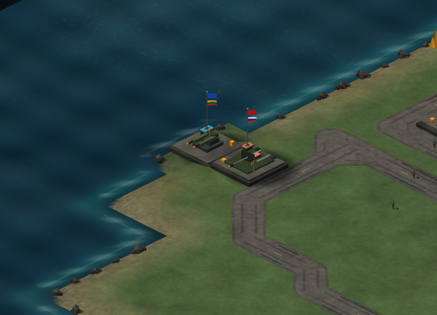
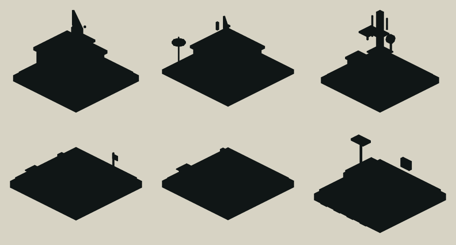
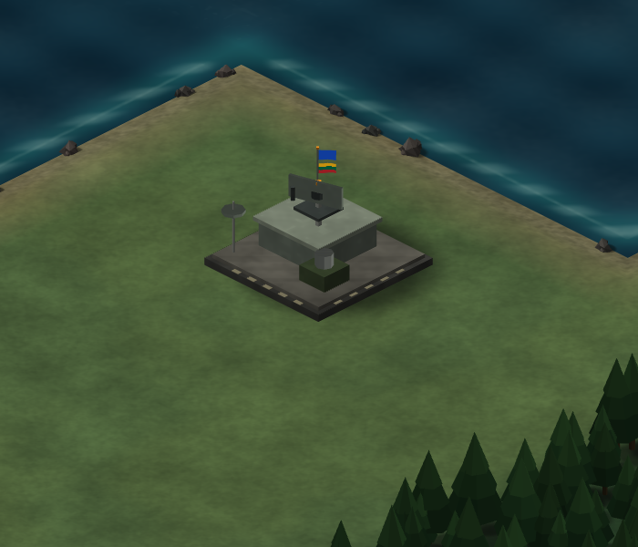
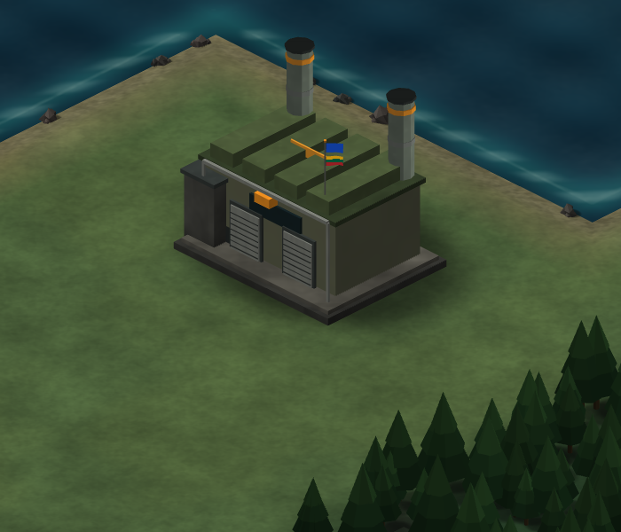
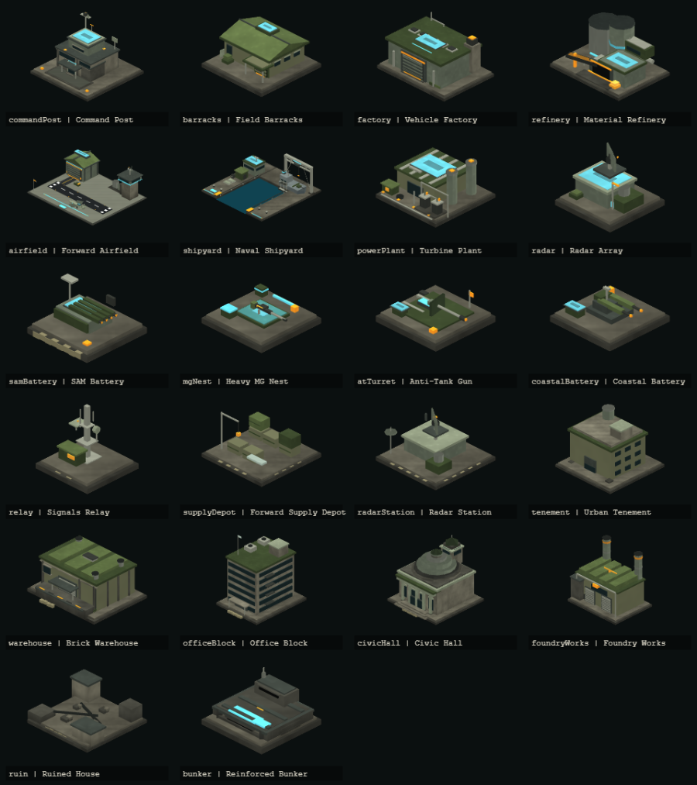

# MCA — Building Visual Roster Audit

**Date:** 2026-10-28

**Commit:** `248fabb` — version 0.1.0 BETA

**Scope:** read-only visual audit of every implemented building, plus a prioritised implementation plan. No production source, mesh, shader, gameplay data, UI, test, save or asset was modified. The only additions are this document and the audit captures under `docs/visual-audit/audit-*.png`.

## 1. Executive summary

There are **22 implemented building definitions**: **13 player-buildable** structures (12 shared baseline types plus the Hungarian Reinforced Bunker) and **9 authored-neutral** structures. Every definition has a real `buildingStyle`; the generic fallback box is not used. No two bodies are accidental copies. The Hungarian Bunker has its own body and shares only the machine-gun turret with the Heavy MG Nest. The Airfield and Shipyard are now independent models.

The earlier building work is present and visible in the current tree. Phase 2 fixed the Bunker clone, the missing ownership surfaces on player-buildable structures, the flag anchors and the building health-bar anchors. Phase 3 separated the Airfield and Shipyard. The environment phase layered the Command Post and Warehouse facades. Those findings should not be re-opened as if they were still current.

The remaining problems are concentrated:

- **4 of 22 models are rated Weak:** the Anti-Tank Gun and Coastal Battery have different meshes but very similar low, sandbag-pad silhouettes at battle zoom; the Radar Station reads as a flat-roofed shed rather than a surveillance station; the Signals Relay is a thin mast whose ownership is carried almost entirely by its flag.
- **Captured objectives do not fully change ownership appearance.** Relay and Radar Station have no body team-mask vertices. After capture, only the flag and the small health-bar team edge change. The Supply Depot shows the correct pattern: its loading mat is neutral grey when unowned and becomes team-coloured when captured.
- **A shared material-classification defect makes dark glazing render as `track and rubber`.** `materialForColor()` uses the already-shaded face colour, and its `< 0.135` dark-surface rule catches the shaded sides of `PALETTE.glassDark`. In the Tenement body, 53.2% of vertices are assigned the track material; the Office Block is 42.7%. The visible result is flat, matte window bands with no glazing response.
- **A few flag anchors do not sit on a surface or pass through geometry.** The Radar Station pole is based at `y = 3.40` and passes through its raised platform at `y = 4.68`. The Foundry Works pole is based at `y = 7.60` inside a sawtooth roof whose surface is at `y = 8.75`. The MG Nest and Tenement poles float 0.30 world units above the highest surface at their anchor. All health bars are correct.
- **The shared foundation slab is the largest remaining cohesion issue.** At Foundry District zoom, the uniform dark plinth reads as a display base under almost every structure. It is present on all 22 models and is more visible than most facade trim.

No **P0** defect remains: there are no missing meshes, no duplicate bodies, no buildable structure without a team surface, no misplaced health bar, and no visible upward-facing coplanar z-fighting. The audit found **10 Good, 8 Adequate, 4 Weak and 0 Broken** buildings. The ratings are developer inspections, not a human recognition study.

The recommended next implementation phase is **Building Visual Phase 4 — Defensive and Captured-Objective Identity**, limited to `atTurret`, `coastalBattery`, `radarStation` and `relay`, plus the captured-ownership and material-classification contracts. It should not remodel the already successful core base, Airfield, Shipyard or urban landmarks.

## 2. Method and current baseline

### 2.1 Source of truth and working tree

The audit used the current working tree, not an older report. `src/render/buildingMeshes.ts`, `src/render/flags.ts`, `src/render/materials.ts`, `src/render/geometry.ts`, `src/render/thumbnailFrame.ts` and `src/ui/overlay.ts` are unchanged from `HEAD`. The checkout already contained uncommitted simulation, pathfinding, unit-heading and save-migration work; that work was preserved and is unrelated to this audit. `renderer.ts` also has pre-existing unit-heading edits, but its building draw, team-colour and flag paths are unchanged. The captures therefore describe the current tree, while the visual code under audit is the committed building code.

### 2.2 Roster derivation

The roster is derived from `BUILDINGS` in [buildings.ts](../src/data/buildings.ts), not from earlier inventory tables. `BUILDING_LIST` contains 21 definitions; `NATIONAL_BUILDING_LIST` adds `bunker`. `BUILDABLE_BY_PLAYER` yields 13 buildable definitions after `authoredOnly` is filtered. The remaining nine are map-authored structures.

### 2.3 Capture method and conditions

The existing dev-only [building-audit.js](../tools/building-audit.js) placed one structure at a time on the real Kestrel Bay terrain or on authored Foundry District, froze the simulation and renderer clock, framed the footprint centre and rendered through the real game renderer. Native frames were written by the existing loopback [audit-capture-server.mjs](../tools/audit-capture-server.mjs). Contact sheets are native-frame crops; the downscaled review sheets are aids only.

| Item | Value |
| --- | --- |
| Browser / API | Chromium preview, WebGL 2 |
| Drawing buffer | **1599 × 899** |
| Page CSS viewport | **1777 × 1000**, DPR **0.9** |
| Camera | fixed 45° yaw, **30°** pitch |
| Zooms | battle **36**, close **18–30**, tactical context **24–32** |
| Lighting / weather | day, clear; effects off |
| Scenarios | Kestrel Bay showroom; Foundry District; a dev-only coastal fixture for water-required structures |
| Clock | tick 0, renderer time 0 |
| Human review | **none**; all readability statements are developer inspection |

The standard showroom places structures on grass. Water-required structures (`coastalBattery`, `shipyard`) are rejected or do not resolve in that fixture. The Coastal Battery captures therefore use a **runtime-only** fixture that edits a 2×2 grass shelf beside western water and places `coastalBattery` at `(11, 41)`. It is not a production map change and no production code was edited. The Shipyard was captured at the documented Phase 3 coastal site and in a close view; its basin is still a local vertex-coloured panel, not an excavated sea-level dock.

The first contact-sheet attempt for the Coastal Battery reused a previous frame when the water-required placement failed. That sheet was discarded. The images referenced in this document use the valid coastal fixture and the actual `coastalBattery` mesh. This is recorded so the evidence trail is not overstated.

### 2.4 What is measured, derived and inspected

- **Measured:** mesh vertices/triangles, per-vertex team-mask share, material-id share, mesh bounds, flag anchors, banner anchors, draw submission counts, scene triangle counts, CPU submission time and the tick-zero state hash.
- **Derived:** draw calls per building from its parts, flag-support gaps and overhead collisions by vertical ray against the authored mesh, and the roster availability from `BUILDABLE_BY_PLAYER` and nation rosters.
- **Inspected:** silhouettes at battle and close zoom, both alliance colours, neutral/captured states, thumbnails, selection and health bars, fog-on presentation, source paths for construction/damage/destruction and shared geometry.
- **Not measured:** GPU time, mobile performance, human recognition rates, full four-yaw sweeps, time-of-day sweeps and a newly captured remembered-building state.

## 3. Confirmed scope and complete roster

The table below is the complete current roster. **Tri** is body / combined-with-moving-parts triangles. **Team %** is the body's team-masked vertex share; it is not a screen-area measurement. **Draws** is body-and-parts / plus flag when owned. Garrison variants still use one body draw.

| ID | Name — role | Availability | Mesh and footprint | Tri | Team % | Draws | Top |
| --- | --- | --- | --- | ---: | ---: | :---: | ---: |
| `commandPost` | Command Post — headquarters | all six nations | unique; 4×4 | 760 / 808 | 4.6 | 2 / 3 | 9.94 |
| `barracks` | Field Barracks — infantry production | all six | unique; 3×3 | 522 / 642 | 6.9 | 2 / 3 | 5.68 |
| `factory` | Vehicle Factory — vehicle production | all six | unique; 4×3 | 456 / 636 | 7.9 | 2 / 3 | 7.70 |
| `refinery` | Material Refinery — resource drop-off | all six | unique; 4×3 | 696 / 696 | 11.3 | 1 / 2 | 8.30 |
| `airfield` | Forward Airfield — air production / recovery | all six | unique; 6×5 | 1,062 / 1,290 | 7.8 | 3 / 4 | 9.10 |
| `shipyard` | Naval Shipyard — naval production / repair | all six | unique; 5×5 | 1,182 / 1,182 | 6.9 | 1 / 2 | 7.55 |
| `powerPlant` | Turbine Plant — power generation | all six | unique; 3×3 | 672 / 672 | 3.3 | 1 / 2 | 6.08 |
| `radar` | Radar Array — detection / tactical map | all six | unique; 2×2 | 244 / 280 | 13.8 | 2 / 3 | 6.35 |
| `samBattery` | SAM Battery — static air defence | all six | unique; 2×2 | 492 / 492 | 4.7 | 1 / 2 | 4.80 |
| `mgNest` | Heavy MG Nest — static anti-infantry | all six | unique; 2×2 | 492 / 564 | 12.2 | 2 / 3 | 2.05 |
| `atTurret` | Anti-Tank Gun — static anti-armour | all six | unique; 2×2 | 420 / 532 | 8.6 | 2 / 3 | 2.90 |
| `coastalBattery` | Coastal Battery — static anti-ship | all six | unique; 2×2 | 348 / 492 | 6.9 | 2 / 3 | 3.35 |
| `relay` | Signals Relay — capturable requisition objective | authored neutral | unique; 2×2 | 228 / 308 | **0** | 2 / 3 | 7.50 |
| `supplyDepot` | Forward Supply Depot — capturable material objective | authored neutral | unique; 3×3 | 444 / 444 | 2.7 | 1 / 2 | 6.80 |
| `radarStation` | Radar Station — capturable reconnaissance objective | authored neutral | unique; 3×3 | 452 / 500 | **0** | 2 / 3 | 7.10 |
| `tenement` | Urban Tenement — garrison strongpoint | authored neutral | unique; 4×4 | 788 / 788 | 0 | 1 / 2 | 10.85 |
| `warehouse` | Brick Warehouse — garrison strongpoint | authored neutral | unique; 5×4 | 864 / 864 | 0 | 1 / 2 | 7.64 |
| `officeBlock` | Office Block — garrison strongpoint | authored neutral | unique; 4×5 | 640 / 640 | 1.8* | 1 / 2 | 17.70 |
| `civicHall` | Civic Hall — landmark strongpoint | authored neutral | unique; 5×5 | 1,088 / 1,088 | 0 | 1 / 2 | 16.25 |
| `foundryWorks` | Foundry Works — landmark strongpoint | authored neutral | unique; 5×4 | 956 / 956 | 0 | 1 / 2 | 14.40 |
| `ruin` | Ruined House — garrison position | authored neutral | unique; 3×3 | 276 / 276 | 0 | 1 / 2 | 3.70 |
| `bunker` | Reinforced Bunker — fortified anti-infantry | **Hungary only** | unique body + shared MG turret; 2×2 | 456 / 528 | 5.1 | 2 / 3 | 3.96 |

\* The Office Block's 1.8% is the existing mast marker, not a permanent faction panel. Authored neutral structures keep their unowned appearance until captured or garrisoned.

Availability notes:

- The six playable nations share the 12 baseline buildables. Hungary replaces `mgNest` with `bunker`; no other national building variant exists. Legacy alliance presets use the shared baseline and cannot build the Bunker.
- `relay`, `supplyDepot` and `radarStation` are authored objectives. They are placed neutral on maps and can change hands through capture.
- `tenement`, `warehouse`, `officeBlock`, `civicHall`, `foundryWorks` and `ruin` are authored neutral shelters. Infantry can garrison them; the owner stays neutral, while the garrison's team supplies the flag and the occupied dressing.
- Every authored structure is present in the current map data; the Foundry District urban block contains all the urban shelter types, and the objective structures appear across the authored maps.

## 4. Rendering and shared-geometry architecture

### 4.1 Data to mesh to renderer

The path is data-driven but not generic in the ECS sense:

1. `BUILDINGS` in [buildings.ts](../src/data/buildings.ts) supplies the gameplay contract: ID, name, description, footprint, HP, armour, cost, build time, power, vision, weapons, capture rules and display metadata. The renderer never changes these.
2. `BUILDING_LIST`, `BUILDABLE_BY_PLAYER` and `NATIONAL_BUILDING_LIST` determine what is buildable and by whom. `BUILDABLE_BY_PLAYER` filters `authoredOnly`; the Bunker is added only by the Hungarian national list.
3. `STYLES` in [buildingMeshes.ts](../src/render/buildingMeshes.ts) maps every ID to a `body`, optional `turret`, `door` and `rotor`, plus local offsets and a pre-merged `garrisoned` variant for the six urban shelter types. `buildingStyle(id)` returns the entry; `buildingMesh(id)` bakes moving parts at rest for thumbnails and bounds.
4. The renderer resolves a building entity and draws `body` (or `garrisoned` when occupied), then the turret, then the animated parts. It does not build geometry per frame or per instance. `buildingMeshes` is a lazily-populated cache of GPU buffers keyed by definition ID, so repeated buildings share geometry.
5. A first capture can rewrite the signature palette per map; mesh colours and team masks are baked at build time. There is no per-building material override, texture nor UV. The only per-building variation is the definition's `STYLES` entry, the model transform and the team uniform.

### 4.2 Team colour, neutral presentation and capture

Buildings use the shared vertex-colour mesh pipeline. `MeshBuilder` colors every vertex; a parallel `teamMask` array marks vertices whose colour should be replaced by the current team colour. The shader receives one `uTeamColor` per draw and mixes at those vertices.

- For a player-built structure, `teamMask` is baked into the model. It remains team-coloured in fog-remembered state, so ownership does not disappear with the current visibility.
- For an occupied urban shelter, the renderer selects the pre-merged `garrisoned` body and passes the **garrison's** team colour to the shader. The shell's own `teamMask` is zero; the dressing carries the team surfaces. The flag uses `flagOwnerForBuilding(owner, garrisonOwner)`, so an occupied neutral structure flies the garrison flag while retaining its neutral gameplay owner.
- For a neutral or unowned structure, `teamColorOf` resolves to the grey `[0.55, 0.60, 0.58]`; a baked team mask therefore reads as neutral grey, not as a team colour. This is the existing capture semantics and must be preserved.
- Capture changes `owner` but does not swap the mesh. A capturable structure with no team-mask vertices can therefore change only its flag and health-bar edge. This is the Relay and Radar Station defect recorded in section 6.

`supplyDepot` is the working reference for a capturable structure: 2.7% of its body vertices carry a team mask on the loading mat. Unowned captures show a grey mat; owned captures show the owner's colour. The mesh is otherwise unchanged.

### 4.3 Draw submissions and states

Normal draws are small and stable:

- **1 body draw**, always. A garrisoned shelter still uses one merged body, not a second draw.
- **+1 turret draw** for `mgNest`, `bunker`, `atTurret` and `coastalBattery`.
- **+1 animated-part draw** for `barracks` and `factory` (door).
- **+1 rotor draw** for `radar`, `relay` and `radarStation`.
- **+1 flag draw** when the resolved flag owner is `>= 0` and a national flag exists. An unowned neutral structure has no flag draw.
- **+1 temporary body pass** while a structure is under construction: the same mesh is drawn again translucent and team-tinted at full height. This is the existing scaffold cage, not an extra asset.

There is no per-building material switch, texture bind, shadow map or post-process. The six `garrisoned` variants are pre-merged at module load and cost no additional draw.

### 4.4 Shared geometry and exact sharing

All 22 definitions have a unique body with one deliberate exception: **`bunker` shares the `buildMgNestTurret()` machine-gun turret** with `mgNest`. It has its own `buildBunkerBody()`, different footprint dressing, roof mass, embrasure and team surfaces. That sharing is intentional: both are heavy-machine-gun positions and the shared gun reads as the same weapon family. It is not a duplicate structure.

No other bodies are shared. `airfield` and `shipyard` are independent after Phase 3; `shipyard` has no door part, because it has no wall or shutter. `officeBlock` / `civicHall` / `foundryWorks` / `tenement` / `warehouse` / `ruin` share helper functions and palette families, not meshes. The common helpers are:

- `ownershipPanel`, used by the player-buildable structures for a raised team panel. The panel is geometry, not a decal.
- `sandbagWall`, `barrel`, `crate`, `vent`, `door`, window and roof-plant helpers, used across many bodies.
- The `box`, `boxRot`, `cylinder`, `cylinderX`, `sphere`, `wedge` and `addQuad` primitives in [geometry.ts](../src/render/geometry.ts).
- The supplied `PALETTE` colours and `materialForColor` classification in [geometry.ts](../src/render/geometry.ts), and the shared material table in [materials.ts](../src/render/materials.ts).

The fallback `FALLBACK_BUILDING` box exists but is unreachable for the 22 current IDs. A missing `STYLES` entry would render that box; the tests and this audit found all 22 entries and no fallback use.

### 4.5 Flag, banner and health-bar anchors

- **Flags:** `BUILDING_FLAG_ANCHORS` in [flags.ts](../src/render/flags.ts) is the explicit per-building local-space contract. It replaced the old footprint-corner search. `flagMountFor()` uses the table when present and only falls back to the corner search for unknown prototype IDs. The Airfield and Shipyard are documented apron exceptions: their flags stand at ground level beside an open working yard, not on a roof. The flag rig, cloth, national texture, wind animation, ownership and remembered-freeze behaviour are unchanged.
- **Health bars:** `buildingTopHeight()` in [buildingMeshes.ts](../src/render/buildingMeshes.ts) takes the taller of the body and the occupied garrison variant, then `buildingBannerAnchor()` adds 0.45. `buildingBannerPoints()` projects the whole top band so a rotated tall point cannot push the bar into the roof. [overlay.ts](../src/ui/overlay.ts) uses these for building banners only; unit banner height is a separate contract. The audit measured all 22 anchors above the mesh top; the nearest clearance is 0.45.
- **Selection and picking:** these remain footprint/entity based. No mesh change in this audit and none recommended in the first group changes footprint, picking radius or collision.

## 5. Complete visual matrix

### 5.1 Current measured state

All values below are body-plus-moving-parts geometry. Material shares are per body. Flags and construction ghost passes are excluded. Triangle counts are authored, not rendered after culling.

| ID | Top | Flag base | Health anchor | Team verts | Bare-metal / glass / track share | Body material summary |
| --- | ---: | ---: | ---: | ---: | --- | --- |
| `commandPost` | 9.94 | 7.75 | 10.39 | 4.6% | 8.0 / 0 / 15.0% | painted-dominant; concrete and some dark trim |
| `barracks` | 5.68 | 5.65 | 6.13 | 6.9% | 0 / 6.9 / 15.1% | painted steel and concrete; dark door trim |
| `factory` | 7.70 | 6.55 | 8.15 | 7.9% | 0 / 9.0 / 17.6% | painted steel, concrete, window bands |
| `refinery` | 8.30 | 6.05 | 8.75 | 11.3% | 19.9 / 0 / 12.5% | steel and concrete; dark pipes and cylinders |
| `airfield` | 9.10 | 0.45* | 9.55 | 7.8% | 7.8 / 1.1 / 25.6% | concrete apron, painted hangar, dark runway |
| `shipyard` | 7.55 | 0.95* | 8.00 | 6.9% | 17.2 / 1.0 / 17.4% | concrete, steel gantry, water basin |
| `powerPlant` | 6.08 | 4.25 | 6.53 | 3.3% | 22.9 / 0 / 14.3% | concrete stacks and painted turbine hall |
| `radar` | 6.35 | 3.12 | 6.80 | 13.8% | 6.5 / 0 / 21.7% | painted equipment, steel mast, dark dish |
| `samBattery` | 4.80 | 2.65 | 5.25 | 4.7% | 31.1 / 0 / 15.4% | concrete pad, painted launcher, metal tubes |
| `mgNest` | 2.05 | 1.95 | 2.50 | 12.2% | 0 / 0 / 20.7% | concrete and canvas sandbags |
| `atTurret` | 2.90 | 1.75 | 3.35 | 8.6% | 0 / 0 / 19.7% | concrete revetment, painted gun, sandbags |
| `coastalBattery` | 3.35 | 1.76 | 3.80 | 6.9% | 1.4 / 0 / 18.4% | concrete pad, painted rails, metal fittings |
| `relay` | 7.50 | 3.35 | 7.95 | **0** | 14.6 / 0 / 15.6% | concrete base, steel mast, painted cabin |
| `supplyDepot` | 6.80 | 3.95 | 7.25 | 2.7% | 17.0 / 0 / 21.2% | concrete apron, containers, steel crane |
| `radarStation` | 7.10 | 3.40 | 7.55 | **0** | 3.2 / 0 / 18.7% | concrete base, steel mast, painted dish |
| `tenement` | 10.85 | 8.90 | 11.30 | 0 | 4.9 / 0 / **53.2** | brick body; glass bands misclassified as track |
| `warehouse` | 7.64 | 7.15 | 8.09 | 0 | 3.9 / 0 / 13.5% | concrete plinth, olive walls/roof, steel frame |
| `officeBlock` | 17.70 | 12.90 | 18.15 | 1.8% | 6.8 / 0 / **42.7** | concrete piers; glass bands misclassified as track |
| `civicHall` | 16.25 | 9.35 | 16.70 | 0 | 4.2 / 1.3 / 10.0% | stone/concrete and painted details |
| `foundryWorks` | 14.40 | 7.60 | 14.85 | 0 | 13.9 / 0 / 14.5% | brick, concrete, steel stacks, dark trim |
| `ruin` | 3.70 | 3.75 | 4.15 | 0 | 2.3 / 0 / 28.6% | concrete and rubble; intentional dark cavities |
| `bunker` | 3.96 | 3.00 | 4.41 | 5.1% | 6.8 / 0 / 5.2% | heavy concrete, painted roof band, dark embrasure |

\* Airfield and Shipyard flag bases are **ground-level apron anchors**, not roof violations. All other bases are on or above their local roof mass; the four exceptions where a flag pole passes through or floats above geometry are identified in section 6.5.

Health anchors are exactly `mesh top + 0.45` for every definition. The overlay projects every top-band vertex, so the screen-space clearance is at least that value for the current camera. The nearest measured world clearance is the Airfield at 0.45; the tallest is the Office Block at 18.15.

Material-share highlights, measured on the body:

- The **Command Post** is 44.0% painted and 27.9% concrete; 8.0% bare metal is the mast, rail and dish cluster. It is not a monotone model.
- The **Turbine Plant** is 59.2% concrete (three stacks and the hall) and 22.9% bare metal (stack caps, pipework); only 3.3% team mask.
- The **Refinery** uses 19.9% bare metal and 12.5% track for the cylinders, pipework and dark bands, plus 11.3% team mask on the loading canopy and wall band.
- The **Tenement** is 53.2% track: the window boxes and balcony rails all fall into the dark-material rule. The Office Block is 42.7% track for the same reason. This is a classification defect, not intentional dark glazing.
- The **Ruin** is intentionally 28.6% track/very-dark material for window cavities and charred timber. That is appropriate for a ruin and should not be "fixed" by the same change.

### 5.2 Visual matrix

**How to read the ratings.** `G` = Good, `A` = Adequate, `W` = Weak. The overall rating is a holistic player-visible judgement, not the worst individual cell: a strong silhouette with one weak surface can be Adequate while the surface is still recorded as Weak. No building is rated Broken. The ratings are developer inspections of the current captures; no human recognition test was conducted.

**Player-buildable structures**

| ID | Overall | Role at battle zoom | Architectural identity | Surface / material | Ownership | Anchors / overlays | Main finding and treatment |
| --- | :---: | --- | --- | --- | --- | --- | --- |
| `commandPost` | **G** | G — headquarters mass, mast, rotor and apron read as the command centre | G — layered operations block, rotor, antenna cluster; the apron is broad but subordinate | A — improved facade, but the dark slab and apron still carry most of the lower mass | G — 4.6% roof/wall panels plus flag | G — flag on upper roof, bar clear | It is a successful command building. P3 only: apron/plant polish, no remodel. |
| `barracks` | **A** | A — the door and squad bay are visible, but the low roof reads like a storehouse | A — a field shed rather than a barracks; the entrance is small at 36 | A — clean materials, but little wall depth or accommodation rhythm | G — panel and roof band | G — flag and bar on the low roof | P2: raise/expose the squad entrance and roof ventilation, add modular bays. Preserve the animated door. |
| `factory` | **G** | G — long sawtooth hall and vehicle doors immediately read as production | G — loading bay, roof monitors, industrial roofscape | A — a large dark plinth and repeated dark bands flatten the lower walls | G — roof sign/panel | G | P3: reduce plinth contrast and add yard equipment only if it survives at 36. Do not touch the silhouette. |
| `refinery` | **G** | G — silos and conveyor identify processing at a glance | A — storage/processing is clear; the delivery mouth and unloading relationship are not | A — many cylinders are very dark and lose separation; the catwalk is thin | G — 11.3% canopy/band | G | P2: strengthen the unloading bay and harvester apron, lighten cylinder separation. Keep the silo profile. |
| `airfield` | **G** | G — runway, hangar and parked aircraft read as an airbase | G — long runway and hangar form a distinct open plan | A — broad apron and a strong plinth; the static jet may read as a unit at 36 | G — roof and hangar band | G — apron flag is intentional | P3: service clutter/ground blend. Verify that the static aircraft is never mistaken for a controllable unit. |
| `shipyard` | **G** | G — gantry over a slipway reads as naval construction | G — open gantry and basin; no fake shutter or wall | A — basin is a local panel, not an excavated sea-level dock; the waterline can look inset from some angles | G — gantry band | G — apron flag is intentional | P3: animate/ground the basin at sea level and add a launch cue. Do not restore a door. |
| `powerPlant` | **G** | G — three stacks and turbine hall read as generation | G — stacks dominate; transformer yard and hall are subordinate | A — large concrete mass and strong team panels; small electrical parts disappear | G — 3.3% panel | G | P3: transformer/cable detail and plinth softening; no simulation change. |
| `radar` | **G** | G — rotating dish and mast read as detection | G — dish crown, equipment cabin and mast | A — small footprint, but clear; the support base is simple | G — 13.8% crown/panel | G | P3 only. It remains the strongest 2×2 silhouette. |
| `samBattery` | **A** | A — four tubes read close-up; at 36 the pad reads as a generic defence position | A — launcher pack is visible, but the surrounding pad dominates | A — broad concrete, few vertical cues | A — 4.7% panel, mostly on the low edge | G | P2/P3: enlarge the launcher pack and blast area, not the pad. Keep it distinct from the AT/Coastal family. |
| `mgNest` | **A** | A — open ring and gun are present; the flag often does the recognition work | G — low sandbag emplacement with a traversing gun | A — the ring is low and the gun is small at 36 | G — 12.2% panel on the parapet | A — flag floats 0.30 above the surface at its anchor | P2: fix the flag anchor and raise the gun/tripod slightly. Do not add walls; it must stay an open nest. |
| `atTurret` | **W** | W — at 36 the gun and trails disappear into the pad | W — low revetment; no weapon-forward mass | A — concrete and painted gun, but mostly horizontal | A — 8.6% panel on the low edge | G | **P1:** rebuild the gun/revetment silhouette so the barrel, shield/trails and crew bay are visible. Preserve the hardpoint. |
| `coastalBattery` | **W** | W — the launch rails do not read at 36; it looks like a second AT pad | W — low pad; the twin anti-ship rails and blast deflector are not primary | A — concrete and painted rails; dark fittings | A — 6.9% panel on the low edge | G | **P1:** raised twin-rail launcher, blast deflector and ready-rack mass. Keep the 2×2 footprint and water requirement. |
| `bunker` | **G** | G — heavy roof and embrasure read as a reinforced bunker | G — distinct from the MG Nest; roof mass and narrow firing slit | A — team strip is large and bright, but material separation is otherwise good | G — 5.1% roof band | G — flag on the roof | P3 only: tone down the team strip if it competes with the embrasure. Keep the Hungarian replacement. |

**Authored neutral structures**

For these, "ownership" means the structure's placement as neutral and its occupied/garrisoned presentation. They are not player-buildable and do not need a permanent faction panel. A zero body team-mask is correct only if the garrison dressing or flag still makes the occupant readable.

| ID | Overall | Role at battle zoom | Architectural identity | Surface / material | Ownership | Anchors / overlays | Main finding and treatment |
| --- | :---: | --- | --- | --- | --- | --- | --- |
| `relay` | **W** | A — the mast is visible, but it reads as a radio mast rather than a requisition objective | W — thin mast, small cabin and a dish; the flag is the main identifier | A — the concrete pad and thin steel are clean but sparse | **W — no body team surfaces; capture changes only the flag** | G — flag is above the cabin | **P1:** add a readable equipment cabin/antenna mass and a neutral-grey captured ownership panel. Keep the rotating dish. |
| `supplyDepot` | **A** | A — containers and crane read as a logistics yard | A — believable forwarding depot; the apron is sparse | A — good container colour separation; crane is thin at 36 | A — 2.7% loading mat works in both neutral and captured states | G | P2: more loading clutter and a stronger team sign. This is the positive ownership reference, not a defect. |
| `radarStation` | **W** | W — reads as a flat-roofed shed with a small mast, not a fixed radar station | W — low operations block and thin mast; no dominant array silhouette | W — the flat roof panel dominates; the dish is small relative to the mass | **W — no body team surfaces; flag pierces the platform at y 4.68** | **W — flag pole begins at 3.40 inside the platform** | **P1:** rebuild as a fixed surveillance station with a substantial array, and move the flag above the platform. Add a neutral-grey captured sign. |
| `tenement` | **A** | G — dense apartment block reads immediately | G — balconies, recessed entrance and roofline are distinctive | **W — 53.2% track; window boxes have no glazing response** | A — garrison dressing carries team trim; neutral otherwise | A — flag floats 0.30 above the roof at its anchor | P2: fix `materialForColor()` and the flag anchor. The silhouette is already successful; do not remodel it. |
| `warehouse` | **G** | G — long gabled shed with loading doors reads as warehousing | G — believable port/warehouse mass, roof vents and dock | A — olive walls and roof dominate; the name says brick, the material reads canvas/painted metal | A — garrison dressing adds team trim; neutral otherwise | G | P2 optional: brick/trim variation or a clearer dock sign. No structural need. |
| `officeBlock` | **A** | G — tall vertical piers and floor bands read as an office block | G — strong height and facade rhythm | **W — 42.7% track; glazing bands are matte and flat** | A — garrison trim and mast marker; neutral otherwise | G — flag and bar at 18.15 | P2: correct the glass classification and add mullions/piers only where they survive at 36. The silhouette is not the problem. |
| `civicHall` | **G** | G — dome, clock tower and portico read as a civic landmark | G — the most architecturally specific building in the roster | A — stone/concrete is convincing, but the lower facade is smooth | A — garrison trim only; neutral otherwise | A — flag sits at the dome skirt, clear in the captured view but needs a four-yaw check | P2: verify the dome flag from all sides; add restrained stone trim. Keep the composition. |
| `foundryWorks` | **A** | G — twin stacks and sawtooth roof read as heavy industry | G — strong foundry silhouette | A — brick/concrete and dark trim; the stacks are the main identity | A — garrison trim only; neutral otherwise | **W — flag base at 7.60 is inside a sawtooth volume at 8.75** | **P1 flag anchor**, otherwise P2: move the flag to the clear roof/stack edge. Keep the model. |
| `ruin` | **A** | A — broken walls read as a ruin at 36, though the pad is sparse | A — deliberate broken shell; interior is empty | A — rubble and dark cavities read correctly; intentionally rough | A — no team surface when neutral; garrison dressing/flag when occupied | G | P3: rubble, exposed beams and interior debris. Do not "repair" the damage. |

### 5.3 Rating summary

| Rating | Count | Buildings |
| --- | ---: | --- |
| **Good** | **10** | `commandPost`, `factory`, `refinery`, `airfield`, `shipyard`, `powerPlant`, `radar`, `warehouse`, `civicHall`, `bunker` |
| **Adequate** | **8** | `barracks`, `samBattery`, `mgNest`, `supplyDepot`, `tenement`, `officeBlock`, `foundryWorks`, `ruin` |
| **Weak** | **4** | `atTurret`, `coastalBattery`, `relay`, `radarStation` |
| **Broken** | **0** | — |
| **Total** | **22** | |

This is the count used in the executive summary after the matrix was finalised. The Weak group is exactly the four models whose **primary identity** fails at battle zoom or whose **capture state** fails the ownership contract. The Adequate group contains successful silhouettes with a specific surface or anchor defect; those are recorded separately below so they are not lost.

## 6. Key findings

### 6.1 What already works

The roster is in substantially better shape than the earlier audits implied:

- **All 22 definitions have authored bodies.** There is no `FALLBACK_BUILDING` submission and no missing `STYLES` entry. The audit confirmed this by resolving every ID and by the existing `building-presentation` tests.
- **The major identities are strong.** The Command Post, Vehicle Factory, Refinery, Airfield, Shipyard, Turbine Plant, Radar Array, Warehouse, Civic Hall and Bunker are all identifiable from their thumbnails and from the battle-zoom roster sheet. Their silhouettes are not generic boxes.
- **The Phase 2 and Phase 3 fixes are present.** The Bunker is no longer an MG Nest clone. The MG Nest remains an open sandbag ring. The Airfield and Shipyard are independently modelled; the Shipyard has no shutter. Phase 2 team panels and mesh-bound health anchors are in the current code.
- **All 13 player-buildable structures have meaningful team surfaces.** Body team-mask shares are 3.3% (Turbine Plant) to 13.8% (Radar Array); the visual panels are integrated roof/wall surfaces, not a single flag. This meets the Phase 2 contract.
- **All 22 health-bar anchors clear the mesh.** The anchor is `top + 0.45`; the selected-state captures show the bar above the roof and not across it. Unit banner heights are separate and untouched.
- **All 22 have thumbnails, and all thumbnails are generated from the same mesh path.** There are no placeholders in the current set.
- **The common material families are present.** Concrete, painted metal, bare metal, glass, canvas, track and asphalt are differentiated through the shared material table; the Command Post and Warehouse are no longer monochrome.

The remaining work should preserve this base. A wholesale reskin would discard successful silhouette and ownership work.

### 6.2 Silhouette and architectural identity

**The weak four.** The Anti-Tank Gun and Coastal Battery are the clearest role-identity failures. Both are 2×2 concrete pads with a low revetment, a small traversing mount and a flag. The AT gun has a long barrel and trails, and the Coastal Battery has twin rails, but those differences are not primary at zoom 36. In the valid pair capture they read as two variants of the same defence pad, not as anti-armour and anti-ship weapons:

*Both structures are in their valid coastal/land placement. The flag, base pad and low horizontal mass dominate; the weapon differences are only legible at closer range. The capture contains both roles on adjacent pads; the labels are intentionally absent so the shape is judged without text. This is the evidence for the P1 pair.*

The Signals Relay and Radar Station fail for a different reason: their primary masses are too thin or too low. The Relay is a mast on a small cabin; at 36 the mast reads, but the role (a capturable requisition objective) does not. The Radar Station has a low operations block, a thin mast and a dish that is smaller than the roof panel. It reads as a shed with an antenna, not as a surveillance station. The objective silhouette sheet makes the contrast clear: the Relay and Radar Station have no dominant functional mass comparable to the Refinery's silos or the Airfield's runway.

*Silhouette-only objective sheet. The Relay and Radar Station (lower row) are distinguished mainly by a thin pole; the Supply Depot and the urban structures have more mass. This is a shape problem, not an ownership-colour problem.*

**The secondary identity issues.** The Field Barracks is not Weak — its door and roof are readable — but its low, flat-roofed shed still reads closer to a storehouse than an infantry-production building at 36. The SAM Battery is recognisable close-up because of its four tubes, but at battle zoom its pad dominates. The MG Nest is intentionally open and low; its silhouette is appropriate, but the gun is small and the flag is doing too much recognition work. These are P2 issues, not the first group.

**The successful deliberate duplication.** The Bunker and MG Nest share the machine-gun turret. That is correct component reuse: both are heavy-MG positions, and the Bunker's body, roof mass, embrasure and team band are visibly different. The Bunker is the stronger of the two and should be the visual reference for the MG Nest's gun mount, not a reason to merge the bodies again.

**National identity is currently flag-only.** No building has a nation-specific architectural variant. The Hungarian Bunker is the only national replacement, and its visual difference comes from its role (reinforced concrete) rather than a national style. This is a scope question for a later phase, not a defect in the current roster.

### 6.3 Team ownership and captured objectives

**Player buildables: pass.** Every player-buildable definition has a body team mask. The shares are 4.6% Command Post, 6.9% Barracks, 7.9% Factory, 11.3% Refinery, 7.8% Airfield, 6.9% Shipyard, 3.3% Turbine Plant, 13.8% Radar Array, 4.7% SAM Battery, 12.2% MG Nest, 8.6% AT Gun, 6.9% Coastal Battery and 5.1% Bunker. These are integrated panels/bands, not a single pixel. The two lowest shares (Turbine Plant and Command Post) still read as a team panel at 36 in the captured owned state.

**Captured objectives: fail for Relay and Radar Station.** Both `buildRelay()` and `buildRadarStation()` author no `ownershipPanel()` call and no other team-mask surface. Their `STYLES` entries have no `garrisoned` variant. When a player captures either structure, the renderer changes `owner`, so the **flag and the health-bar edge** change, but the body remains its neutral concrete/steel colours. This is the exact failure the Phase 2 contract was meant to prevent, now isolated to two capturable authored structures rather than the buildable roster.

The Supply Depot is the working counter-example. It has a small team-masked loading mat (`supplyDepot` loading mat, 2.7% of body vertices). Unowned, the mat is neutral grey; captured, it takes the owner's colour. That is the right pattern for a capturable structure because it does not give a neutral building a permanent faction identity.

| Structure | Neutral body | Captured body | Flag | Verdict |
| --- | --- | --- | --- | --- |
| `supplyDepot` | concrete/steel, grey mat | mat becomes team colour | owner flag | **Correct** |
| `relay` | concrete/steel, no team mask | unchanged | owner flag | **Fail** |
| `radarStation` | concrete/steel, no team mask | unchanged | owner flag | **Fail** |

This is a presentation defect, not a gameplay defect: capture rules, owner, vision and requisition behaviour are correct. It is nonetheless a P1 identity issue because a player must be able to identify who owns a strategic objective without reading a small flag at 36.

**Garrisoned urban shelters.** The six urban shelter bodies have no permanent team mask. When occupied, the renderer selects the pre-merged `garrisoned` body and passes the garrison's team colour. The dressing carries the team trim and the flag owner follows the garrison. This is why `tenement`, `warehouse`, `officeBlock`, `civicHall`, `foundryWorks` and `ruin` show team trim only when occupied. Their neutral state is correctly neutral. The Office Block's 1.8% is the existing mast marker, not a permanent faction panel.

**Unowned and remembered states.** Captured neutral states show no flag when `owner < 0`; a garrisoned neutral shelter shows the garrison flag but keeps the neutral owner. `teamColorOf` resolves unowned masks to grey, so a baked mask cannot accidentally display a team colour on a neutral structure. The existing fog tests and `building-presentation` tests cover the remembered-team path. This audit did not re-capture a remembered building; that is a verification gap, not a positive finding.

### 6.4 Surface and material quality

**The dark-glazing misclassification is confirmed.** `materialForColor()` first checks `Math.max(r, g, b) < 0.135` and returns `MATERIAL.track`. The intent is to catch tyres and tracks. But `MeshBuilder` passes the **shaded** face colour, and `PALETTE.glassDark` is `[0.08, 0.13, 0.14]`. An unshaded glassDark face has a max of 0.14 and is classified as glass; a face shaded by roughly 5% or more drops below 0.135 and is classified as track. Box side faces receive different lighting from the top, so the same window box can be glass on one face and track on another.

The measured effect is large:

- **Tenement:** 53.2% of body vertices are `MATERIAL.track`; the window boxes, balcony rails and dark entrance all collapse into one matte family.
- **Office Block:** 42.7% is `MATERIAL.track`; the glazing bands lose their low-roughness/high-specular response and read as dark painted strips.
- **Other glass:** the Command Post (0%), Factory (0%), Refinery (0%), Airfield (1.1%), Shipyard (1.0%), Civic Hall (1.3%) and other bodies are mostly unaffected because their glass faces are either lighter or not shaded below the threshold. The threshold is a global bug, but the visible damage is concentrated in the two buildings with the largest dark-glass areas.

The correct fix is to classify the **unshaded base colour** at the `box`/`cylinder` call, not the shaded copy, or to classify glass by its hue before the dark-value shortcut. This audit does not prescribe the implementation beyond noting the two viable paths; the first group should choose one and add a regression test for a shaded glassDark face.

**Flat plinths and dark aprons are the strongest environment-level weakness.** Almost every body begins with two large concrete slabs, and the slabs receive a dark, low-value finish. At battle zoom, the uniform plinth frames each building like a display base and reduces the sense that the structure is bedded into the terrain. The Command Post and Airfield are the most exposed because their aprons are large. This is a **shared** issue: changing one building's plinth would make the roster less consistent, not more. It should be treated as a later foundation/grounding contract across all 22, not as a per-model remodel.

**Materials that work.** The Refinery's steel/concrete separation, the Turbine Plant's stacks, the Bunker's concrete/roof-band contrast and the Warehouse's olive roof all survive at 36. The material table is already small and shared; there is no need for texture atlases, normal maps or a new material pass to fix the plinth or the glazing.

### 6.5 Flags, health bars and technical geometry

**Health bars: pass.** All 22 measured anchors are exactly `top + 0.45`. The selected-state captures show the bar above the roof. The overlay projects the full top band, so rotation cannot push a bar into the geometry. The audit found no building whose bar crosses its roof or facade. Unit health bars were not changed and are outside this contract.

**Flags: four anchor defects, not a systemic failure.** The explicit `BUILDING_FLAG_ANCHORS` table is the right contract, and most entries are on a roof or mast. Four entries fail a support/clearance check:

| Building | Anchor `(x, y, z)` | Finding | Severity |
| --- | --- | --- | --- |
| `radarStation` | `(-0.9, 3.40, -0.8)` | The pole begins at 3.40 and passes through the 2.6×2.6 platform whose underside is at 4.68; the flag emerges above the platform but the pole is embedded in the roof mass. | **Confirmed defect, P1** |
| `foundryWorks` | `(4.8, 7.60, 3.2)` | The pole base is inside a sawtooth roof volume whose surface at that position is 8.75, so the pole emerges through the roof rather than standing on it. | **Confirmed defect, P1** |
| `mgNest` | `(-1.9, 1.95, 2.1)` | The highest surface at the anchor is 1.65; the pole base floats 0.30 above it. | Confirmed defect, P2 |
| `tenement` | `(-3.6, 8.90, 3.2)` | The highest surface at the anchor is 8.60; the pole base floats 0.30 above it. | Confirmed defect, P2 |
| `atTurret` | `(-2.1, 1.75, 2.4)` | Base is 0.02 inside the layered surface. | Hidden/internal, P3 |
| `coastalBattery` | `(-2.1, 1.76, 2.3)` | Base is 0.045 inside the layered surface. | Hidden/internal, P3 |
| `relay` | `(0, 3.35, 2.2)` | Base is 0.05 inside the cabin roof. | Hidden/internal, P3 |
| `shipyard` | `(-7.0, 0.95, 8.6)` | Apron exception, base is 0.22 above the ground slab. | Documented exception; check ground contact |

`shipyard`'s flag is an intentional apron flag; the small base gap is within the flag pole footing. It is not a roof violation. `airfield`'s apron flag sits on the ground and is correct.

*Radar Station from the objective close-up: the flat roof mass dominates, and the flag pole is embedded in the raised platform rather than mounted on a mast above it. The model also has no body team mask, so a captured station would differ only by this flag.*

*Foundry Works: the pole emerges through the sawtooth roof at the anchor. The roof mass is strong; the fix should move the anchor, not cut the roof.*

**No visible upward-facing z-fighting.** A coplanar-pair scan of all 22 bodies found **0 upward-facing overlapping pairs**. The only coplanar twins were downward-facing internal layers (for example, the Command Post's stacked foundation layers and the Tenement's floor slabs). Those are hidden beneath a plinth/roof and are not visible from the isometric camera. This confirms the earlier Command Post z-fighting fix; it does **not** guarantee that a future mesh edit cannot reintroduce a visible pair. Any first-group mesh change should rerun the scan.

**No duplicate or unreachable meshes.** Every style resolves; the Bunker body is unique; the Airfield and Shipyard are distinct; the `FALLBACK_BUILDING` path is unreachable. The only deliberate duplicate component is the MG turret shared by `mgNest` and `bunker`.

**Construction, damage and destruction are visually minimal.** Source inspection shows a translucent team-tinted body pass and a vertical squash during construction. There is no distinct damage mesh, rubble state or destruction animation in the building renderer. The ruin is a separate authored neutral building, not a destroyed-state mesh. This is a confirmed presentation gap to schedule later; it is not a defect in the current static roster.

### 6.6 Scale and grounding

No building uses a hidden visual scale multiplier. Building model transforms are unit scale except for the construction `verticalScale`; only units have `unitVisualScale`. The meshes are authored at world scale:

- The standard 2×2 defensive pad is 7.4–7.6 world units wide. A 3×3 structure is 11–11.8 wide; a 4×4 is ~15.4; a 5×5 is ~18–20. These match the data footprints closely enough that no picking/silhouette mismatch was observed.
- Building heights range from 2.05 (MG Nest) to 17.70 (Office Block). The urban landmarks are intentionally taller than the base structures; the Airfield and Shipyard are broad rather than tall.
- The 2×2 defensive family is the most compressed: four different roles share the same pad size and a similarly low centre of mass. That is the scale/identity interaction behind the AT/Coastal problem, not a global scale error.
- The Bunker stays within 2×2 and has a visibly heavier roof than the MG Nest. The shared turret is mounted at the same 1.55 height; the body difference is what makes the Bunker read.

No building geometry was observed to breach its footprint in a way that changes collision or picking. This audit did not run a per-vertex footprint containment check across all 22; that is a verification task for the first group if a body is enlarged.

### 6.7 Thumbnails and preview quality

All 22 thumbnails are generated by the same renderer path and exist in the current contact sheet:

*The complete 22-building thumbnail sheet. The AT Gun and Coastal Battery are the two most similar tiles; the Relay and Radar Station are the two least self-explanatory. The medium buildings are otherwise clear.*

The thumbnails are not the primary problem, but three weaknesses matter for build menus and the editor:

- **Relay / Radar Station:** thin masts and small dishes disappear at thumbnail scale. The Radar Station reads as a small shed. These tiles need a stronger body/array, not a different camera.
- **AT Gun / Coastal Battery:** the two tiles are near-duplicates in composition. A player scanning the build menu sees two low pads with a flag. This is the same identity problem as the battlefield, and the first-group silhouette fix will fix both.
- **Office Block:** the dark glazing bands make the tile read as a striped slab; the material fix will restore the window rhythm. The silhouette itself fits the tall thumbnail frame.

The thumbnail camera, lighting, scale fitting and transparent background are shared. There is no evidence of a thumbnail-specific material or geometry path; the thumbnails reflect the live meshes.

### 6.8 Defect classification

| Class | Finding | Evidence | Priority |
| --- | --- | --- | :---: |
| **Confirmed defect** | `materialForColor()` sends shaded `glassDark` faces to `MATERIAL.track`; Tenement 53.2%, Office Block 42.7% track | Source and vertex-material counts | **P1** |
| **Confirmed defect** | Radar Station flag pole passes through its raised platform | Anchor y 3.40; platform underside 4.68 | **P1** |
| **Confirmed defect** | Foundry Works flag pole is based inside a sawtooth roof volume | Anchor y 7.60; roof surface 8.75 | **P1** |
| **Confirmed defect** | Relay and Radar Station captured bodies do not change ownership | Team-mask share 0; no `ownershipPanel`; no `garrisoned` | **P1** |
| **Confirmed defect** | MG Nest and Tenement flag poles float 0.30 above the surface at their anchor | Anchor-to-surface measurement | P2 |
| **Confirmed weakness** | AT Gun and Coastal Battery share a low-pad composition at 36 | Pair capture | **P1** |
| **Confirmed weakness** | Relay and Radar Station lack a dominant functional mass | Objective silhouette sheet | **P1** |
| **Confirmed weakness** | Uniform dark plinth under all 22 structures dominates the lower silhouette | Foundry context captures | P2 |
| **Confirmed weakness** | Barracks roof/entrance reads as a storehouse | Thumbnail and battle capture | P2 |
| **Confirmed weakness** | Refinery unloading role is unclear beside the silos | Refinery capture | P2 |
| **Confirmed weakness** | Office/Tenement glazing is matte because of the material defect | Close captures | P2 |
| **Confirmed weakness** | SAM Battery pad dominates its launcher at 36 | Roster sheet | P3 |
| **Probable issue** | Civic Hall dome flag may be partly occluded from some yaws | Single captured yaw | P3 |
| **Probable issue** | Static Airfield jet could be mistaken for a unit at 36 | Battle capture only | P3 |
| **Probable issue** | Shipyard basin reads as a local inset panel, not sea-level water | Close/battle captures | P3 |
| **Optional polish** | Bunker team strip is very bright relative to the embrasure | Thumbnail | P3 |
| **Optional polish** | Ruin interior/rubble is sparse | Thumbnail | P3 |
| **No P0** | No missing mesh, missing buildable ownership, misplaced health bar, or visible upward z-fighting | Full roster scan | — |

## 7. Shared versus building-specific opportunities

The roster has enough repetition to justify a small number of shared contracts, but not enough to justify a generic building framework. The distinction below is deliberate.

### 7.1 Shared opportunities supported by real repetition

| Opportunity | Repetition | Recommended form | Not recommended |
| --- | --- | --- | --- |
| **Flag-anchor contract** | All 22 buildings; 4 defective entries | Keep `BUILDING_FLAG_ANCHORS` and add a support/clearance test. Fix the four entries in place. | Another vertex heuristic; a single vertical offset for every building; moving apron flags onto roofs. |
| **Mesh-bound health anchors** | All 22 | Already correct in `buildingTopHeight()` / `buildingBannerAnchor()`. Reuse for every new body. | Footprint-height fallback; unit-banner changes. |
| **Ownership masks** | 13 buildables + 1 capturable reference | Use `ownershipPanel()` or an equivalent neutral-grey team surface for the two failing objectives. Keep the existing shader and team-mask range. | A unique shader, texture, or per-captured-structure material. Permanent team colour on neutral structures. |
| **Glass classification** | Shared `materialForColor()` path; visible on Tenement, Office Block and some smaller glazing | Classify the unshaded base colour, or resolve glass hue before the dark-value shortcut. One shared fix and one regression test. | Per-building material overrides; a second material pipeline; normal maps. |
| **Foundation / plinth grounding** | All 22 bodies use the same two-slab base | One shared grounding treatment: lower the plinth, vary its edging, or recess it into the ground. Apply at the builder or vertex level, not per model. | Bespoke foundation geometry for every building; terrain height changes. |
| **Defensive pad base** | `mgNest`, `atTurret`, `coastalBattery`, `samBattery` all share the 2×2 pad language | Keep the shared pad as a role-neutral base; differentiate only the upper mass and weapon. | A single generic "defence" body with cosmetic weapon swaps. |
| **Thumbnail framing** | All 22 | Keep the existing `thumbnailFrame` fitting and transparent background. | Per-building cameras or bespoke thumbnail renders. |
| **Construction scaffold pass** | All buildable structures | Keep the existing single translucent team-tinted body pass. | A separate construction mesh per building. |

### 7.2 Building-specific work

The following should remain specific because the repetition is weak or the identity depends on the unique form:

- **Command Post:** central operations mass, rotor and communications cluster. Already successful; P3 polish only.
- **Refinery:** silo/conveyor identity and unloading bay. A generic industrial kit would flatten the strongest remaining economy silhouette.
- **Airfield / Shipyard:** open aprons, runway/slipway and their ground-level flags. Their layouts are intentionally different and should not be merged into a shared "production yard."
- **Barracks:** squad entrance and accommodation rhythm. The door animation is already unique; the fix is proportions, not a new shared door system.
- **Civic Hall / Tenement / Warehouse / Office / Foundry / Ruin:** these six share urban helpers and garrison dressing, but each has a distinct architectural identity. A generic "urban building" generator would be a regression.
- **Bunker:** heavy roof and embrasure. It shares only the MG turret; its body should stay unique.

### 7.3 The one abstraction that is not yet justified

An entrance/canopy helper could serve the Barracks, Supply Depot and Warehouse, but the three entrances differ in width, height, door type and animation. There is not yet enough repetition to justify a shared component. The audit recommends building the Barracks and Supply Depot entrances independently in their own phases and only extracting a helper if the final forms genuinely share dimensions and construction. This avoids creating a framework for three bespoke openings.

## 8. Prioritised improvement roadmap

Priority is by player-visible benefit and correctness, not by implementation convenience.

### P0 — Correctness

**No P0 findings.** There are no broken mappings, missing buildable ownership surfaces, misplaced health bars, duplicate bodies, unreachable meshes or visible upward-facing z-fighting. The four P1 work items below are presentation-correctness issues, not gameplay blockers.

### P1 — Identity and presentation correctness

| # | Work | Buildings | What is wrong now / player sees | Fix | Complexity | Dependencies / risk |
| ---: | --- | --- | --- | --- | :---: | --- |
| 1 | **Glass material classification** | `tenement`, `officeBlock` (shared classifier; check units) | Window bands are matte `track`; the office reads as a striped slab, the tenement windows lose depth | Classify unshaded glass; add a shaded-glass regression test | S code / M verification | Global classifier; verify units and all glass surfaces. No geometry change. |
| 2 | **AT Gun and Coastal Battery identities** | `atTurret`, `coastalBattery` | Two low pads; gun/trails and launch rails disappear at 36; the pair reads as one role | Build a weapon-forward AT revetment and a raised twin-rail coastal launcher; keep pads, footprint and hardpoints | M | Shared 2×2 pad; must not become a bunker or SAM clone; water requirement for coastal. |
| 3 | **Relay and Radar Station identities + captured ownership** | `relay`, `radarStation` | Thin/low masses; the flag carries the role; captured bodies do not change colour | Add a strong equipment/array mass and a neutral-grey ownership panel; move the Radar Station flag above its platform; keep the rotors | M–L | Neutral/captured semantics; 2×2 and 3×3 footprints; must not look like the Radar Array or Airfield tower. |
| 4 | **Flag-anchor correctness** | `radarStation`, `foundryWorks` | Pole passes through the Radar Station platform; Foundry pole is inside the sawtooth | Move each anchor to a supported, clear point; add support tests for all 22 | S | Geometry change for Radar Station; Foundry is anchor-only. Check flag cloth clearance. The MG/Tenement 0.30 float is P2 #11. |

### P2 — Cohesion and secondary identity

| # | Work | Buildings | What is wrong now / player sees | Fix | Complexity | Dependencies / risk |
| ---: | --- | --- | --- | --- | :---: | --- |
| 5 | **Foundation / plinth grounding** | all 22 | Uniform dark slab frames every building; reduces terrain bedding and makes the base look like a display stand | Shared lower/recessed plinth treatment and edge variation; preserve footprint and collision | L | High regression surface; all 22 cameras; do after the P1 models to avoid rebasing. |
| 6 | **Barracks squad identity** | `barracks` | Low shed; entrance/canopy too small at 36; reads as a storehouse | Expose the squad bay, roof ventilation and a larger entrance canopy; keep door animation | M | 3×3 footprint; do not copy Warehouse/Factory. |
| 7 | **Refinery delivery role** | `refinery` | Silos read, but unloading mouth and harvester relationship do not | Strengthen the unloading bay/hopper and apron; lighten cylinder separation | M | Keep the silo profile and economy unchanged. |
| 8 | **Supply Depot loading yard** | `supplyDepot` | Sparse apron; thin crane; otherwise the ownership reference works | Add loading clutter, a stronger crane/sign, and a clearer yard | S | Keep the working neutral/captured mat. |
| 9 | **SAM Battery launcher mass** | `samBattery` | Pad dominates; four tubes are only clear close-up | Enlarge the launcher pack and blast area without growing the pad | M | Keep distinct from AT/Coastal; no new draw. |
| 10 | **Office/Tenement glazing and trim** | `officeBlock`, `tenement` | Matte glazing; office needs facade rhythm, tenement needs window depth | After the material fix, add mullions/piers and balcony/window trim only where visible at 36 | S–M | Depends on #1; do not remodel the silhouette. |
| 11 | **Minor flag-anchor floats** | `mgNest`, `tenement` | Pole bases float 0.30 above the highest surface at their anchors | Move the anchors down to the supported surface; include in the all-22 support test | S | No body change; check flag cloth clearance. |
| 12 | **Civic Hall flag verification** | `civicHall` | Dome-skirt flag is clear in the captured yaw, but rear/side occlusion is untested | Four-yaw capture; move the anchor only if the flag is obscured | S | No mesh change unless proven. |
| 13 | **Construction/damage/destruction presentation** | all buildable | Only a translucent squash/ghost pass; no distinct damage or rubble state | Define a shared damage stage and a rubble/destruction presentation using existing mesh/vertex tools | L | Cross-cutting; no simulation changes. Schedule after the identity work. |

### P3 — Polish and optional identity

| # | Work | Buildings | Why it can wait |
| ---: | --- | --- | --- |
| 14 | Airfield service clutter / static-jet readability | `airfield` | Strong identity already; only a possible unit-confusion issue |
| 15 | Shipyard sea-level basin / launch cue | `shipyard` | Strong silhouette; basin is a known local-panel limitation |
| 16 | Turbine Plant transformer/cable detail | `powerPlant` | Strong stacks/hall; team panel works |
| 17 | Radar Array base detail | `radar` | Strongest 2×2 identity; low benefit |
| 18 | Bunker team-strip balance | `bunker` | Distinct and correct; optional contrast polish |
| 19 | Ruin rubble/interior debris | `ruin` | Deliberately sparse; low battlefield impact |
| 20 | Warehouse trim / brick question | `warehouse` | Strong silhouette; material naming is cosmetic |
| 21 | National architectural variants | all nations | Design decision and large asset scope; not supported by current repetition |

### 8.1 Sequencing

1. **Phase 4 (recommended): P1 #1–#4.** The four Weak identities, the captured-ownership contract and the P1 anchor corrections. This is the only group where the primary player-visible failures coincide.
2. **Phase 5: P2 #5–#12.** Foundation grounding first (shared), then the secondary identities (Barracks, Refinery, Supply, SAM), the glass-dependent office/tenement polish and the minor flag floats/civic check.
3. **Phase 6: P2 #13 and P3 #14–#20.** Construction/damage presentation and the optional environment-specific polish.
4. **Separate design decision: P3 #21.** National architecture should not be smuggled into a visual-fix batch.

The audit deliberately does **not** recommend starting with the Command Post, Factory, Power Plant or Airfield. They are already Good, and reworking them would spend the highest-effort modelling time on the lowest-marginal-benefit buildings. The role-sampling idea in the brief is satisfied by the audit: headquarters, economy, power, production, air/naval and urban roles all have at least one verified Good representative. The first batch is selected by failure, not by role coverage.

## 9. Recommended first implementation group

### 9.1 Name and scope

**Building Visual Phase 4 — Defensive and Captured-Objective Identity.**

Remodel exactly four models:

1. `atTurret` — Anti-Tank Gun.
2. `coastalBattery` — Coastal Battery.
3. `radarStation` — Radar Station.
4. `relay` — Signals Relay.

Add these shared corrections in the same phase:

- **Captured ownership:** give `relay` and `radarStation` a neutral-grey team surface using the existing team-mask pipeline, following the Supply Depot pattern. Unowned must stay neutral; captured must show the owner's colour without a flag. Do not add a permanent faction colour to the neutral state.
- **Material classification:** fix `materialForColor()` so shaded `glassDark` faces remain glass. This is a prerequisite for the Tenement/Office P2 polish and prevents the same bug in any new glazing. It changes no geometry.
- **Flag anchors:** correct the Radar Station (in-model) and Foundry Works (anchor-only) P1 entries; do not leave a known P1 defect in a building that is otherwise Adequate. The MG Nest and Tenement float fixes are P2 and may be included only if the shared anchor test is already being touched; they are not required for Phase 4 acceptance.

### 9.2 Why these four

They are the only four **Weak** ratings. The pair failure is not cosmetic: at 36 the Anti-Tank Gun and Coastal Battery are not reliably distinguishable by role, and they occupy the same 2×2 pad language. The objective failure is also structural: the Relay and Radar Station have no body ownership response when captured. Fixing them together tests both halves of the visual contract — role silhouette and ownership — without touching the Good core.

### 9.3 Per-model targets

| Model | Target identity | Must read at 36 | Preserve |
| --- | --- | --- | --- |
| `atTurret` | Low anti-armour revetment with a dominant gun | Long barrel, shield/breech and trail legs project beyond the pad; the crew bay is visible | 2×2 footprint, `turretOffset` hardpoint, turret traverse, AT weapon stats |
| `coastalBattery` | Fixed anti-ship launch position | Twin rails, blast deflector and ready racks form a raised, unmistakable launcher | 2×2 footprint, water requirement, `turretOffset`, anti-ship weapon stats |
| `radarStation` | Fixed surveillance station | A substantial array/mast above the operations block; the dish is the primary crown | 3×3 footprint, rotor scan, capture rules, vision/scan radius |
| `relay` | Capturable signals/requisition node | Equipment cabin and antenna mass, not just a pole; the dish remains visible | 2×2 footprint, rotor, requisition rate, indestructible objective behaviour |

### 9.4 Geometry and performance ceilings

Use the existing one-body/one-turret/one-rotor submission model. No new draw call, material pass, texture or runtime dependency is permitted.

| Model | Current body / combined tris | Ceiling body / combined | Current draws | Allowed draws |
| --- | ---: | ---: | :---: | :---: |
| `atTurret` | 420 / 532 | **900 / 1,100** | 2 / 3 | 2 / 3 |
| `coastalBattery` | 348 / 492 | **900 / 1,100** | 2 / 3 | 2 / 3 |
| `radarStation` | 452 / 500 | **1,200 / 1,400** | 2 / 3 | 2 / 3 |
| `relay` | 228 / 308 | **800 / 1,000** | 2 / 3 | 2 / 3 |

These are ceilings, not targets. The current models have wide headroom; the first group should use only the triangles needed for the primary silhouette and the ownership panel. Do not add tiny bolts, grilles or cable runs that disappear at 36.

### 9.5 Out of scope

- Remodelling the Command Post, Factory, Refinery, Airfield, Shipyard, Turbine Plant, Radar Array, SAM Battery, MG Nest, Supply Depot, Warehouse, office, civic hall, foundry body or Bunker body.
- The shared foundation/plinth pass (P2, all 22 models).
- Construction/damage/destruction presentation.
- National architectural variants.
- Any change to gameplay data, footprints, collision, pathfinding, picking, costs, HP, armour, vision, power, weapons, capture/garrison rules, AI, economy or victory logic.
- Any new rendering pass, texture atlas, normal-map pipeline, material dependency or thumbnail camera.

### 9.6 Acceptance criteria for Phase 4

1. **Silhouette:** with flags, labels and team tint removed, six independent reviewers can distinguish `atTurret`, `coastalBattery`, `radarStation` and `relay` at zoom 36 in two orientations. Target ≥85% per model and ≥90% across 48 observations; report the actual result, not developer inspection.
2. **Ownership:** with flags hidden, reviewers can identify the owner of a captured Relay and Radar Station against a neutral baseline in both alliance colours. Target ≥90% over 36 observations; neutral must remain neutral. The Supply Depot remains the positive control.
3. **Anchors:** every Phase 4 model's flag base is supported; the Radar Station and Foundry Works poles no longer intersect geometry; every building health bar is at least 0.4 above the rendered top. Re-run the 22-building support/clearance scan and record the remaining P2 MG/Tenement floats explicitly, rather than silently accepting them.
4. **Geometry:** each model stays within its footprint and its ceiling; the AT/Coastal turret hardpoints remain on their existing firing transforms; no new draw calls; no new assets.
5. **Materials:** the shaded-glass regression test proves a `glassDark` side face is classified as glass; the Tenement and Office Block track share falls from 53.2%/42.7% to less than 5% each. No other material family regresses.
6. **Simulation:** tick-zero `stateHash()` for the matched scenarios is unchanged; capture/garrison/fog tests pass; no save schema change.
7. **Verification:** full test suite, typecheck and production build pass; before/after captures exist for every model and every required state; draw calls and triangles are recorded; CPU submission is reported separately from GPU time.

### 9.7 Evidence that already exists as the "before"

| Subject | Existing captures |
| --- | --- |
| AT Gun | [audit-aturret-crop.png](visual-audit/audit-aturret-crop.png), [audit-roster-battle-b2.png](visual-audit/audit-roster-battle-b2.png) |
| Coastal Battery | [audit-coastal-valid-crop.png](visual-audit/audit-coastal-valid-crop.png) |
| The pair | [audit-defence-pair-valid.png](visual-audit/audit-defence-pair-valid.png) |
| Radar Station | [audit-radar-station-crop.png](visual-audit/audit-radar-station-crop.png), [audit-radar-station-neutral.png](visual-audit/audit-radar-station-neutral.png) |
| Relay | [audit-relay-close.png](visual-audit/audit-relay-close.png), [audit-relay-neutral.png](visual-audit/audit-relay-neutral.png) |
| Ownership reference | [audit-supply-neutral.png](visual-audit/audit-supply-neutral.png), [audit-supply-close.png](visual-audit/audit-supply-close.png) |
| Silhouette context | [audit-silhouette-objectives.png](visual-audit/audit-silhouette-objectives.png), [audit-silhouette-all.png](visual-audit/audit-silhouette-all.png) |
| Materials | [audit-tenement-flag-crop.png](visual-audit/audit-tenement-flag-crop.png), [audit-office-close.png](visual-audit/audit-office-close.png) |

These are the current-tree baselines. They are not "after" evidence; no production code was changed in this audit.

## 10. Before/after capture and regression-verification plan

### 10.1 Matched capture scenes

The Phase 4 implementation should reproduce these scenes exactly, with the same map, camera centre, zoom, facing, lighting, fog and resolution. Native images stay in `docs/visual-audit/`; downscaled sheets are review aids only.

| Scene | Before file | After requirement |
| --- | --- | --- |
| Defensive pair, valid coastal fixture | `audit-defence-pair-valid.png` | Same 2×2 pads at `(11,41)` and the adjacent land pad; zoom 36 and 18; both structures visible |
| AT Gun, coastal fixture | `audit-aturret-crop.png` | Same camera and facing; barrel/trails readable at 36; front and side |
| Coastal Battery, coastal fixture | `audit-coastal-valid-crop.png` | Same water edge; rails/deflector readable at 36; front and seaward three-quarter |
| Radar Station, objective context | `audit-radar-station-crop.png`, `audit-radar-station-neutral.png` | Same Foundry objective area; neutral and captured; flag clear of the platform |
| Relay, objective context | `audit-relay-close.png`, `audit-relay-neutral.png` | Same camera; neutral and captured; cabin/mast mass readable |
| Tenement glazing | `audit-tenement-flag-crop.png` | Same close view; window material no longer track; flag base supported |
| Office glazing | `audit-office-close.png` | Same close view; glazing response restored; no silhouette change |
| Supply ownership control | `audit-supply-neutral.png`, `audit-supply-close.png` | Same neutral/captured states; unchanged or improved |
| Full roster battlefield | `audit-roster-battle-a2.png`, `b2`, `c`, `d-small` | Same four scene groups; all 22 present; no regression in Good buildings |
| Full roster thumbnails | `audit-thumbnails.png` | Same sheet dimensions and camera; all 22; no placeholder |
| Silhouette-only sheets | `audit-silhouette-all.png`, `audit-silhouette-objectives.png` | Flags, labels and team tint removed; four models distinguishable |

For the AT/Coastal pair, capture at least four facings (0°, 90°, 180°, 270°) because the gun/turret orientation changes the silhouette. For the Radar Station and Relay, capture front and rear three-quarter views; the dish and mast can be occluded differently. For all four, include a **flags-hidden, team-tint-free** silhouette and a **flags-visible, both-alliance** ownership pair. Neutral and captured states are required for the two objectives.

### 10.2 Matching conditions

- Use the same 1599×899 drawing buffer and 1777×1000 CSS viewport/DPR 0.9, or record the new values if the machine changes. Do not compare a 1599 capture with a 4K capture.
- Fix the camera yaw (45°) and pitch (30°); record camera centre, zoom and screen lift.
- Freeze the simulation at tick 0 and the renderer clock; disable particles, damage flashes and construction unless the state is under test.
- Use day/clear lighting and the same fog setting. For flag/ownership tests, capture fog-off; for fog integrity, capture fog-on and remembered state separately.
- Use the real game renderer and thumbnails, not a separate preview or a hand-authored mesh viewer.
- Keep the custom coastal fixture runtime-only and identical before/after. Do not add it to a production map to make a capture easier.

### 10.3 Measurements

- **Triangles:** body and combined, from the same mesh builder and the same `buildingMesh()` path used by thumbnails; record per model and per ceiling.
- **Draw calls:** body, turret, rotor, flag and construction pass; record the four Phase 4 models and the matched Kestrel/Foundry scenes. The baseline is 30 draw calls / 82,818 triangles for the Kestrel opening and 103 draw calls / 134,248 triangles for Foundry District with 48 visible buildings. These are comparison points, not universal budgets.
- **CPU submission:** same 20-frame clear-and-render protocol, 1599×899, DOM overlays cleared. Report mean CPU submission in milliseconds and label it CPU, not GPU/frame time. The current one-session values are 0.21 ms (Kestrel) and 0.83 ms (Foundry); they are not a benchmark and must not be compared across GPUs without a repeat.
- **Texture memory / shader errors:** no new textures or shaders are expected; record `renderer.info` / console only if the material fix touches the shader path.

### 10.4 Automated checks

Run the full existing suite, typecheck and production build. Add focused tests for:

- `materialForColor()` with an unshaded and shaded `PALETTE.glassDark`; assert glass, not track.
- The Tenement and Office body track share below 5% after the fix; no regression in the Ruin's intentional dark cavities.
- The four Phase 4 bodies: unique `atTurret` vs `coastalBattery`; `radarStation` and `relay` non-empty team masks; both have a neutral/captured path.
- `BUILDING_FLAG_ANCHORS` support/clearance for all 22; the Radar Station and Foundry anchors are outside the roof volume; apron exceptions are explicit. Use an explicit temporary allowlist only for the two known P2 floats (MG Nest, Tenement), so the test cannot hide any new collision.
- `buildingBannerAnchor()` above `buildingTopHeight()` for all 22; unit banner contract unchanged.
- Captured Relay/Radar Station resolve a team colour from the body mask, while unowned resolves neutral; Supply Depot remains the control.
- Tick-zero `stateHash()` for the matched Kestrel and Foundry scenarios is unchanged.
- Fog integrity, remembered-building presentation, thumbnails, picking and construction states remain green.

### 10.5 Human review

No screenshot or developer inspection substitutes for the recognition test. The Phase 4 acceptance review should use six independent reviewers who have not seen the implementation notes:

- **Shape:** four models × two orientations × six reviewers = 48 observations. Show the silhouette-only, flag-free, team-tint-free image. Ask for the role, not the model name. Require ≥85% per model and ≥90% overall.
- **Ownership:** three states (neutral, captured A, captured B) × two objective models × six reviewers = 36 observations. Hide flags; ask which team owns the structure. Require ≥90% and a clear neutral answer.
- **Material:** paired close-ups of Tenement/Office before/after, unlabelled, asking which has readable glazing. This is a preference check, not a numerical quality score. Record the result and any disagreement.

If the recognition threshold is missed, do not relabel the test or add a HUD marker to compensate. Revise the primary mass and repeat the test.

### 10.6 Regression risks

| Risk | Why it matters | Mitigation |
| --- | --- | --- |
| AT/Coastal become too tall or bulky | They must remain 2×2 low defensive positions, not bunkers | Ceiling and footprint checks; silhouette comparison against Bunker/MG Nest |
| Coastal rails read as a SAM pack | The anti-ship role must stay distinct | Twin rails and blast deflector, not four vertical tubes; capture beside the SAM |
| Radar Station array reads as the Radar Array | Two different roles must not become one silhouette | Fixed station body with a broad low array, not a thin rotating mast |
| Relay becomes a second Radar Array | The Relay is a requisition objective, not a detection building | Cabin/mast proportion; keep the dish secondary; ownership panel |
| Captured colour violates neutral semantics | Neutral structures must not look owned | Neutral-grey mask test; capture before/after with flags hidden |
| Material fix changes units unexpectedly | `materialForColor` is shared | Full unit material-share check; glass regression test; no geometry change |
| Flag anchor moved into cloth/rotor | A correct base can still collide with the flag or dish | Support and clearance test; four-yaw captures |
| New geometry pushes footprint/picking | Gameplay collision and selection must not change | No footprint edits; vertex containment check; existing picking tests |
| Foundation pass later invalidates Phase 4 anchors | A new plinth could change flag support | Do the foundation pass after Phase 4; re-run the anchor scan |

### 10.7 Baseline verification results

These are the checks completed for this read-only audit. No production file was changed after them; the only later edits were to this document and its screenshots.

| Check | Result | Notes |
| --- | --- | --- |
| `npm run typecheck` | **Pass** | `tsc --noEmit`; no errors |
| `npm test` | **Pass** | 59 test files, 637 tests, 89.6 s; includes `building-presentation`, `thumbnails`, `flags`, `fog-integrity`, `determinism-save`, `unit-scale`, `perf` and `construction` |
| `npm run build` | **Pass** | Vite production build; the existing chunk-size warning remains; service worker built and 13 files precached |
| Tick-zero hash | **Match** | Kestrel scenario prefix `t=0\|r=773311\|v=playing\|p0:3000.00:180.00` matched the recorded baseline; the full hash was observed in the audit run |
| Kestrel opening | **30 draw calls / 82,818 triangles** | Matched the audit baseline |
| Foundry District | **103 draw calls / 134,248 triangles**, 48 visible buildings | Matched the audit baseline |
| CPU submission | **0.21 ms Kestrel / 0.83 ms Foundry** | 20-frame clear-and-render mean, 1599×899, DOM overlays cleared; CPU only, not GPU/frame time |
| Fog integrity | **Pass** | Existing suite; remembered-building visuals were not newly captured |
| Determinism | **Pass** | Existing suite plus the tick-zero hash above |
| Production code / gameplay | **Unchanged** | `git diff` is empty for the building meshes, flags, materials, geometry, thumbnail frame and overlay; the pre-existing `renderer.ts` diff is unit-heading only. This audit added only the document and captures |

These results are a baseline, not evidence that Phase 4 has passed. Phase 4 must repeat the matched capture protocol and the full verification after its own changes.

## 11. Known limitations and questions for visual review

### 11.1 Limitations of this audit

- **No human recognition study.** All ratings are developer inspections. The six-reviewer acceptance test is a plan, not a completed result.
- **No GPU or mobile measurement.** The CPU submission numbers are one desktop session; they do not establish GPU frame time, thermals or mobile compatibility.
- **One lighting state.** Captures use day/clear. Night, rain, dust and low-sun conditions are untested.
- **Limited yaw coverage.** Most models were captured from one three-quarter view; the Civic Hall dome flag and the Office/Foundry roof edges need four-yaw checks.
- **No remembered-building capture.** Fog-on/off was inspected in prior work and covered by tests, but this audit did not newly capture a remembered silhouette for every building.
- **No construction/damage/destruction capture.** Source inspection found only the translucent squash/ghost pass; the visual states were not exercised building-by-building.
- **The coastal fixture is synthetic.** It is a dev-only runtime edit beside western water, not a production map placement. It validates the Coastal Battery mesh and water requirement, not level-design suitability.
- **The Shipyard basin is a local panel.** The audit can recommend sea-level integration but did not test an excavated water mesh or a moving ship.
- **Thumbnail sheet is a review aid.** The individual native images are retained, but some contact-sheet crops are downscaled. Do not use the sheet for pixel-level material judgement.
- **The working tree contains unrelated uncommitted simulation/unit/save work.** Building files were clean against `HEAD`; the captures still reflect the full tree. A future implementation must rebase onto the current branch and re-capture if those files change rendering.

### 11.2 Questions that need visual review

1. **AT vs Coastal:** In a real defensive line at 36, are the long gun/trails and the twin rails enough to distinguish the roles, or does the shared pad still dominate?
2. **Radar Station:** Does the proposed fixed array read as a surveillance station, or as a shed with a larger antenna?
3. **Relay:** Is a cabin/mast mass enough to read as a requisition objective, or does it need a distinct beacon/sign that does not become a HUD crutch?
4. **Captured ownership:** Is a neutral-grey body panel enough to identify the owner without a flag, or do players read the health-bar edge instead?
5. **Plinth:** Is the uniform base accepted as an intentional MCA stylisation, or does it still read as a tabletop display base after the Phase 4 models?
6. **Office Block:** After the glass fix, does the facade read as an office building, or does it need deeper mullions/piers?
7. **National identity:** Is flag-only national identification acceptable for buildings, or does the design require distinct architectural cues per nation? This is a product decision, not a mesh fix.
8. **Static props:** Does the Airfield's parked jet ever read as a controllable unit at battle zoom?
9. **Construction/damage:** Does the current translucent squash/ghost pass communicate construction well enough, or does it need a dedicated damage/rubble phase before more building polish?

## 12. Final recommendation

**Proceed with Building Visual Phase 4 — Defensive and Captured-Objective Identity.** It is the smallest batch that addresses every remaining **Weak** rating and the only confirmed ownership defect:

- Remodel `atTurret` and `coastalBattery` so their weapons, not their pads, define the silhouette.
- Remodel `radarStation` and `relay` so each has a dominant functional mass and a captured ownership surface.
- Fix the shared glass classification and the Radar Station/Foundry Works flag anchors as part of the same contract work.
- Keep every other building, gameplay rule, footprint, draw-call count and simulation path unchanged.

Do not start with a full-roster remodel. The audit found 10 Good buildings and a coherent core; the remaining value is concentrated in four identities, two captured bodies and one shared material bug. Finish that batch, run the six-reviewer acceptance test, and select the next phase from the remaining P2 foundation/secondary-identity backlog.

**This audit changes no production code and begins no implementation. Wait for explicit approval of Phase 4.**
