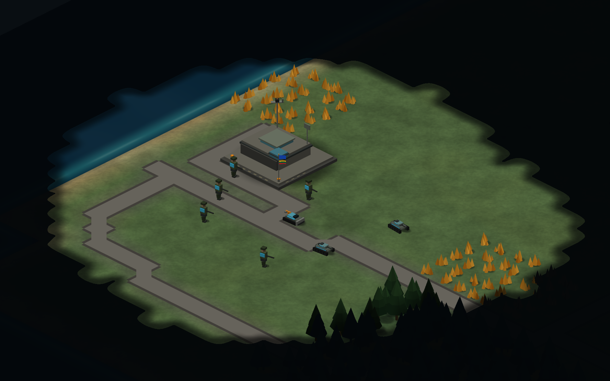

# Kestrel Bay Terrain Correction

**Scope:** correct the inverted beach classifier in `createIslandAssault()` and remeasure the resulting
terrain composition and gameplay effects. No renderer, AI, combat, economy, roster, save or balance
rule was changed.

## 1. Result

Kestrel Bay now uses the ground mix its map builder was written for:

| Type | Before | After | After, share of land |
| --- | ---: | ---: | ---: |
| Open ground (grass/scrub) | 0 | **2 103** | 62.8% |
| Beach | 2 728 | **264** | 7.9% |
| Forest | 114 | **475** | 14.2% |
| Ridge | 247 | **247** | 7.4% |
| Road | 219 | **219** | 6.5% |
| Rubble / urban | 39 | **39** | 1.2% |
| Land total | 3 347 | **3 347** | 100% |

The ore layout is unchanged: **127 ore tiles, 38 940 materials**, the same as before the fix. No other
built-in theatre is touched.

## 2. Root cause

The old pass was:

```ts
if ((tile.t === Terrain.Grass || tile.t === Terrain.Rock) && landNeighbour(x, z)) {
  tile.t = Terrain.Sand;
}
```

`landNeighbour()` answers “does this tile touch any non-water tile?”. It is the correct predicate for
the preceding shallow-water margin, where it is called on water tiles. Called on a land tile, it is
true for almost the entire island, so the whole interior was reassigned to sand. Only an isolated
one-tile islet could have no land neighbour and remain grass. The ridge, forests, roads and village
were painted afterwards, which is why 114 southern forest tiles and the 247 ridge tiles survived;
the northern forest loop only paints existing grass, so it produced nothing.

This was a map-data defect, not a renderer limitation. It is why Phase 3's material pass could only
make the island read as varied dry coastal ground.

## 3. Fix

`createIslandAssault()` now uses a separate predicate for the beach pass:

```ts
const waterNeighbour = (x, z) =>
  any neighbour is Terrain.DeepWater or Terrain.ShallowWater;

if ((tile.t === Terrain.Grass || tile.t === Terrain.Rock) && waterNeighbour(x, z)) {
  tile.t = Terrain.Sand;
}
```

`landNeighbour()` remains in place for the shallow-water margin. The beach pass still runs before the
ridge, forest, roads and village, so those authored features overwrite the beach exactly as before.
The change is deterministic, uses no new state, and does not alter any save field.

## 4. Terrain-derived gameplay effects

Measured on the corrected map against a temporary copy generated with the old classifier. Land is
3 347 tiles in both cases.

| Measure | Before | After | Change |
| --- | ---: | ---: | ---: |
| Buildable land | 2 986 (89.2%) | **2 625 (78.4%)** | −361 tiles |
| Mean ground cover | 0.0746 | **0.1384** | +85.5% |
| Mean concealment | 0.0484 | **0.1460** | +201.7% |
| Land that blocks line of sight | 10.8% | **21.6%** | +10.8 pp |
| Ore tiles / materials | 127 / 38 940 | **127 / 38 940** | unchanged |

The extra cover and blocking terrain comes from the restored northern forest belt and the interior
grass, not from a statistics change. Forest and ridge remain non-buildable, which is why the
buildable share falls even though the absolute area remains large.

### Movement

A* route costs in `moveCost` units, same starts and destinations, before → after:

| Route | Foot | Tracked | Wheeled |
| --- | ---: | ---: | ---: |
| West start → east start | 58.9 → 56.9 | 61.3 → 55.8 | 69.2 → 57.4 |
| West start → central relay | 29.7 → 28.4 | 31.9 → 28.7 | 34.6 → 30.8 |
| West start → supply depot | 28.4 → 27.5 | 30.4 → 27.5 | 32.3 → 29.2 |
| West start → northern flank | 58.1 → 55.7 | 60.1 → 54.7 | 77.1 → 56.8 |
| West start → southern shore | 43.5 → 42.7 | 45.1 → 42.1 | 46.9 → 42.3 |
| West start → eastern relay | 48.5 → 52.3 | 48.9 → 46.9 | 48.5 → 44.8 |

- Tracked routes are 4.1–10.0% cheaper; wheeled routes 7.6–26.3% cheaper.
- Foot routes are 1.8–4.4% cheaper on five routes. The eastern-relay approach is 7.8% more expensive
  because it now crosses the restored forest edge instead of open sand.
- Every tested destination remains reachable for every ground movement class.
- The ridge is still impassable except at the authored pass and the northern flank. The focused test
  asserts that the ridge tile at (53,30) is unreachable to tracked movement.

### Matched AI sample

Five seeds, 600 seconds, both seats on Veteran, identical starting forces and AI personalities. This
is a terrain-effect sample, not a balance experiment: the island is asymmetric and neither arm
changes the rules.

| Seed | Materials gathered, west old → new | Materials gathered, east old → new | Units built, west old → new | Units built, east old → new |
| --- | ---: | ---: | ---: | ---: |
| 773311 | 14 117 → 13 271 | 8 140 → 8 479 | 33 → 17 | 43 → 42 |
| 101 | 13 862 → 4 124 | 8 386 → 10 334 | 30 → 16 | 39 → 45 |
| 4009 | 4 447 → 11 689 | 8 692 → 9 116 | 22 → 50 | 22 → 27 |
| 2055 | 13 933 → 14 170 | 8 145 → 7 595 | 49 → 42 | 33 → 23 |
| 5963 | 12 757 → 11 770 | 8 941 → 9 422 | 31 → 27 | 36 → 39 |

All ten matches reached the 10-minute limit with victory still `playing`; none produced a decisive
HQ result. The spread is large in both directions and is not evidence of a win-rate improvement or
regression. It does show that the corrected terrain changes real unit routing, cover and economy
timing, rather than only the frame's colours.

## 5. Presentation and probe baseline

`tools/visual-probe.js`, Kestrel Bay, Baltic vs Expeditionary, fog on, tick 0, 1777 × 1111 CSS and
buffer, DPR 1:

| Measure | Phase 3 | After correction |
| --- | ---: | ---: |
| Entities | 23 | **23** |
| Draw calls | 30 | **30** |
| Triangles | 37 044 | **75 588** |
| CPU render submission | 0.3–0.9 ms | **0.61 ms** |
| Tree instances | 187 | **771** |
| Rock / ore instances | 99 / 127 | **99 / 127** |
| Visible / charted / hidden view tiles | — | **475 / 0 / 1 640** |

The extra **38 544 triangles** are exactly 584 additional instanced trees at 66 triangles each. They
are submitted by the existing single instanced tree draw, so the draw-call count is unchanged. The
terrain mesh, fog texture, picking and entity submission were not modified.



The opening frame now shows a grass/scrub interior, a narrow beach ring, dark forest clusters and the
existing roads and ore piles. Water, flags, unit markers and the fog boundary were not changed.

## 6. Tests and the one timing adjustment

Added `tests/kestrel-terrain.test.ts` (6 tests):

1. exact intended tile census, with beach smaller than open ground;
2. buildable area and ore layout unchanged from the measured baseline;
3. every beach tile touches deep or shallow water;
4. the northern forest belt contains more than 100 forest tiles;
5. scenario validation, launchability, opposing-start connection, and the ridge wall/pass invariant;
6. deterministic scenario generation.

The full suite exposed one timing-sensitive existing test: `builds a coastal shipyard and maintains a
corvette` allowed 180 seconds for the first hull after the yard completed. With the corrected ground
mix the AI spends that bank on other priorities first; the first corvette arrives at tick 6 003
(about 210 seconds after the yard completed), and the yard itself is operational and can produce it.
The wait was extended to 420 seconds. The production assertions are unchanged; no AI or production
rule was altered.

## 7. Validation

| Check | Result |
| --- | --- |
| Typecheck | clean |
| Focused terrain/map/scenario/presentation suite | **78 / 78** |
| Full suite | **47 files, 513 tests passed** |
| Production build | clean; 464.42 kB JS / 137.31 kB gzip |
| Difficulty contracts | Recruit–Veteran −50 005 (4–12), Elite–Recruit 86 251 (15–1), Elite–Veteran 36 531 (11–5) |
| Determinism / saves / rosters | full suite passes; save schema unchanged |
| Visual probe | 30 draw calls, 75 588 triangles, 0.61 ms CPU submission |

The difficulty numbers are identical to Phase 3. No simulation, AI, combat, economy, roster, save or
renderer file changed.

## 8. Remaining risks

- **Map asymmetry:** Kestrel Bay is an authored island, not a mirrored arena. The five-seed AI sample
  cannot separate side bias from the terrain change.
- **Buildable area:** 361 fewer buildable tiles (−10.8% of land). The AI still places every tested
  structure, including a 5 × 5 shipyard, and the remaining 2 625 buildable tiles are ample, but a
  broader construction-stress run would be needed to rule out local crowding.
- **Cover balance:** forest now covers 14.2% of land and blocks sight. This is intended map data, but
  its effect on infantry/armour exchanges was not isolated in a controlled combat fixture.
- **Beach width:** the beach is now one tile wide around most of the coast. It is visually coherent
  and leaves shipyard access, but it is a sharper land/water transition than the old sand plain.
- **Single probe environment:** one Chromium/ANGLE configuration. The probe measures CPU submission,
  not GPU time, and does not establish mobile performance.
- **No screenshot of the old map at the same camera** was regenerated after the temporary comparison
  copy was removed; the before numbers come from the temporary generator and the Phase 3 captures.

## 9. Files changed

- `src/data/scenarios.ts` — `waterNeighbour()` beach classification; `landNeighbour()` retained for the
  shallow margin.
- `tests/kestrel-terrain.test.ts` — six composition, buildability, shoreline, connectivity and determinism tests.
- `tests/ai.test.ts` — shipyard/corvette wait extended from 180 s to 420 s, with the reason recorded.
- `docs/visual-audit/p4-kestrel-terrain-fix.png` — corrected opening frame.
- `docs/visual-audit/p4-kestrel-terrain-nofog.png` — corrected ground close-up with fog disabled.
- `docs/VISUAL_AUDIT_PHASE_1.md` — historical Phase 3 limitation annotated with a link to this report.
- This report.
