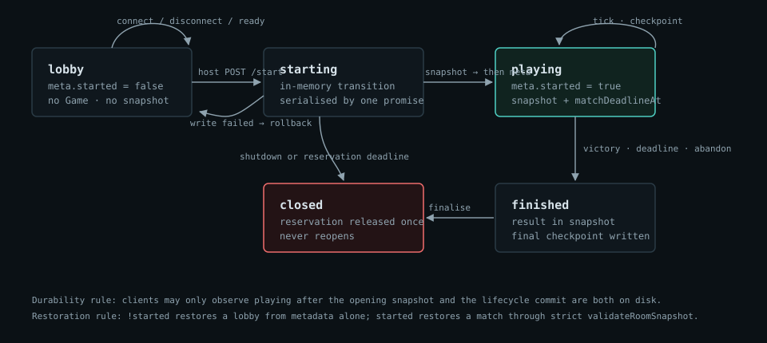
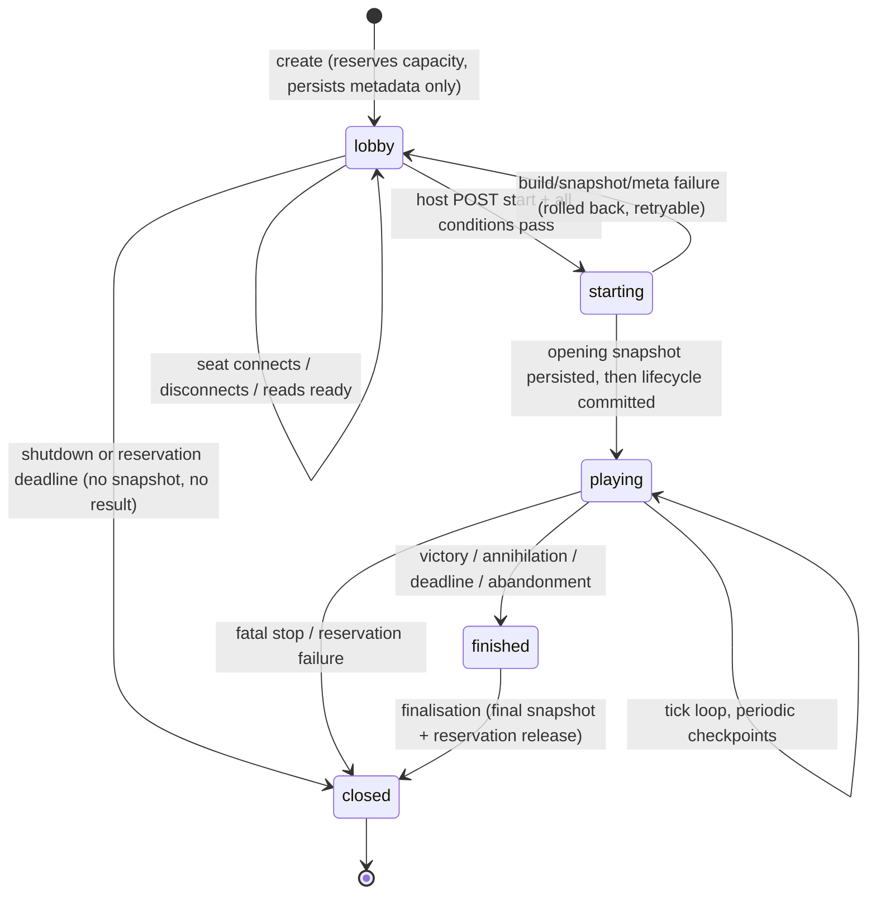

# MCA — Multiplayer Phase 2B.1: Persistent Lobby Lifecycle and Explicit Match Start

**Status:** implementation complete, locally verified, **CONDITIONAL** (one unproven transport boundary — see §11)
**Scope:** room lifecycle, persistence, restoration and authoritative transitions only. No lobby UI, no room discovery, no nation/colour controls, no deployment.

---

## 1. Baseline

| Item | Value |
| --- | --- |
| Branch | `master` |
| Test suite before edits | 100 files / **1033 tests passing** |
| Typecheck before edits | clean (`tsc --noEmit`) |
| Staging artifact under test | `990d7da4-83ce-41a1-91a0-4b7772e7d9a4`, tag `phase2a16`, health build `phase2a16-staging` |
| `MULTIPLAYER_FEATURE` | disabled |
| Working tree | heavily dirty with pre-existing uncommitted work (`src/multiplayer/**` is entirely untracked); nothing was reset, stashed, cleaned or discarded |

The Phase 2A.16 snapshot read-back diagnostic is untouched and still guarded by both the admin token and `MP_DEV_MODE`.

**Audit vs. source.** The Phase 2B audit described two blockers. Reading the source confirmed both and corrected two details:

1. `load()` treated *every* non-closed room as started: it called `loadSnapshot()` and set `fatal` when the index was missing. Creation worked around this by building a `Game` and persisting a tick-zero snapshot before any player joined — a lobby that existed only by accident. `createRoom` also constructed a `Game` and discarded it.
2. `RoomMatch.connect()` flipped `waiting → playing` and stamped `startedAtMs` when the second socket arrived. So the *first* pair of connections started the match, and the deadline came from `reservation.hardDeadlineAt` (creation time), not from a start.

---

## 2. Lifecycle





The single durable distinction is `meta.started`:

| `meta.started` | durable world | restored as |
| --- | --- | --- |
| `false` | none (no snapshot may exist) | `RoomLobby` — no `Game`, no snapshot read |
| `true` | chunked `RoomSnapshot` + `matchDeadlineAt` | `RoomMatch` through strict `validateRoomSnapshot` |

`meta.closed` is checked first and ends restoration immediately for either half.

### Metadata schema (`mca-mp-room-meta-v1`)

```jsonc
{
  "version": 1,
  "roomId": "phase2b1-room",
  "mode": "1v1",
  "seats": [                                  // minted once, at creation
    { "seatId": 0, "playerId": 0, "team": 0, "token": "<32 hex chars>" },
    { "seatId": 1, "playerId": 1, "team": 1, "token": "<32 hex chars>" }
  ],
  "reservation": { "reservationId": "...", "status": "active|released", "hardDeadlineAt": 0 },
  "createdAt": 0,
  "matchDurationMs": 120000,                  // the duration the host chose
  "started": false,                           // the commit point for the lifecycle
  "startedAtMs": null,                        // set only by an accepted start
  "matchDeadlineAt": null,                    // startedAtMs + matchDurationMs
  "lobbyConfig": {                            // present from creation until start
    "version": 1,
    "mapId": "island-assault",
    "matchDurationMs": 120000,
    "seats": [
      { "nation": "baltic", "color": "#3f8fd2", "ready": false },
      { "nation": "expeditionary", "color": "#c8503f", "ready": false }
    ]
  },
  "finishedAtMs": null,
  "totalTicks": 0,
  "closed": false,
  "closedReason": null,
  "closedAt": null,
  "finalResult": null
}
```

`validatePersistedMeta` now rejects, among the pre-existing checks:

- `started: false` with a `startedAtMs`, a `matchDeadlineAt` or a `finishedAtMs`;
- `matchDeadlineAt` before creation, after the reservation deadline, or before its own start;
- a `lobbyConfig` that fails `validateLobbyConfig` (version, map, duration, nation, colour, duplicate colour, readiness type).

A `lobbyConfig` that is **absent** (a room created before 2B.1) is upgraded once from the room's own duration and the catalogue default map, and logged. A stored-but-**malformed** configuration is fatal (`room-state-unavailable`); it is never silently replaced.

### Lobby configuration model (`src/multiplayer/lobbyConfig.ts`)

Versioned (`LOBBY_CONFIG_VERSION = 1`) and validated only against the authoritative catalogues already in the build: `BUILTIN_SCENARIOS` / `builtinScenario()` for maps, `isKnownFactionId()` for nations, a fixed eight-colour palette for colours, and `[60s, 30min]` for durations. `buildLobbyScenario()` reads `builtinScenario(mapId).create()`, sets `fog`, `timeLimitSec = duration`, and assigns `factionId` + `color` per seat — no parallel multiplayer scenario format.

Defaults until the lobby editing API exists (documented for the next phase): map `island-assault`, nations taken from that map's own two players (`baltic`, `expeditionary`), colours `#3f8fd2` / `#c8503f`, readiness `false`, duration = the room's requested duration.

---

## 3. Blocker A — lobby restoration

`load()` now branches before touching the snapshot:

```ts
if (!meta.started) { this.restoreLobby(meta); return; }
```

- `restoreLobby()` reads **only** durable metadata: seat table and tokens, reservation identity/deadline, lobby configuration. It creates a `RoomLobby` (seats, sockets, readiness, config) and arms heartbeat/deadline timers.
- No `Game` is constructed, no snapshot chunk is read, no default match is built and thrown away.
- `createRoom` no longer builds a scenario, a `Game` or a snapshot; a created room persists exactly one key (the metadata).
- Playing rooms still restore through `loadSnapshot()` + `restoreRoomMatch`, with `matchDeadlineAt` now taken from `meta.matchDeadlineAt` (falling back to the reservation deadline only for rooms started before 2B.1).
- Missing or malformed snapshot in a playing room still fails closed with `503 room-state-unavailable`.
- Finished/closed rooms are unaffected: they never reopen and keep their final result.

Two narrow schema guards were adjusted, both with the invariant intact:

1. **Opening snapshot of an explicit start.** A start persists its tick-zero world *before* admitting a socket, so that snapshot legitimately has `everConnected: false` with `epoch 0 / seq 0`. `RoomMatch` accepts that case only at tick 0 with zero generation and zero sequence (nothing was ever sent, so nothing can collide), and still refuses an *advanced* snapshot that lost a generation. `disconnectedAt` for a brand-new room is now `null` until a real socket is admitted or a send fails, which is what the snapshot schema already required for a never-connected seat.
2. The lobby is a sibling, not a half-built match: `this.lobby` and `this.match` are mutually exclusive, and `openLobbySocket` returns before any match code runs.

---

## 4. Blocker B — explicit start

### Transport

`POST /api/multiplayer/rooms/:id/start`, `Authorization: Room <seat token>`.

The caller proves identity with **its own** seat token; the room resolves which seat that is. There is no seat id, team, player id or host flag in the request body, and the body is ignored. Seat 0 is the host because it is the seat that created and reserved the room.

| Condition | Response |
| --- | --- |
| no/invalid `Room` token | `401 unauthorized` |
| room closed | `410 room-closed` |
| caller is not seat 0 | `403 not-host` |
| a seat has never joined | `409 seat-empty` |
| a joined seat is offline | `409 seat-disconnected` |
| either seat not ready | `409 not-ready` |
| invalid stored config | `409 <lobbyConfigProblem code>` |
| match would outlive the reservation | `409 match-window-expired` |
| reservation released | `409 reservation-inactive` |
| world cannot be built | `500 match-build-failed` |
| persistence fails | `503 match-start-not-durable` (lobby intact, retryable) |
| already started | `200 { alreadyStarted: true, startedAtMs, matchDeadlineAt, tick }` |

`startConditions()` in `lobbyConfig.ts` is the single ordered list, so each rule is independently testable and the first failure is the response code.

### Transition and persistence order (`beginMatch`)

1. Validate (above).
2. Build the scenario from the validated config via `buildLobbyScenario`, then `new Game(...)`; events cleared, `eventSeq = 1`.
3. Create the `RoomMatch` with `phase: 'playing'`, `startedAtMs = startedAt`, `matchDeadlineAt = startedAt + config.matchDurationMs`.
4. `persistSnapshot()` — chunks first, then the index.
5. `persistMeta()` — the commit point (`started`, `startedAtMs`, `matchDeadlineAt`, duration, ticks).
6. Only now swap in the match, hand the **existing** sockets to it (`match.connect` per seat), drop the lobby and arm timers.

No client can observe `playing` before step 5: nothing is broadcast, the tick loop is not armed, and `handleWebSocket` and `handleStart` both wait for an in-flight `starting` promise rather than acting on a half-committed transition.

### Idempotency

- Sequential duplicates return `alreadyStarted` with the original `startedAtMs`/`matchDeadlineAt`.
- Concurrent duplicates serialise on `this.starting`; exactly one builds a game (`started: true`), the other reports `alreadyStarted` with identical timing.
- No path allocates a second reservation, releases one, resets the timer or produces a second result.

---

## 5. Failure boundaries

| Boundary | Injected failure | Observed outcome |
| --- | --- | --- |
| before start | none | lobby, `started: false`, no snapshot |
| during snapshot write | chunk `put` throws | `503 match-start-not-durable`; in-memory rollback; retry succeeds |
| snapshot written, lifecycle write fails | meta `put` throws | `503`; lobby still authoritative; tick-zero snapshot on disk is orphaned and overwritten on retry |
| eviction between snapshot and commit | meta write blocked, then new object | restored as **lobby** (`started: false`), players reconnect, start succeeds |
| eviction after commit | new object after a successful start | restored as **playing** with the original `startedAtMs` and `matchDeadlineAt` |
| invalid stored config | version 7 in metadata | `503 room-state-unavailable`, no match invented |

Each of these is a real test over the real object class and the real storage protocol (`FakeStorage` serialises every value to JSON, so no in-memory aliasing can mask a persistence bug), and "eviction" is a genuinely separate `MatchRoomDurableObject` over the same storage.

---

## 6. Match timing

- The deadline is derived **only** at start: `matchDeadlineAt = startedAt + config.matchDurationMs`, then persisted.
- Connecting (first or second player) never sets or resets it; `meta.matchDeadlineAt` is `null` until the start.
- A restored playing match uses `meta.matchDeadlineAt`; a restored lobby has none.
- The 30-minute hard maximum is unchanged (`bounds.max`, `MP_MAX_MATCH_SECONDS`).
- A lobby cannot start a match that would outlive its reservation (`match-window-expired`).

---

## 7. Reservations and capacity

- Creation reserves exactly once, via the unchanged `activateReservedRoom` path.
- Restoring a lobby, connecting, starting and duplicate starts allocate nothing.
- A failed start does **not** release the lease — the lobby keeps its reservation and can retry.
- Closing a lobby releases exactly once through the same guarded lease (no snapshot, no result written); a second shutdown returns `alreadyClosed` and does not release again.
- The two-active-room cap and daily allowance are untouched: creation sequence `200, 200, 503` verified against the real ledger.

**One deliberate change inside the existing model.** The ledger sets `hardDeadlineAt = now + matchDurationMs` at reserve time. Since a lobby occupies that window too, a room that waited any measurable time could never start a match of the requested length. Creation now asks for `min(cap, matchDuration + 5 min lobby allowance)`; the match duration the host chose is unchanged, the deadline is still `startedAt + duration`, and release still books actual elapsed time (capped by the reservation). No ledger field, cap, policy or quota changed. A maximum-length (30 min) match therefore has no lobby headroom — documented, not worked around.

---

## 8. Wire surface

Exactly two new messages, no other protocol change (`mca.v2` unchanged):

- server → seat: `{ type: 'lobby', v, roomId, seat, phase: 'lobby', hostSeat, matchDeadlineAt, config: { version, mapId, matchDurationMs, seats: [{ nation, color, ready, host, connected }] } }` — no tick, no entities, no tokens.
- client → room: `{ type: 'ready', v, ready: boolean }` — strict field allowlist; any other field is rejected as `unknown-field`.

In a lobby: `command` and `resync` are refused with `match-not-started`, `keepalive` is acknowledged, readiness is applied and broadcast plus persisted. In a match: `ready` is refused with `match-already-started`. No browser can obtain another seat's token: `roomInfo()` (which returns both) is only reachable behind the admin token.

The match→client handoff is the existing match `hello` (`phase: 'playing'`) plus a baseline `sync` on the socket the seat already holds; no new message and no reconnect storm at the busiest moment.

---

## 9. Verification

| Check | Result |
| --- | --- |
| Typecheck (`tsc --noEmit`) | **clean** |
| Full suite (`vitest run`) | **101 files / 1070 tests passing, 0 failed** (baseline 100/1033) |
| New suite | `tests/phase2b1-lobby-lifecycle.test.ts`, **37 tests** |
| Production build (`npm run build`) | **passed** (84 modules, `index-*.js` 688.86 kB / 206.08 kB gzip) |
| Worker build (`vite build --config mp-room-vite.config.ts`) | **passed** (`dist-mp-room/roomWorker.js`, 563.94 kB / 140.87 kB gzip) |
| Production bundle isolation | no `X-MCA-Room-Action`, `snapshotReadback`, `inspectStoredSnapshot`, `MP_ADMIN_TOKEN` or `phase2a*` strings in `dist/` |
| Phase 2A.16 read-back diagnostic | unchanged, still admin-token + `MP_DEV_MODE` guarded, tests green |
| `MULTIPLAYER_FEATURE` / production | untouched, no deployment performed |

Existing regression coverage re-run unchanged (assertions kept, not loosened): playing-room restore, snapshot reference validation, epoch continuity, reconnect/resync, completion, abandonment, deadline, reservation release, capacity accounting, security, CommandGate, and the 2A.16 read-back suite. Six in-process fixtures needed one explicit line — `promoteOnConnect: true` — because they construct a `RoomMatch` already past its lobby and relied on the socket that used to start it; that option defaults to `false` and is never set by the Durable Object. Two fixtures that must be mid-match now declare `phase: 'playing'`.

### Local workerd attempt

I built the worker and started it with `wrangler dev` to exercise the real 101 upgrade. The worker served `/api/multiplayer/health` and reached the room object on `create` (which correctly answered `503 reservation-not-configured` until `MCA_RESERVATION_TOKEN` was supplied), then the local dev server entered a reload loop on build output and stopped answering. That environment was abandoned rather than iterated on, and the local `.wrangler` cache it created is gitignored. The probe tool is kept for a future staging run: `node tools/phase2b1-lobby-probe.mjs --base <origin> --admin <token>`.

---

## 10. Files

**New**

- `src/multiplayer/lobbyConfig.ts` — versioned lobby configuration, catalogue validation, scenario construction, start conditions.
- `src/multiplayer/roomLobby.ts` — pre-match authority: seats, sockets, readiness, lobby state message, message allowlist.
- `tests/phase2b1-lobby-lifecycle.test.ts` — 37 tests over the real object and storage protocol.
- `tools/phase2b1-lobby-probe.mjs` — end-to-end lobby/start probe for a real origin.

**Modified**

- `src/multiplayer/roomDurableObject.ts` — lobby branch in `load()`, `restoreLobby`, `persistLobbyMeta`, `openLobbySocket`, `handleStart`, `beginMatch`, lobby-aware heartbeat/close/status, `start` route, lobby allowance in the reservation request.
- `src/multiplayer/roomMatch.ts` — `promoteOnConnect` (default off), exported `seatTokenMatches`, tick-zero opening-snapshot guard, `disconnectedAt` for a brand-new room, `ready` refused in a match.
- `src/multiplayer/protocol.ts` — `ready` client message, `lobby` server message.
- `src/multiplayer/roomWorker.ts` — `start` route, health build tag `phase2b1-staging`.
- `tests/phase2a-room-match.test.ts`, `tests/phase2a11-recovery.test.ts`, `tests/phase2a2-diagnostics.test.ts`, `tests/phase2a3-keepalive.test.ts`, `tests/phase2a4-room-sync.test.ts`, `tests/phase2a13-integrity.test.ts`, `tests/phase2a16-snapshot-readback.test.ts` — one-line fixture updates described above.

---

## 11. Limitations and verdict

1. **Unproven: the 101 upgrade success path.** `openLobbySocket`'s authorized branch cannot be executed under vitest (`WebSocketPair` and a `101` response are workerd-only). The suite proves every rejection before it (426 / 403 / 400 / 401 / 409 / 410, and that the caller reaches the transport constructor), and the lobby object it hands the socket to is fully covered, but the upgrade itself has not run. This is the one acceptance guarantee not demonstrated.
2. Local `wrangler dev` could not be stabilised (reload loop), so no workerd evidence exists for this phase; no staging deployment was made, as instructed.
3. A 30-minute match has no lobby headroom under the unchanged cap (see §7).
4. Rooms created before 2B.1 are upgraded to a default lobby configuration once, at restore.
5. Lobby configuration editing (map/nation/colour) and the browser lobby are out of scope; only readiness is wired.

**Verdict: CONDITIONAL.** Every lifecycle guarantee in the acceptance list is implemented and demonstrated against the real object and its storage protocol — lobby restoration without a `Game`, no start on connect, host-only start, validation, snapshot-before-commit, four-way failure-boundary recovery, idempotent and concurrent starts, timer survival, exactly-once release, capacity intact, production untouched. The gap is narrow and named: the WebSocket upgrade that admits a lobby seat has not been executed on a real runtime.

To close it: deploy the `phase2b1` staging artifact (§11 allows staging only), run `tools/phase2b1-lobby-probe.mjs` against it, and record the 101 + lobby-hello + start + match-hello transcript as the missing evidence.
