# Visual Development, Phase 1 — Renderer and Visual Audit

**Scope:** read-only audit of the shipping renderer and the running game. No production
code, simulation, balance, save-schema or gameplay change was made. Everything below is
either read from the tree or measured/inspected in a live Chromium session; where a number
is derived rather than measured it is labelled **derived**.

**Verdict in one paragraph.** The custom WebGL2 renderer is the right engine for the target
and does **not** need replacing. It is small, dependency-free, deterministic-safe (all
randomness is render-side) and already holds 60 fps with only 0.2–0.5 ms of CPU submission
per frame at the game's entity counts. The gap to "grounded, stylised 3D military realism"
is almost entirely **art and content authored as code**, plus four capability gaps (a
material/texture pipeline, real shadows, a post/AA stage, and effects that read as combat).
The highest-return next step is one representative slice — ground material, one infantry
family, one vehicle, and a credible firefight — not a renderer rewrite and not a full art
pass.

---

## 1. Method and environment

| Item | Value |
| --- | --- |
| Date | 2026-10-26 |
| Browser | Chromium preview, 1440 × 810 CSS px, DPR 1 |
| GPU / API | ANGLE (AMD "AMD Custom GPU 0405"), D3D11; WebGL 2.0 (OpenGL ES 3.0 Chromium); `MAX_TEXTURE_SIZE` 16384 |
| Build | Vite 8.3.5 dev server; TypeScript 5.7; Vitest 5.0.5; no runtime dependencies |
| Bundle (production) | 459.92 kB JS (135.75 kB gzip), 90.07 kB CSS (17.87 kB gzip) |
| Scenario | Kestrel Bay, Lithuania vs Russia, Veteran, default 19 200 ore |
| Screenshots | [`docs/visual-audit/`](visual-audit/) — 8 captures, listed in §6 |

Reproduction:

```bash
npm run dev            # http://127.0.0.1:5173
npm run bench          # simulation-cost numbers (§5.2)
```

The running game was inspected through the dev server with the in-page `window.ironTide`
handle (the app already exposes it in `src/main.ts`). Two inspection-only manipulations were
used and are disclosed wherever they affect a screenshot: **fog was switched off** in one
frame to see terrain that is otherwise black, and the **pause modal was hidden** (DOM style
only) to photograph the frame it covers. Combat could not be observed passively in this
session — the AI army sat idle after its first push — so a firefight was **induced** by
ordering the player's starting force onto the enemy command post; the captured frame is a
real simulation frame, not a mock-up.

---

## 2. Architecture as built

### 2.1 Ownership of time

`src/app.ts` (~1968 lines) owns the frame loop:

- Fixed-step simulation at 20 Hz (`TICK_MS`), capped at 8 catch-up steps per frame, with a
  0.25 s accumulator clamp; speed multiplier applies to the accumulator.
- Renderer update + render + 2D overlay every animation frame, regardless of pause
  (`renderer.update(dt)` keeps particles and visual smoothing alive).
- The renderer never advances the simulation and never mutates it; it reads `Game.state`
  plus a small visual-side smoothing map (`VisualEntity`) keyed by entity id.

This separation is clean and is the reason visual work can stay out of determinism.

### 2.2 Module map

| File | Lines | Responsibility |
| --- | --- | --- |
| `src/render/renderer.ts` | 1650 | Passes, entity draw loop, visual smoothing, event→effect mapping, fog/ore textures, lighting presets |
| `src/render/shaders.ts` | 364 | All GLSL: mesh, terrain, water, props, particles, shadows |
| `src/render/gl.ts` | 327 | `StaticMesh`, `FlagMesh`, `InstancedMesh`, program helpers |
| `src/render/camera.ts` | 233 | Orthographic dimetric camera (yaw 45°, pitch 30°), screen↔world, view rect |
| `src/render/geometry.ts` | 326 | `MeshBuilder` (box/cylinder/cone/sphere), palette, prop meshes |
| `src/render/terrainMesh.ts` | 426 | Terrain mesh (4 verts/tile, per-corner colour/normal), roads, shore texture, prop instances |
| `src/render/terrainSurface.ts` | 276 | Height field used by visuals **and** input picking |
| `src/render/unitMeshes.ts` | 484 | Styles for the 19-unit roster, visual scale table, shadow radii |
| `src/render/buildingMeshes.ts` | 1154 | Styles for the 22-building roster, garrison dressing, doors/rotors/flag mounts |
| `src/render/particles.ts` | 239 | CPU particle system, 11 emitters, 2800 cap |
| `src/render/particleGpu.ts` | 142 | Two instanced batches (normal/additive), 8 floats per instance |
| `src/render/shadowGpu.ts` | 134 | Instanced soft ellipse shadows |
| `src/render/flags.ts`, `thumbnails.ts`, `unitTransform.ts`, `math.ts` | — | Flag rigs/textures, unit cards, limb/turret matrices, helpers |
| `src/ui/overlay.ts` | 448 | 2D canvas: paths, selection rings, health bars, relay meters, labels, placement ghost, drag box |

### 2.3 Frame composition (in submission order)

`Renderer.render()` issues, every frame:

1. `drawTerrain()` — land mesh (one draw) **and** road mesh (one draw, fog-sampled).
2. `drawWater()` — one full-map quad with a shore mask + animated waves (one draw).
3. `drawShadows()` — one instanced draw of soft ground ellipses (entities + cached props).
4. `drawProps()` — three instanced draws: trees, rocks, ore.
5. `drawBattleEntities()` (or `drawScenarioEntities()` for menus) — one program, then
   **2–6 draws per entity** (body, turret, two legs, door, rotor, flag).
6. `drawParticles()` — two instanced draws (normal, additive).

Measured at 1440 × 810, DPR 1:

| View | Entities drawn | Draw calls/frame | Triangles/frame | CPU submit (120-frame average, `gl.finish`) |
| --- | --- | --- | --- | --- |
| Close zoom (zoom 24), 4 units + HQ | 5 | **22** | 35 606 | **0.22 ms** |
| Battle default (zoom 48), start force | ~10 | **30** | ~37 000 | **0.28 ms** |
| Whole map (zoom 110, fog off) | 20 | **38** | 39 778 | **0.53 ms** |

GPU timing was not captured (no timer-query extension in the app); the frame loop is
rAF-locked at 60 fps in every view tested, so these are submission costs, not headroom.

How the numbers were taken (devtools console, no code change — the app exposes
`window.ironTide`):

```js
const gl = ironTide.renderer.gl, c = { calls: 0, tris: 0 };
for (const k of ['drawArrays', 'drawElements', 'drawArraysInstanced', 'drawElementsInstanced']) {
  const f = gl[k].bind(gl);
  gl[k] = (...a) => {
    c.calls++;
    c.tris += (k.startsWith('drawElements') ? a[1] : a[2]) / 3 * (k.endsWith('Instanced') ? a[a.length - 1] : 1);
    return f(...a);
  };
}
// sample 120 frames with gl.finish() around renderer.render() for submit time
```

### 2.4 Scene representation

There is **no scene graph**. Each frame iterates `game.state.entities`, looks up a cached
per-`defId` mesh set, computes a model matrix from the smoothed transform and issues draws
with per-draw uniforms (`uModel`, `uTeamColor`, `uAlpha`, `uFlash`). Selection, health,
paths and placement are drawn separately on the 2D overlay. There is no batching by
`defId`, no instancing for game entities, no frustum culling and no LOD.

Consequences (measured/derived):

- Infantry cost **3 draws** (body + two leg meshes); vehicles **2** (body + turret), or 1
  plus an optional load; buildings **2–6** (body, turret, door, rotor, national flag).
- At the perf harness's representative stress of **163 entities** (140 combat units +
  ~20 structures), **derived** draw calls are **≈390–530, including the nine fixed passes**
  (terrain, roads, water, shadows, three prop batches, two particle batches). That is
  comfortable on desktop, and the first real mobile risk.
- Whole-map terrain, roads, water and all props are submitted regardless of the camera;
  at 96 × 72 this is ≈6.7 k land triangles (**derived** from the 3 347 land tiles reported
  by the bench) plus several hundred prop instances in three instanced calls and one water
  quad — not a problem at this map size.

### 2.5 Camera and projection

`camera.ts` uses a fixed orthographic dimetric projection: yaw 45°, pitch 30°, distance
1400, near 1 / far 3000, half-height zoom clamped to **[22, 110]**. `BATTLE_ZOOM = 36`;
`setBattleZoom()` widens the view on narrow aspect ratios to keep the opening base framed.
`screenRay`, `screenToGround`, `worldToScreen` and `viewRect` are the shared camera API used
by input, overlay, picking and shadows. There is no rotation, no perspective and no zoom
animation — an intentional readability choice that should be preserved.

### 2.6 Terrain

- One height per grid **corner**, averaged from the touching tiles (`terrainCornerHeight`),
  so terraces become ramps; normals from the corner gradient.
- One colour per **corner**, averaged over the four land tiles that meet there, with a
  deterministic brightness hash (±5%). This is what removed the old visible tile grid.
- Per-tile UVs exist in the terrain VAO but the shader only uses them for the fog texture.
- Fragment shader adds 2-octave value noise as grain, a sun/ambient term, and the fog mix.
  There are no terrain textures, no slope/altitude material blending and no decals.
- Roads: per-tile asphalt triangles raised 0.022 world units, diagonal bridges, a graded
  verge ribbon (0.16 tile) — all flat vertex colour, no markings, no wear, no kerbs.
- Water: a single y = 0.12 quad with a shore mask sampled from a per-tile R8 texture
  (shallow 220 / deep 15 / land 0), two animated sine waves, a fake sun glint and a foam
  band. Geometry never deforms; small water bodies are therefore exact tile rectangles.

### 2.7 Units and buildings

Both are procedural, hand-authored primitive assemblies in code. `MeshBuilder.box()`
pre-shades faces (0.7–0.94 brightness per face) *and* the shaders apply a second diffuse
term — double shading is why flat surfaces look simultaneously grey and unlit.

- **Infantry** are one man per unit (`VISUAL_SCALE` 2.35–2.4). The torso has no arms; the
  weapon is a floating cylinder/box at chest height. Legs are a separate mesh swung about
  the hip (two extra draws). Medic and ATGM differ by attachments and colour only.
- **Vehicles** are box hulls with cylinder tracks/wheels, separate turret meshes, 0.7–0.78
  visual scale. Tracks and wheels never animate; there is no suspension, recoil or dust
  under the hull except the particle emitter.
- **Proportions are hand-tuned, not derived.** Every style is authored in its own arbitrary
  units and then normalised by a per-id `VISUAL_SCALE` spanning **0.42 (corvette) to 2.4
  (rifleman)**. That table is the only place relative size is decided, so infantry-vs-tank
  and infantry-vs-building scale is an authoring choice with no physical reference — the
  root of the "toy soldier beside a tank" read. It is also collision-independent, which is
  why changing it does not disturb the simulation.
- **Buildings** range from a 3-storey windowed block (reads well at close zoom) to the
  player's command post, which is a low slab on a large empty concrete pad. Animated parts
  exist (shutter, radar rotor, dish), plus construction squash and a translucent tint pass.
  Flags are real textures and are the strongest faction read in the game.
- **Team identity** is a per-vertex mask mixed with the faction colour in the mesh shader.
  There are no decals, markings, nationality-specific silhouettes or non-colour cues.

### 2.8 Lighting, materials, shadows

- One directional sun + constant ambient, four time-of-day presets and two weather presets
  (`applyLighting`). No specular on units/buildings, no ambient occlusion, no fog/haze, no
  tone mapping, no gamma workflow, no bloom.
- Materials are **vertex colour + team mask**, with one optional texture path (national
  flag). `StaticMesh` interleaves only position/normal/colour/team, so unit and building
  meshes have **no UVs at all**.
- Shadows are soft ellipse quads lifted 0.09 above the terrain, leaning away from the sun
  by a fixed 0.55–1.5 world units. Buildings get a footprint-sized rounded rect, props get
  cached ellipses, aircraft get an offset shadow. No shadow map, no self-shadowing, no
  height-dependent shadow length.

### 2.9 Effects

`ParticleSystem` (CPU, `MAX_PARTICLES = 2800`) has 11 emitters: explosion, impact, muzzle,
smoke, dust, track dust, wake, jet trail, damage smoke, capture and sparks. Each particle
is an instanced camera-facing quad (it already carries a 0–1 UV pair) rendered with a
**procedural circle** in the fragment shader — no atlas, no flipbook, no soft depth fade,
no rotation.

Renderer event mapping (`consumeEvents`): `shot` → muzzle flash; `impact` → sparks/water
splash; `explosion`/`unitLost` → fireball + smoke + shake; `buildingLost` → large fireball;
`buildingPlaced`/`Complete`/`unitBuilt`/`aircraftReturn` → dust; `capture` → coloured ring.
Projectiles are drawn as one bright round sprite plus a short faded copy behind it; only
missiles/SAMs leave a smoke trail. Shells and bullets have **no tracer**. There are no
craters, scorch marks, debris, wreck hulks or persistent damage decals; a destroyed unit
simply disappears into a puff.

### 2.10 Fog of war

The simulation owns a per-team tri-state tile array; the renderer uploads it as an R8
texture every 3 ticks (≈6.7 Hz, `updateFog`) and samples it in terrain, road, water and prop
shaders:

- `2` → 255 (fully visible), `1` → 112 (charted, dimmed), `0` → 0 (never seen).
- Entities are **not** fog-shaded; instead `visionStateOf` decides whether to draw them at
  all (hidden = skip, remembered = alpha 0.5 with frozen moving parts).
- Roads and terrain **intend** the same falloff (`fog < 0.08` → ~12% of surface colour plus a
  dark tint at 0.22; otherwise `mix(col × 0.34, col, smoothstep(0.18, 0.92, fog))`), so
  never-seen ground lands at roughly **3% of visible luminance** — a hole rather than
  "unknown terrain".
- **However, roads never reach that shader path** (defect **V1**, §4.0): the fog sampler is
  rebound to the white texture before the road draw, so roads render at full brightness
  everywhere. The three-state rule described here is therefore only actually applied to
  terrain, water and props in the running build.
- The boundary is tile-quantised and LINEAR-filtered, uploaded on a 3-tick (≈6.7 Hz)
  cadence: at close zoom the edge shows 4-pixel-scale stair-steps and lags fast camera pans.

### 2.11 Overlay, picking, input

- `overlay.ts` draws on a second canvas at DPR ≤ 2: dashed amber path, destination cross,
  red target ring, cyan/red/neutral selection ellipses (radius from the **simulation**
  radius, not the visual mesh), health bars 24–30 px × 4 px with 1 px outline, suppression
  bar, relay meters, hover label, placement ghost, drag box and gamepad cursor.
- `pickAt` is screen-space: a circle of 26 px around a unit's projected centre (42 px for a
  building), nearest-first, gated by `isKnownTo`. It does not know the visual mesh scale;
  box selection uses the projected centre only.
- Input is unified across mouse, touch and gamepad (`src/ui/input.ts`), so picking
  tolerances are shared.

### 2.12 Assets, memory, save/determinism boundaries

- The **only** raster assets are 6 national flag PNGs (640 px wide, uploaded at startup)
  and PWA icons. There is no terrain, unit, building, effect or UI
  texture atlas, no glTF/OBJ pipeline and no audio assets in the render path.
- Meshes are generated once at startup (one `StaticMesh` per unit/building style); GPU
  memory is dominated by vertex buffers (tens of thousands of triangles total) and is
  **estimated < 15 MB**; textures are 96 × 72 R8 fog/shore plus six flag textures.
- Per-frame uploads: particles (≤ 2800 × 32 B per batch), shadows (≤ entities), ore
  instances at 5 Hz (the whole ore list is rebuilt and re-uploaded every 20 ticks).
- No renderer state is serialised. Save/replay tests (`tests/determinism-save.test.ts`)
  touch the simulation only; particle randomness (`Math.random`) is render-side and cannot
  affect `stateHash()`.

---

## 3. What the visuals say about the target

The target is *grounded, stylised 3D military realism* with preserved isometric
readability. Judged against that, the current build reads as **clean, readable 2010-era
low-poly RTS**:

- **Silhouettes:** vehicles are recognisable as "tank-ish" boxes; infantry read as toy
  soldiers without arms; buildings are inconsistent (a good 3-storey block next to a flat
  slab). Nothing carries stowage, markings, antennas, weathering or national character.
- **Ground:** one flat khaki sand tone dominates 60–80% of the screen. There is grain but
  no material story: no grass/dirt/rock transitions, no slope erosion, no wear, no debris.
  Roads read as grey painted strips with staircase diagonals.
- **Water:** a flat blue sheet; the coast is a cut-out polygon with a 1-tile cyan band;
  inland water bodies are perfect rectangles.
- **Props:** pines are stacked cones, ore is amber cones (same silhouette family as trees),
  rocks are dark blobs. At gameplay zoom, ore and vegetation are told apart only by colour.
- **Lighting:** flat. Double-baked face shading plus a weak diffuse term, no AO, no contact
  darkening under objects, no specular on metal, no atmospheric recessional.
- **Combat:** a single round flash at the muzzle, invisible shell travel, small spark
  impacts, and smoke made of unlit, unfaded circles that reads as flat grey blobs rather
  than a plume. Destruction is an explosion and a disappearance.
- **Readability:** selection and health work and are legible at default zoom; health bars
  are thin and green-on-sand; team identity is colour-only, which contradicts the GDD's
  §5.4 ("team identity cannot rely on colour alone").

The **menu backdrop** (the same island rendered behind a sepia field-monitor grid with
scanlines, a CRT vignette and occasional signal tearing) is closer to the intended tone than
the battle view — useful as a reference for the palette and contrast the slice should aim
for.

---

## 4. Findings, ranked

Impact = player-visible value; Risk = chance of breaking something (picking, fog,
determinism, perf); Cost = engineering effort for a first credible version; Perf = runtime
cost. All items are independent unless stated.

### 4.0 Confirmed defect (found during this audit)

| # | Defect | Evidence | Minimal correction |
| --- | --- | --- | --- |
| **V1** | **Roads ignore fog of war.** The intended dimming never runs, so the whole road network is drawn at full brightness through never-seen ground. | Code: `drawTerrain()` binds `fogTexture` to `TEXTURE0` and sets `uFogTex = 0` (renderer.ts:909–911), then calls `bindFlagTexture()` (914), which binds the white/flag texture to **the same unit 0** and sets `uFlagTex = 0` (867–872). The mesh shader samples both samplers from unit 0, so `fog` reads the white texture → `1.0` → no dimming. Visual: screenshot 02, bright grey roads across the black unexplored quadrant. | Give the road pass its own texture unit: bind fog to `TEXTURE1` and set `uFogTex = 1`, leaving flags on 0 (the water pass already uses this two-unit pattern). Three lines in `drawTerrain`, no shader change. |

This is a renderer/physical bug, not an AI information leak: it exposes only the static
road layout, never unit or structure positions. It is also the single largest visual
defect in the default view — it makes the fog look broken rather than dark.

### 4.1 Art / content deficiencies (fixable without new engine capability)

| # | Finding | Impact | Risk | Cost | Perf |
| --- | --- | --- | --- | --- | --- |
| A1 | **Unit silhouettes are generic**: infantry have no arms and a floating rifle; every vehicle is a box with a thin barrel; no stowage, markings or national shape cues. Relative size comes from a hand-tuned per-id table (0.42–2.4), not from physical proportions | High | Low | M | None |
| A2 | **Ground has no material story**: single-tone sand, one noise octave, no slope/terrain blending, no debris or wear | High | Low | M | Low |
| A3 | **Roads read as painted grey strips**: flat colour, staircase diagonals, no markings/kerbs/wear | Med-High | Low | M | None |
| A4 | **Coast and water are flat**: cut-out shoreline, 1-tile cyan band, rectangular lakes, no foam/depth/refraction | Med-High | Low | M | Low |
| A5 | **Props collide in meaning**: ore cones vs pine cones vs rock blobs; prop shadows are flat ellipses placed at the prop origin height, so they float on slopes; ore shrinks without a "mined" language | Med | Low | S | None |
| A6 | **Buildings inconsistent**: command post is a slab on an empty pad; sandbags read as pebbles; detail quality varies sharply across the set | Med-High | Low | M | None |
| A7 | **Lighting is flat**: baked + dynamic double shading, no AO/contact term, no metal response | High | Low | M | Low |
| A8 | **Combat feedback is thin**: round flash, no tracers, flat unlit smoke, no debris, no muzzle smoke persistence | High | Low | M | Med (fill) |
| A9 | **Destruction is disappearance**: no wrecks, craters, scorch decals, rubble or burning state | High | Low | M | Low |
| A10 | **Team identity is colour-only** (GDD §5.4): no markings, pennants, shapes or hatching | Med | Low | S | None |
| A11 | **Overlay is minimal**: thin green-on-sand bars, selection rings sized from collision radius, no stance/facing/range cues | Med | Low | S | None |
| A12 | **No atmosphere**: time-of-day changes light colour only; no haze, no weather visuals, no god-rays/vignette in battle | Med | Low | M-L | Low |

### 4.2 Renderer / technical limitations (capability gaps)

| # | Limitation | Why it matters | Workaround today | Cost to close |
| --- | --- | --- | --- | --- |
| R1 | **No material/UV pipeline.** `StaticMesh` has no UVs; one shader path with vertex colour + team mask + optional flag texture | Blocks all texture-based realism (albedo detail, normals, decals, wear) | Hand-authored vertex colour only | M (extend buffers + shader; keep vertex colour as tint) |
| R2 | **No real shadows.** Instanced ellipses with fixed lean; buildings cast a footprint rect regardless of height; no self-shadowing | Objects float; tall structures look pasted on; the mast casts nothing | Blob shadows | S for cards/height-scaled ellipses, L for a shadow map |
| R3 | **No post/AA stage.** MSAA only (context `antialias: true`); no bloom, tonemap or FXAA; DPR capped at 2 | Aliasing on thin barrels/poles; effects cannot bloom; no filmic grade | — | M (one resolve pass for bloom/tonemap; optional) |
| R4 | **Effects are primitive.** Procedural circle sprites, no atlas/flipbook, no soft depth fade, no rotation | Smoke reads as a hard white blob; fire is a cluster of dots | Larger counts | S-M within the existing pipeline (add UV rect + soft fade) |
| R5 | **No batching for entities.** 2–3 draws per unit, 2–6 per building, per-draw uniforms | ≈390–530 calls at 163 entities; mobile risk, limits future visual variety (more parts = more calls) | — | M (instanced-by-def with per-instance colour/anim params) |
| R6 | **Fog mask is per-tile, aliasable and low-frequency** (plus defect V1 on roads). Tri-state, 6.7 Hz, LINEAR; never-seen ground ≈3% luminance; edges stair-step at close zoom and lag pans | Explored space reads as a hole; the boundary draws attention to the mask rather than the map | V1's 3-line unit fix first | M (soft/SDF mask, lifted unexplored floor, higher upload cadence) |
| R7 | **Transparent entity pass writes depth.** Blending enabled with default `depthMask(true)` | Latent sorting artifacts for remembered silhouettes and construction ghosts | — | S (`depthMask(false)` + explicit sort) |
| R8 | **No culling or LOD.** Whole map terrain/props drawn every frame; every visible entity submitted | Fine at 96 × 72; limits larger maps and dense zooms | — | S (view-rect prop layers), M for entity LOD |
| R9 | **Animation is procedural only.** No skeleton/vertex animation, no animation events, no attachment transforms beyond turret/hardpoints | Infantry gait and shutters are the ceiling; no recoil, reload, death or build animations | — | M (keyframed part transforms) |
| R10 | **No colour management.** Colours hand-tuned in linear-ish space; no gamma/tonemap decision | Textures/PBR will look wrong until a workflow is chosen | — | S (decide + document) |

Every one of these is **incremental work inside the existing renderer**. None requires
WebGPU, a scene graph, a third-party engine or a new dependency. The renderer uses only
core WebGL2 features (instancing, VAOs, R8/RGBA textures, `UNSIGNED_INT` indices, MSAA) and
**no extensions**; support is broad (Chrome/Edge/Firefox, Safari 15+, iOS 15+).

---

## 5. Performance picture

### 5.1 Rendering (measured, this machine)

- 22–38 draw calls, 35–40 k triangles and **0.22–0.53 ms** CPU submission per frame in
  every view tested — including the whole map at maximum zoom with fog off.
- 60 fps everywhere (rAF-limited), including during a live firefight.
- Particle system: 2 draw calls, ≤ 2800 particles, ~90 kB of instance data per batch.
- Per-frame allocations exist in `drawShadows` (rebuilt array) and `refreshOre` (full ore
  list rebuild + upload every 20 ticks), but neither is measurable at this scale.

### 5.2 Simulation (from `npm run bench`, unchanged by this audit)

| Case | Result |
| --- | --- |
| Baseline (24 entities) | 600 ticks in 217.2 ms — **0.362 ms/tick** |
| Stress (163 entities, attack orders) | 300 ticks in 1 728.4 ms — **5.761 ms/tick** |
| Pathfinding | 100 orders in 74.2 ms |
| Save / load (133 entities) | 5.1 ms / 12.3 ms, 311 KiB |
| Map | 96 × 72, 3 347 land tiles (48%) |

At 20 Hz the stress case costs ≈115 ms of CPU per simulated second. **Simulation, not
rendering, is the current budget owner** — which is exactly the order the GDD asks for
(fidelity reduced on the visual side first), and it means visual work has room to grow as
long as fill rate and draw calls are watched on mobile.

### 5.3 Mobile constraints

- DPR is capped at 2; MSAA is on and cannot be disabled from settings; canvas is a single
  full-screen WebGL2 target plus a 2D overlay (two full-screen composites per frame).
- Overdraw is the risk, not vertex count: additive particles, the water quad, the terrain
  and the seven CSS `backdrop-filter` rules in `src/style.css` (the pause modal blurs the
  whole battlefield behind it — expensive on mobile GPUs).
- `RenderSettings` exposes four flags (`effects`, `shake`, `showFog`, `grid`), the last
  being placement-mode guidance only. There is no quality preset, resolution scale, particle
  budget or FPS cap to degrade gracefully as §13.9 of the GDD requires.
- Draw calls at 163 entities (≈390–530) are comfortable on desktop; whether they fit a
  mid-range phone is **unverified** (no mobile hardware was exercised), and they leave
  little room for the extra parts that better art will want. R5 becomes relevant exactly
  when A1/A6 are addressed.
- The GDD asks for "potentially hundreds of meaningful entities", so the render budget
  should be verified at **200–250** entities before the slice ships, not only at the
  bench's 163.

---

## 6. Visual inspection — evidence

All captures: 1440 × 810, DPR 1, Kestrel Bay, Lithuania vs Russia, Veteran. Click any image
to open it at full size; each is a real frame from the running build.

**Default battle view** — the first thing a player sees. A bright revealed patch surrounded
by near-black unexplored ground; the base pad dominates; a rifleman is about 20 px tall.
Health bars and team bands are the only saturated colour besides ore. The road network on
the right is fully visible through unexplored ground — that is defect **V1**, not intended
fog behaviour.

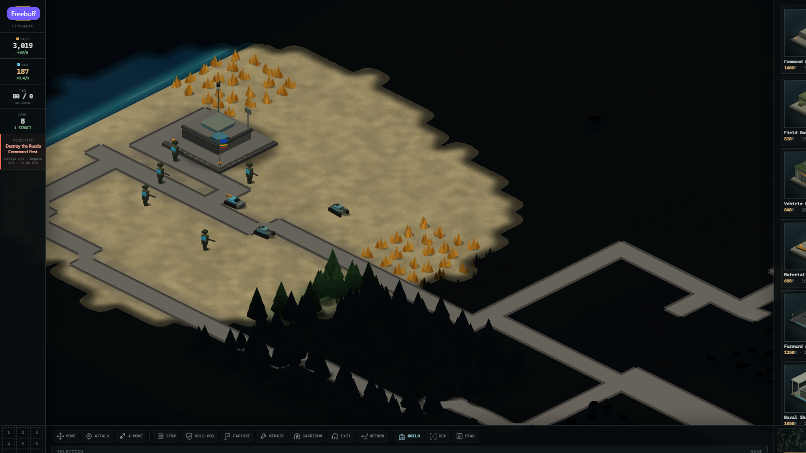

**Close zoom, own base** — blocky infantry with a floating rifle, box vehicles with a cyan
tint, flat concrete pads, and roads with hard edges. Shadows are soft ellipses; the terrain
has no surface detail at this scale.

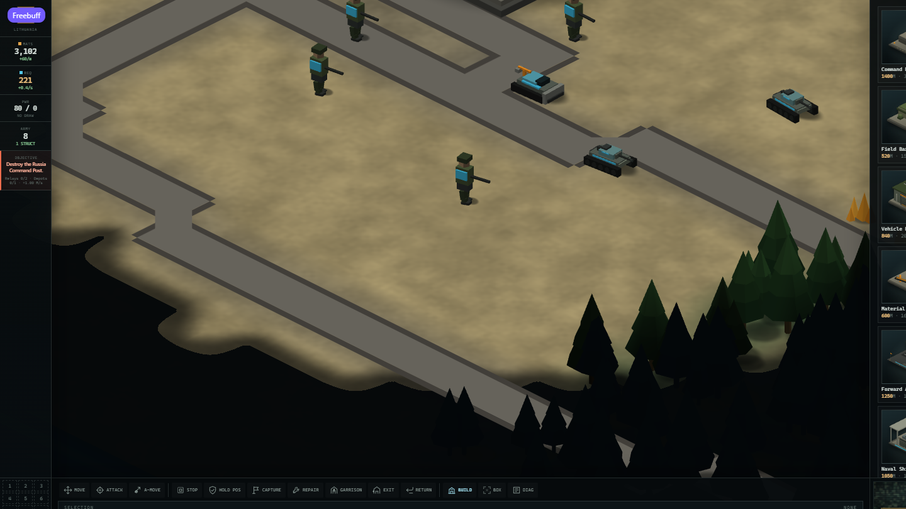

**Command post** — a low slab with a glass cube, a mast with a flat dish, sandbags that read
as pebbles, and a small but effective national flag. The building has almost no vertical
mass next to its 4 × 4 pad.

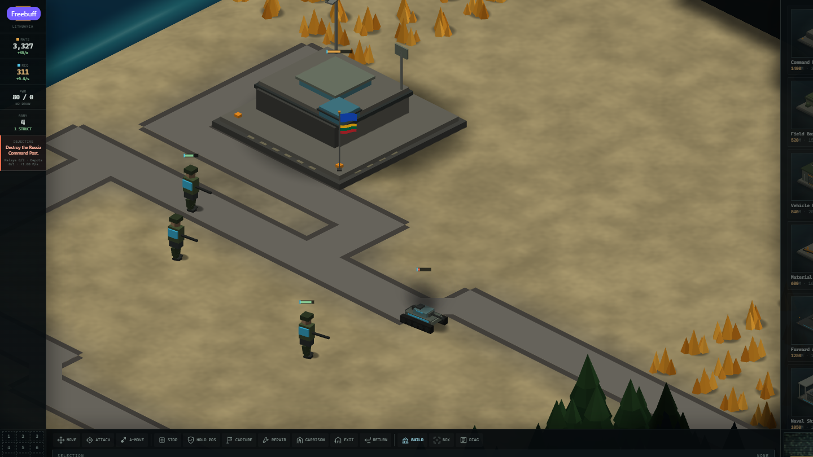

**Coast and terrain with fog disabled** (inspection only) — the island edge is a hard cut-out
with a one-tile cyan band; the inland water body is a perfect rectangle; pines and ore cones
share a silhouette family; rocks read as dark stumps; roads are flat grey ribbons.

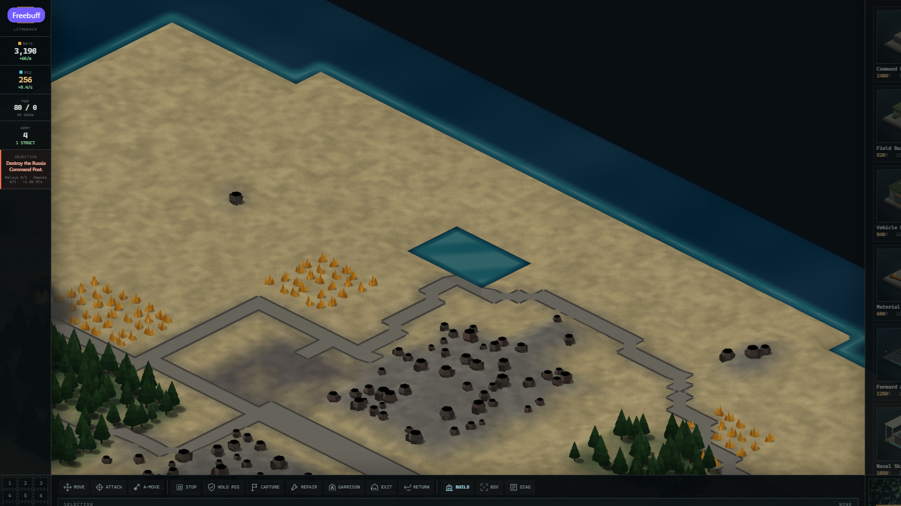

**Enemy compound** — the set's strongest building (three storeys, windows, a real facade) next
to low sheds; a good target for the level of detail the rest of the set should reach.

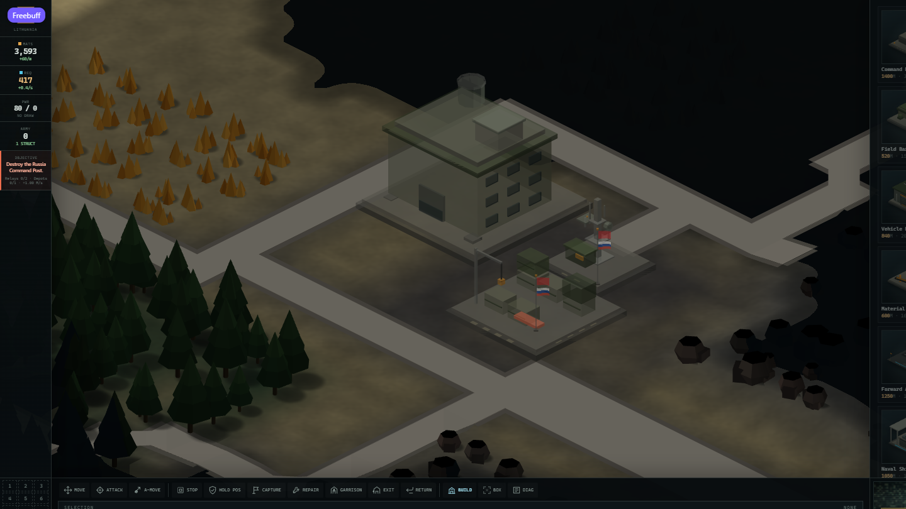

**Firefight** — a real simulation frame during the induced assault on the enemy compound.
Two riflemen and two vehicles are engaged beside a structure, and the infantry carry depleted
health bars. In this frame there is **no** tracer, impact flash, debris or damage state:
combat is legible only through the UI bars and the units' poses. Shell travel is invisible.

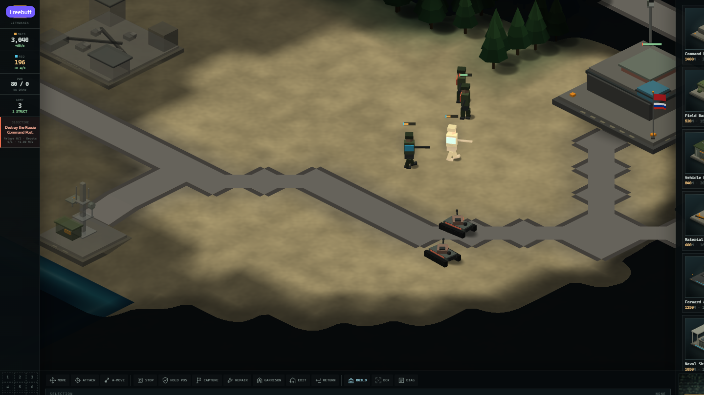

**Island overview** — the whole battlefield at wide zoom: readable composition at a glance,
but the ground is a single khaki tone, water is a flat sheet, and the fog boundary is a
stair-stepped edge.

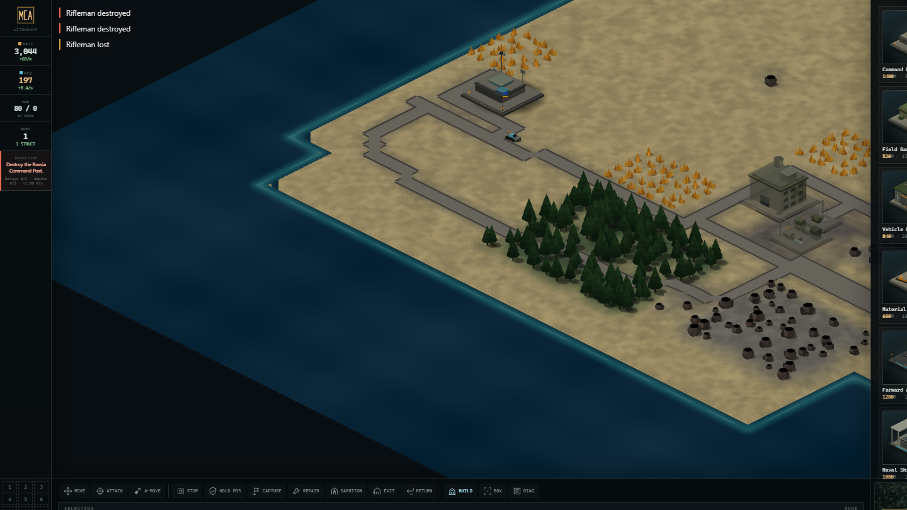

**Menu** — included for palette/contrast reference: the island behind a sepia field-monitor
grid, scanlines and a CRT vignette. It reads more "grounded military" than the battle view
does.

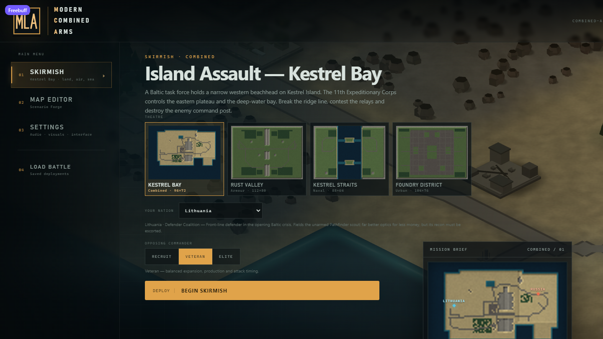

Additional captures retained in `tmp/` (not linked): defeat screen, paused frame, movement
and no-combat variants.

---

## 7. Can the existing renderer reach the target?

**Yes, incrementally, with one structural investment.** The engine already does the hard,
boring parts well: deterministic-safe separation from the simulation, an orthographic
camera API shared by input/overlay/picking, instanced props and particles, a working
fog-of-war texturing contract, and a code-first mesh pipeline that is trivial to extend.

What it cannot do *today*, and what the target needs:

1. **Surface detail** — blocked by R1 (no UVs/textures). Without this, "grounded realism"
   is limited to more polygons and more vertex colours, which is exactly what the current
   art already does and why it reads as flat.
2. **Grounding** — blocked by R2 (no height-aware shadows/AO). Contact darkening and
   directional shadow length are the cheapest large perceived-realism wins.
3. **Combat legibility** — blocked by R4/A8 (effects). The simulation already emits shot
   positions with real muzzle heights and per-weapon events, so the data needed for
   tracers, impacts, recoil and destruction states already exists.
4. **Mobile headroom for that detail** — blocked by R5 (batching) and the missing quality
   presets. Both are engineering, not art.

Nothing on this list argues for replacing the renderer, and nothing argues for a new asset
pipeline **yet**. A procedural slice can prove the target without committing to glTF, an
editor pipeline or third-party tools.

---

## 8. Recommended next phase — the "First Contact" slice

One representative slice, on Kestrel Bay, that proves the target and the pipeline:

**In scope**

1. **Ground + fog material pass** (A2, A3, R1 partial, R6 partial): a two-material blend
   driven by terrain type and slope (sand / dry grass / rock), a second noise octave for
   macro variation, road surface detail (verge, wear, centre line), and a lifted, softened
   fog floor with the *same* rule in terrain, road, water and props.
2. **Silhouette pass** (A1, A6, A10): one infantry family (rifleman + ATGM variant) and one
   vehicle (tank) rebuilt with arms holding the weapon, a helmet/webbing read, stowage,
   tracks with animated tread, and a non-colour team cue (shape/panel marking) — plus a
   command-post facade pass so the base does not read as a slab.
3. **Combat feedback** (A8, A9, R4): muzzle flash with a short-lived light card + smoke,
   visible tracer/shell streak, impact sparks with a 1.5 s smoke wisp, and destruction that
   leaves a wreck or scorch decal plus a 2–4 s smoke column.
4. **Shadow and contact pass** (A7, R2 partial): height-scaled directional ellipses (or a
   1024/2048 shadow map if the slice shows it is needed), ambient-occlusion darkening under
   buildings and vehicles, and a specular term on metal.
5. **Draw-call budget** (R5): instanced-by-def unit submission (hull and turret as two
   instanced draws per `defId`, per-instance model/colour/flash), so the extra parts in
   items 2–4 fit the frame budget. This is the slice's only structural renderer change.
6. **Readability pass** (A11, A10): overlay health bars with outline/contrast, selection
   radius derived from the visual footprint, and a non-colour team marker.

**Explicitly out of scope for the slice:** post-processing/bloom, weather, glTF/asset
pipeline, entity LOD, renderer replacement, simulation/balance/save changes.

### 8.1 Acceptance criteria (measurable)

**Visual quality**

- At default battle zoom (1440 × 810, `BATTLE_ZOOM`), a blind test of 12 screenshots
  identifies rifleman / ATGM / tank / command post correctly in **≥ 90%** of answers across
  ≥ 6 testers, using silhouettes only (team colour desaturated for the test).
- Each unit class carries **≥ 2 non-colour identifying features** (e.g. helmet + weapon
  length; turret shape + stowage), satisfying GDD §5.4.
- Ground: within a 400 × 300 px region at 1× zoom, **≥ 3 distinct surface layers** are
  visible (base tint, macro variation with ≥ 8% luminance range, micro detail at ≥ 2 px);
  no tile-edge luminance step above **2%** at DPR 1.
- Shadows: every unit, building and large prop has a contact shadow aligned to the sun
  vector (**≤ 10° error**), soft edge ≥ 3 px, with no visible gap at the contact point;
  buildings' shadow length scales with height.
- Fog: **V1 fixed** — a pixel test on an unexplored tile shows the road at the same
  luminance as its terrain (no more than ±3%); boundary step **≤ 2 CSS px** at DPR 1;
  charted ground ≥ **45%** of visible luminance; never-seen ground between **5% and 12%**
  (unknown, not a hole) while still hiding entity detail; remembered buildings stay readable
  at 0.5 alpha.
- Combat: firing produces a flash **and** a tracer/streak visible for ≥ 2 frames at 60 fps;
  impacts leave a mark or smoke for ≥ 1.5 s; an explosion has three temporal stages
  (flash ≤ 80 ms, fireball 150–400 ms, smoke 2–4 s); destruction leaves a wreck or scorch
  decal for ≥ 20 s of match time.

**Performance (measured, not estimated)**

- Desktop reference (this machine): **≥ 60 fps** with 163 entities visible; CPU render
  submission **≤ 2.5 ms/frame**; **≤ 250 draw calls** once item 5 lands (without it the
  same view costs ≈380–520 today); p95 frame ≤ 16.7 ms over a 30 s capture.
- Mobile target (mid-tier, DPR 2, effects = medium): **≥ 30 fps**, ≤ 180 draw calls, no
  frame > 50 ms after warm-up, JS heap ≤ 150 MB.
- Particles: cap unchanged (2800), still **2 draw calls**; no more than **1.4×** the
  current worst-case overdraw (measure with a 1080p frozen frame).

**Correctness**

- `npm test`, `npm run typecheck`, `npm run build` pass; the Elite–Veteran contract and all
  Phase 11–15 fixtures unchanged.
- A fixed seed + command sequence produces an identical `stateHash()` before and after the
  visual work (`tests/determinism-save.test.ts` extended with a slice scenario).
- Save bytes remain compatible: no renderer/visual field is serialised.
- A click 6 px inside a unit's visual silhouette selects it; a click 6 px outside its
  shadow ellipse does not. Box selection matches what is highlighted.
- Fog integrity fixtures still pass: no visual layer can reveal an unseen entity.

**Regression harness**

- A dev-only deterministic screenshot route (fixed scenario, seed, camera, no HUD) that
  emits reference PNGs for the slice, compared with a perceptual threshold (SSIM ≥ 0.98)
  in CI; failures attach the diff. This is the first tooling item, so every later pass has
  evidence rather than opinion.

### 8.2 Phases after the slice

Committed work ends with the slice. The two phases below are contingent on its measurements:

- **Phase 3 — material depth and atmosphere.** Only if the slice shows that vertex-colour
  detail is not enough: add a real UV/texture path (offline-baked procedural atlas or hand
  textures), ground decals, then a single post/AA pass (tonemap + light bloom) and the
  time-of-day/weather visuals the presets already imply. R1/R3/R10 get closed here.
- **Phase 4 — content breadth and scale.** Rebuild the remaining unit and building
  silhouettes to the slice's standard, add entity LOD/frustum culling only if larger maps or
  dense zoom require it, and add the mobile quality presets (resolution scale, particle
  budget, MSAA off) that §13.9 of the GDD asks for.

### 8.3 Risks and mitigations

| Risk | Why | Mitigation |
| --- | --- | --- |
| **Picking** | `pickAt` uses a fixed 26 px / 42 px screen radius around the entity centre, not the mesh | Keep the entity centre as the anchor; derive the pick radius from the visual footprint only if models grow (and cap it); add the 6 px in/out test above |
| **Selection rings** | Radius comes from the simulation radius, not the visual scale | Overlay-only change: ring radius = max(sim radius, visual shadow radius); no sim change |
| **Fog of war** | New shaders/decals must not reveal unseen ground or entities | Every new material samples `uFogTex` with the same three-state semantics; decals are gated by `visionStateOf(team, entityId)`; fog-integrity tests extended to cover decals and ground detail |
| **Determinism** | Visual work invites per-frame randomness and time-based logic into the sim | Keep all randomness in the renderer (as today); visual animation driven by `renderer.time`; never write visual state into `Game.state`; hash test guards it |
| **Saves** | New visual state (wrecks, decals) could drift into the save | Wrecks/decals are derived from the event log and the state hash; nothing added to `SaveGame` |
| **Terrain picking** | Overlay and input use `terrainVisualHeight`; displacing the visual mesh breaks click accuracy | Never displace terrain beyond the simulation height field; new detail is shading/decal only |
| **Cross-device input** | Touch uses the same screen thresholds; HUD occupies more of the view | Keep 26 px minimum touch target; test at 360 px wide portrait → rotate prompt and at 844 × 390 landscape |
| **Mobile performance** | More parts, more fill, MSAA + DPR 2 | Batching (R5) and a quality preset before the slice ships to mobile; budget checks in §8.1 |
| **Scope creep** | "Realism" pulls in post, weather, glTF, PBR | Slice is capped at the six items above; everything else is a later phase |

---

## 9. Exact files and systems to change first, and why

Ordered by leverage per line of code. Each is a renderer/UI file; **no simulation file
appears in this list**, which is the point.

0. **`src/render/renderer.ts`, `drawTerrain()` (V1)** — fix the fog texture unit on the road
   pass before anything else. It is three lines, removes the most obvious wrong thing in the
   default frame, and gives the slice an honest fog baseline to measure against.
1. **`src/render/shaders.ts`** — one place controls every surface. Add a lightweight
   material path (albedo tint × detail), a warm/cool grade, contact darkening, a metal
   response and the lifted fog floor, keeping the three-state fog semantics intact.
   Everything else in the slice renders through this file, so it lands first.
2. **`src/render/terrainMesh.ts` + `src/render/geometry.ts`** — the ground is 60–80% of the
   screen and currently carries no material story. Per-corner colour averaging and the
   height/normal field are the right substrate; add terrain-type blending, macro noise and
   road details here rather than in the shader alone.
3. **`src/render/particles.ts` + `src/render/particleGpu.ts`** — combat legibility is the
   cheapest large perceived win: an atlas/flipbook UV rect, soft depth fade, a tracer
   primitive and a debris emitter fit inside the existing two-batch design.
4. **`src/render/unitMeshes.ts`** — the infantry and tank silhouettes are single files with
   a style table; arms, helmet, stowage, animated treads and a shape-based team cue are
   local edits plus one new table column.
5. **`src/render/renderer.ts` + `src/render/gl.ts`** — pass ordering, `depthMask(false)` for
   translucent passes, height-scaled shadows, muzzle/impact anchoring (the `shot` event
   already carries the true muzzle `x/y/z` and `entityId`, so no new event fields are
   needed), decal/wreck lifetime, and the instanced-by-def submission path.
6. **`src/ui/overlay.ts`** — health-bar contrast, selection radius from the visual footprint,
   and a non-colour team marker; a small file with high readability return.
7. **`src/render/camera.ts` / `src/app.ts` (picking only)** — last, and only if the 6 px
   selection test fails after the silhouette pass.

Do **not** start with `buildingMeshes.ts` (1154 lines, a large surface with lower per-line
return than the ground and effects), with a shadow map, or with post-processing. Those are
phase-3 decisions that the slice's measurements should justify.

---

## 10. Limitations of this audit

- One machine, one GPU (a virtualised AMD adapter under ANGLE), DPR 1, Chromium only. No
  mobile hardware, Safari, Firefox or touch device was exercised; mobile numbers above are
  budgets to verify, not measurements.
- GPU-side timings were not captured (no timer queries); the render numbers are CPU
  submission, and 60 fps is rAF-limited rather than a headroom measurement.
- The AI army did not engage on its own during the session, so the firefight frame was
  induced by a player order. Fog-off and pause-modal-hidden are disclosed inspection-only
  manipulations; no production code was changed.
- Memory is estimated from mesh/texture counts, not profiled.
- Visual judgement is qualitative by nature; §8.1 defines the measurements that turn it
  into acceptance criteria, and the screenshot harness is a prerequisite for enforcing them.

**Bottom line:** keep the renderer, invest in one slice, and let the ground, the effects and
two silhouettes prove the direction before any further engine or asset-pipeline work.

---

# Phase 2 — Road-Fog Fix and Visual-Slice Foundation

Presentation-only phase. No simulation, AI, combat, economy, roster or save file was
touched. The road-fog defect V1 from §4.0 is fixed and measured; the Kestrel Bay scene now
has a deterministic capture probe and a recorded baseline for the slice criteria in §8.1.

## 2.1 The defect: two samplers resolving to one texture unit

`drawTerrain()` set up the road pass in this order (`src/render/renderer.ts`):

1. bind `fogTexture` to `TEXTURE0` and `uFogTex = 0`;
2. call `bindFlagTexture()` for the road mesh, which binds the white fallback to
   `TEXTURE0` and sets `uFlagTex = 0`;
3. draw the roads.

`MESH_FS` declares `uFogTex` and `uFlagTex` as separate samplers, but a sampler reads the
unit its uniform names — both named unit 0. The road pass therefore sampled the white
fallback as fog: `fog = 1.0`, `smoothstep` returned full brightness, and the whole road
network was painted at lit brightness across never-seen ground. Terrain, water and props
were unaffected; only the road pass shared the mesh program with the flag sampler.

**Fix (three lines of behaviour, one helper).** `src/render/gl.ts` now owns the contract:

- `MESH_FLAG_TEXTURE_UNIT = 0` — entity passes, unchanged;
- `MESH_FOG_TEXTURE_UNIT = 1` — the road pass;
- `bindTextureUnit(gl, unit, texture, sampler)` binds the texture and points the sampler
  at the same unit.

`bindFlagTexture()` and the road fog bind both go through the helper, and the road pass
binds fog on unit 1 before binding the flag on unit 0. `MESH_FS` needed no change. The
water pass already used this two-unit pattern.

**Regression guard.** `tests/presentation.test.ts` now has two extra tests: one drives
`bindTextureUnit` with a recording fake GL and asserts `activeTexture(TEXTURE1)` +
`uFogTex = 1`; the other reads the road block out of `renderer.ts` and asserts the fog bind
uses `MESH_FOG_TEXTURE_UNIT`, flags are bound after it, and no `uFogTex, 0` remains. The
existing shader tests still pin the three-state fog formula.

## 2.2 Before and after, matched

Both frames: Kestrel Bay (`island-assault`), Baltic, fog on, tick 0, speed 0, pause dialog
hidden, HUD hidden, camera `(314, 134)`, zoom 36, pitch 30°, CSS 1600×900, drawing buffer
1439×809, DPR 0.9, screenshot raster 1296×729. The before arm is the shipped code with
`MESH_FOG_TEXTURE_UNIT` temporarily set to 0 — the exact pre-fix binding order — and was
reverted immediately. Pixel values are `gl.readPixels` from the same frame, median over
road/terrain tiles in the framed view (0.2126 R + 0.7152 G + 0.0722 B, 0–255).

| Sample (fog state) | Before | After |
| --- | --- | --- |
| Road, never seen (fog 0) | **99.1** | **7.5** |
| Terrain, never seen (fog 0) | 8.4 | 8.4 |
| Road, visible (fog 2) | 99.1 | 99.1 |
| Terrain, visible (fog 2) | 127.4 | 127.4 |

- Never-seen roads fell by **91.6 luminance points** and now sit within **0.9 / 255
  (0.35% of full scale)** of the terrain beside them. The residual 10.7% relative gap is
  the asphalt's darker albedo after the shared fog floor, not a second leak: visible
  asphalt is also darker than visible sand (99.1 vs 127.4), and that ratio compresses under
  the same 0.12× fog mix.
- Visible road and terrain medians are unchanged before and after, so the fix does not
alter the explored battlefield.
- 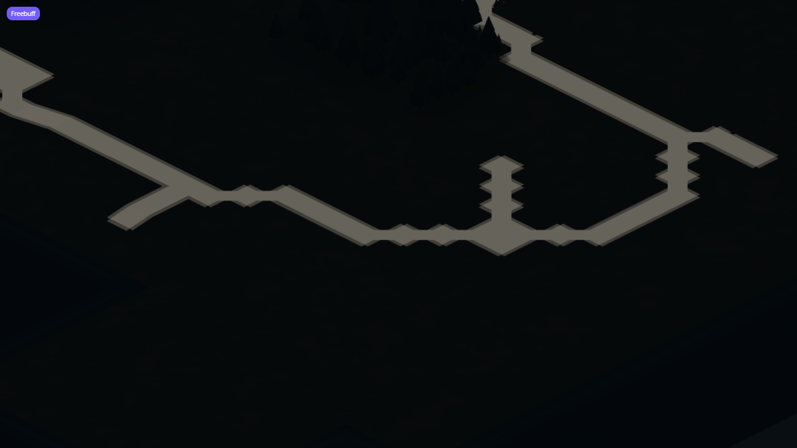
- 
- 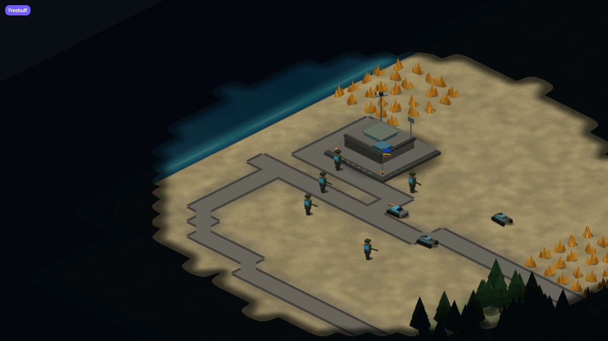

**Cost.** Zero additional draw calls and no shader branch: the same two texture binds now
land on different units. The opening frame stays at 30 draw calls and 37 044 triangles.
Warmed 8-frame CPU submission measured **0.64 ms** in the unit-0 arm and **0.88 ms** in
the shipped arm — run-to-run noise in the same range, not a cost change.

## 2.3 Kestrel Bay baseline

`tools/visual-probe.js` is the repeatable setup. With the dev server running:

```js
await (await import('/tools/visual-probe.js')).captureKestrel()
```

It starts the shipped skirmish on Kestrel Bay with the fixed Baltic setup, holds speed at
zero while the loading screen returns (so the match is at **tick 0**, not wherever the
menu was), freezes simulation speed **and** the renderer clock, hides the HUD/overlay,
frames the player base at battle zoom, measures one frame and returns the baseline object
(`window.__capture`). `frameCamera(x, z)` re-frames the frozen scene for a second shot.

**Opening frame (representative scene).**

| Measure | Value |
| --- | --- |
| Frame | 1777×1000 CSS, buffer 1599×899, DPR 0.9 |
| Camera | `(83.01, 139.25)`, zoom 36, pitch 30° |
| Entities / units | 23 / 16 |
| Draw calls | **30** |
| Triangles | **37 044** |
| CPU render submission | **0.6–0.9 ms/frame** (warmed 8-frame mean; the two arms differ only by sampler unit) |
| Fog in view | 475 visible, 0 charted, 1 875 never-seen of 2 350 tiles |
| FPS | 55–60, rAF-limited (not headroom) |

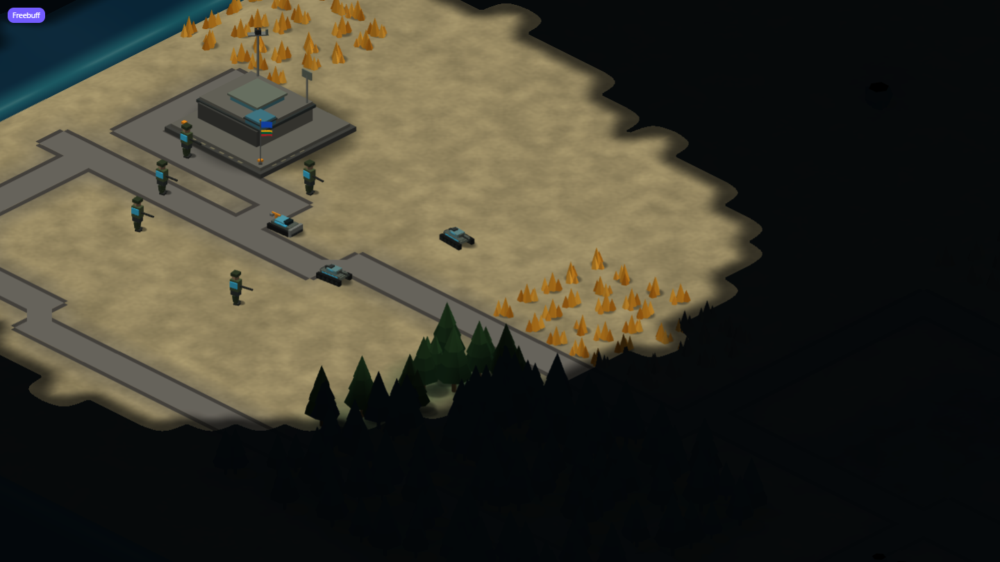

**Dense stress view (the §8.1 entity target).** A separate experiment-only scene added 140
friendly units around the base — 163 entities, 156 units, all in vision — at CSS 1600×900
(DPR 0.9): **404 draw calls**, **78 756 triangles**, **1.72 ms** per render call (8 frames,
one GPU flush at the end), 60 fps.
That is consistent with the Phase 1 estimate of 380–520 calls and confirms the slice's
≤ 250-call budget is only reachable with the instanced-by-def submission (slice item 5),
not with micro-optimisation of the existing per-entity draws.

**Fog boundary baseline (measurable, and not yet at the slice target).** The mask is
96×72 — one texel per 4-unit tile — `R8`, linear-filtered, uploaded every 3 ticks
(6.7 Hz) with values 0 / 112 / 255 for hidden / charted / visible. At battle zoom 36 one
tile projects to **43.9 CSS px** along either ground axis, so the bilinear transition band
is about one texel, **≈ 40–44 CSS px**, and the boundary follows tile edges as visible
stair steps. The §8.1 target (≤ 2 CSS px at DPR 1) is therefore **not met** by the current
mask; it requires the higher-resolution/soft mask listed in Phase 1 R6. This phase records
the number rather than changing fog resolution.

The other fog-floor criterion also misses: never-seen ground measures **8.4 / 255 = 3.3%**
of full luminance, below the §8.1 5–12% band, so it still reads as a hole rather than
unknown ground. That is the lifted-floor item in Phase 1 R6, not a binding bug; both are
left for the slice's material pass.

## 2.4 Slice acceptance checklist (§8.1, units preserved)

| Criterion (abbreviated, original units) | Validation |
| --- | --- |
| Blind silhouette test: rifleman/ATGM/tank/command post ≥ 90% across ≥ 6 testers, team colour desaturated | **Human.** Not automatable in this repository. |
| Each unit class has ≥ 2 non-colour identifying features | Design/code review; silhouette renders inspected by a human. |
| Ground: ≥ 3 surface layers in 400×300 px at 1×; macro range ≥ 8%; micro detail ≥ 2 px; no tile-edge step > 2% at DPR 1 | **Pixel analysis** on a capture (automatable once the probe is wired to a diff); not measured this phase. |
| Shadows: contact shadow per unit/building/large prop, sun error ≤ 10°, soft edge ≥ 3 px, no contact gap; building length scales with height | Visual + pixel analysis; **human** for the gap/alignment judgement. |
| Fog V1: unexplored road within ±3% of its terrain; boundary step ≤ 2 CSS px at DPR 1; charted ≥ 45% luminance; never-seen 5–12%; remembered buildings at 0.5 alpha | V1 **automated by the probe's readPixels method**: road 7.5 vs terrain 8.4, i.e. **0.9 / 255 = 0.35% of full scale**; read as a fraction of the terrain it is 10.7%, the asphalt albedo at the dark floor. Boundary **fails** at ≈ 44 px; never-seen floor **fails** at 3.3%. Charted luminance and remembered alpha not yet measured. |
| Combat: flash + tracer ≥ 2 frames at 60 fps; impacts ≥ 1.5 s; explosion flash ≤ 80 ms, fireball 150–400 ms, smoke 2–4 s; wreck/scorch ≥ 20 s | **Human/video review** today; frame-sequence capture can automate the timings later. |
| Desktop: ≥ 60 fps at 163 entities; CPU ≤ 2.5 ms; ≤ 250 draw calls after item 5; p95 ≤ 16.7 ms over 30 s | Draw calls/triangles/CPU are **automated by the probe**. 404 calls at 163 entities fails the call budget before item 5. FPS is rAF-limited; a 30 s p95 capture is still **human-run**. |
| Mobile: ≥ 30 fps, ≤ 180 calls, no frame > 50 ms, heap ≤ 150 MB (mid-tier, DPR 2, effects medium) | **Hardware.** No mobile device was tested; this is a budget, not a result. |
| Particles: cap 2800, 2 draw calls, ≤ 1.4× worst-case overdraw at 1080p | Cap and batches are code-checkable; overdraw needs a **GPU capture** (not performed). |
| `npm test`, typecheck, build; Elite–Veteran and Phase 11–15 contracts unchanged | **Automated** (see §2.6). |
| Fixed seed + commands produce identical `stateHash()`; save bytes compatible | **Automated** in `tests/determinism-save.test.ts`; the probe also returns the tick-0 hash. |
| Click 6 px inside a unit's silhouette selects it; 6 px outside its shadow ellipse does not | **Conflicts with the current picking contract** (see §2.5). Needs a human-input test today. |
| Fog-integrity fixtures still pass | **Automated** (`tests/fog-integrity.test.ts`). |
| Dev-only deterministic screenshot route + SSIM ≥ 0.98 in CI | **Partially built.** The probe is deterministic and repeatable; a CI browser runner and SSIM comparison are not installed and were not added (no browser test dependency in this repository). |

## 2.5 Conventions confirmed (and the picking caveat)

- **World scale:** `TILE_SIZE = 4` world units; the ground plane is `x/z`, `y` is up; tile
  centre is `((tx + 0.5) * 4, (tz + 0.5) * 4)`. Terrain height is sim-owned; the renderer
  never displaces the visual mesh beyond it (terrain picking uses the same height field).
- **Camera:** orthographic, yaw 45°, pitch 30°, `BATTLE_ZOOM = 36` half-height world units;
  one tile ≈ 44 CSS px per ground axis at the reference frame.
- **Mesh orientation:** unit and building meshes are authored facing local `+x`; the
  simulation's `facing` is a world-XZ angle, and the renderer applies `-facing` as the
  isometric model yaw (`unitTransform.ts`). Turrets use the same convention with their own
  angle; muzzle/flash anchors come from the shot event, not guessed.
- **Simulation vs presentation:** `Entity` owns position, facing, hp, orders and timers;
  `Renderer.visuals` owns only presentation state (smoothed facing, gait, doors, emergence)
  keyed by entity id, driven by `renderer.time`/`dt`. Nothing in the renderer writes back
  into `Game.state`; determinism tests confirm it.
- **Fog:** the mask is sim data (`state.fog`), converted to 0/112/255 and sampled by
  terrain, road, water and prop shaders; hidden entities are not submitted at all, and
  charted structures draw as dimmed silhouettes. The unit fix did not alter this path.
- **Picking caveat:** `pickAt` is a screen-space radius around the projected entity centre
  — **26 CSS px for units, 42 for buildings** — not the mesh silhouette. The §8.1 test as
  worded ("6 px outside its shadow ellipse does not select") would fail by design for a
  unit whose shadow ellipse is smaller than 26 px: a point 6 px outside the ellipse can
  still be inside the centre radius. This phase did **not** change the radius or selection
  semantics. The slice test should define the 6 px probes against the centre radius and
  record the actual result; changing to silhouette picking is a separate, riskier change.

## 2.6 Verification

| Check | Command | Result |
| --- | --- | --- |
| Typecheck | `npm run typecheck` | clean |
| Focused road/fog tests | `npx vitest run tests/presentation.test.ts` | **20 / 20** pass (2 new binding tests) |
| Full suite | `npx vitest run` | **45 files, 495 tests** pass |
| Production build | `npm run build` | clean, 460.45 kB JS / 135.94 kB gzip (+0 draw calls) |
| Determinism | suite + probe | tick-0 `stateHash` returned by the probe; `tests/determinism-save.test.ts` passes |
| Fog integrity | suite | Phase 12/13 fixtures pass; hidden entities still skipped |
| Difficulty contracts | suite | Recruit–Veteran −50 005 (4–12), Elite–Recruit 86 251 (15–1), Elite–Veteran 36 531 (11–5) |
| Visual regressions | matched screenshots | flags, water, terrain, ore, overlay and shadows unchanged; visible road luminance identical |

No simulation, save, roster, cost or gameplay file changed; save schema untouched.

## 2.7 Remaining risks and limitations

- One machine, one GPU (virtualised AMD under ANGLE), Chromium, DPR 0.9. No mobile,
  Safari, Firefox or touch hardware was exercised; mobile budgets remain untested.
- The capture probe needs a human to take the screenshot; it is not a CI job. SSIM
  comparison and a browser runner are still to be introduced with the slice's harness.
- The fog boundary is ~44 px wide at battle zoom, so the §8.1 ≤ 2 px criterion fails
  today; that is a mask-resolution change (R6), deliberately not attempted here.
- Charted-ground luminance and remembered-building alpha were not measured in this phase;
  the never-seen floor was (3.3%) and is below the 5–12% target.
- GPU timings, memory and overdraw were not captured; CPU submission only.
- The 163-entity stress numbers come from an experiment-only scenario injected into the
  page, not from a shipped save; they are a repeatable approximation, not a benchmark.
- The 6 px picking criterion needs redefinition against the centre-radius contract before
  it can be automated.

## 2.8 Files changed

- `src/render/gl.ts` — texture-unit constants and `bindTextureUnit`.
- `src/render/renderer.ts` — road fog on unit 1, flag binding through the helper.
- `tests/presentation.test.ts` — two binding-contract regression tests.
- `tools/visual-probe.js` — deterministic Kestrel Bay capture and baseline probe (dev only).
- `docs/visual-audit/p2-01…p2-04` — before/after and baseline captures.
- This section.

**Smallest justified next phase:** slice item 1–2 on the ground only — material tint /
terrain-type blending and macro variation in `shaders.ts` + `terrainMesh.ts`, using the
probe's 37 044-triangle, 30-call opening frame as the budget, with the fog floor and
visible-road luminance unchanged. Silhouettes and effects follow in separate measured
slices; the instanced submission (item 5) should land before the 163-entity view grows
past the 250-call budget.

---

## 3. Phase 3 — ground material pass

This phase implements the ground half of slice item 1. It does not touch unit or building
meshes, effects, shadows, fog resolution, picking, simulation, saves, rosters or balance.

### 3.1 Material model and data path

`TERRAIN` already gave every tile a colour, but the opening frame's only surface detail was
a two-octave brightness grain in the fragment shader. Terrain has no material texture or
UV atlas, and adding one would be a pipeline change the slice does not yet need. The
smallest reusable representation was therefore a **per-corner ground-cover mask**:

- `buildTerrainGeometry()` now emits one `vec4 aGround` per terrain vertex. The four weights
  are grass/scrub, dry earth, forest floor and stone. They are built from the simulation's
  tile types, averaged over the same four land tiles that already supply the corner colour,
  and normalised. Water contributes nothing.
- The mask is interleaved into the existing terrain VAO (stride 11 → 15 floats, attribute 4).
  There is no new texture, sampler, draw call or simulation field. For Kestrel Bay this is
  one 4-float attribute on 13 388 terrain vertices (≈214 KiB); Rust Valley’s larger land mesh
  costs proportionally more, still with one terrain submission.
- `TERRAIN_FS` applies deterministic world-space layers before the unchanged fog branch:
  1. broad cover at two low frequencies plus a mid-scale field offset;
  2. dry-earth patches driven by domain-warped noise, stronger on sand and thin grass;
  3. damp, cooler soil where the ground meets the water plane;
  4. a forest-floor leaf-litter tint where forest cover is present;
  5. fracture bands and slope exposure where stone is present;
  6. sub-tile aggregate grain (highest octave: one feature every 0.196 world units).

All material noise is a pure function of `vWorld.xz`; `uTime` is not read. There is no
render-side random state, so the same map and camera produce the same field every frame.
The fog expression at the end of the shader is byte-for-byte the Phase 2 version, and the
road pass, water pass, prop pass and entity passes are unchanged.


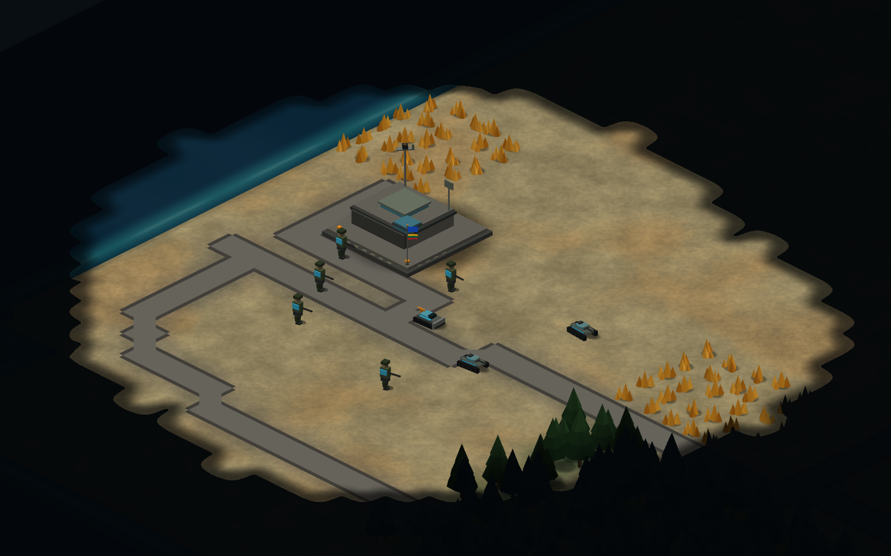

### 3.2 Matched captures

The probe was run against a temporary copy of the Phase 2 tree and the shipped tree with the
same seed, map, camera, tick, DPR and frozen clock. The comparable frame is **1777×1111 CSS,
1599×999 buffer, DPR 0.9**, camera `(81.91, 138.92)`, zoom 36, tick 0, 23 entities / 16
units. The 400×300 sample was taken at image coordinates `(880, 330)`.

| Measure | Phase 2 | Phase 3 | Change |
| --- | --- | --- | --- |
| Draw calls | 30 | **30** | 0 |
| Triangles | 37 044 | **37 044** | 0 |
| CPU render submission | 0.3–0.8 ms | 0.3–0.9 ms | run-to-run noise; shader is fragment-side |
| Visible / hidden fog tiles in view | 475 / 1 875 | 475 / 1 875 | 0 |
| `stateHash()` at tick 0 | fixed | **identical** | 0 |

- 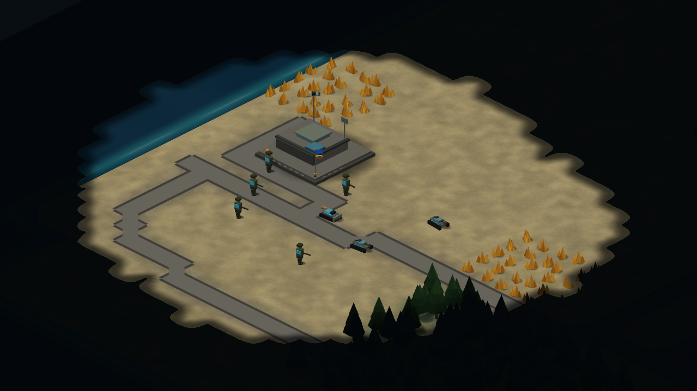
- 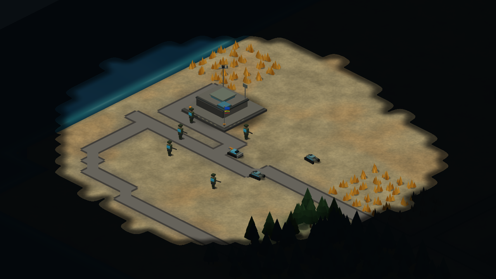
- 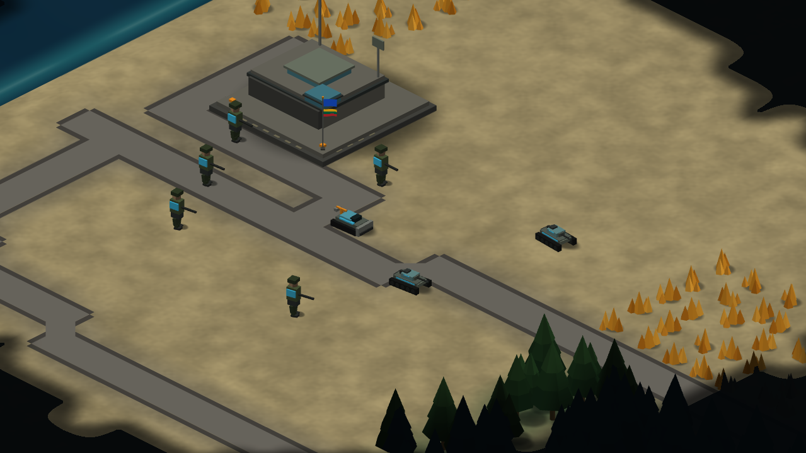
- 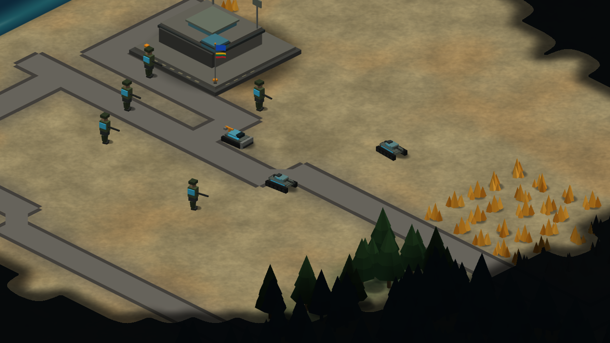
- 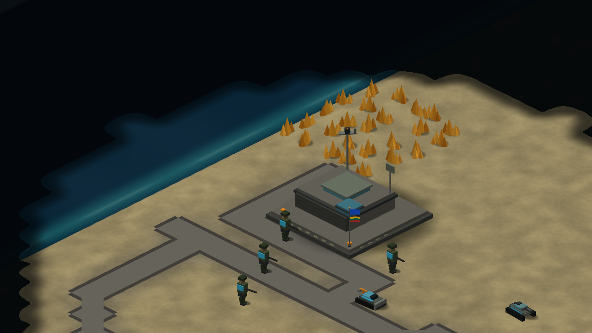
- 
- 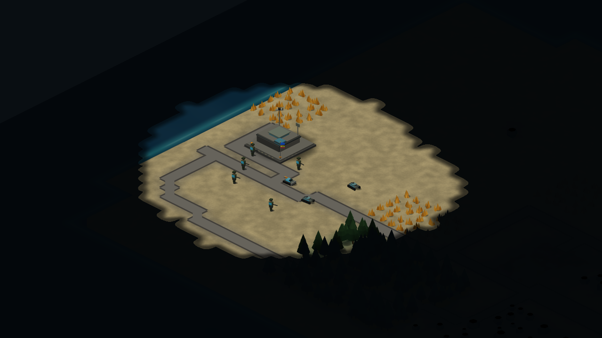
- 
- 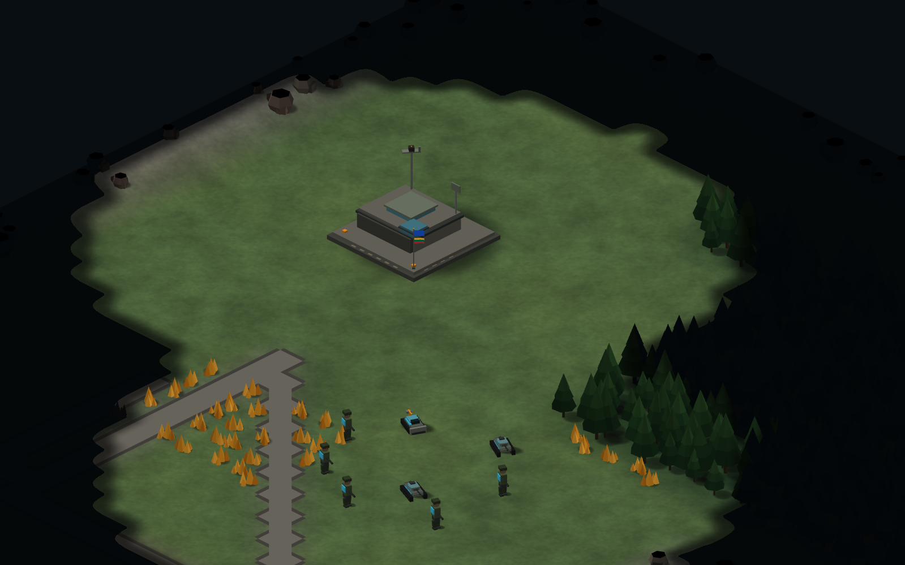

The material pass is deliberately restrained at battle zoom; the close-up and the 400×300
sample make the layers measurable, while the default view keeps unit, building, ore and team
readability. In the default view the ground now has large light/dark formations and warm
dry-earth patches instead of one uniform khaki field. Road asphalt, water, flags, ore,
shadows and all entity passes are visually unchanged.

### 3.3 §8.1 ground criteria

The sample is a fully visible dry-ground rectangle with no units, roads, structures or trees.
It is measured at default battle zoom on the 1599×999 buffer. “Macro” is a 31×31 px box blur
of the luminance field, so the sub-tile grain does not count as macro variation.

| Criterion | Phase 2 | Phase 3 | Result |
| --- | --- | --- | --- |
| ≥ 3 distinct surface layers | base tint + fine grain | base tint + broad patches + mid-scale wear + damp/exposed variants + sub-tile aggregate | **met** |
| Macro luminance range ≥ 8% | 6.66% | **8.45%** | **met** |
| Raw p5–p95 range in 400×300 | 8.23% | **9.46%** | context |
| Micro detail at ≥ 2 px | detail only at 4.8–20 px | highest octave ≈ **2.15 px** at 43.9 px/tile, DPR 1 | **met** |
| No tile-edge step > 2% at DPR 1 | — | 1 px cross-edge median 1.0 (0.4%), p95 3.86 (1.51%), max 5.14 (2.02%) on a clean 48×32 sand mesh | **p95 met; max is 0.02 over the gate; see caveat** |

The tile-edge probe uses the same renderer on a flat all-sand scenario with no entities,
props, water or fog. Shared-corner colours and the new shared-corner material mask make the
field continuous across every tile edge, so what remains is continuous texture gradient, not
a tile-aligned seam. The 2.02% maximum is one pixel pair on a steep gradient; there is no
visible grid step in either the clean render or the shipped scene. A populated-scene probe
sees larger pre-existing differences where unit and building shadows cross tile boundaries
(p95 4.79% after vs 5.18% before), so that number is **not** a clean measurement of tile-edge
material discontinuity and is not presented as one.

The close-up at zoom 22 was measured as a second, independent sample: raw p5–p95 moved
from 6.80% to 8.26%, and blurred macro from 4.71% to 6.66%. It confirms the material layers
survive a closer camera, while the default-zoom large frame is the criterion-bearing one.

### 3.4 Fog invariants

Measured from `gl.readPixels()` on the same frame, using a 5×5 median at the centre of every
road and sand tile in view (values are 0–255 luminance):

| Sample | Phase 2 | Phase 3 | Change |
| --- | --- | --- | --- |
| Road, never seen (fog 0) | 7.51 | **7.51** | 0 |
| Terrain, never seen (fog 0) | 8.43 | **8.43** | 0 |
| Road, visible (fog 2) | 99.06 | **99.06** | 0 |
| Terrain, visible (fog 2) | 128.31 | 125.66 | −2.64 (−1.0% full scale) |

- Never-seen road remains **0.93 / 255 = 0.36%** from never-seen terrain, exactly the Phase 2
  result. Material shading happens before the fog mix and contributes only through the same
  0.12× term, so hidden ground cannot reveal material or shore detail.
- Visible road luminance is unchanged; the road pass was not touched.
- The never-seen floor stays at **8.43 / 255 = 3.3%**, and the fog boundary stays at the
  Phase 2 **≈ 40–44 CSS px**. Both remain known Phase 1 shortcomings; neither is changed or
  claimed as solved here.
- The darker visible-ground median is the intended material aggregate/dry-cover weight, not
  a fog change. It is a 1.0%-of-full-scale reduction and does not affect team markers or
  selection overlays.

### 3.5 Kestrel Bay’s actual ground data

> **Post-audit correction:** the classifier defect described below was fixed after this pass. The
> island now has 2 103 open-ground, 264 beach and 475 forest tiles; see
> [KESTREL_BAY_TERRAIN_CORRECTION.md](KESTREL_BAY_TERRAIN_CORRECTION.md). The figures and
> screenshots in this section record the state at the time of Phase 3 and are retained as the
> historical baseline.

A material pass cannot create grass where the map contains none. Kestrel Bay’s shipped tile
census is:

| Type | Tiles | Share |
| --- | ---: | ---: |
| Deep water | 3 269 | 47.3% |
| Shallows | 296 | 4.3% |
| **Sand** | **2 728** | **39.5%** |
| Forest | 114 | 1.6% |
| Rock | 247 | 3.6% |
| Road | 219 | 3.2% |
| Urban | 39 | 0.6% |
| **Grass** | **0** | **0%** |

This is not a renderer choice. `createIslandAssault()` runs a beach-classification pass whose
test is inverted: `landNeighbour()` returns true when it finds a **land** tile, so almost every
grass and rock tile with a land neighbour is reassigned to `Sand`. The resulting all-sand
land mass is why the Phase 1 frame read as one khaki board. Fixing the classification would
change tile colours and also cover, movement costs and buildability, so it is a simulation/
map-data correction rather than a visual-only edit. It is deliberately **not** bundled into
this phase.

Consequences for this pass:

- Kestrel Bay can be made to read as varied dry coastal ground — exposed earth, compacted
ground, damp shore and stone texture — but it cannot show grass/scrub until the map data is
  corrected.
- The material rules are generic and already work on the other theatres. Rust Valley’s grass,
  forest and rock exercise the grass, forest-floor and stone branches, and the screenshot
  above shows the same reusable treatment rather than a Kestrel-only shader branch.

### 3.6 Validation

| Check | Command | Result |
| --- | --- | --- |
| Typecheck | `npm run typecheck` | clean |
| Focused terrain/shader tests | `npx vitest run tests/presentation.test.ts` | **25 / 25** pass (5 new) |
| Full suite | `npm test` | **46 files, 507 tests** pass |
| Production build | `npm run build` | clean; 464.22 kB JS / 137.29 kB gzip (+3.77 / +1.35 kB vs Phase 2) |
| Determinism | probe + `tests/determinism-save.test.ts` | tick-0 `stateHash()` unchanged; save tests pass |
| Fog integrity | `tests/fog-integrity.test.ts` | Phase 12/13 fixtures pass |
| Difficulty contracts | `tests/ai-matchups.test.ts` | Recruit–Veteran −50 005 (4–12), Elite–Recruit 86 251 (15–1), Elite–Veteran 36 531 (11–5) |
| Rosters / presets / saves | full suite | pass |

The new focused tests cover normalised per-vertex weights, different dominant cover for grass
and sand, identical weights at a shared four-tile corner, deterministic geometry, and the
shader contract that material shading precedes the unchanged fog branch. No simulation, save,
roster, combat or economy file changed.

### 3.7 Remaining limitations

- **Fog floor and boundary:** still 3.3% and ~44 px. Both are reserved for the separately
  measured mask phase and are not fixed here.
- **Kestrel Bay ground identity:** zero grass tiles because of the inverted beach pass. The
  pass adds depth but cannot restore the intended grass/scrub without a map-data correction.
- **GPU cost not measured:** only CPU submission was captured. The new fragment layers add
  ALU, not draw calls; no GPU timing, memory or overdraw capture was available on this
  machine.
- **163-entity stress not rerun:** entity submission is untouched, so the Phase 2 404-call
  result still applies and the ≤ 250-call target remains unresolved pending slice item 5.
- **Single environment:** one virtualised AMD GPU under ANGLE, Chromium, DPR 0.9. No mobile,
  Safari or Firefox run; the material pass is not claimed mobile-ready.
- **No UV/material atlas:** the mask is a procedural shader treatment, not textured art. A
  future material-atlas pass can replace the noise layers without changing the vertex mask.

### 3.8 Files changed

- `src/render/terrainMesh.ts` — per-corner material weights and interleaved geometry data.
- `src/render/shaders.ts` — `aGround`/`vGround`, deterministic macro/meso/micro material
  treatment before the unchanged fog branch.
- `src/render/renderer.ts` — terrain VAO stride/attribute 4 upload.
- `tests/presentation.test.ts` — five ground-material and shader-order tests.
- `docs/visual-audit/p3-01…p3-13` — matched before/after, close-up, shore, wide and Rust
  Valley captures.
- This section.

**Phase conclusion:** the ground-material pass is complete against its own material, macro,
micro, performance and fog criteria at the measured frame. The separate fog-floor, fog-boundary
and 163-entity draw-call targets remain explicitly unsolved, and Kestrel Bay’s grass-less tile
data is a documented map defect for a later simulation/data phase.

**Follow-up:** that map defect is now corrected. The classifier, the new 2 103 / 264 / 475 tile mix,
the measured cover and movement effects, and the 771-tree / 75 588-triangle probe are documented in
[KESTREL_BAY_TERRAIN_CORRECTION.md](KESTREL_BAY_TERRAIN_CORRECTION.md).

---

## 4. Phase 4 — representative unit silhouette pass

This phase implements the smallest representative slice of §8.1 item 2: the rifleman, ATGM
gunner and main battle tank. It does not touch buildings, effects, shadows, fog, terrain,
picking, simulation, AI, balance, rosters or saves.

### 4.1 Baseline model conventions

`/src/render/unitMeshes.ts` maps the scene's simulation ids to code-built meshes. The three
units in this pass are:

| Simulation id | Display name | Visual scale | Turret mount / hardpoint |
| --- | --- | ---: | --- |
| `rifle` | Rifleman | 2.4 | none; `muzzle.forward 0.3`, `height 1.0` |
| `atgm` | ATGM Gunner | 2.4 | none; `muzzle.forward 0.45`, `height 0.9` |
| `tank` | Main Battle Tank | 0.72 | turret offset `[0, 1.32, 0]`; `muzzle.forward 2.2`, `height 1.18`, `turretRate 2.4` |

These scales and hardpoints were measured before editing and are unchanged. Meshes face local
**+X**, with local +Z as the right side. The renderer draws the body with a `-facing` model
rotation, the turret with `turretModelMatrix()` at the same mount, and infantry legs with
`limbModelMatrix()` about the hip (`HIP_Y = 0.48`). Weapons are body geometry, not separate
props or render-only transforms; only the legs and the tank turret are separately submitted
moving parts.

Geometry counts before and after (vertices / triangles, body + turret):

| Unit | Before | After | Triangles added |
| --- | ---: | ---: | ---: |
| Rifleman | 206 / 98 | 988 / 484 | +386 |
| ATGM Gunner | 338 / 158 | 1 260 / 588 | +430 |
| Main Battle Tank | 916 + 236 / 492 | 2 274 + 1 132 / 1 488 | +996 |

The tank still uses two static meshes (body + turret) and each infantry type still uses one
body mesh plus the shared articulated leg mesh. No buffer, VAO or draw-submission count was
added per unit.

### 4.2 What changed

**Rifleman.** The old `soldier()` slab (one torso box, one head sphere, one attached rifle
line) was replaced by `addInfantryBase()` + explicit limb and weapon geometry:

- hips, narrow torso, belt/webbing, shoulder caps, neck and a separate head;
- helmet shell with brim, ear covers, NVG mount, goggle strip, backpack, radio antenna and a
  raised team-tinted shoulder patch;
- two oriented forearm/upper-arm beams with hands placed on the handguard and pistol grip;
- a rifle with stock, receiver, handguard, magazine, optic, muzzle device and grip;
- a detailed leg mesh with thigh, knee pad, shin and boot, keeping the boot sole exactly on
  the Y = 0 ground plane used by the existing walking animation.

**ATGM Gunner.** Same anatomy and leg rig, but the specialist role is carried by a shoulder
tube with a rear bell, sight block, two grips, a warning-orange live missile tip, an antenna
and a two-handed carrying pose. The launcher is body geometry, so it follows the unit's
heading without a separate transform.

**Main Battle Tank.** The `tank` style now uses `buildMbtBody()` and `buildMbtTurret()`:

- hull with two track runs, eight top-run segments, six road wheels, drive sprocket, idler,
  side skirts, lower and upper hull plates, a sloped glacis and rear plate, engine deck,
  headlights, tow hooks, stowage boxes and a tarpaulin roll;
- low wide turret with mantlet, bustle, commander's cupola, loader hatch, periscopes, smoke
  dischargers, stowage and an eight-sided gun tube;
- the tube tip is at local X = 3.04, which is **2.189 world units** at scale 0.72 against the
  unchanged `muzzle.forward = 2.2` hardpoint (0.011 units, 0.5 %, visually flush).

The legacy `buildTankBody()` / `buildTankTurret()` remain in place for the SPG, Spearhead,
MLRS and heavy howitzer, so the national variants and artillery silhouettes were not
silently reskinned by this pass.

### 4.3 Matched captures

Opening Kestrel Bay frame, same probe camera and tick 0 (before: terrain-corrected tree,
after: this tree). Unit close-ups use the deterministic one-unit showroom at the same
900 × 535 viewport.

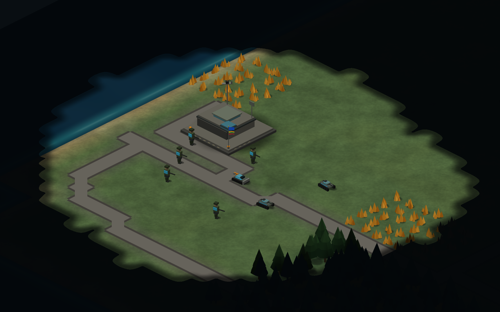


Default battle zoom (camera zoom 22), matched frames:

| Before | After |
| --- | --- |
| 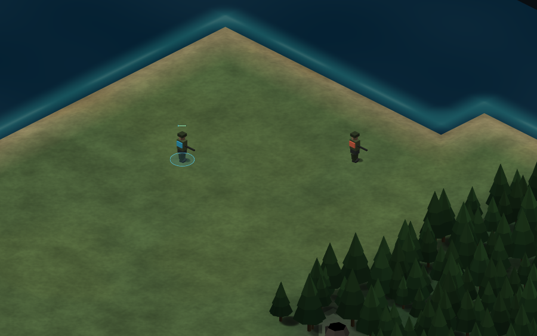 |  |
| 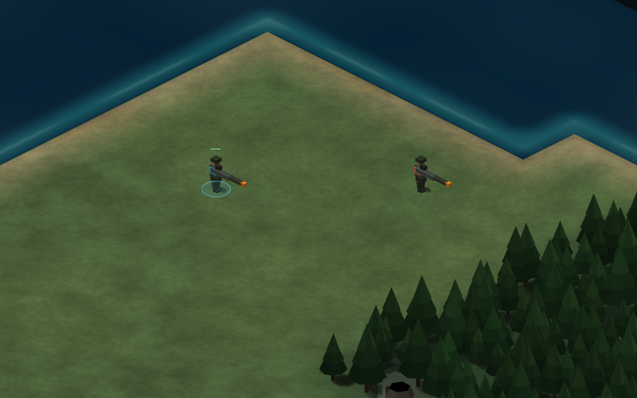 |  |
| 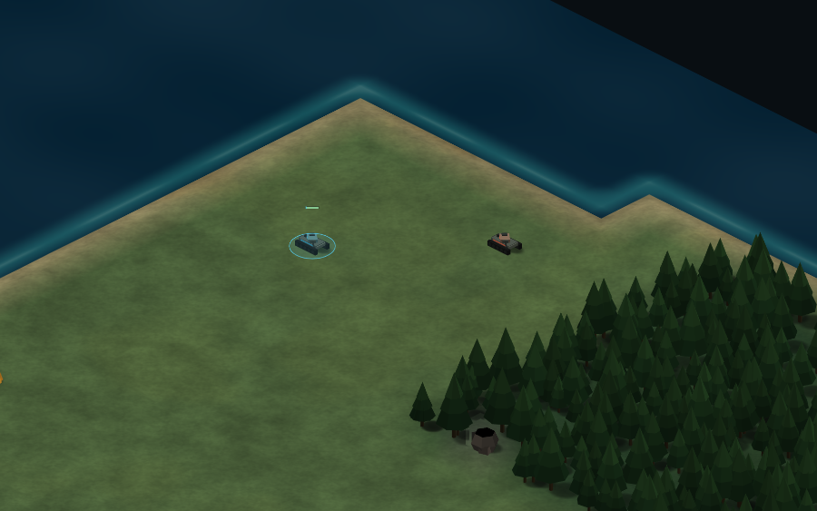 | 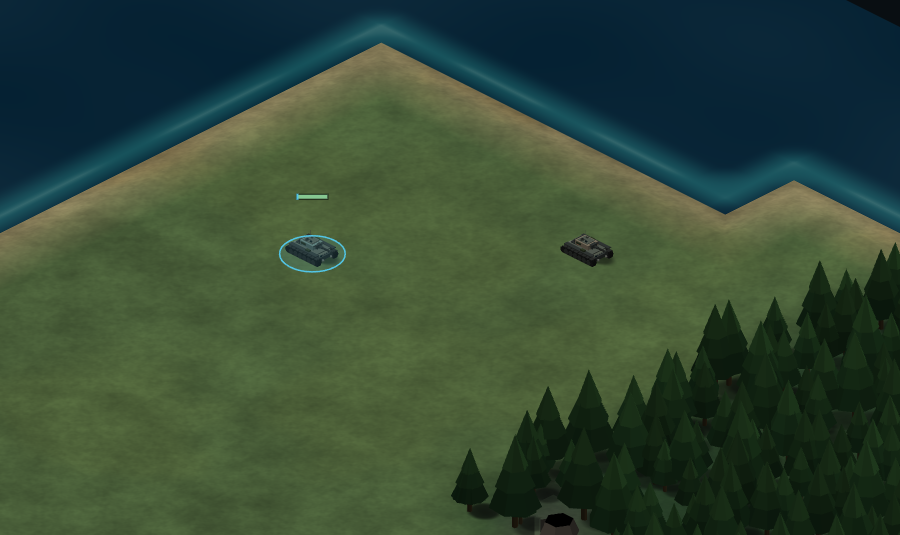 |

Close inspection at the same zoom with the overlay present:

- 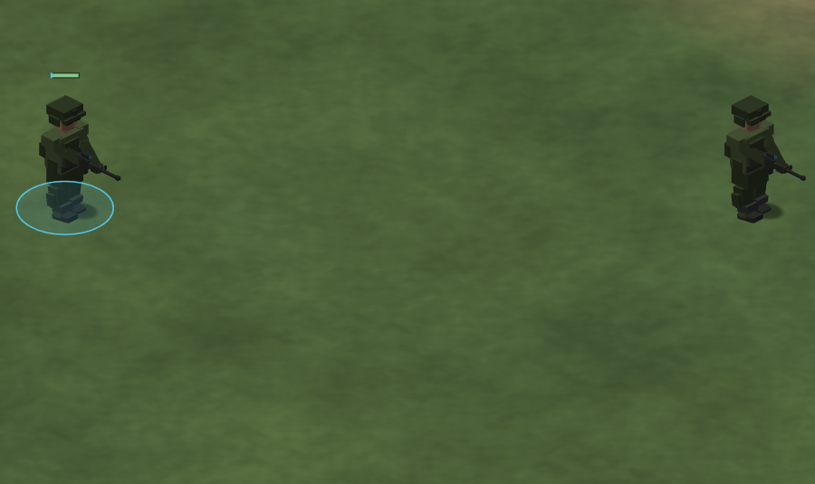
- 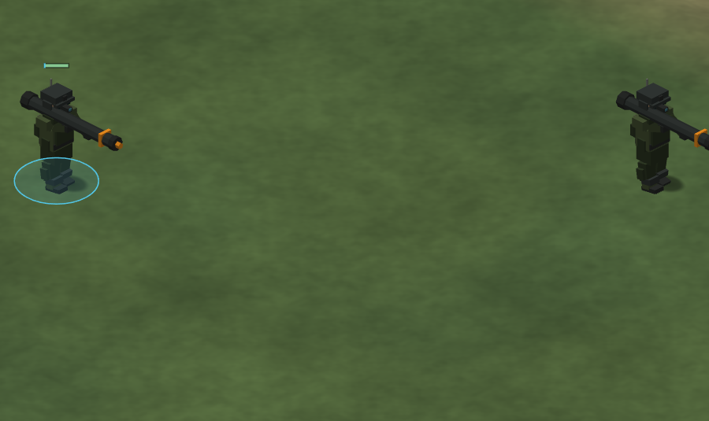
- 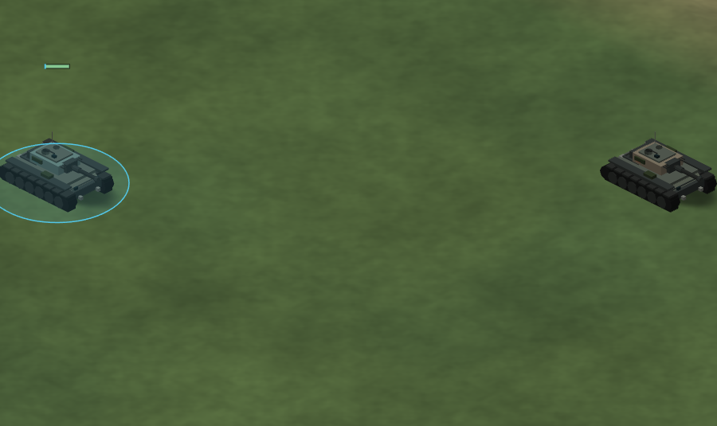
- 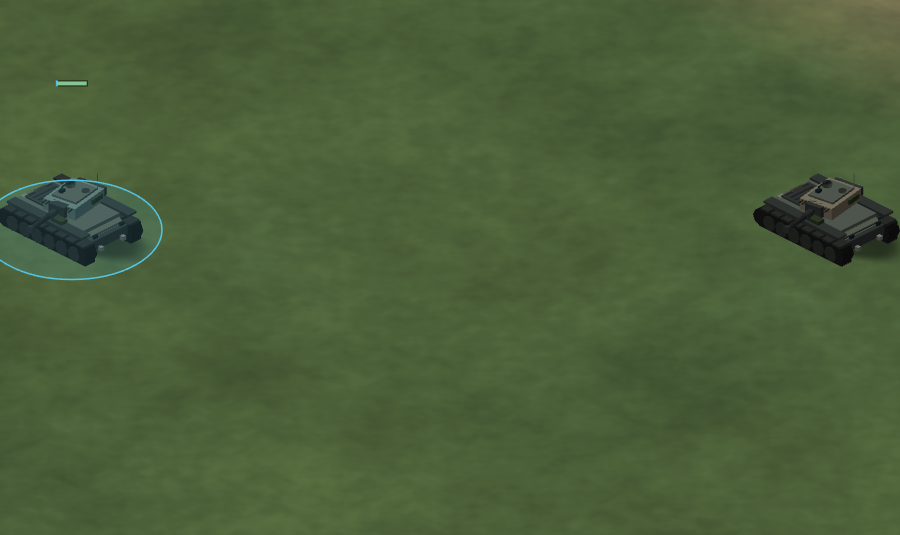
- 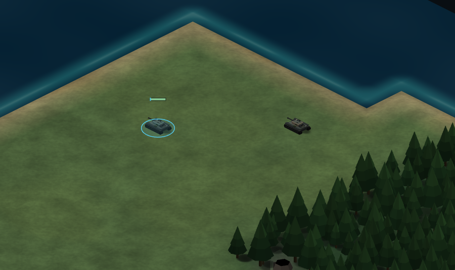
- 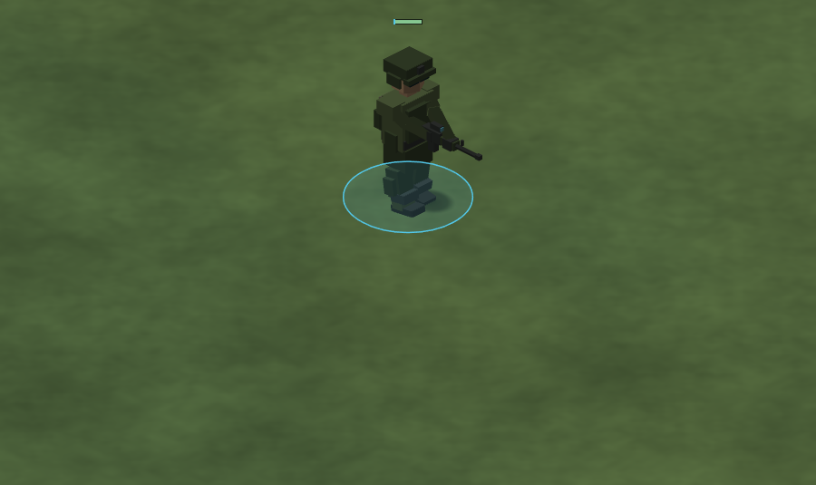
- 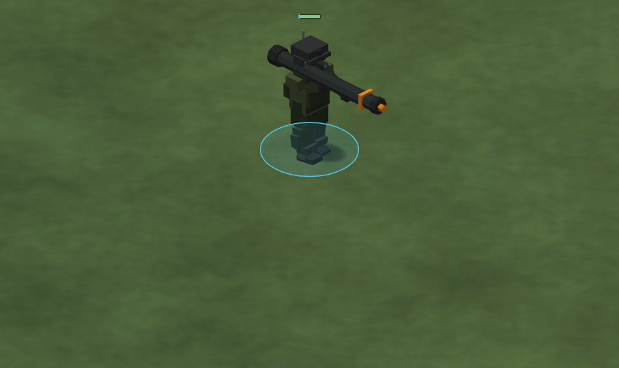
- 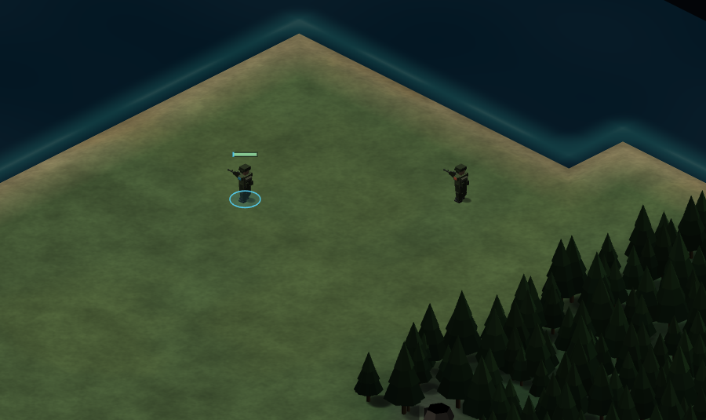
- 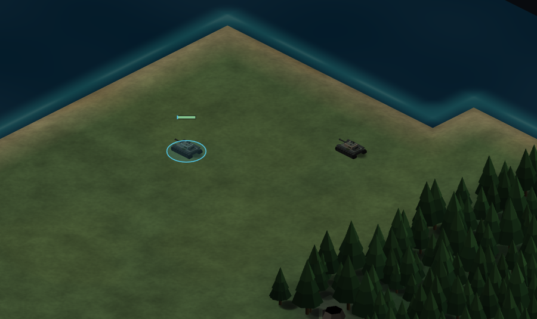

The two macro frames are zoom-6 inspections of the body only, not gameplay framing. They
show the helmet, shoulders, arms, hands, weapon, knee pads and separate boots that are too
small to resolve at battle zoom. The last two frames are dusk/night fixtures captured through
the same probe with the selection overlay; silhouettes and team markers stayed readable, but
the small TOD lighting difference is not presented as a lighting-quality result.

The tank frame at facing 0 points the gun away from the isometric camera, so the tube is
occluded by the turret; the west-facing frame and the angled-turret frame show the barrel
attached and traversing with the turret. The ATGM tube and rifle are visibly held at the
body, and both infantry silhouettes keep the selection ring and health bar readable.

### 4.4 Alignment and readability

- **Tank:** the turret yaw is independent of the hull yaw and the tube is part of the turret
  mesh. The new tip sits on the existing hardpoint, and `turretModelMatrix()` is unchanged.
  The barrel therefore follows the same `turretFacing` used by the firing path.
- **Infantry:** weapon and arms are part of the body mesh and inherit the body's `facing`.
  Hands land on the rifle grip/handguard and under the ATGM tube; no weapon is a separate
  floating mesh. The leg rig keeps the sole at Y = 0 at rest (existing test).
- **Team identity:** team tint (`uTeamColor`), the raised shoulder patch, the selection ring
  and the health bar all remain. Silhouette shape, not colour alone, now distinguishes the
  three roles: rifle + upright infantry, long shoulder tube, tracked hull with turret.
- **Six-tester silhouette criterion:** **not run**. No independent reviewer panel was
  available, so the §8.1 ≥ 90 % identification target remains **pending human validation**.
  The objective evidence is the matched frames above: at 900 × 535 and zoom 22 the three
  roles differ in outline, not only in colour.
- **Selection/picking:** no radius, hit test, command path or input code changed. Visual
  silhouette quality is separate from the existing 26 px unit-centre picking contract; the
  audit's 6 px criterion was not used to alter selection.

### 4.5 Performance and determinism

Probe: Kestrel Bay, Baltic vs Expeditionary, fog on, tick 0, **1777 × 1111 CSS/buffer, DPR 1**,
camera `(81.92, 138.91)`, zoom 36, 23 entities / 16 units.

| Measure | Pre-pass baseline | Phase 4 | Change |
| --- | ---: | ---: | ---: |
| Draw calls | 30 | **30** | 0 |
| Triangles | 75 588 | **79 990** | **+4 402 (+5.8 %)** |
| CPU render submission | 0.61 ms | **0.19–0.52 ms**, median 0.46 | within run noise; not claimed faster |
| `stateHash()` at tick 0 | no simulation change | `t=0\|r=773311\|…`, **stable over 3 runs** | 0 |
| Fog tiles in view | 475 / 0 / 1 640 | **475 / 0 / 1 640** | 0 |

The 4 402 added triangles are the visible richer unit meshes in the opening frame; hidden
enemy units are not drawn, so the scene delta is smaller than the sum of every unit's mesh
delta. Draw calls are unchanged because each unit still submits one body, two legs and (for
tanks) one turret. The CPU figures are submission timings, not GPU timings, and the baseline
was a single probe run; the ranges overlap.

The 163-entity stress scene was **not rerun**. Per-entity submission is unchanged, but the
new meshes add triangles per entity, so the Phase 2 404-call / 78 756-triangle stress result
no longer describes the triangle load and the ≤ 250-call target remains unresolved.

### 4.6 Validation

| Check | Command | Result |
| --- | --- | --- |
| Typecheck | `npm run typecheck` | clean |
| Focused render/alignment tests | `npx vitest run tests/unit-scale.test.ts tests/weapon-transform.test.ts tests/presentation.test.ts` | **58 / 58** pass (2 new) |
| Full suite | `npm test` | **47 files, 515 tests** pass |
| Production build | `npm run build` | clean; **469.73 kB JS / 139.02 kB gzip** (+5.31 / +1.71 kB vs terrain-corrected baseline) |
| Fog integrity | full suite (`tests/fog-integrity.test.ts`) | pass |
| Determinism / saves / rosters | full suite | pass; save schema unchanged |
| Difficulty contracts | `tests/ai-matchups.test.ts` | Elite–Recruit 86 251 (15–1); Elite–Veteran 36 531 (11–5); Recruit–Veteran unchanged |

The two new focused tests lock the tank tube tip to `muzzle.forward` at the visual scale and
the ATGM launcher's longer forward extent relative to the rifle. Existing tests continue to
cover the leg sole, articulated foot travel, turret mount matrices, muzzle world offsets and
the real firing path.

### 4.7 Remaining limitations

- **Human silhouette panel not run:** the ≥ 90 % six-tester criterion is pending, not passed.
- **Flat, untextured geometry:** the richer forms are vertex-coloured boxes and cylinders
  with no UVs. Small equipment reads by shape and colour blocks; at extreme close-up the
  styling is faceted by design, not textured realism.
- **Infantry fire FX origin unchanged:** `muzzle.forward` for rifle/ATGM is 0.3/0.45 world
  units, authored before this pass. The visible barrel is longer than that hardpoint, so the
  flash origin still sits near the receiver. Changing it would move projectile spawn logic
  and is a simulation change, so it was not done here.
- **Tank variants not converted:** Spearhead, SPG, MLRS and heavy howitzer still use the
  legacy family hulls. This pass deliberately proves the approach on the shared MBT first.
- **No GPU timing, memory or mobile capture:** desktop Chromium/ANGLE only, DPR 1. No mobile
  readiness is claimed.
- **Stress triangle load not remeasured:** see §4.5.

### 4.8 Files changed

- `src/render/unitMeshes.ts` — detailed infantry anatomy and weapons, detailed leg, new MBT
  hull and turret; `tank` remapped to the new style. Other styles untouched.
- `tests/unit-scale.test.ts` — two alignment/silhouette tests.
- `tools/unit-probe.js` — deterministic one-unit showroom/capture helper used for the matched
  frames; dev-only and never imported by game code.
- `docs/visual-audit/p4-01…p4-07` — matched opening, battle-zoom, close-up, turret-traverse,
  west-facing tank, macro and dusk/night captures.
- This section.

**Phase conclusion:** the three representative silhouettes are complete and readable at
normal gameplay zoom, the tank gun remains attached to the traversing turret and on its
existing hardpoint, and the pass adds no draw calls or simulation state. The six-tester
readability target is still unverified, and the unit geometry is still untextured. The next
smallest justified visual-slice task is a measured, human-reviewed readability check of these
three models at final resolution, before converting the rest of the roster or adding a UV /
material pipeline. The 163-entity draw-call target remains a separate batching task.

## 5. Phase 5 — human silhouette readability validation

### 5.1 Scope and method

Phase 4 left the six-tester ≥ 90 % identification criterion unverified. This phase prepared a
controlled, unlabeled review pack and re-checked the Phase 4 technical invariants. It did not
change model geometry, shaders, the renderer, simulation, saves, rosters or gameplay.

The pack is in [`visual-audit/p5/`](visual-audit/p5/README.md):

- `review-pack.html` — one sample at a time, six different order sets, no role labels and no
  answer feedback;
- `primary-{a,b,c}.png`, `close-{a,b,c}.png`, `orientation-{a,b,c}.png`, `ui-{a,b,c}.png` —
  the 12 controlled images;
- `ANSWER_KEY.md` — coordinator-only sample mapping and scoring rule;
- `responses-template.csv` — optional transcription sheet.

### 5.2 Corrected test conditions

The Phase 4 frames were captured at camera zoom 22 and described as “default battle zoom.” The
actual opening battle camera uses `BATTLE_ZOOM = 36`; zoom 22 is the closest zoom the gameplay
setter permits. The Phase 5 primary images therefore use the real opening zoom for a fair test.

The capture is from the shipped renderer on Kestrel Bay clear grass, day, clear weather, fog off,
effects off, one stationary owner-0 unit, no other entities. The game canvas backing buffer is
**1919 × 1079 device pixels** (CSS viewport 2133 × 1200, renderer DPR 0.9). Primary, orientation
and overlay crops are 640 × 360; close crops are 640 × 480. Every crop is taken **1:1 from the
buffer** and is not enlarged. The primary tank hull faces west with its turret traversed 0.55 rad;
the alternate tank heading traverses the turret 1.65 rad from the hull. The overlay stage restores
only the ordinary team-blue selection ring and health bar.

A silhouette-only neutral-material set was not produced. It would need a renderer material
override or destructive image manipulation, neither of which is authorised in a validation-only
phase. The real Phase 3 terrain and materials are used instead.

### 5.3 Reviewer panel result

**Reviewer count: 0.** No six independent reviewers were available in this environment. Six
synthetic or developer-supplied “answers” would not satisfy the criterion, so none were invented.

| Measure | Result |
| --- | --- |
| Primary observations (3 roles × 6 reviewers) | **0 / 18** collected |
| Primary identification score | **not computed** |
| Close-zoom secondary score | **not computed** |
| Orientation and overlay repeated samples | **not collected** |
| Misidentification patterns | **none recorded** |
| Decision | **Inconclusive** under the pre-registered rule |

The pack is ready to administer. Assign sets 1–6, use 100 % page zoom, complete Stage A before the
secondary stages, and score only first exposures. The pass boundary is 17/18 (94.4 %); 16/18
(88.9 %) fails. Repeated Stage C/D images are not independent observations.

### 5.4 Technical invariants

No production file was changed. The review tooling is `tools/readability-probe.js` (single-unit
showroom and 1:1 crop) plus `tools/readability-capture.cjs` (local PNG sink); neither is imported
by the game.

| Check | Result |
| --- | --- |
| Kestrel probe, tick 0, 23 entities | **30 draw calls**, **79 990 triangles** — unchanged from Phase 4 |
| `stateHash()` at tick 0 | `t=0\|r=773311\|v=playing\|p0:3000.00:180.00…`, **stable over 3/3 runs** |
| Fog view, this probe viewport | 475 visible / 0 charted / 1,825 hidden; viewport differs from Phase 4, so the count is not a like-for-like baseline |
| CPU render submission | 0.60 / 1.69 / 0.60 ms on a different probe viewport; run noise, not a GPU timing or a performance claim |
| Focused render, weapon, fog, determinism tests | **81 / 81 pass** (`unit-scale`, `weapon-transform`, `presentation`, `fog-integrity`, `determinism-save`) |
| Typecheck | clean |
| Phase 2 road-fog binding contract | covered by the 25 passing presentation tests |
| Phase 4 tank tube and ATGM/rifle silhouette tests | 9 passing `unit-scale` tests |

The 1919 × 1079 buffer is a real 1080p-class desktop render, not a resized 900 × 535 image. The
earlier 900 × 535 Phase 4 frames remain valid close comparisons but are not the primary evidence
for the missing panel.

### 5.5 Decision and next step

**Inconclusive — no production change.** The images are ready, but the audit cannot report that
the ≥ 90 % criterion passed, failed, or produced a consistent misidentification pattern without six
real reviewers. The Phase 4 conclusion that the silhouettes are “readable at normal gameplay
zoom” should remain treated as an unreviewed claim until this panel is run.

The next step is to administer the six sets and record the raw counts. Do not convert the rest of
the roster in this phase. If the panel fails, the smallest model-specific correction should be
chosen from the recorded role and orientation errors; if it passes, a later phase can choose the
next representative model or the next visual-slice gap.

## 6. Phase 6 — cross-unit scale and proportions

Phase 6 audited the actual scale path before editing geometry. The three target models already
used `unitVisualScale = 1`; the perceived infantry/tank similarity came mainly from the old MBT's
near-square 3.56 × 2.00 track envelope and rectangular turret slab, together with blocky
infantry forms and the deliberate 2.4 m infantry silhouette. The phase:

- narrowed the MBT track envelope to 1.825 and rebuilt its turret as a tapered 1.30 × 1.00 base
  with a 1.08 × 0.84 roof;
- replaced the rifleman's square helmet box with a rounded shell, brim, ear covers and NVG mount;
- retained the existing hardpoints, turret-aiming contract, boots-on-ground contact, picking,
  simulation and saves;
- documented a shared scale reference and classified the remaining legacy-vehicle and overlay
  issues.

Measured Kestrel tick-0 result: **30 draw calls, 80 584 triangles, 0.67 ms CPU submission** (was
30 draws / 79 990 triangles; +594 triangles, no new draws). The tick-0 `stateHash()` prefix is
unchanged. Full suite **517/517 pass**, typecheck clean, production build clean, and the
difficulty contract is unchanged (Elite–Recruit 86 251, 15–1; Elite–Veteran 36 531, 11–5). The
six-reviewer ≥ 90 % panel remains **pending**. The full audit, reference table,
captures and follow-ups are in
[`VISUAL_PHASE_6_SCALE_AND_PROPORTIONS.md`](VISUAL_PHASE_6_SCALE_AND_PROPORTIONS.md).
