# Visual Building Audit — Phase 1

**Scope:** read-only audit of every implemented building and structure in the current
working tree. No production source, mesh, shader, gameplay data, UI, save or test was
edited. The only new code is dev-only capture tooling under `tools/`.

**Verdict in one paragraph.** All 22 implemented structures have a real mesh and no shipped
building falls back to the generic box. The strongest silhouettes — factory, turbine plant,
radar array, SAM battery, tenement, warehouse, office block, civic hall and foundry — already
work at normal battle zoom and survive the Phase 3 terrain palette. The weak points are
concentrated rather than roster-wide: the **Command Post and Field Barracks are too flat and
anonymous for their importance**, the **Hungarian Reinforced Bunker is byte-for-byte the
shared MG Nest**, **half of the player-buildable base has no team-coloured surface at all**,
and **flag poles and health bars are anchored from footprint size rather than the mesh**, so
both sit inside or beside tall buildings. The first implementation batch should be the five
core base families — Command Post, Field Barracks, Material Refinery, Turbine Plant, and the
Heavy MG Nest / Reinforced Bunker family — plus the shared ownership and anchor contracts.
Airfield/Shipyard and the urban block should follow as separate batches.

---

## 1. Method and environment

| Item | Value |
| --- | --- |
| Date | 2026-10-27 |
| Source of truth | current working tree (already contains uncommitted work from earlier phases) |
| Browser | Chromium preview; drawing buffer **1599 × 899**, page CSS **1777 × 1000**, DPR **0.9** |
| GPU / API | ANGLE (AMD "AMD Custom GPU 0405"), D3D11; WebGL 2.0; `MAX_TEXTURE_SIZE` 16384; 32 texture units |
| Camera | fixed dimetric camera, yaw 45°, pitch **30°**; battle zoom **36**, close inspection **18–26** |
| Build | Vite 8.3.5 dev server; TypeScript 5.7; Vitest 5.0.5; no runtime dependencies |
| Scenario | Kestrel Bay showroom for single buildings; Foundry District for authored urban context |
| Determinism | simulation and visual clock frozen at tick 0; `renderer.time = 0` |
| Human review | **none**; every readability statement below is developer inspection |

### 1.1 Capture method

The existing unit probes only place units. The audit therefore added
[`tools/building-audit.js`](../tools/building-audit.js), a dev-only module that:

- places an authored structure on the shipped Kestrel Bay terrain, or adds it to an authored
  Foundry District battle;
- hides the HUD, freezes the simulation and visual clock, frames the footprint centre, and
  optionally includes selection/health overlay;
- renders each building from its real renderer path, not a thumbnail or mesh viewer;
- saves native-resolution PNGs through the loopback-only
  [`tools/audit-capture-server.mjs`](../tools/audit-capture-server.mjs).

Contact sheets are crops of separate native frames at the stated zoom, not upscaled images.
Each cell keeps the building at its actual battle-zoom pixel size within the crop. Review
copies used for this report are downscaled; the native frames are retained.

No scene could be captured from a clean commit because the working tree was already dirty.
The audit did not edit any of those pre-existing production changes.

### 1.2 What is measured, derived and inspected

- **Measured:** native frame and DPR, draw calls, triangles, CPU submission, tick-0 hash,
  fog coverage, mesh bounds, triangle counts, team-mask vertex share, flag mount heights.
- **Derived:** per-building draw counts from style parts; building-attributable draw calls in
  the Foundry frame.
- **Inspected:** silhouettes, role readability, colour separation, overlay placement, fog
  filtering, construction/damage code paths and shared geometry dependencies.
- **Not measured:** GPU time, mobile performance, human identification rates, time-of-day
  sweeps, construction/destruction captures, and every building at four yaw angles.

---

## 2. Verified building inventory

There are **22 implemented building definitions**: 21 in `ROSTER` plus the Hungarian
national variant `bunker`. Every one has a `buildingStyle` entry. There are no missing styles
and the `FALLBACK_BUILDING` box is not used by the shipped roster.

`Owner` below means: **all** = shared player-buildable baseline available to all six nations;
**Hungary** = replaces `mgNest` for that roster only; **authored** = neutral map objective or
garrison shelter, not player-buildable.

| ID | Name — role | Owner | Mesh / footprint | Envelope X × Z × Y | Tri | Team % | Read at zoom 36 | Model priority |
| --- | --- | --- | --- | --- | ---: | ---: | --- | --- |
| `commandPost` | Command Post — headquarters | all | unique, 4×4 | 15.60 × 15.60 × 9.94 | 480 | 2.5 | Moderate — flag/mast only | **P1** |
| `barracks` | Field Barracks — infantry production | all | unique, 3×3 | 11.80 × 11.80 × 3.70 | 420 | 2.9 | Weak — generic low shed | **P1** |
| `factory` | Vehicle Factory — vehicle production | all | unique, 4×3 | 15.80 × 11.80 × 7.70 | 600 | 2.0 | Strong — sawtooth hall and bay | P2 |
| `refinery` | Material Refinery — resource drop-off | all | unique, 4×3 | 15.80 × 11.80 × 8.30 | 392 | 2.7 | Moderate — tanks, no drop-off cue | **P1** |
| `airfield` | Forward Airfield — air production / recovery | all | unique, 6×5 | 23.60 × 19.60 × 9.12 | 696 | 1.7 | Strong alone; shares language | **P1** |
| `shipyard` | Naval Shipyard — naval production / repair | all | unique, 5×5 | 19.60 × 15.78 × 8.70 | 552 | 4.3 | Strong in water; weak on land | **P1** |
| `powerPlant` | Turbine Plant — power generation | all | unique, 3×3 | 11.80 × 11.80 × 6.08 | 540 | **0** | Strong shape; no ownership | **P1** |
| `radar` | Radar Array — detection / tactical map | all | unique, 2×2 | 7.80 × 7.80 × 6.35 | 232 | **0** | Strong dish; no ownership | **P1** |
| `samBattery` | SAM Battery — static air defence | all | unique, 2×2 | 7.60 × 7.67 × 4.80 | 456 | **0** | Strong four-cell pack | **P1** |
| `mgNest` | Heavy MG Nest — static anti-infantry | all | unique, 2×2 | 7.40 × 7.40 × 2.05 | 516 | **0** | Moderate; flag-only ownership | **P1** |
| `atTurret` | Anti-Tank Gun — static anti-armour | all | unique, 2×2 | 7.67 × 7.60 × 2.90 | 484 | **0** | Weak against coastal pair | **P1** |
| `coastalBattery` | Coastal Battery — static anti-ship | all | unique, 2×2 | 7.60 × 7.60 × 3.35 | 456 | **0** | Weak against AT pair | **P1** |
| `relay` | Signals Relay — capturable requisition objective | authored | unique, 2×2 | 7.60 × 7.60 × 7.50 | 308 | **0** | Weak — thin mast, tiny footprint | **P1** |
| `supplyDepot` | Forward Supply Depot — capturable material objective | authored | unique, 3×3 | 11.80 × 11.80 × 6.80 | 444 | 2.7 | Moderate — crates and canopy | P2 |
| `radarStation` | Radar Station — capturable reconnaissance objective | authored | unique, 3×3 | 11.80 × 11.80 × 7.10 | 500 | **0** | Weak — roof slab reads shed | **P1** |
| `tenement` | Urban Tenement — garrison strongpoint | authored | unique + garrisoned, 4×4 | 15.40 × 15.40 × 10.85 | 788 | **0** | Strong | P2 |
| `warehouse` | Brick Warehouse — garrison strongpoint | authored | unique + garrisoned, 5×4 | 16.40 × 14.18 × 7.64 | 516 | **0** | Strong | P2 |
| `officeBlock` | Office Block — garrison strongpoint | authored | unique + garrisoned, 4×5 | 13.20 × 17.07 × 17.70 | 640 | 1.8 | Strong tower | P2 |
| `civicHall` | Civic Hall — landmark strongpoint | authored | unique + garrisoned, 5×5 | 16.80 × 17.57 × 16.25 | 1,088 | **0** | Strong landmark | P2 |
| `foundryWorks` | Foundry Works — landmark strongpoint | authored | unique + garrisoned, 5×4 | 16.60 × 12.60 × 14.40 | 956 | **0** | Strong landmark | P2 |
| `ruin` | Ruined House — garrison position | authored | unique + garrisoned, 3×3 | 12.00 × 11.60 × 3.70 | 276 | **0** | Moderate — sparse but legible | P2 |
| `bunker` | Reinforced Bunker — fortified anti-infantry | **Hungary** | **exact `mgNest` clone**, 2×2 | 7.40 × 7.40 × 2.05 | 516 | **0** | **None — identical to MG Nest** | **P0** |

`Team %` is the share of vertices with a non-zero `aTeam` value in the body mesh, before a
garrisoned variant replaces the body. A zero does not mean the building can never show
ownership: every owned building also draws a national/alliance flag rig, and a garrisoned
urban building switches to a dressing mesh with a team trim. Those dependencies are the
problem, not an absence of a fallback.

### 2.1 Corroboration of the two identity collisions

- **Bunker / MG Nest:** the two styles call the same body and turret builders. A direct
  comparison of positions and indices returned `bodyEqual: true`, `turretEqual: true`;
  body 444 triangles + turret 72 = 516 triangles. The data says the bunker is tougher, but
  the mesh has no heavier roof, embrasure or other national feature.
- **Airfield / Shipyard:** these are **not** shared geometry and can be changed
  independently, but they are copy-paste compositions: dark rectangular apron, hangar or
  gantry mass, control shed and tower, perimeter team strip. In the water context the
  shipyard's gantry and gate read; on the grass showroom the two are nearly the same
  silhouette. This is a visual-language collision rather than a shared-mesh bug, so it is
  ranked **P1**, not P0.

---

## 3. Rendering and shared-geometry architecture

### 3.1 Data to mesh

`src/data/buildings.ts` defines all 22 structures: footprint, HP, armour, cost, build time,
vision, power, production, weapons, capture/garrison rules and national variant. Visual data
is not in that file. `src/render/buildingMeshes.ts` maps each `defId` to a
`BuildingStyle`:

- `body` — one static mesh, always present;
- optional `turret` + `turretOffset`;
- optional `door` + offset + retract fraction;
- optional `rotor` + offset + rotation rate;
- optional `garrisoned` mesh, used instead of `body` while occupied;
- `flagMount` is computed later from the footprint and body by `flagMountFor()`.

All geometry is code-authored at **1:1 world scale** with `MeshBuilder`. The renderer applies
no per-building visual multiplier. A mesh must therefore fit its tile footprint directly in
world units; e.g. 4x4 tiles is 16 × 16 world units before the footprint clearance.

### 3.2 Mesh format and team colour

Building meshes are indexed `positions`, `normals`, per-vertex `colors`, a per-vertex
`teamMask` float and indices. They have **no UVs and no textures**. The mesh fragment shader
computes lighting from the vertex normal and mixes the vertex colour toward `uTeamColor` by
the mask:

```glsl
vec3 base = mix(vColor, uTeamColor, clamp(vTeam, 0.0, 1.0)) * uTint;
```

A mask of 0 means the surface is permanently neutral. There is no material atlas, no
per-material draw, and no second texture bind. The only textured building art is the flag
rig, which is a separate mesh with its own texture and wind attribute.

This is why the zero-team entries in the inventory are a **mesh authoring gap**, not a
renderer limitation. The same shader can colour any surface in the mesh.

### 3.3 Draw cost per instance

Buildings are not instanced or batched by type. Each body and part is a separate
`StaticMesh.draw()` with per-draw uniforms. The global shadow pass is one instanced draw;
building shadows are not per-building submissions.

| Family | Body | Turret | Door | Rotor | Flag (owned) | Total draws / instance |
| --- | :---: | :---: | :---: | :---: | :---: | :---: |
| Command Post | 1 | — | — | 1 | 1 | 3 |
| Barracks | 1 | — | 1 | — | 1 | 3 |
| Factory | 1 | — | 1 | — | 1 | 3 |
| Refinery | 1 | — | — | — | 1 | 2 |
| Airfield | 1 | — | 1 | 1 | 1 | 4 |
| Shipyard | 1 | — | 1 | — | 1 | 3 |
| Turbine Plant | 1 | — | — | — | 1 | 2 |
| Radar Array | 1 | — | — | 1 | 1 | 3 |
| SAM Battery | 1 | — | — | — | 1 | 2 |
| MG Nest / Bunker | 1 | 1 | — | — | 1 | 3 |
| AT Gun / Coastal | 1 | 1 | — | — | 1 | 3 |
| Relay | 1 | — | — | 1 | 1 if owned | 2 neutral / 3 owned |
| Supply Depot | 1 | — | — | — | 1 if owned | 1 neutral / 2 owned |
| Radar Station | 1 | — | — | 1 | 1 if owned | 2 neutral / 3 owned |
| Urban garrison block | 1 | — | — | — | 1 if owned | 1 neutral / 2 owned |

Garrisoned shelters still use one body draw; the dressing mesh replaces the base body. A
construction site adds one full-height translucent body pass, and no flag. Remembered
structures use the same draw count at alpha 0.5 with moving parts frozen. Neutral buildings
subtract the flag draw but keep any rotor or door part; the table's total is the owned case.

### 3.4 Shared dependencies

- **Exact clone:** `bunker` uses `buildMgNestBody()` and `buildMgNestTurret()`. Any edit to
  those functions changes both the shared Hungarian replacement and the baseline MG Nest.
- **Shared dressing:** `garrisonDressing()` is used by tenement, warehouse, office block,
  civic hall, foundry and ruin. It adds the concertina ring, roof firing positions and team
  trim. Changing it changes all six occupied variants.
- **Shared flag anchor:** `flagMountFor()` runs for every building. It is the single cause
  of the ground-level flag placements below.
- **Shared health anchor:** `overlay.ts` computes building bar height from
  `footprint.h`, not mesh bounds. This affects every building and is shared with no unit
  code, so it can be corrected without touching unit bars.
- **FALLBACK_BUILDING:** a small generic box, only selected if a definition has no style.
  It is not used by any current building and is not an art fallback to preserve.
- **Airfield / Shipyard:** independent builders. Editing one cannot silently alter the
  other, but their copy-pasted composition has to be changed deliberately in both.
- **Thumbnails:** `buildingMesh()` merges moving parts at rest for build-card thumbnails.
  A remodelled body changes the card as well as the battlefield.

### 3.5 Vision, ground contact and states

- **Vision:** the battle draw filters hidden structures completely; remembered structures
  are drawn at 0.5 alpha with frozen doors/rotors and frozen flag cloth. Hidden structures
  do not reveal team colour or geometry. This is unchanged by the audit and is exercised by
  `tests/fog-integrity.test.ts`.
- **Ground contact:** entity Y is the elevation of the footprint centre. Player placement
  rejects non-level foundations. Authored structures sit on flat urban/grass lots. The mesh
  origin is at ground level; the visible base slab is part of the model.
- **Construction:** body and parts are squash-scaled vertically from 0.25 to 1.0;
  construction alpha is 0.72; a second full-height translucent cage pass is drawn at alpha
  0.1. Flags are not drawn until complete.
- **Damage:** recent hits flash `uFlash` for three ticks; below 25% HP alpha drops to 0.94.
  There is no damaged geometry stage.
- **Destruction:** entities at `hp <= 0` are skipped immediately. There is no rubble or
  wreck mesh. The site becomes empty terrain.
- **Placement:** the 2D overlay draws only a footprint rectangle and a reason label. No 3D
  ghost model or orientation preview is drawn before committing a structure.
- **Rotation:** structures use authored `facing`; water-dependent structures derive it from
  the coast. There is no player-facing structure rotation UI in the current placement path.

---

## 4. Visual readability findings

### 4.1 What already works

These structures have a shape-first role read at zoom 36, not merely a flag:

- **Vehicle Factory** — the sawtooth roof, deep garage bay, vents and chimney make a clear
  production hall. It remains distinguishable from a warehouse.
- **Turbine Plant** — three stacks and the ribbed turbine hall read as power generation even
  though the body has no team colour.
- **Radar Array** — the rotating dish is the strongest 2×2 silhouette in the roster.
- **SAM Battery** — the four-cell pack and support mast are unmistakable at close and battle
  zoom.
- **Urban Tenement / Warehouse / Office Block** — window rhythm, gable and ribbon glazing
  give three different urban massings. The office tower and tenement are not interchangeable.
- **Civic Hall / Foundry Works** — dome-and-columns versus twin chimneys and rolling bays:
  both are genuine landmarks, and the Foundry District reads as a place rather than a grid of
  identical boxes.
- **Material palette** — the muted concrete, olive and rust values sit correctly in the
  Phase 3 ground materials. Nothing glows through fog, and the buildings do not fight the
  unit silhouettes for attention.

The Foundry District street view is the best evidence that the overall language works:

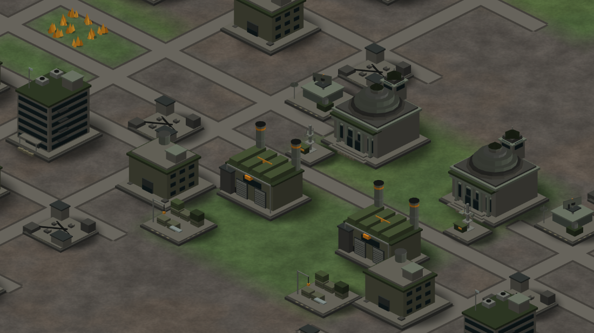

### 4.2 Role identity problems

#### Command Post — a flat administration compound, not a headquarters

The 15.6 × 15.6 base slab and 10 × 8.4 operations block occupy only part of the footprint;
the roof box is smaller still. At battle zoom the dominant shapes are a flat plinth, a low
green box and two thin antennae. The mast and flag are the only reliable command cues. The
model does not communicate the victory condition strongly enough for the structure that ends
the match.

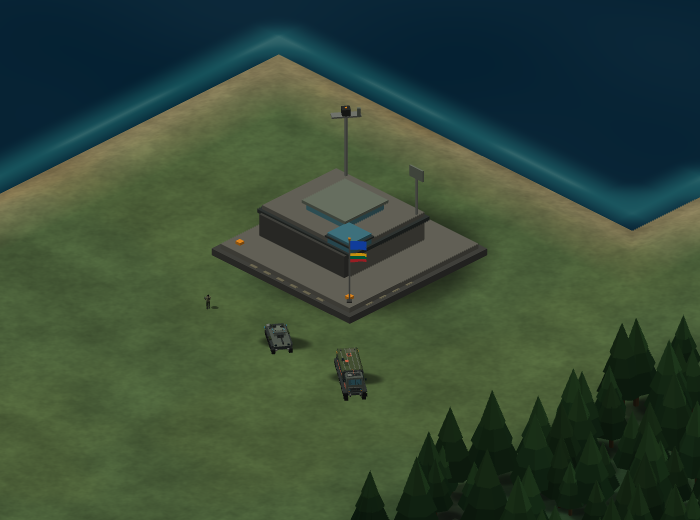

At close zoom the empty apron and tiny operations block are clearer; the mast and flag do the
identifying work, not the architecture.

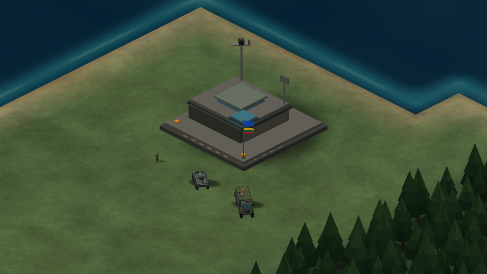

**Target identity:** a protected command element with a strong central operations mass,
communications mast/dish cluster, vehicle apron, roof plant and a flag above the roof plane.
Do not add simulation functions; express existing command/relay/engineer functions visually.

#### Field Barracks — a low generic shed

The barracks is only 3.7 world units high across an 11.8-unit footprint. The flattened roof,
small windows and single canopy read closer to a utility store than a place that trains and
houses infantry. At 36 zoom the roof occupies most of the silhouette; the animated door is
not visible from the tactical camera unless it is open. This is the weakest core production
building.

(Close evidence: `visual-audit/b1-close-02-production.png`, top-left cell.)

**Target identity:** a field barracks with a clear entrance, raised squad-bay roof, vents or
canvas structure, staging yard and a broad roof ownership panel. It must not become a second
warehouse or a second factory.

#### Reinforced Bunker — an exact clone of the shared MG Nest

The Hungarian national replacement has the same 7.4 × 7.4 × 2.05 envelope, the same 516
triangles and byte-identical body/turret geometry. It has no heavier roof, no concrete
embrasure, no national visual language and no team-tinted surface. Its advertised durability
is invisible. This is the only unambiguous **P0** identity failure in the roster.

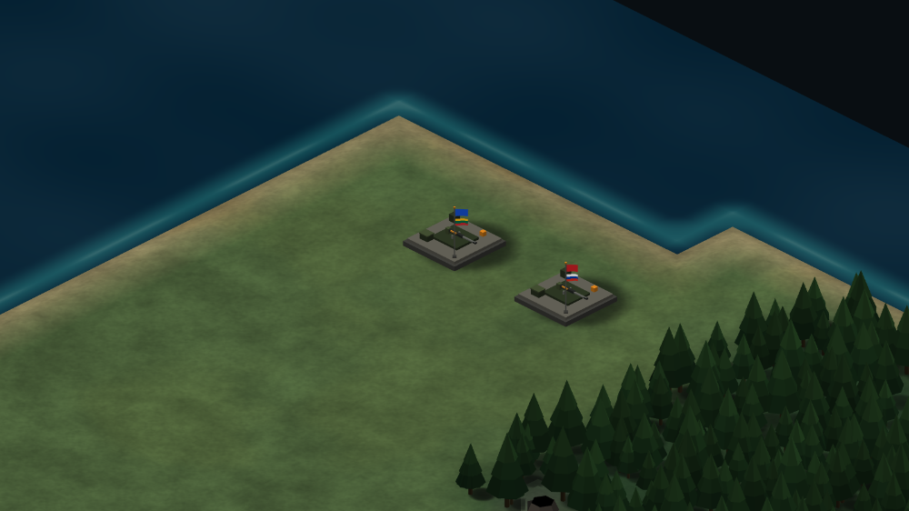

**Target identity:** keep the same heavy-MG pintle and hardpoint, but give the bunker a
visibly heavier low concrete roof, narrow embrasure and reinforced side mass. The baseline
MG Nest should remain an open sandbag ring. Split the builders; do not re-colour the clone.

#### AT Gun and Coastal Battery — same sandbag pad, different weapon

Both are 2×2 sandbagged revetments with a gun or rail group on the same concrete pad. At
battle zoom the long single barrel and the twin anti-ship rails are only a few pixels apart.
The shared composition is appropriate for a defensive family, but the role distinction is
not strong enough in a defensive line.

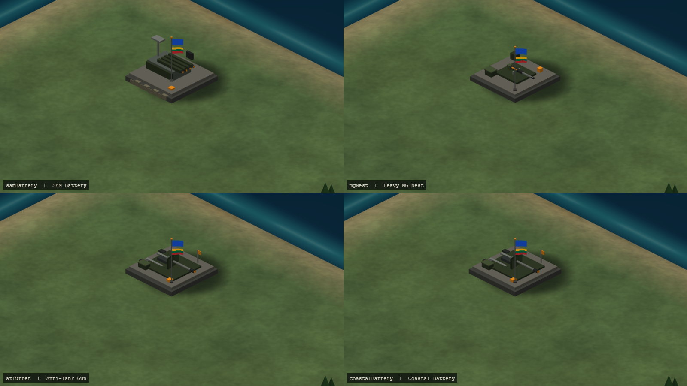

**Target:** a long, low anti-tank barrel with shield and split trails versus a raised, wider
twin-rail anti-ship mount with a visible blast/reload area. Preserve turret offsets and
weapon hardpoints.

#### Airfield and Shipyard — two large aprons with the same design language

The airfield's runway and hangar are a good airfield read on their own. The shipyard is also
convincing in water context: gantry, slipway gate and control shed. The problem is the common
large dark apron, control tower and hangar/gantry mass. On the grass showroom they are nearly
interchangeable at battle zoom; a player should not need the water tile to know which
production domain a building serves.

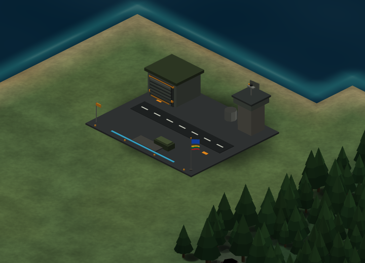

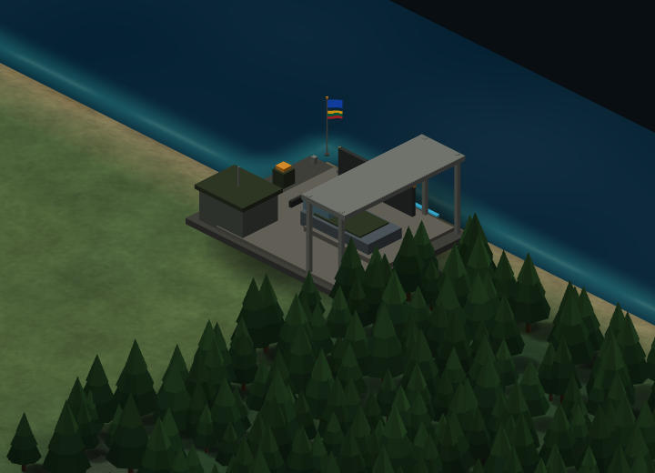

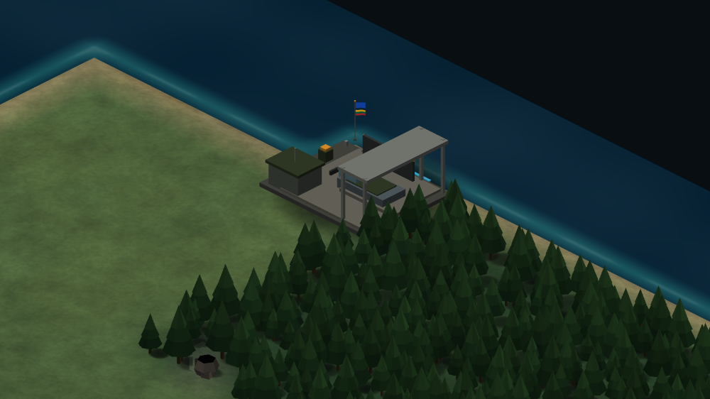

This is not a shared-mesh dependency: the builders are independent. It is still a **P1**
because both structures are expensive strategic investments and their silhouettes should
diverge before the player reads the label or the water.

#### Radar Station — the roof panel reads as a broken shed roof

The capturable 3×3 radar station has a large overhanging dark radar panel over a plain
concrete block. At battle zoom the panel is a flat slab and the mast is lost; the structure
looks like a depot with a damaged roof. The small 2×2 Radar Array is the stronger radar cue
and should inform the larger station's treatment without making them identical.

#### Signals Relay — a thin cross on a small pad

The relay's lattice mast is a good idea, but the 2×2 footprint and thin members disappear at
battle zoom. The neutral state has no flag and no team mask, so the objective reads as a
small unowned utility rather than a strategic communications site.

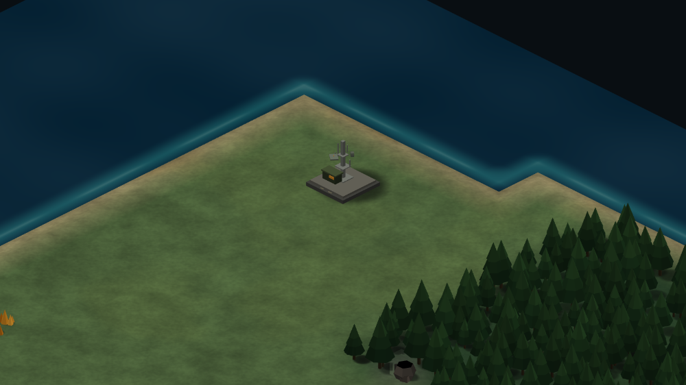

#### Refinery — industrial, but not clearly a drop-off

Two large silos and a conveyor dominate the model. The unloading bay and hopper are small and
read as generic machinery. A harvester has no obvious place to deliver, and the team patch is
a tiny blue strip. The refinery is recognisable as industry, not specifically as the economy
building the player must defend.

(Close evidence: `visual-audit/b1-close-01-hq-economy.png`, top-right cell.)

#### Supply Depot and Ruin — acceptable, sparse

The depot's crates, canopy and flag work at close zoom but the base slab and open apron
account for most of the area. The ruin is deliberately broken but is mostly an empty pad with
four low wall fragments; it is legible but not yet a convincing urban strongpoint.

### 4.3 Ownership is carried by flags, not by the buildings

Fourteen of the 22 body meshes have **zero** team-masked vertices: power plant, radar array,
SAM battery, MG nest, AT gun, coastal battery, relay, radar station, tenement, warehouse,
civic hall, foundry, ruin and bunker. Among the 13 player-buildable structures, the entire
defensive set and the power and radar support set have no owned surface. The flag rig and the
health-bar team strip are therefore the only ownership cues.

The blue/red Command Post comparison makes the weakness obvious: apart from a small roof
patch and the low flag, the two headquarters are the same grey compound.

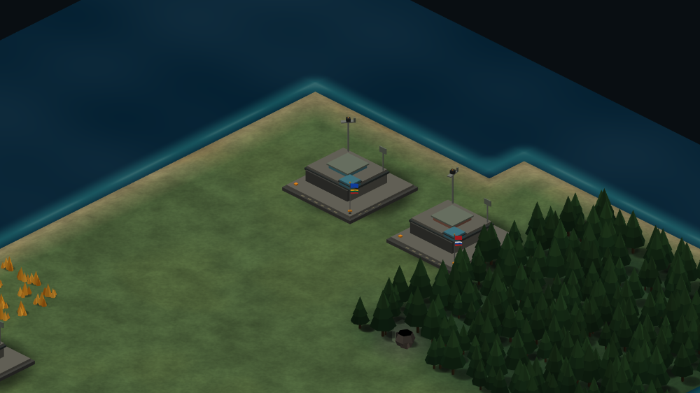

For a 2×2 MG Nest the flags are the only difference at all:


Ownership should not depend on a 5.6-unit pole whose cloth is a handful of pixels at battle
zoom. The owned/neutral read needs a roof or wall surface that survives the tactical camera,
while neutral capturable objectives should remain visibly unowned until captured.

### 4.4 Presentation anchors are derived from the wrong quantities

#### Flag poles are planted on the plinth

`flagMountFor()` searches near the forward footprint corner for the highest nearby vertex.
For compact buildings this finds the roof. For tall buildings that do not fill the corner it
finds the base slab or a ground prop, so the pole stands at the foot of the facade instead of
on the roof.

| Building | Mesh top | Flag base | Gap to roof |
| --- | ---: | ---: | ---: |
| Command Post | 9.94 | 1.32 | **8.62** |
| Refinery | 8.30 | 3.82 | 4.48 |
| Airfield | 9.12 | 0.53 | 8.57 (apron; documented) |
| Shipyard | 8.70 | 0.62 | 8.08 (apron; documented) |
| Relay | 7.50 | 0.97 | 6.53 |
| Supply Depot | 6.80 | 2.52 | 4.28 |
| Radar Station | 7.10 | 2.22 | 4.88 |
| Tenement | 10.85 | 1.32 | 9.53 |
| Warehouse | 7.64 | 0.96 | 6.67 |
| Office Block | 17.70 | 1.02 | **16.68** |
| Civic Hall | 16.25 | 0.96 | **15.29** |
| Foundry Works | 14.40 | 0.96 | 13.43 |

The airfield and shipyard can legitimately have a ground-mounted flag on an open apron; a
17.7-unit office tower cannot. The shared helper needs a per-building roof anchor, or a
search that prefers the highest connected roof surface rather than the footprint corner.

#### Health bars sit inside tall buildings

The overlay uses `footprint.h * TILE_SIZE * 0.45` for every structure. For a 5-tall civic hall
that is 9 world units, while the dome reaches 16.25; the selected bar is drawn across the dome
base, not above it.

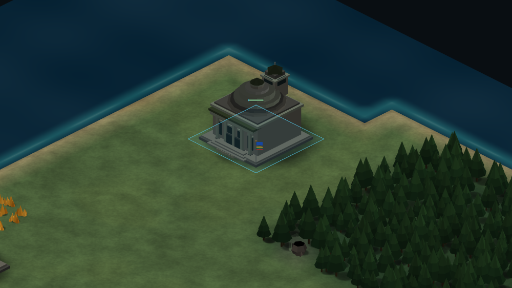

A 17.7-unit office tower gets the same 9-unit anchor; its bar sits on the roof face rather
than clear of the silhouette.

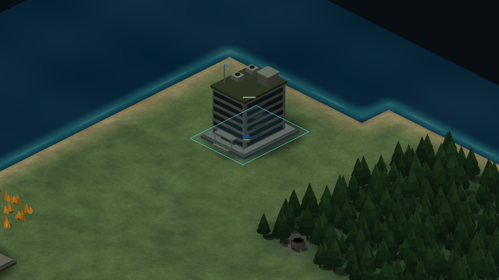

The bar is not shown for full-health buildings unless selected or hovered, so this is a
selection/damage-state defect rather than constant clutter. It is still a shared presentation
contract that should be fixed before adding more height to any building.

### 4.5 Scale, grounding and material language

- Buildings are authored at 1:1 and are correctly larger than the 4.4-unit MBT and the
  ~1.8-unit infantryman. There is no hidden visual multiplier to correct.
- The 2×2 defensive structures are 7.4–7.7 units across against an 8-unit footprint: dense,
  but plausible for a prepared emplacement.
- The large footprints are mostly filled: the command post is 15.6 of 16 units, the airfield
  23.6 of 24. The office and warehouse are inset from their tile footprints, which leaves a
  visible border on the selection footprint.
- Every model shares a flat base slab/plinth. On urban pavement this reads as a foundation;
  on open grass it reads as a display base, especially for the airfield and depots. This is a
  P2 material/grounding issue, not a reason to change the footprint.
- The strong buildings use only vertex colours and controlled value separation. No building
  needs a texture to read; the first batch should not introduce a UV/material pipeline.

### 4.6 Urban context and overlays

In the authored Foundry District the urban block holds together well. The mirrored civic halls
and foundries are legible landmarks, the streets have a clear hierarchy, and the neutral
warehouses/offices/tenements form readable cover without becoming identical.

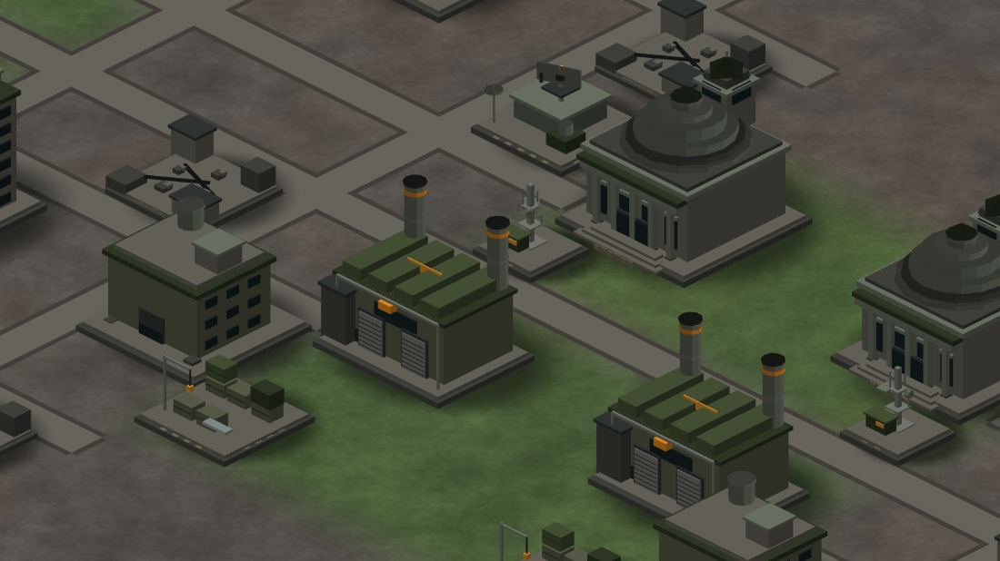

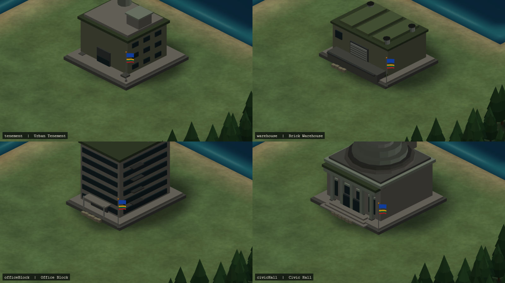

The selection footprint is drawn from the data footprint, so it remains aligned with the
plinth and does not inherit mesh overshoot. The bar anchor is the only overlay mismatch found.

### 4.7 Fog and state behaviour

In the fog-on opening frame only the visible friendly headquarters, its units and the terrain
in vision are drawn. No neutral or enemy structure leaks through the mask; the fog coverage
reported 475 visible, 1,875 hidden and 0 charted tiles in the framed area.

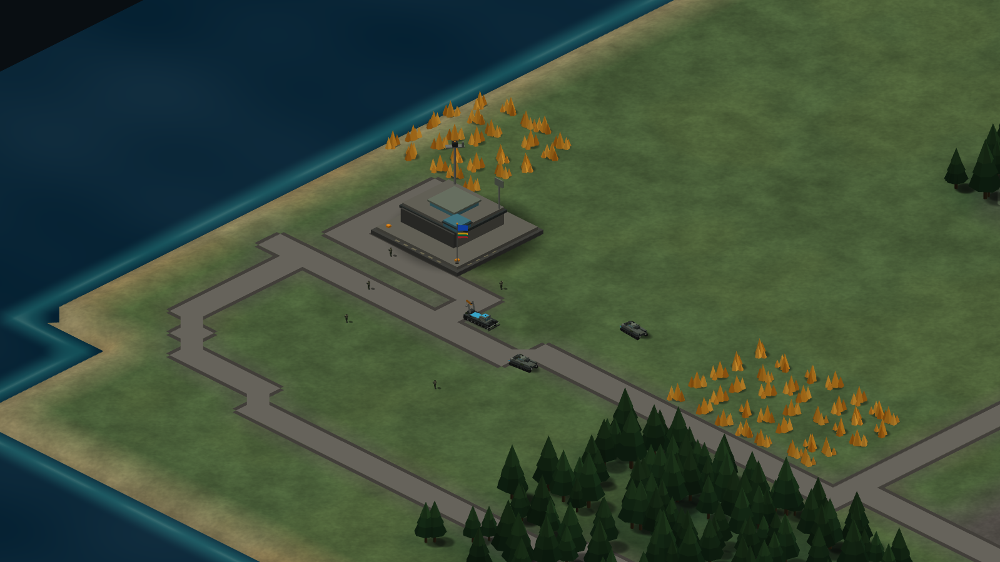

Remembered structures retain a dimmed silhouette with frozen rotors and flags; no live
health bar is shown for a remembered structure. Construction squashes the body and parts and
adds a translucent cage, but there is no scaffolding prop set. Destruction removes the model
immediately and leaves no rubble. Those are presentation gaps, not fog or determinism bugs.

---

## 5. Baseline performance and verification

### 5.1 Frame-cost baseline

All measurements use the same Chromium/ANGLE configuration and the frozen renderer clock.
CPU time is draw submission measured before `gl.finish()`, not GPU frame time.

| View | Conditions | Entities | Buildings | Draw calls | Triangles | CPU submit |
| --- | --- | ---: | ---: | ---: | ---: | ---: |
| Kestrel opening | zoom 36, fog on, tick 0, day | 23 | 7 | **30** | **82,818** | **0.63–0.95 ms** |
| Foundry District city | zoom 36, fog off, all visible, tick 0 | 64 | **48** | **103** | **134,248** | **1.11–1.29 ms** warm; 4.07 ms cold |

The opening Kestrel values match the Phase 9 record (30 calls, 82,818 triangles), which
confirms the building audit did not alter the shipped frame. The CPU spread is environment
noise from a single browser session; it is not evidence of a speed-up or regression.

**Derived building share in Foundry:** 48 body draws + 6 rotor draws (2 Command Posts, 2
Relays, 2 Radar Stations) + 2 owned-command-post flag rigs = **56 of 103 calls**. The
remaining 47 calls are terrain, water, shadows, props, units and particles. There is no
per-building shadow draw. A 48-building city is therefore still dominated by one body
submission per structure; adding detail without splitting meshes will not change that.

No per-building draw-call change is proposed. The five-family first batch should keep one
body draw and only the existing moving-part draws. No runtime dependency, texture atlas or
additional material pass is justified by this baseline.

### 5.2 Mesh-cost baseline

The 22 definition meshes total **11,856 triangles**; after removing the Bunker's duplicate
geometry there are **11,340 distinct triangles**. The range is 232 (Radar Array) to 1,088
(Civic Hall). The five proposed first-batch bodies are 2,348 triangles in total; adding the
split Bunker brings the six models to 2,864. Garrisoned variants are 1,884–3,260 triangles each because the dressing
mesh replaces the body; none adds a draw call.

| Batch family | Current triangles | Draws |
| --- | ---: | ---: |
| Command Post | 480 | 3 |
| Field Barracks | 420 | 3 |
| Material Refinery | 392 | 2 |
| Turbine Plant | 540 | 2 |
| Heavy MG Nest + Reinforced Bunker | 516 each | 3 each |
| **Batch total (six models)** | **2,864** | unchanged |

### 5.3 Automated checks

| Check | Result |
| --- | --- |
| `npm run typecheck` | clean |
| `npm test` | **49 files, 532/532 tests pass** |
| `npm run build` | clean — **495.92 kB JS / 146.29 kB gzip**, 90.07 kB CSS / 17.87 kB gzip |
| Difficulty ladder inside the suite | Recruit–Veteran **−50,005** (4–12); Elite–Recruit **86,251** (15–1); Elite–Veteran **36,531** (11–5) |
| Tick-0 `stateHash()` | repeated twice, identical: `t=0|r=773311|v=playing|p0:3000.00:180.00:0:0|p1:3000.00:180.00:0:0|…` |
| Fog integrity | `tests/fog-integrity.test.ts` passes in the full suite |
| Save schema | unchanged |
| Production source edited | **none** |

The audit added two dev-only tools and documentation. It did not change `src/`, `tests/`,
`package.json`, the save format, the rosters or any building data.

### 5.4 Reproducibility and limitations

Reproduction is through the dev server and the new audit helper:

```bash
npm run dev
node tools/audit-capture-server.mjs
# in the game page:
await (await import('/tools/building-audit.js')).showBuilding('commandPost', { zoom: 36 })
await (await import('/tools/building-audit.js')).saveFrame('b1-commandpost-battle.png', false)
```

Limitations:

- **Single GPU/browser.** No mobile, Safari, Firefox, integrated-GPU or 4K test was run.
- **CPU submission only.** There is no timer-query instrumentation and no claim of GPU
  headroom.
- **No human review.** The six-reviewer readability test has not been run for any building.
- **No full 22-type field.** Foundry contains 48 instances of 10 types. Airfield, shipyard,
  barracks, factory, refinery, power, SAM and defensive structures are not authored there;
  their singles were captured in the Kestrel showroom.
- **No all-yaw sweep.** Front/quarter views are the default; airfield rear and shipyard
  water-facing views were captured. The remaining structures were not rotated through four
  headings.
- **No time-of-day sweep.** Captures use day lighting; dawn/dusk/night were not compared.
- **State gaps.** Construction, damage flash, destruction and a door fully open were read in
  code and not captured as matched evidence.
- **Working tree.** Measurements describe the current dirty tree, not a tagged commit.

---

## 6. Ranked improvement backlog

Severity here is presentation severity, not gameplay priority. **P0** means the structure's
identity is wrong or missing in a way that cannot wait. **P1** means a primary role,
ownership or shared overlay contract fails at battle zoom. **P2** means secondary detail or
authored-only polish.

| Rank | Item | Severity | Evidence | Why now |
| ---: | --- | :---: | --- | --- |
| 1 | Split the Reinforced Bunker from the MG Nest | **P0** | exact geometry equality; `b1-review-mgnest-teams.png` | A national roster choice is invisible and the Bunker is the only true duplicate. |
| 2 | Add a consistent ownership surface to player-built structures | **P1** | 14/22 body meshes have 0 team vertices; blue/red captures | All six buildable defensive/support types rely only on a flag. Ownership must survive the tactical camera. |
| 3 | Derive flag mounts from the building roof, not the footprint corner | **P1** | 16.68-unit gap on office block; 15.29 civic; 8.62 command post | The national/alliance flag is the current ownership fallback; planting it at the base weakens both systems. |
| 4 | Derive building health-bar anchors from mesh height | **P1** | selected civic/office captures; 15 bars below mesh top | Every selected/damaged tall structure draws its bar inside the silhouette. Units must keep their existing anchors. |
| 5 | Rework Command Post primary mass | **P1** | native battle crop; close capture | It is the victory condition and every match's first base silhouette. It currently reads as a low utility compound. |
| 6 | Rework Field Barracks primary mass | **P1** | production contact sheet | Core infantry production is the weakest low-rise building; a shed silhouette undermines the base's production read. |
| 7 | Give Refinery a visible drop-off and stronger ownership | **P1** | HQ/economy close sheet; team 2.7% | The economy loop needs a place a harvester is visibly delivering to, not only a tank farm. |
| 8 | Separate AT Gun and Coastal Battery silhouettes | **P1** | defence close sheet | Two 2×2 sandbag pads with barrel/rail differences are weak role cues in a defensive line. |
| 9 | Diverge Airfield and Shipyard composition | **P1** | native crops; production sheet | Both are expensive strategic production sites and share the same apron/tower/hangar language. Independent builders make this a contained pair pass. |
| 10 | Give Radar Station a legible radar silhouette | **P1** | objective close sheet | The large station is less readable than the small Radar Array and currently reads as a shed with a broken roof. |
| 11 | Strengthen Relay and Supply Depot objective presence | P1/P2 | neutral relay capture; economy sheet | Capturable objectives should be identifiable before capture and clearly owned after. |
| 12 | Foundation, construction, damage and destruction presentation | P2 | source + showroom frames | Floating plinths, no scaffolding, no damaged stage and no rubble are visible gaps, but they are not blocking role recognition. |

### 6.1 What not to do

- Do not increase the triangle count indiscriminately to make the models “more detailed”.
  The gap is primary mass and proportion, not polygon density.
- Do not add a texture/UV pipeline for this batch. The team-mask and vertex-colour system
  already supports the required ownership read.
- Do not replace the common foundation slab with a new terrain-decal system. A foundation
  skirt/apron within the existing mesh is enough to test the approach.
- Do not change footprint sizes, selection rings or collision to make a silhouette fit.
- Do not convert the whole roster in the first batch.

---

## 7. Recommended first implementation batch

**Name:** Building Visual Phase 2 — Core Base Identities and Ownership Anchors.

**Batch:** five families / six models:

1. `commandPost` — headquarters.
2. `barracks` — infantry production.
3. `refinery` — economy drop-off.
4. `powerPlant` — power generation.
5. `mgNest` + `bunker` — static anti-infantry family and the Hungarian variant.

This covers the required headquarters, economy, power and defensive roles and adds a second
production structure. All five roles exist in the current game; no substitute role was
invented. The Bunker is included because it shares geometry with the MG Nest; it would be
wrong to change one and leave the other unexamined.

| Building | Why it is in the batch | Most important problem | Identity it should communicate | Must read at zoom 36 | Geometry dependency | Verification evidence |
| --- | --- | --- | --- | --- | --- | --- |
| **Command Post** | Victory condition; every match | Flat slab, small operations box, flag/mast doing all the work | Protected command element: operations block, comms cluster, vehicle apron, roof flag | Central mass, mast/dish, roof ownership panel, entrance | Unique body; rotor + flag anchors shared | 36/18 captures, both teams, neutral flag-off, fog-on, native crop, selection bar |
| **Field Barracks** | Core infantry production | 3.7-unit bungalow; no squad or staging cue | Field barracks: entrance canopy, raised squad bay, vents/canvas, staging yard | Roof mass, entrance, team panel; door open/closed | Unique body; door part | 36/18, door open and closed, both teams, silhouette-only |
| **Material Refinery** | Economy drop-off; every match | Silo pair dominates; no unloading bay; team patch tiny | Material processing and delivery: hopper, conveyor mouth, pipe manifold, storage, team band | Silo/conveyor profile, delivery bay, team band | Unique body | 36/18, harvester alongside for scale, team and neutral |
| **Turbine Plant** | Power role; every base | Good machinery, but zero team surface and flag at 3.22 | Turbine hall with stacks, transformers and owned roof panel | Stacks, ribbed hall, team panel | Unique body | 36/18, both teams, roof patch pixel coverage |
| **Heavy MG Nest** | Cheapest defence | No team surface; exact family clone | Low sandbag ring with tripod and clear MG | Sandbag ring, MG barrel, team roof strip | Shared family with Bunker; split | 36/18, both teams, turret traverse |
| **Reinforced Bunker** | Hungarian national choice | Byte-identical MG Nest | Heavier low concrete roof, narrow embrasure, reinforced mass, same pintle | Roof weight, embrasure, team panel | Split from MG body; keep hardpoint | 36/18, Hungary roster, both teams, turret traverse |

### 7.1 Scope of the batch

In scope:

- the six meshes above;
- a shared ownership-surface convention (roof/wall panels, neutral/captured variants);
- roof-based flag anchors and mesh-height health-bar anchors, validated on **all 22**
  structures because the helpers are global;
- a foundation/skirt treatment if it is needed to ground the new primary masses;
- capture and regression tooling for this batch.

Out of scope:

- Airfield, Shipyard, Factory, Radar, SAM, AT Gun, Coastal Battery, Relay, Supply Depot and
  all urban structures;
- new building types, new resource mechanics, new production rules;
- a material/texture/UV pipeline, post-processing, shadows/AO, fog changes;
- full roster conversion or a new renderer architecture.

### 7.2 Shared implementation order

1. Establish the shared ownership and anchor contracts in data/helpers; prove them without
   changing any primary silhouette.
2. Split the MG Nest and Bunker builders and validate the Hungarian roster mapping.
3. Rework the five core families (six bodies) one at a time, capturing before/after at the
   same conditions.
4. Re-run all 22 flag and health-anchor audits, because the helpers affect every structure.
5. Only then capture the full batch and run the human review pack.

---

## 8. Scope boundaries and regression risks

### 8.1 Hard boundaries

Phase 2 must remain presentation-only. It must not change:

- building IDs, names, roles, footprints, costs, build times, HP, armour, vision, power,
  production lists, weapons, capture/garrison rules or hotkeys;
- simulation, AI, economy, combat, movement, collision, pathfinding or victory logic;
- selection, picking radii, command input or selection semantics;
- fog-of-war rules, vision intervals, remembered/charted behaviour or save schemas;
- unit meshes, terrain materials, the beach classifier, renderer passes, shaders, lighting
  presets or the Phase 2 road-fog contract;
- national/legacy roster validity, including the Hungarian `mgNest → bunker` replacement;
- runtime dependencies or build tooling.

Do not use per-building visual scale multipliers to solve silhouette problems. The roofs,
plinths and bases must fit the existing footprint and ground-contact convention.

### 8.2 Regression risks

| Risk | Affected surface | Required control |
| --- | --- | --- |
| `flagMountFor()` is global | All 22 buildings | Capture every structure's flag before/after; special-case only documented open aprons. |
| Building health anchor is shared through `overlay.ts` | All structures; do not affect units | Split building and unit anchor paths; measure bars against mesh tops. |
| `garrisonDressing()` is shared | Six occupied urban variants | Capture all six occupied states; do not change neutral unoccupied silhouettes accidentally. |
| MG Nest / Bunker shared builder | Baseline and Hungarian roster | Split body only; retain turret hardpoint, weapon, footprint and roster replacement. |
| Airfield / Shipyard copy-paste | Two separate builders | Change both in one pair phase later; do not assume a shared function. |
| New team surfaces | Team-mask shader, fog, thumbnails | Keep mask values in the existing 0–1 range; hidden/remembered filtering must remain identical. |
| Foundation/apron overhang | Shadow footprint, selection ring, ground contact | Keep geometry within the data footprint or document the overhang; test on slopes and coast. |
| Roof-mounted flags | Flag rig scale, occlusion, health bar | A 5.6-unit pole on a 17.7-unit tower needs an anchor check, not a blind offset. |
| More geometry, same draw count | CPU submission, triangle budget | Group body detail; no new draw per material patch or roof part. |
| New thumbnail art | Build menu, roster tests | Re-run thumbnail tests and inspect the 48 px cards, not only the battlefield. |

### 8.3 Picking and fog contract

The audit did not change picking or selection. Phase 2 must keep the data footprint as the
selection ring and target area. If a new roof or canopy extends beyond the mesh envelope, it
must still be inside the data footprint or the overhang must be explicitly documented; do not
enlarge the picking radius to compensate. A hidden building must remain undrawn, and a
remembered building must remain a dimmed frozen silhouette without live flags or live health.

---

## 9. Acceptance criteria for the next implementation phase

These are the gates for **Building Visual Phase 2**, not claims about the current build.

### 9.1 Primary identity (human review required)

- Prepare a blinded pack at **1599 × 899 native buffer**, zoom **36**, day lighting, fog off,
  neutral background, no labels and no flags/team tint for role identification.
- Six independent reviewers, each shown the five families in randomized order in two
  orientations (front and rear/three-quarter), plus a separate close-zoom set.
- Primary denominator: 5 buildings × 2 orientations × 6 reviewers = **60 observations**.
  Require **≥90% correct overall** and **≥80% per family**; report raw counts, not only
  percentages.
- The current audit has **not** run this test. Do not claim a pass without the six reviewers.
- A separate ownership test hides the flags and asks blue/red/neutral for each family; require
  ≥90% correct across both alliance colours and the neutral state.

### 9.2 Automated invariants

- Every player-buildable structure has at least one team-masked surface large enough to read
  at zoom 36; no buildable type remains at 0 team vertices.
- For every solid building, the flag base is at or above the highest roof vertex; for a
  documented open apron, the ground mount is explicitly listed.
- For every building, the health-bar anchor is above the mesh top by at least 0.4 world units;
  selected and damaged captures show no bar inside the silhouette.
- Selection rings still match the data footprint; no picking, footprint or collision change.
- Hidden structures are undrawn; remembered structures remain alpha 0.5 and frozen.
- `stateHash()` at tick 0 is identical for matched scenarios.

### 9.3 Performance gates

- No additional draw call per building: body remains one draw, with only the existing
  turret/door/rotor/flag submissions.
- No new texture, material, post-process or runtime dependency.
- Proposed triangle ceilings for the batch: Command Post **2,000**, Barracks **1,400**,
  Refinery **1,600**, Turbine Plant **1,500**, MG Nest **900**, Bunker **1,100**; batch total
  **≤ 8,500** against the current 2,864. These are ceilings, not targets to fill.
- Matched scene draw calls must not increase. Record triangles and CPU submission; do not
  infer GPU or mobile performance from desktop submission time.
- The 48-building Foundry view (103 calls / 134,248 triangles) is a separate stress reference;
  do not claim the 163-entity ≤250-call target from it.

### 9.4 Gameplay and compatibility gates

- `npm run typecheck`, the full test suite and the production build pass.
- Difficulty ladder and deterministic outputs remain unchanged.
- All six national rosters, legacy alliance presets and the Hungarian Bunker replacement stay
  valid.
- No building data, save schema or simulation ownership changed.
- All 22 flags and health bars are captured after the shared-helper changes, including the
  buildings not in the batch.

### 9.5 Evidence pack

- Matched before/after at zoom 36 and close zoom for each target.
- Four materially different orientations where orientation matters; at least front and rear
  for all targets.
- Both alliance colour schemes; neutral/unowned state; fog-on and fog-off.
- Ordinary selection rings and health bars visible in at least one frame per target.
- Silhouette-only pack separate from the normal-colour pack, with no role labels.
- Shared-geometry regression captures for Bunker, MG Nest, and all six occupied garrison
  variants.
- Native-resolution frames retained; review copies may be downscaled but must not be the
  only evidence.

---

## 10. Completion statement

This audit is complete against its own criteria:

- all **22 implemented building definitions** are inventoried, including the one national
  variant and the six garrisoned variants;
- the data-to-mesh-to-renderer path, draw counts, mesh costs, team-mask behaviour, vision
  filtering, construction/damage/destruction paths and overlay anchors are documented;
- the most important readability failures are supported by native-resolution captures and
  measured anchor/triangle data;
- the first implementation batch is limited to five families and has explicit acceptance
  gates.

It does **not** establish that any building passes a human-recognition threshold, does not
measure GPU or mobile performance, and does not fix any of the issues it documents. The next
step is approval of the core base batch; no production model was changed in this phase.

**Single recommended next phase:** Building Visual Phase 2 — Core Base Identities and
Ownership Anchors, limited to the five families in §7. Airfield/Shipyard divergence and the
urban block are deliberately deferred until that batch has proved the ownership, flag-anchor
and health-anchor contracts.

---

## Appendix — capture index

All files are in `docs/visual-audit/`. Native sheets and crops retain the browser's actual
pixels; `b1-review-*` files are downscaled review copies. The twelve native contact sheets
cover all 22 definitions at battle zoom and at close zoom.

| Evidence | Files |
| --- | --- |
| Battle-zoom contact sheets, 2×2 crops | `b1-battle-01-hq-economy.png` through `b1-battle-06-urban-b.png` |
| Close-zoom contact sheets, 2×2 crops | `b1-close-01-hq-economy.png` through `b1-close-06-urban-b.png` |
| Native battle-zoom Command Post | `b1-commandpost-battle.png`, `b1-crop-commandpost-battle.png` |
| Native battle-zoom MG family | `b1-crop-mgnest-battle.png` |
| Native battle-zoom airfield / shipyard | `b1-crop-airfield-battle.png`, `b1-crop-shipyard-battle.png` |
| Native opening frame, fog on | `b1-baseline-kestrel-opening.png` |
| Close/selected review frames | `b1-review-commandpost-close.png`, `b1-review-commandpost-teams.png`, `b1-review-mgnest-teams.png`, `b1-review-office-overlay.png`, `b1-review-civic-overlay.png` |
| Context review frames | `b1-review-foundry-city.png`, `b1-review-foundry-battle.png`, `b1-review-relay-neutral.png`, `b1-review-shipyard-coast.png`, `b1-review-airfield-rear.png` |

Conditions for all captures: frozen tick 0, renderer time 0, day preset, clear weather;
showroom captures use clear Kestrel grass unless the shipyard is placed on a valid coast.
The Foundry captures use the authored map with fog off for inspection. Contact-sheet cells
are native-frame crops at the stated zoom, not enlarged thumbnails.
