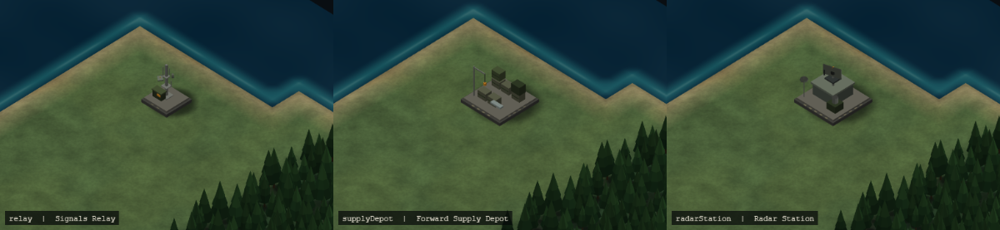

# Building Visual Phase 2 — Core Base Identities and Ownership Anchors

**Scope:** presentation-only implementation of the first building batch from
[`VISUAL_BUILDING_AUDIT_PHASE_1.md`](VISUAL_BUILDING_AUDIT_PHASE_1.md). No building data,
simulation, economy, AI, combat, roster, save or networking change was made.

**Result in one paragraph.** The Command Post, Field Barracks, Material Refinery, Turbine
Plant, Heavy MG Nest and Hungarian Reinforced Bunker now have distinct role silhouettes. All
13 player-buildable structures carry a substantive team-masked surface, every registered
structure has an explicit roof or documented apron flag mount, and building health bars are
anchored to the local top of the authored mesh rather than the data footprint. The six-model
batch is within every triangle ceiling, adds no draw calls or runtime dependencies, and the
tick-zero state hash is unchanged. Human recognition testing was not performed and is not
claimed.

---

## 1. Working tree and baseline

The tree already contained the completed Phase 1 visual work and earlier uncommitted phases;
those changes were preserved. This phase added only the files listed in §9. `npm run
typecheck` was clean before editing, and the Phase 1 audit baseline still reproduced:

- Kestrel opening: **30 draw calls, 82,818 triangles**, 0.63–0.95 ms CPU submission.
- Foundry District: **103 draw calls, 134,248 triangles**, 48 visible buildings.
- Building meshes: 11,856 triangles (11,340 distinct after the duplicate Bunker body).
- Full suite before this phase: 532 tests passing.

No earlier capture or report was treated as proof of the changed tree. All after-images in
this report were captured from the current development build.

---

## 2. Shared presentation contracts

### 2.1 Ownership surfaces

`ownershipPanel()` in `src/render/buildingMeshes.ts` writes the team mask into the existing
body mesh. It uses the current vertex-colour and team-mask shader; there are no UVs, textures,
material passes or extra submissions. The default panel mask is **0.68**, with a darker
inlaid stripe at mask 0.4 so the panel reads as a painted roof marking rather than a flat
colour card. Panels are merged into the existing body.

Every player-buildable structure now has at least one such surface:

| Structure | Team-masked vertices | Share of mesh | Primary ownership surface |
| --- | ---: | ---: | --- |
| `commandPost` | 48 | 3.2% | Operations roof panel |
| `barracks` | 72 | 5.6% | Ridge-monitor roof panel plus notice board |
| `factory` | 72 | 5.7% | Roof panel |
| `refinery` | 172 | 11.3% | Processing-hall panel and silo band |
| `airfield` | 72 | 4.8% | Hangar roof panel plus apron strip |
| `shipyard` | 96 | 8.2% | Control-shed panel plus apron strip |
| `powerPlant` | 48 | 3.3% | Turbine-hall roof panel |
| `radar` | 72 | 12.2% | Bunker roof panel and wall band |
| `samBattery` | 48 | 4.7% | Launcher-shed panel |
| `mgNest` | 120 | 10.5% | Gun-pit net, ready-box lid, rear banner |
| `atTurret` | 72 | 6.6% | Gun carriage and ready-ammo panel |
| `coastalBattery` | 48 | 4.8% | Ready-ammo panel |
| `bunker` | 48 | 4.3% | Casemate roof strip |

Neutral and capturable structures keep their existing unowned appearance: relay, radar
station, tenement, warehouse, civic hall, foundry and ruin have no permanent faction body
panel. The Supply Depot's existing team-tinted loading apron and the Office Block's existing
mast marker were left unchanged. Garrisoned urban structures still swap to their existing
team-trimmed dressing mesh.

### 2.2 Flag placement

`flagMountFor(footprint, body, defId)` now resolves an explicit entry in
`BUILDING_FLAG_ANCHORS` (`src/render/flags.ts`). The old footprint-corner vertex search found
the plinth on tall or inset structures and planted the flag at the foot of the facade. The
explicit table is deterministic, testable and independent of nearby props or masts.

- Solid buildings mount at the intended roof or monitor.
- **Airfield** and **Shipyard** are the only documented apron exceptions: their flags stand
  on the working yard rather than on a hangar or gantry roof.
- The flag rig, cloth animation, national texture, alliance colour, ownership and frozen
  remembered state are unchanged.
- Footprints, placement, collision and picking are unchanged.

All 22 anchors:

| Structure | Flag base (local x, y, z) | Mount |
| --- | --- | --- |
| `commandPost` | −0.8, 7.75, −0.7 | Roof |
| `barracks` | −0.4, 5.65, −1.6 | Ridge monitor |
| `factory` | 0, 6.55, 1.2 | Roof |
| `refinery` | 4.0, 6.05, −2.6 | Control-room roof |
| `airfield` | 0, 0.45, 8.8 | Apron (documented) |
| `shipyard` | 0, 0.95, 7.8 | Apron (documented) |
| `powerPlant` | −1.4, 4.25, −1.0 | Turbine-hall roof |
| `radar` | −2.6, 3.12, 1.2 | Bunker roof |
| `samBattery` | −0.4, 2.65, 0 | Launcher-shed roof |
| `mgNest` | −1.9, 1.95, 2.1 | Ready-box roof |
| `atTurret` | −2.1, 1.75, 2.4 | Ready-ammo roof |
| `coastalBattery` | −2.1, 1.76, 2.3 | Ready-ammo roof |
| `bunker` | −0.5, 3.0, −2.45 | Rear casemate roof |
| `relay` | 0, 3.35, 2.2 | Equipment housing |
| `supplyDepot` | 3.0, 3.95, −2.6 | Container stack |
| `radarStation` | −0.9, 3.4, −0.8 | Bunker roof |
| `tenement` | −3.6, 8.9, 3.2 | Roof |
| `ruin` | −4.4, 3.75, −4.2 | Surviving corner |
| `warehouse` | 3.8, 7.15, −2.0 | Roof |
| `officeBlock` | 2.0, 12.9, 4.6 | Roof |
| `civicHall` | 4.6, 9.35, 3.6 | Roof edge |
| `foundryWorks` | 4.8, 7.6, 3.2 | Roof |

The 22 selected-state anchor captures are
`visual-audit/b2-anchor-<id>.png`, with the group sheets at
`visual-audit/b2-flags-a.png`, `b2-flags-b.png` and `b2-flags-c.png`.

### 2.3 Health-bar anchors

`buildingTopHeight()` and `buildingBannerAnchor()` in `src/render/buildingMeshes.ts` derive
from the combined body, turret, door, rotor and occupied-garrison mesh. The overlay places the
bar at the local top point **plus 0.45 world units**, rotated by the building facing.

The local x/z matters: a refinery silo or foundry stack sits behind the footprint centre and
projects above a centre-mounted bar. Anchoring the bar over the highest band keeps it clear of
the silhouette instead of crossing a roof or facade. Unit bars remain on their existing
`unitBannerHeight()` path.

Examples from the anchor dump:

| Structure | Mesh top | Banner height | Banner local x/z |
| --- | ---: | ---: | --- |
| `commandPost` | 9.94 (rotor) | 10.39 | −4.5, −4.3 |
| `civicHall` | 16.25 | 16.70 | 0.0, −5.6 |
| `officeBlock` | 17.70 | 18.15 | −3.6, 3.8 |
| `refinery` | 8.30 | 8.75 | 0.2, −2.6 |
| `foundryWorks` | 14.40 | 14.85 | −0.2, −4.5 |
| `mgNest` | 2.05 | 2.50 | −0.1, −0.2 |

The full table is recovered by `buildingBannerAnchor()`; the regression test checks every
registered building. The tall-building bars and the repaired refinery/foundry bars are shown
in `visual-audit/b2-anchor-refinery.png`, `b2-anchor-foundryWorks.png`,
`b2-anchor-officeBlock.png` and `b2-anchor-civicHall.png`.

---

## 3. Model changes

All dimensions are world units at 1:1; the renderer still applies no per-building multiplier.
All parts remain merged into the existing body unless the original renderer required a moving
part.

| Model | Triangles before | Triangles after | Overall bounds (x × z × y) | Ceiling |
| --- | ---: | ---: | --- | ---: |
| Command Post | 480 | **504** | 15.6 × 15.6 × 9.94 | 2,000 |
| Field Barracks | 420 | **642** | 11.8 × 11.8 × 5.68 | 1,400 |
| Material Refinery | 392 | **696** | 15.8 × 11.8 × 8.30 | 1,600 |
| Turbine Plant | 540 | **672** | 11.8 × 11.8 × 6.08 | 1,500 |
| Heavy MG Nest | 444 body + 72 turret | **564** | 7.4 × 7.4 × 2.05 | 900 |
| Reinforced Bunker | exact MG Nest clone | **528** | 7.6 × 7.6 × 3.96 | 1,100 |

Total registered building geometry is **12,874 triangles** across 22 definitions, up from
11,856; all six batch models remain well below their ceilings.

### 3.1 Command Post

The old model was a broad slab with a 2.8-high operations block. The new model has:

- a taller central operations mass and a stepped signals room;
- a layered roof with a team panel, roof lights and a roof access/antenna cluster;
- a glazed watch floor, entrance canopy and vehicle apron with lane markings;
- the existing rotor mast and dish, at their existing transform;
- bollards and lighting.

A later correction removed two perimeter sandbag walls that the earlier revision left buried
inside the 1.0-high plinth (only their clipped ends showed), and split the coplanar surfaces
that caused visible z-fighting: the right wing now projects 0.06 past the central block instead
of ending on the same x plane, the apron tucks 0.1 under the block wall, the entrance sinks
0.03 into the deck, and the light roof plate is 0.02 taller than the ownership panel's
underside. The model dropped from 744 to **504 triangles**; dimensions and the 9.94 top are
unchanged.

The rotor offset remains `[-4.8, 9.2, -4.4]`; the body now reaches the mast base and roof
panel without moving the moving part. The flag sits on the signals-room roof.

### 3.2 Field Barracks

The old low shed is replaced by:

- a taller accommodation block with a pitched gable roof and a ridge monitor;
- a squad entrance with a deep canopy and roller door at the unchanged offset;
- windows on the long faces and side elevation;
- roof vents, a notice board, crates and a sandbag line.

The `door` mesh, offset and retract fraction are unchanged. The open-door capture
`visual-audit/b2-barracks-door-open-crop.png` confirms the shutter retracts into the lintel.

### 3.3 Material Refinery

The existing silo and conveyor identity is kept and strengthened:

- twin silos with a connecting catwalk and a team-painted band;
- a larger processing hall with a control room and roof ownership panel;
- a deep unloading bay with a hazard frame, dark delivery mouth and apron;
- a heavier conveyor, hopper, ready piles and support legs.

The flag moved from the low processing roof to the control-room roof. The structure is still
entirely a visual delivery facade; no resource interaction changed.

### 3.4 Turbine Plant

The stacks and turbine hall remain the primary silhouette. Added:

- a large roof ownership panel;
- transformer yard cable gantries and insulators;
- a roof-level exhaust header over the turbine-hall entrance;
- the existing switchgear, cable spools, hazard bollards and perimeter strip.

No power value, threshold or simulation rule changed.

### 3.5 Heavy MG Nest

The low, open sandbag emplacement identity is preserved. Changes are limited to:

- a lower-contrast team-tinted camouflage net over the gun-pit floor;
- a team-painted ready-box lid and a rear parapet banner;
- a slightly clearer tripod and gun mounting.

The existing turret mesh, `turretOffset` and weapon hardpoint are untouched.

### 3.6 Reinforced Bunker

`bunker` no longer uses `buildMgNestBody()`. It now has its own `buildBunkerBody()`:

- a thick concrete casemate with a low, heavy roof;
- a narrow forward embrasure and a second observation slit facing the tactical camera;
- corner buttresses and reinforced roof beams;
- a raised rear casemate/magazine with a vent and antenna;
- a team-painted roof strip.

The machine-gun turret mesh, `turretOffset: [0, 1.55, 0]`, heavy-MG weapon and Hungarian
national substitution are unchanged. `variantOf: 'mgNest'` and the 2×2 footprint are
preserved.

---

## 4. Captures

All after-captures use the frozen Kestrel showroom, 1440 × 810 device pixels, the standard
30° dimetric camera and the same lighting/fog settings as the audit. `zoom 36` is battle zoom;
`zoom 24` is the close inspection view.

### Battle zoom

- [Command Post](visual-audit/b2-commandPost-battle.png)
- [Field Barracks](visual-audit/b2-barracks-battle.png)
- [Material Refinery](visual-audit/b2-refinery-battle.png)
- [Turbine Plant](visual-audit/b2-powerPlant-battle.png)
- [Heavy MG Nest](visual-audit/b2-mgNest-battle.png)
- [Reinforced Bunker](visual-audit/b2-bunker-battle.png)

### Close zoom and moving parts

- [Command Post](visual-audit/b2-commandPost-close.png)
- [Barracks](visual-audit/b2-barracks-close.png)
- [Barracks, door open](visual-audit/b2-barracks-door-open.png)
- [Refinery](visual-audit/b2-refinery-close.png)
- [Turbine Plant](visual-audit/b2-powerPlant-close.png)
- [MG Nest](visual-audit/b2-mgNest-close.png)
- [MG Nest, turret traversed](visual-audit/b2-mgNest-turret-aim.png)
- [Bunker](visual-audit/b2-bunker-close.png)
- [Bunker, turret traversed](visual-audit/b2-bunker-turret-aim.png)

### Rear / materially different three-quarter views

- [Command Post, rear](visual-audit/b2-commandPost-rear.png)
- [Barracks, rear](visual-audit/b2-barracks-rear.png)
- [Refinery, rear](visual-audit/b2-refinery-rear.png)
- [Turbine Plant, rear](visual-audit/b2-powerPlant-rear.png)
- [MG Nest, rear](visual-audit/b2-mgNest-rear.png)
- [Bunker, rear](visual-audit/b2-bunker-rear.png)

### Both alliance colours

- [Command Post pair](visual-audit/b2-commandPost-teams-crop.png)
- [Barracks pair](visual-audit/b2-barracks-teams-crop.png)
- [Refinery pair](visual-audit/b2-refinery-teams-crop.png)
- [Turbine Plant pair](visual-audit/b2-powerPlant-teams-crop.png)
- [MG Nest pair](visual-audit/b2-mgNest-teams-crop.png)
- [Bunker pair](visual-audit/b2-bunker-teams-crop.png)

### Fog and shared anchors

- [Command Post, fog on](visual-audit/b2-commandPost-fog.png)
- [Refinery, fog on](visual-audit/b2-refinery-fog.png)
- [Bunker, fog on](visual-audit/b2-bunker-fog.png)
- [All flag anchors, sheet A](visual-audit/b2-flags-a.png)
- [All flag anchors, sheet B](visual-audit/b2-flags-b.png)
- [All flag anchors, sheet C](visual-audit/b2-flags-c.png)
- [Silhouette-only comparison](visual-audit/b2-silhouettes.png)
- [Neutral capturable objectives](visual-audit/b2-neutral-objectives.png)
- [Foundry District after](visual-audit/b2-foundry-after.png)

The silhouette sheet is generated by the development-only `silhouetteSheet()` in
`tools/building-audit.js`. It projects the actual mesh triangles with one flat fill, no team
tint, no flags, no labels and no terrain. The display order is:

1. Command Post, 2. Field Barracks, 3. Material Refinery,
4. Turbine Plant, 5. Heavy MG Nest, 6. Reinforced Bunker.

Existing Phase 1 before-captures were kept, including
`visual-audit/b1-crop-commandpost-battle.png`, `b1-crop-mgnest-battle.png`,
`b1-review-commandpost-close.png` and `b1-review-mgnest-teams.png`. They use the same
showroom and camera, so they remain the matched before evidence for this batch.

---

## 5. Automated acceptance criteria

Added `tests/building-presentation.test.ts` and updated `tests/flags.test.ts`:

- every player-buildable structure has at least 24 team-masked vertices and >1.5% team
  coverage;
- neutral authored objectives have no permanent faction body panel;
- every registered building has a finite, in-footprint flag anchor;
- solid structures use roof mounts; only the Airfield and Shipyard are marked `apron`;
- every health-banner anchor is at least 0.4 world units above the mesh top;
- the overlay uses `buildingBannerAnchor()` and keeps `unitBannerHeight()` for units;
- MG Nest and Bunker bodies differ, while the turret, offset, footprint and Hungarian
  `variantOf` mapping are identical;
- thumbnails and combined meshes remain finite and present for every building.

Results:

| Check | Result |
| --- | --- |
| `npm run typecheck` | clean |
| Focused renderer/building tests | **52/52 passing** |
| Full suite | **50 files, 541/541 tests passing** |
| Production build | clean — **501.66 kB JS / 148.19 kB gzip**, 90.07 kB CSS / 17.87 kB gzip |
| Fog integrity | passed in the full suite; no hidden-building leak observed in fog captures |
| Difficulty ladder | unchanged: Recruit–Veteran −50,005 (4–12); Elite–Recruit 86,251 (15–1); Elite–Veteran 36,531 (11–5) |
| Tick-0 `stateHash()` | repeated identical; starts `t=0|r=773311|v=playing|...` as before |
| Save schema | unchanged |
| Runtime dependencies | none added |

No test was weakened to accommodate the visuals. The new test file adds coverage rather than
relaxing an existing assertion.

---

## 6. Performance

Matched scene measurements, same Chromium/ANGLE configuration and frozen renderer clock.
These are **CPU draw-submission** measurements, not GPU frame times. The device-pixel buffer
was 1439 × 809, effectively the audit's 1440 × 810 target.

| Scene | Baseline calls / triangles | After calls / triangles | CPU submission samples |
| --- | --- | --- | --- |
| Kestrel opening, 23 entities, 7 buildings | 30 / 82,818 | **30 / 83,082** | 0.17–0.45 ms |
| Foundry District, 64 entities, 48 buildings | 103 / 134,248 | **103 / 134,776** | 0.47–1.37 ms |

The after triangle counts are **+264** in the opening and **+528** in Foundry, from the richer
building bodies. Draw calls are unchanged: each building still uses one body submission plus
only its existing moving parts. No ownership panel, roof detail or new silhouette created a
separate draw.

The CPU ranges differ from the audit's earlier ranges and include environment noise; they are
not claimed as a speed-up. The deterministic call and triangle counts are the comparable
figures. GPU and mobile performance were not measured.

The 163-entity ≤250 draw-call target is still unresolved and was not part of this batch.

---

## 7. Compatibility and invariants

- Building IDs, names, national roster mappings, footprints, HP, armour, costs, build times,
  power, vision, production lists, weapons and capture/garrison rules are unchanged.
- Grid placement, selection, picking, collision, pathfinding, construction, damage and
  destruction are unchanged.
- Fog-of-war semantics, remembered-building alpha, hidden-building filtering, frozen rotors
  and flags are unchanged.
- Unit meshes, unit bars, terrain materials, water, shadow radius, road-fog texture binding
  and time-of-day presets are unchanged.
- The Hungarian Bunker still substitutes `mgNest` and keeps its heavier data identity.
- No runtime dependency, texture atlas, UV pipeline, post pass or save change was introduced.

---

## 8. Limitations and unresolved issues

- **Human recognition testing was not performed.** The six-model batch has developer
  inspection and objective silhouette captures only; no ≥90% identification claim is made.
- The flag table is explicit and must be updated if future roof geometry moves. Tests catch a
  missing entry, not a visually wrong roof.
- The health-bar anchor deliberately follows the top band and can sit off the footprint centre
  on asymmetric structures. This is the intended fix for silos and stacks, not a generic
  centring rule.
- Team panels are untextured code geometry. They are readable but stylised; no weathering,
  decals or material atlas were added.
- The broader backlog remains: Airfield/Shipyard still share too much visual language,
  AT Gun/Coastal Battery remain a weak pair, the Radar Station still reads as a shed, and the
  urban block was not redesigned.
- The working tree was already dirty. These measurements describe the current tree, not a
  clean commit.
- No GPU, mobile or long-session performance claim is made.

---

## 9. Files changed

Presentation and tests:

- `src/render/buildingMeshes.ts` — six body builders, ownership panels, mesh-top and banner
  anchors.
- `src/render/flags.ts` — explicit 22-entry flag anchor table and updated `flagMountFor()`.
- `src/render/renderer.ts` — passes the building id to `flagMountFor()`.
- `src/ui/overlay.ts` — building banner uses the mesh-based local anchor; unit path unchanged.
- `tests/flags.test.ts` — roof/apron and all-building flag coverage.
- `tests/building-presentation.test.ts` — ownership, banner, Bunker split and thumbnail
  coverage.

Development evidence tooling and documentation:

- `tools/building-audit.js` — added deterministic `silhouetteSheet()`.
- `docs/VISUAL_BUILDING_PHASE_2.md` — this report.
- `docs/visual-audit/b2-*` — 92 captures and contact sheets.

No file in `src/data/`, `src/sim/` or the save schema was changed by this phase.

---

## 10. Decision and next phase

**Phase 2 is complete against its own criteria:** all six models were redesigned, all shared
anchors work across the full 22-structure roster, the ownership contract covers all 13
buildable structures, every triangle ceiling is met, draw calls are unchanged, and the full
suite/build pass.

The next building phase should be selected from the audit backlog. The strongest remaining
evidence is the **Airfield / Shipyard visual-language collision**: both are large, important
structures and neither was touched in this batch. A focused identity split for those two
should come before the defensive-pair or urban pass. The 163-entity draw-call target and the
fog-mask boundary remain separate future work.
