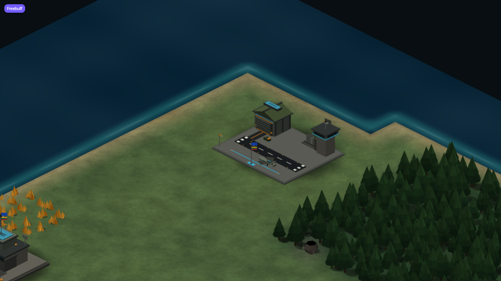
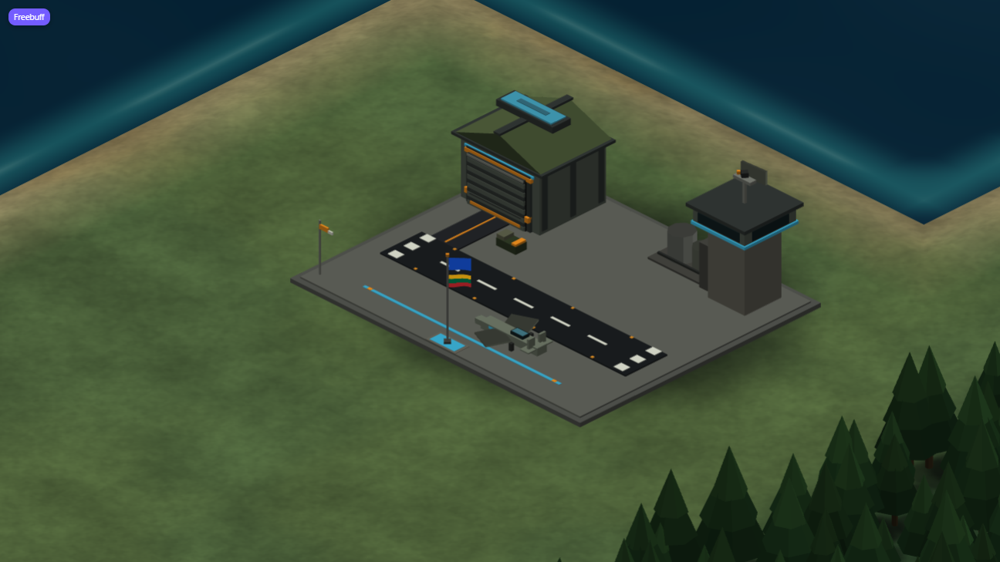
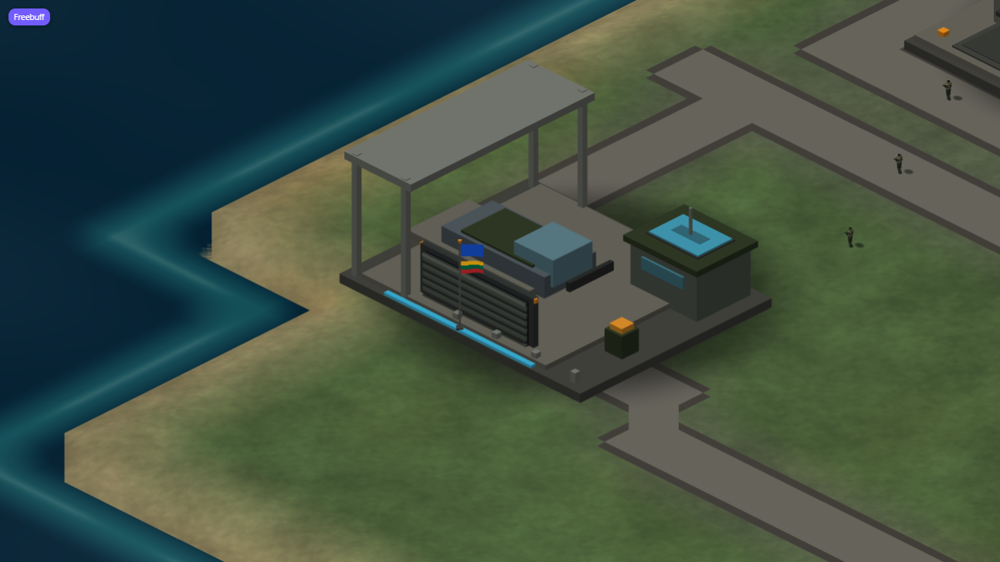
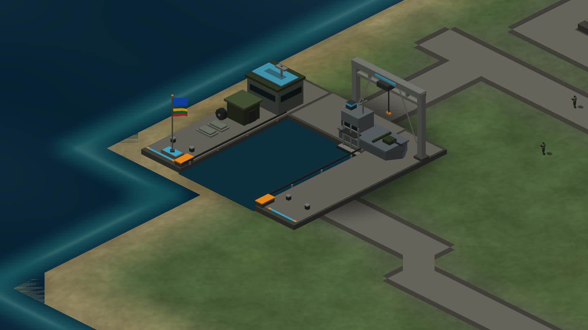
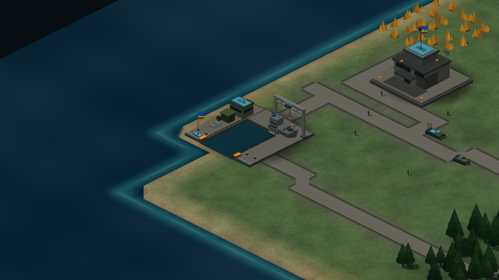

# Building Visual Phase 3 — Airfield and Shipyard Identity Split

**Scope:** presentation-only. The Airfield and Shipyard keep their existing data, footprints,
production, simulation and save behaviour. No unit, terrain, fog or gameplay file was changed.

**Result in one paragraph.** The Airfield now reads as a land airbase — runway, taxiway, pitched
hangar, glazed control tower, fuel farm, parked strike fighter and windsock — instead of a dark
apron with a shed. The Shipyard now reads as a working wet yard: a quay ring around an open
slipway, a corvette on the hardstand under a travel lift, a low control house and stores. The
slipway has **no shutter**: the basin runs through the seaward footprint edge and meets the sea,
with the flag moved onto the left quay and the work staging on a pontoon. The identity collision
documented in `VISUAL_BUILDING_AUDIT_PHASE_1.md` is resolved. Human recognition testing was not
run; the evidence is developer inspection plus geometry and regression checks.

---

## 1. The two identities

### Airfield

- Runway with threshold bars and centreline, a taxiway and a lead line to the hangar.
- Pitched hangar with overhanging eaves, a real gable, buttresses, a hazard-framed shutter and a
  roof ownership monitor.
- Glazed all-round control tower with a painted ownership band and the existing swept approach
  radar rotor.
- Fuel farm with bund, transfer pipe and pump house; windsock; apron flag dais and team line.
- A parked strike fighter, built into the body mesh, supplies the airframe scale cue without a
  moving aircraft entity.

The hangar shutter remains. The Airfield is an **enclosed production bay**, so the existing
shutter, retract transform and thumbnail bake are correct and unchanged.

### Shipyard

- Quay ring on the left, right and rear; the wet basin occupies the centre and runs out through
  the seaward edge (local **+Z**, the direction `waterFacingFor()` already turns to the coast).
- The basin surface is matched to the open-sea value and the inner quay faces carry fenders and
  mooring eyes. Two low guide walls frame the mouth; there is no gate and no wall across it.
- Corvette under construction on the rear/right hardstand: pointed bow, deck, bridge, funnel,
  foredeck gun, scaffolding on a floating work pontoon, keel blocks and shaft tubes.
- Travel lift straddles the stern, so the beam, trolley, cable and hook sit over the hull rather
  than in the middle of the yard.
- Low control house with a long glazing band, roof ownership panel, mast and dish; storehouse,
  steel stock, cable reel, bollards, flag dais on the left quay and painted team lines down each
  side of the slipway.

The old **slipway shutter** is gone. It was a shutter in an unwalled yard, and it forced the
basin to stop behind a concrete sill. The new mouth is open, the basin touches the sea, and the
flag no longer stands in the water.

---

## 2. The open-slipway correction

The first shipyard pass kept a roller shutter across the basin. Review identified three connected
problems:

1. A shutter implies a walled bay; this yard has no walls around the slipway.
2. The basin stopped at a sill inside the footprint, so it did not appear joined to the sea.
3. The flag dais and painted team line were centred on the old sill, which the open basin would
   have put in the water.

The correction:

- Replaced the solid 19.6 × 15.6 slab with three quay blocks forming a ring around the basin.
- Extended the water panel through the seaward edge (`z = +10`, the 20-unit footprint boundary)
  and tucked its sides 0.02 under the quay walls to remove the waterline coplanar seam.
- Deleted `buildShipyardGate()` and the `door` entry from the shipyard style.
- Moved the flag dais to the left quay at `(-7.0, 0.95, 8.6)` and split the team line into two
  side-quay segments, clear of the mouth.
- Moved the travel lift over the corvette's stern and added the pontoon under the scaffolding, so
  opening the basin did not leave either floating over water.
- Matched the basin colour to the sea (`[0.045, 0.19, 0.24]`) instead of the near-black panel.
- Nudged the storehouse door 0.09 proud of its wall to remove a pre-existing coplanar door face.

---

## 3. Flag and health anchors

The shipyard flag anchor moved from the old sill position to the working quay:

| Structure | Anchor | Note |
| --- | --- | --- |
| Airfield | `(0, 0.45, 8.8)`, apron | Unchanged; flag on the working apron. |
| Shipyard | `(-7.0, 0.95, 8.6)`, apron | Moved from `(0, 0.95, 7.2)`; the old point is now open water. |

All 22 registered structures still resolve a finite, in-footprint flag anchor. The Airfield and
Shipyard remain the only documented apron exceptions. Health bars derive from the authored mesh
top: the Shipyard banner sits at `y = 8.00` above its 7.55 travel-lift beam; the Airfield banner
sits at `y = 9.55` above its 9.10 tower/radar top. Unit bars are unchanged.

---

## 4. Matched evidence

The Airfield frames use the deterministic building showroom (Kestrel grass, battle zoom 36 and
close zoom). The Shipyard frames use a valid Island Assault coastal footprint at `(13, 42)`,
facing `0` (local +Z to the sea), battle zoom 30 and close zoom 15. The two types cannot share a
camera because one is a land site and the other must touch navigable water; within each type the
camera, zoom, lighting and placement match. Images are native resolution; no enlarged substitute
is used. The retained before frames are 1296 x 729 browser composites; the final Shipyard frames
are 1439 x 809 read directly from the GL drawing buffer, so the pixel dimensions differ while the
framed scene does not.

| View | Before | After |
| --- | --- | --- |
| Airfield, battle | `visual-audit/b3-airfield-before-battle.png` | `visual-audit/b3-airfield-after-battle.png` |
| Airfield, close | `visual-audit/b3-airfield-before-close.png` | `visual-audit/b3-airfield-after-close.png` |
| Shipyard, close | `visual-audit/b3-shipyard-before-close.png` (shutter) | `visual-audit/b3-shipyard-open-slipway-close3.png` |
| Shipyard, battle | not retained | `visual-audit/b3-shipyard-open-slipway-battle3.png` |

The close Shipyard frame shows the mouth open between the two guide walls, the basin water
continuous with the sea, the flag on the left quay and the travel lift over the hull. The battle
frame shows the same read at gameplay scale: the rectangular basin, gantry verticals and hull are
the primary identity cues, with cyan ownership on the control-house roof, apron lines, flag dais
and lift beam.

---

## 5. Geometry and performance

| Model | Triangles before | Triangles after | Team share before | Team share after | Bounds before (w × d × h) | Bounds after (w × d × h) | Draws before → after |
| --- | ---: | ---: | ---: | ---: | --- | --- | ---: |
| Airfield | 696 | 1,290 | 1.7% | 6.4% | 23.60 × 19.60 × 9.12 | 23.7 × 19.6 × 9.1 | 3 → 3 |
| Shipyard | 552 | 1,182 | 4.3% | 6.9% | 19.60 × 15.78 × 8.70 | 19.7 × 19.8 × 7.55 | 2 → 1 |

The Airfield's three submits are body, hangar shutter and approach-radar rotor. The Shipyard now
has one body submit; its shutter draw is gone. No new material, texture, UV, post pass or runtime
dependency was added. The airfield's parked fighter, runway markings, fuel farm and windsock are
baked into the body; the shipyard's quay ring, basin, guide walls, fenders and stores are baked
into its body.

The Phase 4/2 historical baselines (30 draw calls / 79,990–82,818 triangles in the Kestrel
opening; 103 draws / 134,248 triangles in Foundry) are comparison points, not universal budgets.
Neither site is authored in Foundry, and the Kestrel opening count is unchanged unless a player
builds one. CPU submission timing was not claimed as an improvement; the deterministic counts
above are the comparable figures.

---

## 6. Verification

- `npm run typecheck` — pass.
- Focused presentation tests — 60 pass: `presentation`, `flags`, `shipyard-facing`, `thumbnails`,
  `building-presentation`.
- Full suite — **542 pass / 50 files**, including determinism, save, fog-integrity, production,
  air/naval, AI and matchup tests. The earlier 543rd case was a temporary audit probe, removed
  before the final run.
- `npm run build` — pass (Vite chunk-size warning only, pre-existing).
- Tick-zero determinism: the coastal audit scenario reported `t=0 | r=773311 | v=playing` with 24
  entities. No `src/sim/`, `src/data/` or save file changed; mesh geometry cannot enter this hash.
- Picking, selection, footprints, production, weapons, movement and collision are unchanged.
- Coplanar sweep: 34 coincident triangle pairs remain on the shipyard, all interior or hidden
  (quay-block seams, prop feet on the deck, keel blocks against the hull, control-house roof
  underside). The exposed waterline seam and the storehouse door face were corrected. The
  Airfield has nine hidden pairs from its apron and hangar layers.
- No human recognition test was run; no readability percentage is claimed.

---

## 7. Limitations and regressions

- **Basin elevation.** The footprint terrain is not excavated. The basin reaches the footprint
  edge and its surface matches the sea, so the mouth reads as joined at gameplay zoom, but the
  dock water shares the yard's local elevation rather than sea level. A physically excavated wet
  dock would need terrain modification, which is outside this presentation phase.
- **Corvette emergence cue.** Removing the shutter also removes the renderer's shutter-based
  launch easing for naval units from this building. Corvettes still spawn and launch from the
  simulation berth; they no longer visually ease out of a door. A slipway-specific launch cue
  could restore that without reintroducing a shutter, but it was not added here.
- **Static basin.** The basin is a vertex-coloured panel, not the animated sea shader. It matches
  the sea value at rest but has no moving highlights.
- **Airfield polish.** The apron is still broad and the parked fighter is a simplified silhouette;
  the control tower is a clean box with a glazed cab. These are P2 follow-ups, not identity
  failures.
- **Human review.** Airfield/Shipyard recognition has not been tested with independent reviewers.
- **Working tree.** The tree was already dirty; these measurements describe the current tree.

---

## 8. Files changed

- `src/render/buildingMeshes.ts` — Airfield and Shipyard builders; open slipway, no shipyard
  door, quay-ring water, guide walls, pontoon, travel lift and flag dais.
- `src/render/flags.ts` — Shipyard apron anchor moved to the left quay.
- `tests/presentation.test.ts` — shutter contract now covers enclosed bays only; new test asserts
  the Shipyard has no door and its body reaches the seaward footprint edge.
- `docs/visual-audit/b3-*` — native before/after evidence.
- `docs/VISUAL_BUILDING_PHASE_3.md` — this report.

No `src/data/`, `src/sim/`, `src/ui/` gameplay or save file changed.

---

## 9. Next batch

The identity split is complete; the Airfield and Shipyard no longer share a silhouette language.
The strongest remaining audit item is the **AT Gun / Coastal Battery pair**: two 2×2 sandbag pads
whose barrels and rails are not reliably distinguishable in a defensive line. The **Radar
Station** remains the next objective-readability gap. Neither is started here.
