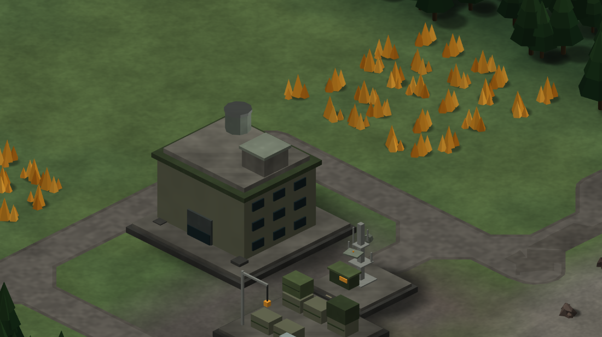
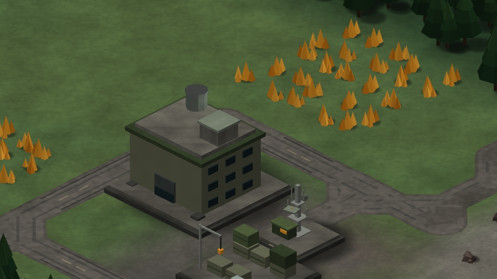
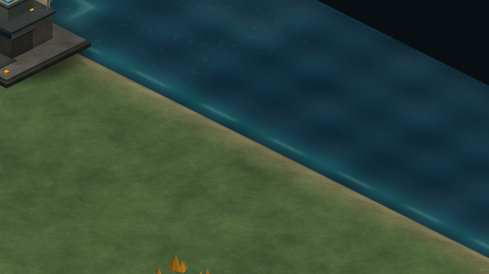
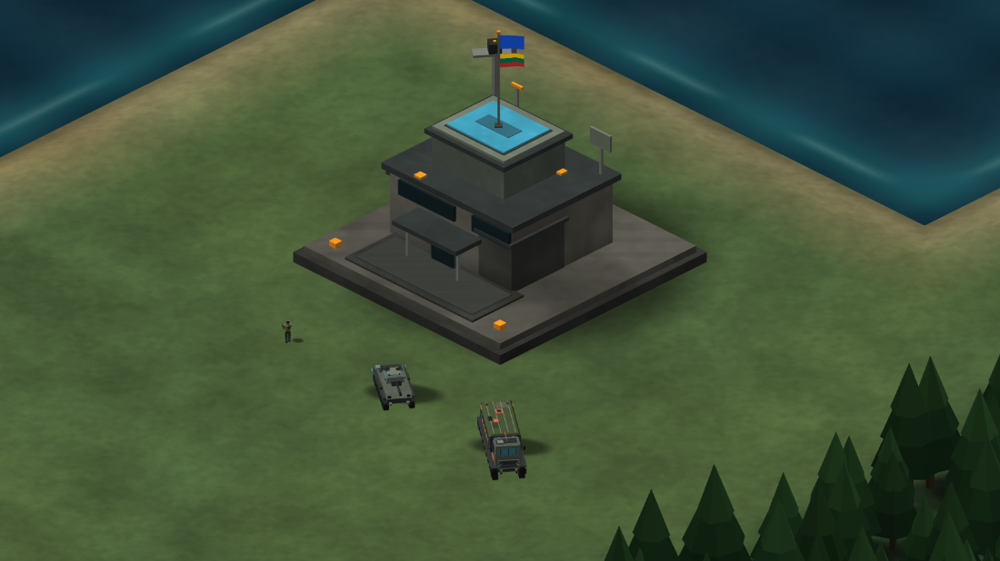
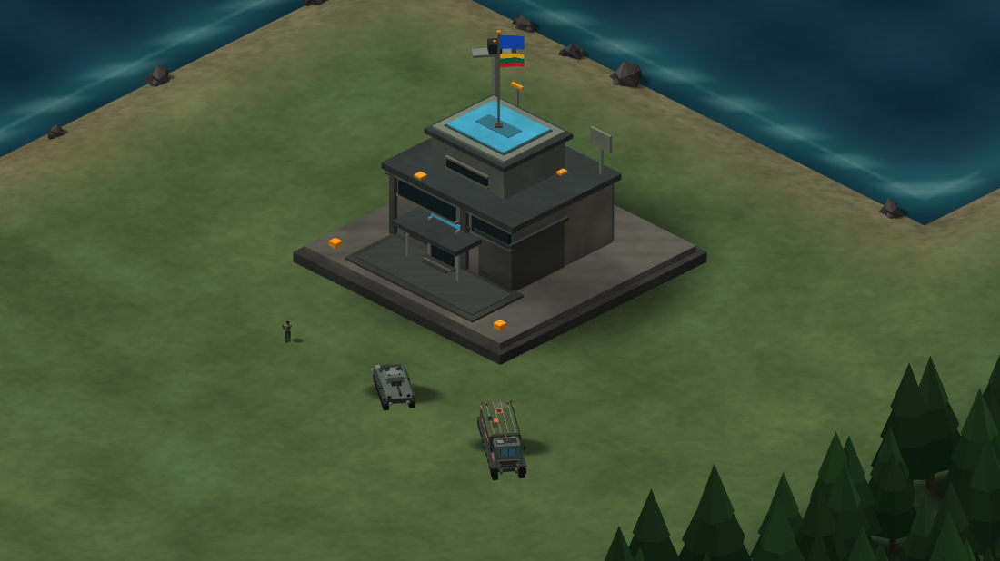
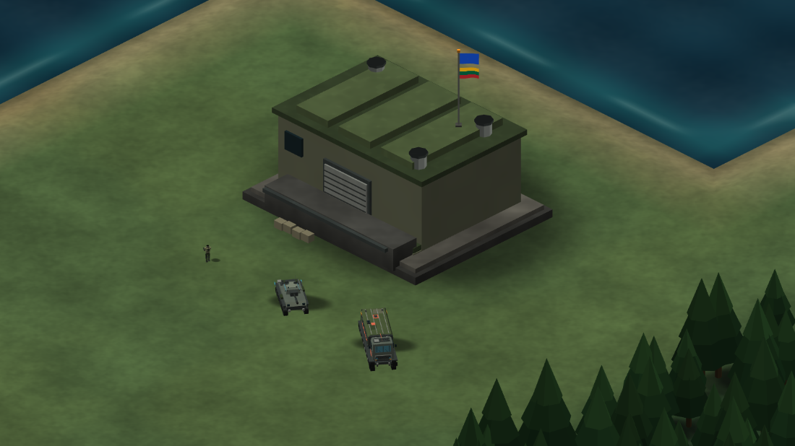
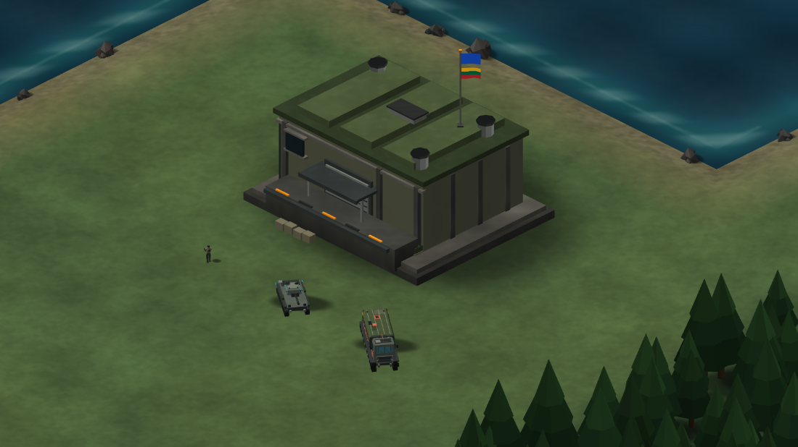

# Visual Environment Coherence Phase — Roads, Coast and Facades

## 1. Executive summary

This pass used the existing vertex-colour/material pipeline to make three
environment surfaces agree with each other:

- Roads are still one batched static mesh, but now carry wheel wear, a broken
  centre line, drainage seams and a subtly irregular carriageway edge.
- The coast is driven by a four-channel field instead of a single "is this
  water" mask. Wet sand, shell/salt band, beach colour, shallow shelf, riprap
  and surf all read from the same land/water distance pair.
- The Command Post and Warehouse receive layered facades: pilasters, sill
  courses, entrance surrounds, roof plant, loading canopy and a framed team
  plaque on the Command Post.

No simulation, data, roster, balance, fog, save, input, picking or overlay file
was changed. Draw calls are unchanged in all matched scenes; the cost is bounded
extra geometry and a 27–31 KB coast texture (up from 7–8 KB).

This is developer visual inspection plus automated regression evidence, not a
human readability study and not a GPU performance claim.

## 2. Matched baseline and scope

The pass starts from the material phase and the earlier road-silhouette
follow-up. Before editing, the existing audit tooling was reproduced at:

- Scenario: `island-assault`, day, clear, effects off.
- Material showroom: fog off, HUD/overlay hidden, frozen at tick 0.
- Building showroom: fog off, HUD/overlay hidden, frozen at tick 0.
- Camera pitch: 30°.
- Viewport: **1777 × 1000 CSS px**, **1599 × 899 GL buffer**, DPR 0.9.
  The previous audit's 1600 × 900 CSS frames were captured under a different
  browser zoom; every pair in this document was captured in one session under
  identical settings, so before/after comparisons remain valid.
- Before frames were captured before the code changes; after frames use the
  same scene, camera centres and zooms.

The audit deliberately kept the existing four programs. There is no new
material pass, texture atlas, draw path or runtime dependency.

## 3. Implementation

### 3.1 Coastal field

`buildShoreTexture()` now returns an RGBA8 field, uploaded as `gl.RGBA`:

| channel | meaning |
|---|---|
| R | legacy water shallowness (shallow 220, deep 15, land 0) |
| G | land distance from water: 255 on the first land tile, 0 about four tiles inland |
| B | water distance from land: 255 on the first water tile, 0 beyond the second |

The distances are a deterministic four-neighbour tile flood at scenario load.
It costs one pass over the map and 27,648 bytes on Kestrel Bay (31,616 on
Foundry District), replacing the old 6,912/7,904-byte single-channel mask.

`TERRAIN_FS` reads **G** and `WATER_FS` reads **R + B**. This removes the old
problem where the wet band could only be painted on water tiles and the surf
mask stopped exactly at a tile boundary. The water shader's foam band is now
limited to the first tile or two and broken by a higher-frequency surf noise;
the previous wide pale bands parallel to the coast were a consequence of the
old B span.

### 3.2 Road surface detail

All road additions are authored in `buildRoadDetails()` and submitted by the
existing single `roadMesh` draw:

- **Wheel wear** — two darker ribbons at ±0.235 tile from the centre line,
  draped with the carriageway. Flat segments use one quad per path; sloped
  segments keep the same subdivision as the road so the wear cannot cut through
  a crest.
- **Lane paint** — a broken centre line on straight-through segments only. It
  stops at junctions instead of painting an X through the turning space.
- **Drainage seams** — a narrow dark strip just inside each carriageway edge on
  straight-through segments.
- **Edge taper** — a deterministic world-space width variation on the
  carriageway and verge. The old ribbon had mathematically perfect edges and
  read as a ruler line at battle zoom.
- **Junction fillets** remain as before. An experimental dark disc at every
  junction was removed after it read as a manhole cover rather than asphalt.

The simulation still uses the original road tiles. Road conformance tests check
that every road vertex remains above the terrain and within 0.12 world units of
it.

### 3.3 Coastal riprap

`buildPropInstances()` now adds sparse, deterministic riprap on ordinary grass
or sand coast tiles. It reuses the existing instanced rock mesh and prop draw,
so there is no new draw call. Placement:

- only on land, never on water tiles;
- never on road, urban, forest or authored building footprints;
- pushed toward the nearest water neighbour, with some pieces half in the
  surf;
- non-blocking, exactly like the existing tree and rock props.

This is visual cover, not a new movement rule or obstacle.

### 3.4 Facade layering

**Command Post**

- Two concrete facade pilasters frame the existing window bands.
- A deep sill course and window sills give the glass strips a structural
  recess instead of a flat decal.
- The entrance gains a surround and three shallow steps down to the apron.
- A framed team plaque sits above the canopy, using the existing team mask;
  the roof ownership panel is unchanged.
- The upper operations room gains a shallow observation band.
- The low wing gets a rooftop plant unit and the rear gets two downpipes.

**Warehouse**

- Concrete pilasters break up the long brick elevation on both sides.
- The loading dock gains a covered bay, support posts, loading lights and
  painted edge markers.
- The street window receives a sill and lintel.
- A roof ridge monitor replaces a slice of the sawtooth silhouette.
- Downpipes tie the roof edge to the slab.

The Warehouse remains a neutral/capturable structure: its body still has zero
permanent team-mask vertices. Its occupied variant retains the existing team
trim from `warehouseDressing()`.

All new boxes are deliberately embedded a few centimetres into their parent
surface. No new face is flush with an existing wall, sill or roof cap, so the
Command Post z-fighting fixed in the previous phase is not reintroduced.

## 4. Files changed

| file | change |
|---|---|
| `src/render/terrainMesh.ts` | RGBA coast field, road wear/lane/drain/edge detail, coastal riprap |
| `src/render/shaders.ts` | terrain wet/beach/salt transitions, water shelf/foam/waterline |
| `src/render/renderer.ts` | RGBA upload path for the coast field |
| `src/render/buildingMeshes.ts` | Command Post and Warehouse facade layers |
| `tests/environment-coherence.test.ts` | new focused suite (10 tests) |
| `tests/road-network.test.ts` | straight-run vertex ceiling raised from 200 to 340 for the intentional wear ribbons |
| `docs/VISUAL_ENVIRONMENT_COHERENCE_PHASE.md` | this record |

No files under `src/sim`, `src/data`, `src/ui`, `public/` or the audio paths
were changed.

## 5. Evidence

### 5.1 Matched pairs

| before | after |
|---|---|
| `docs/visual-audit/env-before-road-open.png` | `docs/visual-audit/env-after-road-open.png` |
| `docs/visual-audit/env-before-coast-open.png` | `docs/visual-audit/env-after-coast-open.png` |
| `docs/visual-audit/env-before-showroom.png` | `docs/visual-audit/env-after-showroom.png` |
| `docs/visual-audit/env-before-commandpost-battle.png` | `docs/visual-audit/env-after-commandpost-battle.png` |
| `docs/visual-audit/env-before-commandpost-close.png` | `docs/visual-audit/env-after-commandpost-close.png` |
| `docs/visual-audit/env-before-warehouse-battle.png` | `docs/visual-audit/env-after-warehouse-battle.png` |
| `docs/visual-audit/env-before-warehouse-close.png` | `docs/visual-audit/env-after-warehouse-close.png` |

Conditions:

- Road: material showroom, zoom 16, centre `(158, 110)` world units.
- Coast: material showroom, zoom 18, centre `(300, 22)` world units.
- Showroom: material showroom, zoom 30, centre `(264, 46)` world units.
- Command Post: building showroom, zoom 36 and 15, centre `(76, 52)`.
- Warehouse: building showroom, zoom 36 and 15, centre `(78, 52)`.

Additional after-only inspection frames:

- `env-after-commandpost-macro.png` (zoom 8)
- `env-after-commandpost-facing-1.57.png` (rear/three-quarter)
- `env-after-warehouse-macro.png` (zoom 8)
- `env-after-foundry.png` (dense 48-building scene)

**Road before / after**

**Coast before / after**

**Command Post close before / after**

**Warehouse close before / after**

### 5.2 What the images show

- The before road is a uniform grey ribbon. The after road has two visible
  wheel paths, a broken faded centre line, edge seams and an irregular
  carriageway edge. The surface remains one draw.
- The before coast is a flat blue plane with a single bright rim. The after
  coast has a darker wet band, a broken surf line and dark riprap stones, with
  the water shelf still reading as shallow near the beach.
- The before Command Post facade is a flat dark plane with two glass strips.
  The after close view shows pilasters, sill shading, a framed entrance,
  an upper observation band, a team plaque and roof plant.
- The before Warehouse is a plain brick box with one dock door. The after view
  shows a covered loading bay, pilasters, painted dock markers, window
  surrounds and a roof monitor.
- The after Foundry District frame confirms the road treatment survives density
  and that buildings remain distinguishable at battle zoom.

## 6. Performance and counts

Triangle counts from the mesh builders (not estimated from screenshots):

| mesh | before | after |
|---|---:|---:|
| Command Post body | 456 | **760** |
| Command Post thumbnail (body + rotor) | 504 | **808** |
| Warehouse body/thumbnail | 516 | **864** |
| Kestrel Bay road mesh | 5,072 | **7,044** |
| Foundry District road mesh | not separately recorded | **29,926** |
| Coast field, Kestrel | 6,912 bytes | **27,648 bytes** |
| Coast field, Foundry | 7,904 bytes | **31,616 bytes** |

Matched scene measurements, `measureCurrent(12)` (CPU submission, not GPU):

| scene | prior audit | this pass | draw calls |
|---|---|---|---|
| Kestrel opening | 30 calls, 83,289 tris, 0.40–0.61 ms | **30 calls, 90,771 tris, 0.26 ms** | unchanged |
| Material showroom | 68 calls, 96,095 tris, 0.39–1.22 ms | **68 calls, 106,313 tris, 0.63 ms** | unchanged |
| Foundry District | 103 calls, 134,248 tris | **103 calls, 152,945 tris, 1.02 ms** | unchanged |

The CPU figures are one 12-frame mean per scene, not a controlled benchmark and
not a speed-up claim. The prior audit used different sample counts and a
different browser scale. No GPU timing or mobile validation was performed.

The scene triangle increases are consistent with the added road wear, lane
paint, riprap and two facade meshes. Draw calls are unchanged in all three
matched scenes. The dense Foundry road mesh is the largest individual cost; if
a later phase needs headroom, the first lever is wheel-wear subdivision on
dense grids, not removal of the lane/edge read.

## 7. Verification

- Typecheck: **pass**.
- Production build: **pass**; only the pre-existing >500 kB chunk warning.
- Full test suite: **597 tests across 54 files, pass**.
- New focused suite: **10 environment-coherence tests pass**.
- Road/network and presentation suites: **pass** after the intentional
  straight-run vertex ceiling adjustment from 200 to 340.
- Tick-zero determinism: `t=0|r=773311|v=playing|…` matched the prior material
  phase in both the opening and showroom scenarios.
- Fog: `tests/fog-integrity.test.ts` (13 tests) passes. The new coast field is
  a static visual texture, not a visibility source; riprap remains drawn
  through the existing fogged prop pass.
- No simulation, roster, weapon, footprint, pick-radius, save or overlay code
  was modified.
- Building banner anchors still derive from mesh tops; the Command Post's top
  remains 9.94 world units, so the established anchor test still passes.

## 8. Limitations and next evidence

1. **Road topology is still the tile graph.** The ribbons now have detailed
   surfaces and filleted joins, but a dense grid still shows broad right-angle
   junctions. Re-curving the network is a separate road-topology phase.
2. **Coastal field resolution is one texel per tile.** The shader smooths it,
   but surf bands can still look broad at low zoom or on very long straight
   coasts. A higher-resolution distance field would be the next step if needed.
3. **Riprap is instanced boulders, not cliff geometry.** It breaks the coast
   line but does not create new cliff/outcrop silhouettes. Those remain a
   geometry task.
4. **No new textures or decals.** All surface detail is still procedural /
   vertex colour. Lane paint is geometry, not a decal atlas.
5. **No GPU/mobile measurement.** CPU submission and triangle counts are the
   only performance evidence.
6. **Developer inspection only.** No human recognition or six-review study was
   performed for this pass.
7. **Warehouse remains neutral.** It intentionally has no permanent faction
   panel; its occupied variant still uses the existing garrison trim.

The next environment phase should be selected from the same evidence: road
topology smoothing if the grid remains the dominant read, or a coastal
cliff/outcrop pass if the shoreline silhouette is the higher-value target.
Do not expand this into a full building-roster material/texture conversion
without a separate measurement and budget.
