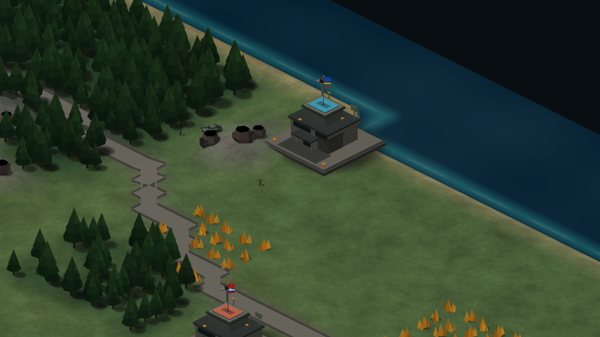
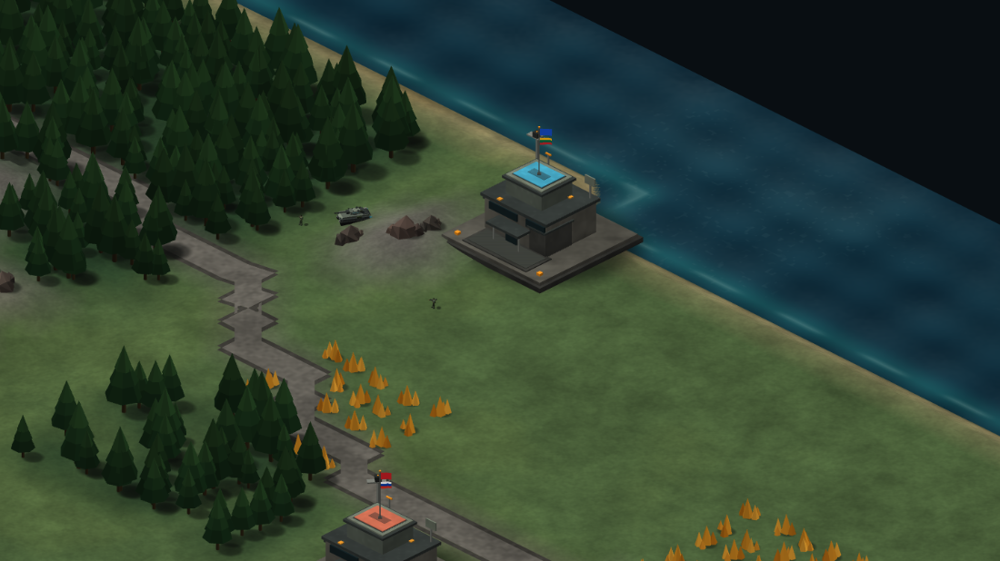
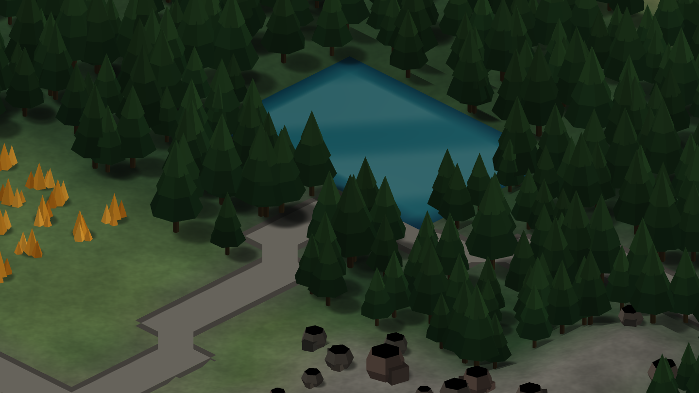
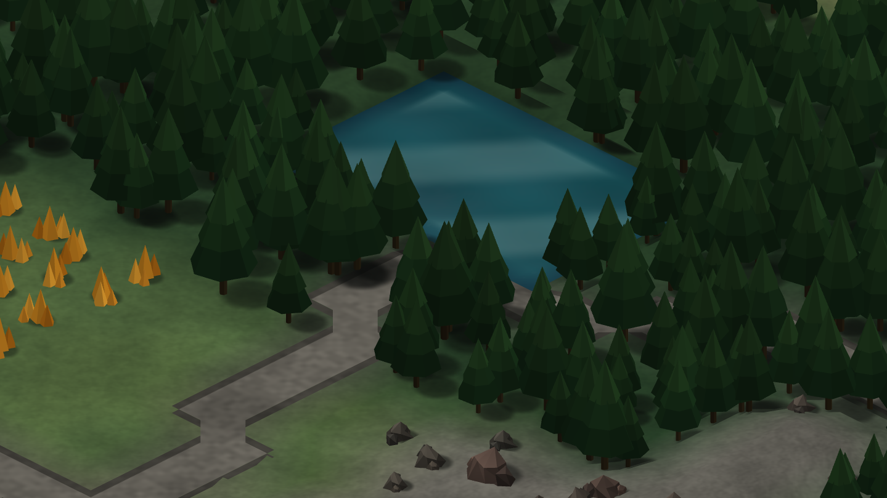

# Visual Foundation Phase — Material Pipeline and Environment Coherence

## 1. Executive summary

The renderer could support a useful material pass without a texture atlas, a
renderer rewrite or a new draw path. The implemented pipeline adds one
categorical material id per vertex, resolves it through a 32-byte LUT, and
evaluates a small shared surface model in the existing mesh shader. Terrain,
water and instanced props keep their existing programs but gain the same
coastal, rock and asphalt treatment.

The representative evidence is deliberately modest:

- **Concrete, painted metal, bare metal, glass and tracks** now separate in the
  Command Post and MBT instead of sharing one flat vertex-colour response.
- Roads are authored as asphalt and show aggregate, repaired patches and a
  darker carriageway rather than a uniform grey ribbon.
- Ridge props are faceted stone with bedding bands; the terrain ridge receives
  a world-space normal bend and strata shading.
- The coast gets a wet band, salt line and a broken surf edge shared with the
  water shader.
- Lakes and sea get animated chop, a sky/fresnel term, two glint lobes and
  shore foam instead of one flat colour.

This is **developer visual inspection plus automated regression evidence**, not
a human recognition study. No claim is made that the new models or environment
pass a blinded readability threshold.

## 2. Current renderer capabilities and limitations

The audit was taken from the working tree at the start of the phase.

### What exists

- Custom WebGL2 renderer with four programs: mesh, terrain, water and prop.
- Mesh vertices: position, normal, vertex colour, team mask. Flag meshes add
  wind, UV and a national-flag texture mask.
- Terrain vertices: position, normal, colour, UV and four ground-cover weights.
- Fog-of-war and shore masks are single-channel textures; national flags are
  RGBA textures; no other material textures are used by the mesh path.
- Team ownership is applied in the mesh fragment shader from a per-vertex team
  mask, so every building can carry a team surface without a separate draw.
- Water is one large flat plane over the map, with a shore mask and a time
  uniform.
- Props (trees, rocks, ore) are instanced meshes with per-instance transform and
  tint.
- Roads are a separate static mesh drawn with the mesh program and the fog
  sampler.
- Flags, selection rings and health bars are 2D overlay work, not material
  geometry.

### What did not exist

- No UVs or tangents on ordinary building/unit meshes.
- No albedo textures, normal maps, roughness or metalness inputs.
- No tangent-space basis for a conventional normal map.
- No material batching or material LUT; vertex colour was the only surface
  input.
- No planar water reflection, refraction or depth texture.
- No per-material draw calls; one body draw per building and one per unit part
  is already the architecture.

A texture-atlas material system would therefore have required UV generation,
tangents, new shader attributes and either extra textures per asset or a
packing pipeline. That is more than this phase could justify. The implemented
pipeline is the smallest reusable layer that improves the existing assets while
preserving every established render path.

## 3. Selected material architecture

### 3.1 Categorical material ids

`src/render/materials.ts` defines eight families:

| id | family | intended use |
|---:|---|---|
| 0 | painted metal | vehicle hulls, painted panels, upper structures |
| 1 | bare metal | barrels, antennae, bare fittings, ore |
| 2 | concrete | plinths, walls, slabs, bunkers |
| 3 | asphalt | carriageways, verges, road repairs |
| 4 | rock | ridge props and stone cover |
| 5 | glass | windows, observation strips |
| 6 | canvas / foliage | sandbags, cloth, tree canopies |
| 7 | track / rubber | tracks, tyres, running gear |

`materialForColor()` in `src/render/geometry.ts` infers the family from the
existing palette. Builders that need a different answer set
`MeshBuilder.material` explicitly; roads, rocks, trees and ore do this. The
inference is deliberately conservative and is checked by
`tests/material-pipeline.test.ts`.

The LUT is one 8×1 RGBA texture: roughness, metalness, detail strength and
specular strength. It is 32 bytes, generated at renderer construction, and
sampled with nearest filtering because the rows are categorical. No external
texture and no new dependency were added.

### 3.2 Vertex and texture contracts

- `MeshBuffers` gains an optional `materials` array, one id per vertex.
- `StaticMesh` and `FlagMesh` carry the id at attribute location 7.
- `InstancedMesh` carries it at location 8 because location 7 is the existing
  per-instance tint.
- The mesh program uses texture unit 2 for the LUT; flag is unit 0 and fog is
  unit 1. The prop program uses unit 1 for the LUT because it has no flag.
- Static mesh stride grows from 10 to 11 floats (+10%); flag stride 14 to 15
  (+7%); instanced stride 10 to 11 (+10%). No additional draw submission or
  per-frame GPU resource is created.
- `mergeMeshes()` carries material arrays through combined building parts, so
  thumbnails and the live building body see the same ids.

### 3.3 Shared mesh model

The mesh fragment shader keeps the existing vertex-colour, team-mask, flag,
flash and fog contracts, then adds:

- triplanar procedural detail in world space (no UV seams, no tangent basis);
- a low-frequency albedo and roughness break-up per family;
- a Blinn-style highlight controlled by roughness/metalness/specular;
- a world-space normal bend for concrete, asphalt and rock, projected onto the
  surface so it has a defined tangent direction without tangents;
- flag cloth bypasses surface detail so ownership stays crisp.

The terrain shader keeps its existing ground-cover model and adds:

- the same shore mask used by water, for a wet coastal band and a salt line;
- stronger stone strata;
- a world-space height-field normal perturbation on steep/stone ground.

The water shader keeps the existing plane and shore/fog textures, and adds:

- a finite-difference wave normal, short chop and a second glint lobe;
- fresnel sky colour and broken surf;
- shallow/deep colour tied to the shore mask.

The prop shader reuses the same LUT for faceted rock bedding, foliage/canvas
variation and ore highlights. The old rock prop (sphere plus two boxes) was
replaced by three faceted stones with an angular silhouette.

## 4. Files changed

| file | change |
|---|---|
| `src/render/materials.ts` | new material table and LUT |
| `src/render/geometry.ts` | material inference, per-vertex ids, angular rock mesh, prop overrides |
| `src/render/gl.ts` | material vertex attributes, material LUT texture units, optional material buffers |
| `src/render/shaders.ts` | shared surface model, terrain coast/ridge detail, water chop/glints, prop rock detail |
| `src/render/renderer.ts` | LUT texture creation/binding, shore bind for terrain |
| `src/render/buildingMeshes.ts` | merge material arrays |
| `src/render/terrainMesh.ts` | asphalt override on the road mesh |
| `src/render/thumbnails.ts` | LUT and eye binding for off-screen card art |
| `tools/material-audit.js` | new dev-only matched coastal showroom |
| `tests/material-pipeline.test.ts` | new focused material and shader tests |

No simulation, data, roster, balance, save, input, fog or overlay file was
changed.

## 5. Representative material set

The audit uses existing assets and one dev-only showroom on the authored
Kestrel coast.

| asset | evidence |
|---|---|
| Command Post | concrete apron, walls, roof ownership panel, glass strips, metal mast |
| Main Battle Tank | painted hull, bare-metal fittings, dark tracks |
| Road bend/junction | asphalt carriageway and verge in the coastal showroom |
| Ridge rock | angular rock props; stone terrain in the ridgeline |
| Coast/lake | wet sand, salt line, surf edge and animated water |

The showroom deliberately places the player Command Post, an MBT, a rifleman
and an ATGM gunner beside the road, rocks and water. It is audit tooling only;
no game module imports `tools/material-audit.js`.

### 5.1 Matched conditions

**Opening frame**

- Scenario: `island-assault`, day, clear, fog visual on.
- Camera: `cx 83.77`, `cz 140.07`, zoom 36, pitch 30°.
- Viewport: 1600×900 CSS, 1439×809 buffer, DPR 0.9.
- Frozen at tick 0; HUD and overlay hidden.
- 23 entities, 16 units.

**Showroom frame**

- Scenario: `island-assault`, day, clear, fog off.
- Camera: zoom 30, `cx 264`, `cz 46`, pitch 30°; no effects.
- 26 entities; player Command Post at the coast, tank/rifle/ATGM in frame.
- Frozen at tick 0; HUD and overlay hidden.

**Close frames**

- Command Post at zoom 15 and macro at 8, centre `(264, 40)`.
- Tank macro at zoom 8, centre `(246, 50)`.
- Water macro at zoom 9, centre `(174, 54)`.
- Matched coastal close at zoom 16, centre `(176, 68)`.

All before frames were captured before the material changes; all after frames
use the same seeded scene and camera where a matched comparison is claimed.

### 5.2 Evidence paths

| before | after |
|---|---|
| `docs/visual-audit/mat-before-battle.png` | `docs/visual-audit/mat-final-kestrel-battle.png` |
| `docs/visual-audit/mat-before-centre.png` | `docs/visual-audit/mat-final-kestrel-centre.png` |
| `docs/visual-audit/mat-before-scene-small.png` | `docs/visual-audit/mat-final-showroom-battle-review.png` |
| `docs/visual-audit/mat-before-hq-showroom-small.png` | `docs/visual-audit/mat-final-hq-close.png` |
| `docs/visual-audit/mat-before-coast-close.png` | `docs/visual-audit/mat-final-coast-close-matched.png` |

Additional after-only inspection frames:

- `docs/visual-audit/mat-final-hq-macro.png`
- `docs/visual-audit/mat-final-tank-macro.png`
- `docs/visual-audit/mat-final-water-macro.png`
- `docs/visual-audit/mat-final-scene-battle.png`

The showroom image contains the building, MBT, road, faceted rocks and water in
one frame, which is the world-level coherence shot. The close frames are not a
substitute for the battle-zoom frame.

**Matched battle-zoom showroom — before**

**Matched battle-zoom showroom — after**

**Matched coastal close — before**

**Matched coastal close — after**

### 5.3 What the images show

- The before coastal close has a flat lake with a single broad highlight,
  black rounded rock props, and a uniform grey road.
- The after coastal close has layered wave bands and glints, angular stone
  facets with bedding, a darker mottled road, wet sand and a broken surf edge.
- The before Command Post close reads as uniform dark slabs; the after macro
  shows broad concrete staining, lower-wall grime, vertical rain streaks and a
  brighter seaward fill while the team roof remains readable.
- The tank's painted surfaces now vary without losing the team strip; tracks
  stay dark and running gear reads separately.
- Trees retain their existing silhouettes and are not replaced. Their foliage
  now uses the canvas family rather than a flat mesh colour.

## 6. Performance and compatibility

Measurements are from the established visual probe. CPU submission time is
JavaScript draw submission, **not GPU frame time**.

| scene | before | after |
|---|---|---|
| Kestrel opening draw calls | 30 | **30** |
| Kestrel opening triangles | 82,842 | **80,763** |
| Kestrel opening CPU | 0.65 ms (one sample) | **0.40–0.61 ms** (four 24-frame means) |
| Showroom draw calls | 68 | **68** |
| Showroom triangles | 98,174 | **96,095** |
| Showroom CPU | 3.61 ms (one sample) | **0.39–1.22 ms** (four 24-frame means) |

The triangle reduction comes from the smaller faceted rock prop, not from the
material pipeline. The CPU ranges are not presented as a speed-up: the
before-state has a single sample and the after-state shows substantial warm-up
variance (the first sample after a scene switch was consistently the slowest).
There is no GPU timing and no mobile validation.

- Texture memory added: **32 bytes** for the material LUT.
- No new draw calls, programs, materials or render passes.
- Vertex memory: +10% on ordinary static/instanced meshes, +7% on flags.
- Shader compile/runtime errors: none. The first compile failed because `patch`
  is a reserved GLSL word; the local was renamed `repaired` and reloads cleanly.
- Thumbnails: Command Post 192×144, 8,677 opaque pixels; Tank 8,773; Rifleman
  4,145; Refinery 10,947. The off-screen thumbnail context binds the LUT and eye
  uniform and remains usable.

## 7. Regression and invariant results

- Typecheck: **pass**.
- Production build: **pass**; only the pre-existing chunk-size warning.
- Full test suite: **549 tests across 51 files, pass**.
- New focused suite: **7 material tests pass**.
- Tick-zero `stateHash()`: `t=0|r=773311|...` before and after in both the
  opening and showroom scenarios.
- Fog: opening fog counts unchanged (`475 visible`, `0 charted`,
  `1875 hidden`, 2350 tiles); road fog still uses the fog sampler and hidden
  ground remains dark.
- No simulation, save, roster, balance, weapon-hardpoint, input, picking or
  overlay code was changed.
- Tank barrel/turret transforms untouched; only the shared fragment material
  response changed.
- Selection rings/health bars untouched. The material shader does not read
  overlay state.
- Flags bypass surface detail; ownership and national imagery remain crisp.
- Remembered buildings keep their tint/alpha path; detail is applied before the
  fog blend and does not reveal unseen state.

## 8. Limitations and trade-offs

1. **No tangent-space normal maps.** The meshes still have no UV/tangent path.
   The normal perturbation is a world-space height-gradient approximation. It
   is stable under camera motion and gives flat surfaces relief, but it is not
   a normal map and cannot carry authored normal detail. Adding that would need
   UVs, tangents and a texture-format decision.
2. **No textured albedo.** All detail is procedural. This avoids seams,
   filtering and asset licensing, but repeated noise lacks the authored
   decals, panel seams, stencils and weathering masks a texture pipeline can
   provide.
3. **Material assignment is inferred from the existing palette.** Explicit
   overrides cover roads, props and stone, but future custom colours may need an
   explicit `MeshBuilder.material` override rather than relying on inference.
4. **Water remains stylised.** There is no reflection, refraction, depth texture
   or shoreline occlusion. The chop and surf are screen-independent but can
   read as a broad band at some angles.
5. **Materials cannot fix silhouette.** The Command Post is still a compound of
   authored masses; the material layer improves its surface, not its roof or
   facade composition. That remains geometry work.
6. **Ridge terrain is still a heightfield.** Its normal/strata treatment helps,
   but there are no new cliff/outcrop meshes. Only the instanced rock props have
   a new faceted silhouette.
7. **GPU/mobile not tested.** Fragment cost increased (four additional
   triplanar samples for the normal bend on stone/asphalt/concrete, plus water
   chop/glints). Trees deliberately skip the extra prop octaves, but they still
   pay the shared lighting path. CPU submission is not evidence of GPU
   performance.
8. **No human study.** These are developer inspections and automated
   invariants. The six-review readability method was not run for this phase.

## 9. Recommendation for the next environment phase

The next justified phase is **Environment Coherence: Road, Coast and Facade
Layering**, using this material vocabulary rather than expanding it:

1. Add authored road shoulders, drainage, kerb breaks and lane-wear cues as
   geometry/decals so asphalt is not only a noise field. Keep the road mesh
   batched with the existing static mesh path.
2. Add a small set of coastal cliff/riprap/outcrop forms and use the shore mask
   to blend their bases into the wet band.
3. Add facade layering to the representative Command Post and one warehouse:
   recessed openings, roof plant, wall panel reveals and a larger team panel.
   This is the point where material and silhouette work must meet.
4. Only after those are measured should water get a reflection/depth pass. A
   planar reflection is the expensive option; a cheap screen-space or
   environment-colour approximation should be evaluated against a GPU budget.

Do not add a broad PBR texture pipeline or convert the whole roster in that
phase. First prove that road/coast geometry plus the existing material ids
produce a coherent world at actual battle zoom.

## 10. Road silhouette follow-up (implemented)

The road-grid issue reported after this phase was a geometry problem rather
than a material problem. The old mesh drew one raised quad per road tile, so a
diagonal run was a staircase and every corner inherited the tile grid.
`buildRoadDetails()` now builds a continuous surface from the road-tile graph:
draped ribbons along each centre-line edge, round fillets at ends, corners and
junctions, and a narrow graded shoulder. Road tiles are excluded from the
terrain's colour and ground-cover averaging, so no square asphalt halo remains
under the rounded edge. The simulation road tiles, movement costs, picking and
building placement are unchanged.

- Draw calls: **30** opening, unchanged; the road is still one static draw.
- Road mesh: **2,546 → 5,072 triangles** on Kestrel Bay.
- Opening scene: **80,763 → 83,289 triangles**, 30 draw calls.
- Tick-zero hash unchanged: `t=0|r=773311|…`.
- Fog coverage unchanged: `475 visible / 0 charted / 1875 hidden`.
- Focused road/presentation/fog tests pass; the full 549-test suite, typecheck
  and production build pass.
- Evidence: `docs/visual-audit/road-before.png`,
  `docs/visual-audit/road-after-battle.png`,
  `docs/visual-audit/road-after-close.png`,
  `docs/visual-audit/road-after-straight.png` and
  `docs/visual-audit/road-after-pass.png`.

Remaining road work is lane markings and junction wear. They should be added
only when the road mesh is next opened; do not add a separate decal pass for a
few painted strips.

**Environment-coherence follow-up:** the single-channel shore mask described
above has been replaced by an RGBA distance field (R shallowness, G land
distance, B water distance), and the road mesh now carries wheel wear, lane
paint and drainage seams in the same batched draw. See
`docs/VISUAL_ENVIRONMENT_COHERENCE_PHASE.md` for the newer evidence and counts.
